# Prompt Seen

  

<strong>Tested AI image prompts and reusable templates.</strong>

  A searchable library of prompts, templates and real generated outputs that helps creators move
  from a visual idea to a repeatable image-making recipe.

  <a href="#gallery">Gallery</a> ·
  <a href="#recently-added--english-prompts">Recently added</a> ·
  <a href="#social-sharing--playful-edits">Social &amp; playful</a> ·
  <a href="#image-models">Image models</a> ·
  <a href="#contributing">Contribute</a> ·
  <a href="#documentation">Documentation</a>

## Why Prompt Seen

- **See the result beside the recipe.** Every work connects the exact prompt to a generated image.
- **Understand what matters.** Annotations explain how individual phrases affect composition, style,
  subject and layout.
- **Reuse instead of starting over.** Literal prompts and field-based templates can be copied,
  adapted and tested for a new project.
- **Find the right starting point.** Browse by category, style, use case, language and collection.
- **Keep the evidence.** Prompt text, model information, inputs, output assets and credits travel
  with the content instead of being lost in a screenshot.

## Gallery

The gallery uses 67 unique outputs from the repository. Every card links to its prompt record and
includes the exact prompt text used for the image, so the visual result can be evaluated beside the
recipe. The five groups use disjoint outputs to cover more subjects and use cases.

### Recently added · English prompts

Ten cases introduced on November 9, 2026, featuring reaction stickers, photo-booth portraits,
a pet newspaper, a meme, a weekend collage, a birthday card and a comic. All ten use English
prompts; expand each card for the exact text from its recorded run. Reference images are linked
in input order where required.

<table>
  <tr>
    <td valign="top"><a href="./content/prompts/p_274/">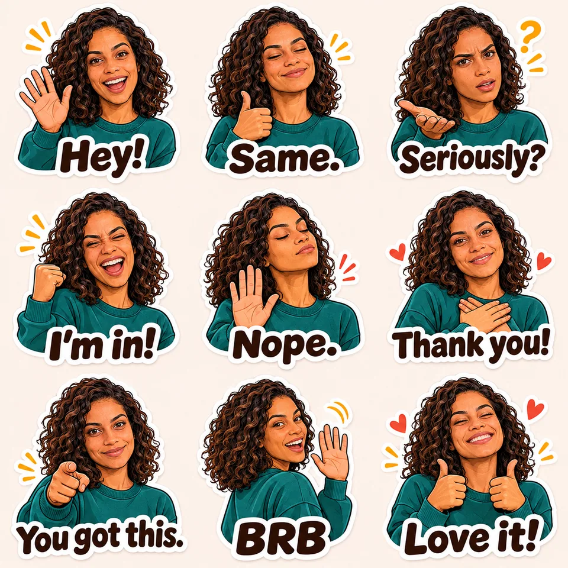</a> Your Everyday Reactions · p_274 Input: <a href="./public/media/a_458/everyday-reaction-stickers-reference-card-034af13da833.webp">portrait photo</a>

Show prompt
<pre><code>Create a square reaction sticker sheet in a clean 3-by-3 grid. Keep the reference person's face and hairstyle consistent. Use crisp editorial cartoon drawing with a teal sweatshirt.&#10;&#10;Use the person in the reference photo as the only character. Preserve their skin tone and recognizable facial features. Use warm colors, expressive eyes and clear hand gestures.&#10;&#10;Exactly nine stickers, read left to right, top to bottom. Give every sticker a distinct expression and pose that clearly matches its caption. Keep the character identity, proportions, outfit and colors consistent across all nine cells. Use generous equal spacing and a simple pale background. Make each silhouette clear, with a white die-cut border. Render each supplied English caption exactly once, verbatim, in large bold lettering inside its own cell, using no more than two lines. The captions, in reading order, are: Hey!; Same.; Seriously?; I'm in!; Nope.; Thank you!; You got this.; BRB; Love it!. No extra titles, watermarks, overlapping cells or additional text.</code></pre>
</td>
    <td valign="top"><a href="./content/prompts/p_275/">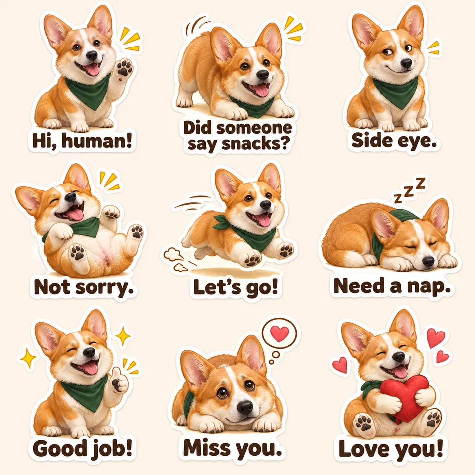</a> My Dog, My Mood · p_275 Input: <a href="./public/media/a_460/dog-mood-reaction-stickers-reference-card-4213dbf22792.webp">dog photo</a>

Show prompt
<pre><code>Create a square dog sticker sheet in a clean 3-by-3 grid. Preserve the reference dog's coat markings and green bandana. Use playful pet illustration with expressive ears and paws.&#10;&#10;Keep the centered white facial blaze, upright ears and short-legged body recognizable in every cell. Use natural canine expressions with playful exaggeration.&#10;&#10;Exactly nine stickers, read left to right, top to bottom. Give every sticker a distinct expression and pose that clearly matches its caption. Keep the character identity, proportions, outfit and colors consistent across all nine cells. Use generous equal spacing and a simple pale background. Make each silhouette clear, with a white die-cut border. Render each supplied English caption exactly once, verbatim, in large bold lettering inside its own cell, using no more than two lines. The captions, in reading order, are: Hi, human!; Did someone say snacks?; Side eye.; Not sorry.; Let's go!; Need a nap.; Good job!; Miss you.; Love you!. No extra titles, watermarks, overlapping cells or additional text.</code></pre>
</td>
  </tr>
  <tr>
    <td valign="top"><a href="./content/prompts/p_276/">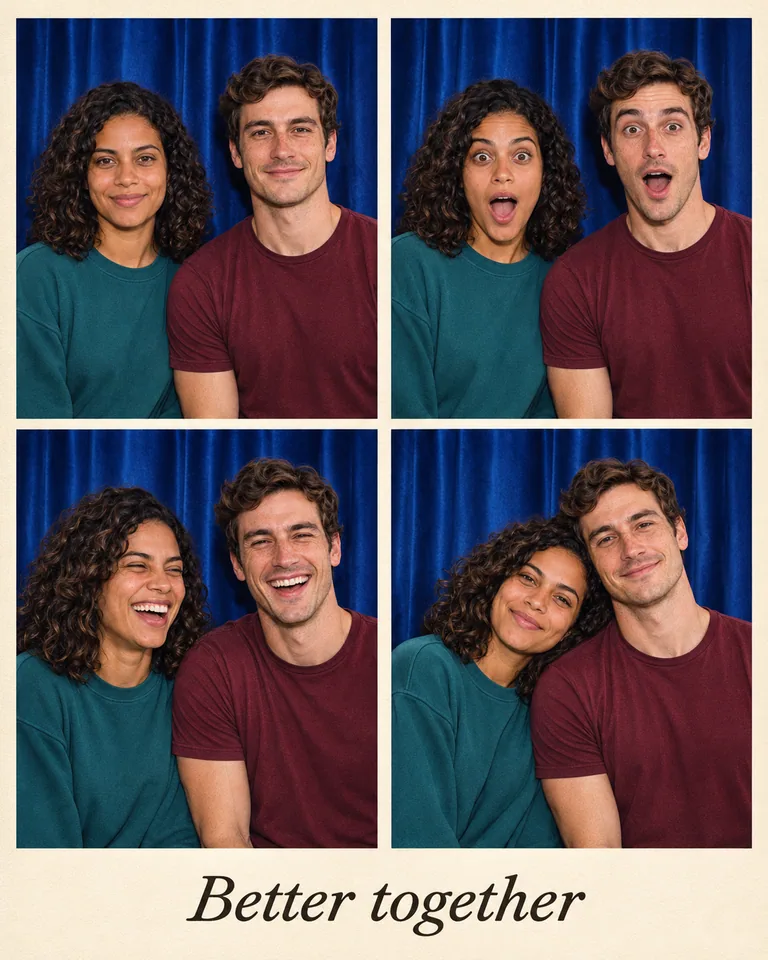</a> Bestie Photo Booth · p_276 Input: <a href="./public/media/a_458/everyday-reaction-stickers-reference-card-034af13da833.webp">portrait 1 (left)</a>; <a href="./public/media/a_462/bestie-photo-booth-reference-card-3eae6833d087.webp">portrait 2 (right)</a>

Show prompt
<pre><code>Create a 4:5 photo-booth print with four photos in a 2-by-2 grid. Use a cobalt curtain, direct flash and subtle film grain. Preserve both reference identities. Reference image 1 is the person on the left; reference image 2 is the person on the right in every panel. Preserve their facial features, skin tones and hairstyles. Show relaxed smiles, exaggerated surprise, shared laughter and a playful shoulder lean, in reading order. Add a cream paper border with the readable caption &quot;Better together&quot; below the four photos. Keep both faces clear and fully inside every frame. No extra text, logos or watermarks.</code></pre>
</td>
    <td valign="top"><a href="./content/prompts/p_277/">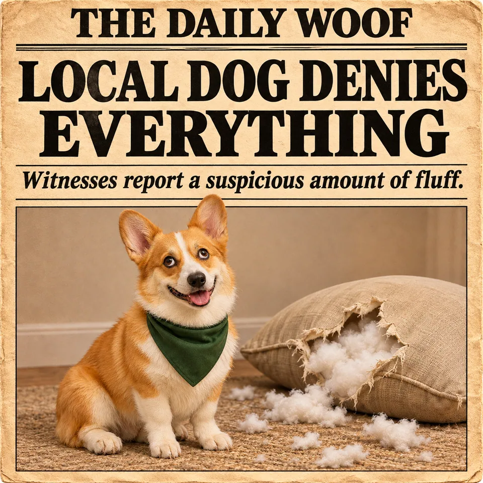</a> The Daily Woof · p_277 Input: <a href="./public/media/a_460/dog-mood-reaction-stickers-reference-card-4213dbf22792.webp">dog photo</a>

Show prompt
<pre><code>Create a square fictional pet newspaper front page with one large photograph, warm newsprint and bold black serif typography. Use the dog in the reference photo, preserving its coat markings and green bandana. Show it sitting beside a torn cushion, looking comically innocent. Render the masthead &quot;THE DAILY WOOF&quot;, the large headline &quot;LOCAL DOG DENIES EVERYTHING&quot;, and the short subheading &quot;Witnesses report a suspicious amount of fluff.&quot; exactly once each. Use only these three text elements. Keep the main headline readable at small sizes. No additional article text, logos or watermarks.</code></pre>
</td>
  </tr>
  <tr>
    <td valign="top"><a href="./content/prompts/p_278/">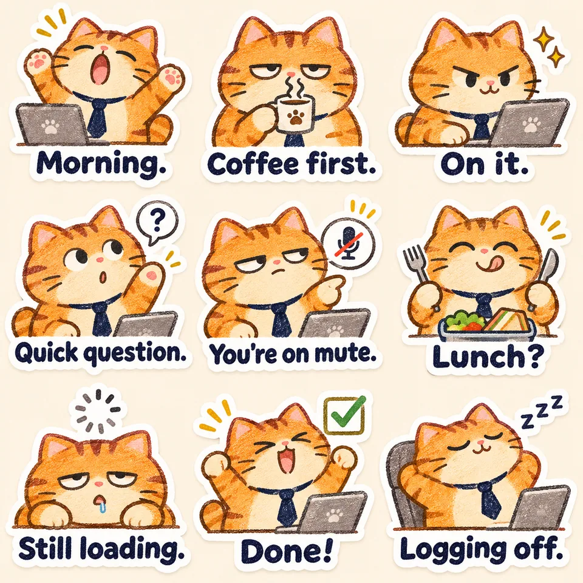</a> Office Cat, Off Duty · p_278 Input: text only

Show prompt
<pre><code>Create a square office-cat sticker sheet in a clean 3-by-3 grid. Draw an original round orange cat wearing a navy tie, using textured crayon lines on warm cream paper.&#10;&#10;Keep the face, orange stripes and navy tie identical across cells. Use small office props and mix sleepy, helpful and quietly sarcastic expressions.&#10;&#10;Exactly nine stickers, read left to right, top to bottom. Give every sticker a distinct expression and pose that clearly matches its caption. Keep the character identity, proportions, outfit and colors consistent across all nine cells. Use generous equal spacing and a simple pale background. Make each silhouette clear, with a white die-cut border. Render each supplied English caption exactly once, verbatim, in large bold lettering inside its own cell, using no more than two lines. The captions, in reading order, are:&#10;Morning.; Coffee first.; On it.; Quick question.; You're on mute.; Lunch?; Still loading.; Done!; Logging off.&#10;&#10;No extra titles, watermarks, overlapping cells or additional text.</code></pre>
</td>
    <td valign="top"><a href="./content/prompts/p_281/">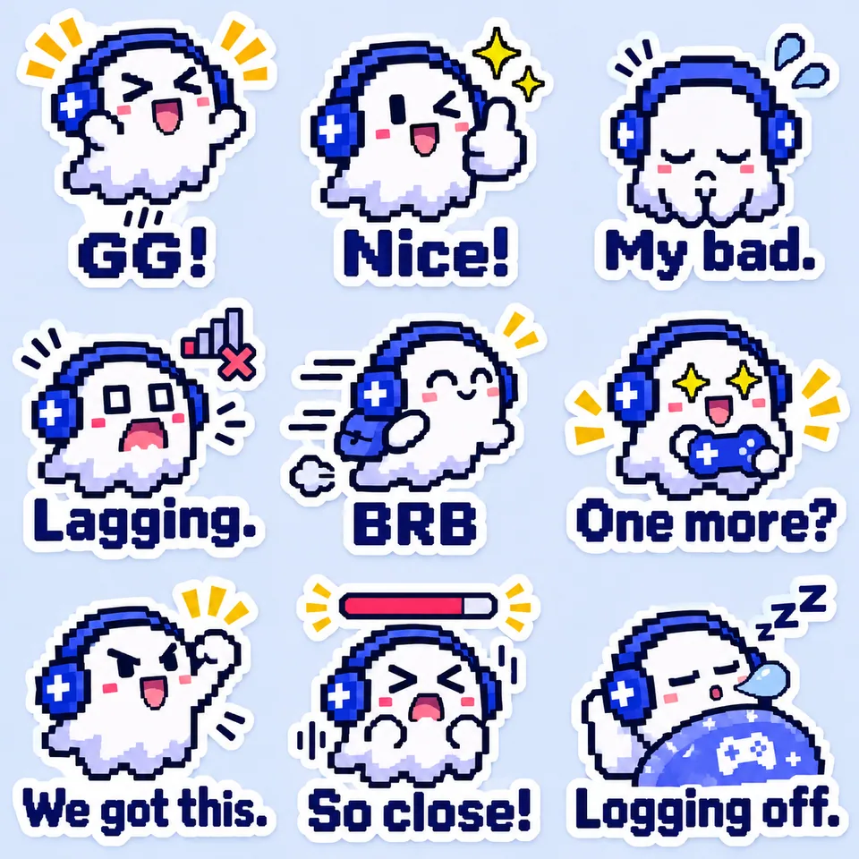</a> One More Game · p_281 Input: text only

Show prompt
<pre><code>Create a square gaming sticker sheet in a clean 3-by-3 grid. Use an original white pixel-art ghost with cobalt-blue headphones, crisp pixel edges and readable pixel lettering.&#10;&#10;Use a limited retro palette, a pale cool background and exaggerated gaming reactions. Keep the ghost and headphones consistent, with a design independent of existing game characters.&#10;&#10;Exactly nine stickers, read left to right, top to bottom. Give every sticker a distinct expression and pose that clearly matches its caption. Keep the character identity, proportions, outfit and colors consistent across all nine cells. Use generous equal spacing and a simple pale background. Make each silhouette clear, with a white die-cut border. Render each supplied English caption exactly once, verbatim, in large bold lettering inside its own cell, using no more than two lines. The captions, in reading order, are:&#10;GG!; Nice!; My bad.; Lagging.; BRB; One more?; We got this.; So close!; Logging off.&#10;&#10;No extra titles, watermarks, overlapping cells or additional text.</code></pre>
</td>
  </tr>
  <tr>
    <td valign="top"> Me Making Plans · p_282 Input: <a href="./public/media/a_458/everyday-reaction-stickers-reference-card-034af13da833.webp">portrait photo</a>

Show prompt
<pre><code>Create a square reaction meme with two vertically stacked panels and expressive editorial illustration. Keep the reference person recognizable in both panels. Preserve their facial features, skin tone and hairstyle. In the top panel, show them smiling enthusiastically at their phone in daylight; caption &quot;Me making plans&quot;. In the bottom panel, show them wrapped in a blanket on the sofa at night, reluctantly looking toward shoes by the door; caption &quot;Me when it's time to leave&quot;. Put each caption in a generous clear band inside its own panel, using large bold English lettering. No additional text, logos or watermarks.</code></pre>
</td>
    <td valign="top"><a href="./content/prompts/p_283/">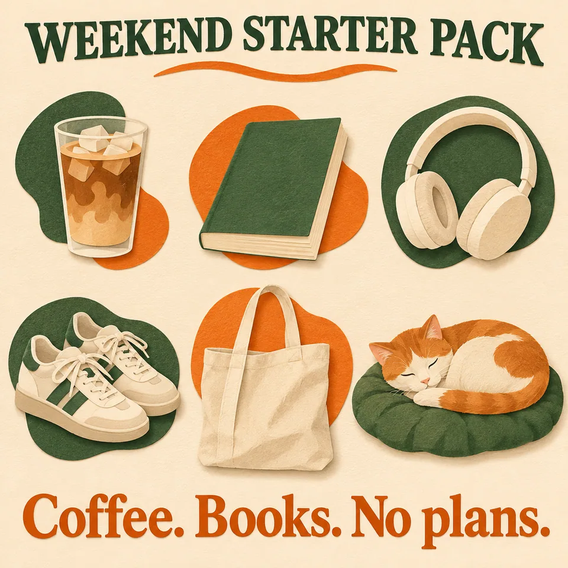</a> Weekend Starter Pack · p_283 Input: text only

Show prompt
<pre><code>Create a square editorial collage with exactly six separate vignettes, using tactile paper-cut shapes and soft shadows on warm cream paper. Arrange: an iced coffee in a plain glass, a paperback with an unlettered cover, over-ear headphones, comfortable sneakers, a canvas tote, and a sleepy cat curled on a cushion. Treat the cat and cushion as one vignette. Use forest-green and orange accents with generous negative space. Add only the title &quot;WEEKEND STARTER PACK&quot; and the large footer &quot;Coffee. Books. No plans.&quot; Render both exactly once. No brand logos, additional objects or extra labels.</code></pre>
</td>
  </tr>
  <tr>
    <td valign="top"><a href="./content/prompts/p_284/">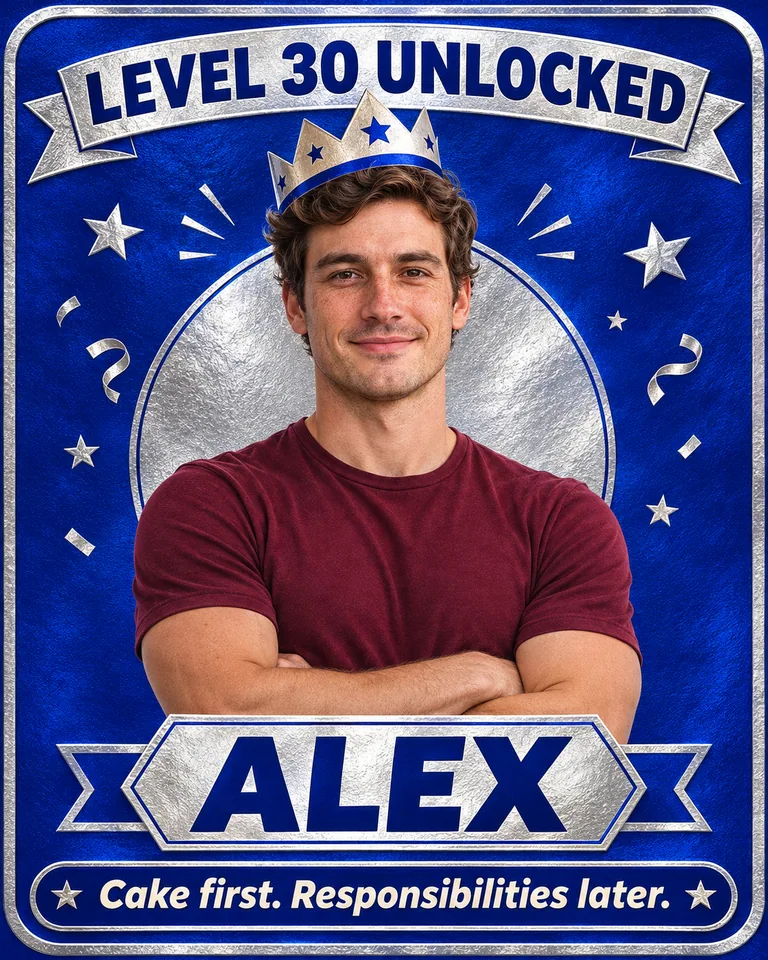</a> Birthday Main Character · p_284 Input: <a href="./public/media/a_462/bestie-photo-booth-reference-card-3eae6833d087.webp">portrait photo</a>

Show prompt
<pre><code>Create a playful 4:5 birthday collectible card with a large portrait, cobalt blue and silver foil textures. Preserve the reference person's facial identity and hairstyle. Show a waist-up portrait wearing a paper party crown, framed by small stars and restrained confetti. Use an original card layout with strong readable typography. Render these exact texts: &quot;LEVEL 30 UNLOCKED&quot;, &quot;ALEX&quot;, and &quot;Cake first. Responsibilities later.&quot; Keep all three text elements inside generous margins. No tiny statistics, brand logos or additional text.</code></pre>
</td>
    <td valign="top"><a href="./content/prompts/p_285/">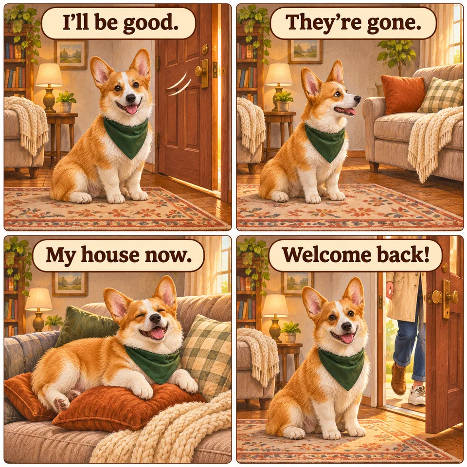</a> Five Minutes Home Alone · p_285 Input: <a href="./public/media/a_460/dog-mood-reaction-stickers-reference-card-4213dbf22792.webp">dog photo</a>

Show prompt
<pre><code>Create a square dog comic with four panels in a 2-by-2 grid, using warm storybook illustration. Keep the same cozy living room and the same reference dog throughout. Preserve its coat markings and green bandana. Panel 1: the dog sits politely by the closing door; caption &quot;I'll be good.&quot; Panel 2: it looks toward the sofa; caption &quot;They're gone.&quot; Panel 3: it proudly occupies a pile of cushions; caption &quot;My house now.&quot; Panel 4: it sits innocently as the door opens; caption &quot;Welcome back!&quot; Read left to right, top to bottom. Use large readable captions in clear bands inside each panel. No extra panels, text, logos or watermarks.</code></pre>
</td>
  </tr>
</table>

### Social sharing & playful edits

Character stickers, festive photo grids, personalized keepsakes and playful transformations for
chats and social feeds. Reference-based examples link to the input image used in the recorded run.

<table>
  <tr>
    <td valign="top"><a href="./content/prompts/p_146/">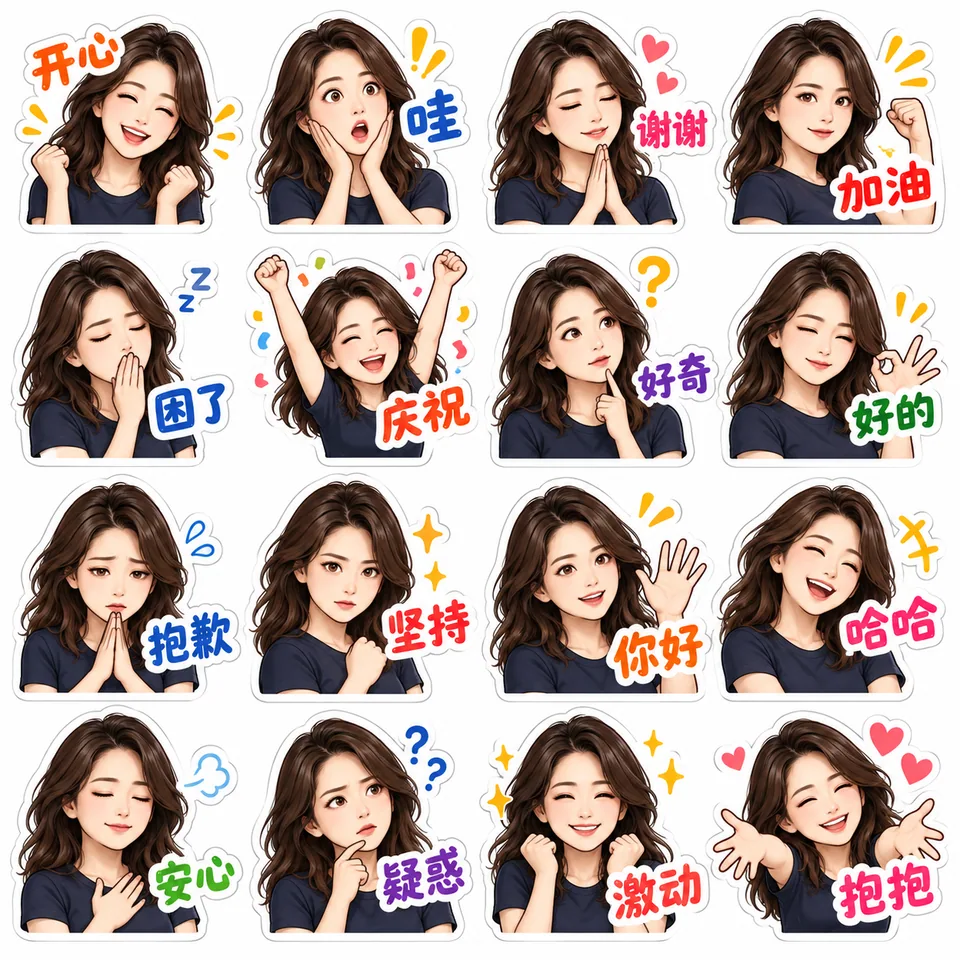</a> Chinese character sticker sheet · p_146 Input: <a href="./public/media/a_214/editorial-cover-portrait-reference-card-c939d7778efa.webp">character portrait</a>

Show prompt
<pre><code>Design one square sticker sheet containing exactly sixteen separate stickers in a clean 4-by-4 grid. Use the uploaded character as the sole character, keeping the face, hairstyle, outfit and colors consistent. Give each cell a different everyday emotion or gesture: joy, surprise, thanks, encouragement, sleepiness, celebration, curiosity, agreement, apology, determination, greeting, laughter, relief, confusion, excitement and affection. Simple expressive cartoon drawing, white cutout borders, generous separation. Add one short Chinese caption per cell from this supplied list: 开心; 哇; 谢谢; 加油; 困了; 庆祝; 好奇; 好的; 抱歉; 坚持; 你好; 哈哈; 安心; 疑惑; 激动; 抱抱. Avoid background scenes and overlapping stickers. Render every caption verbatim, in reading order, without shortening or omitting any Chinese character.</code></pre>
</td>
    <td valign="top"><a href="./content/prompts/p_148/">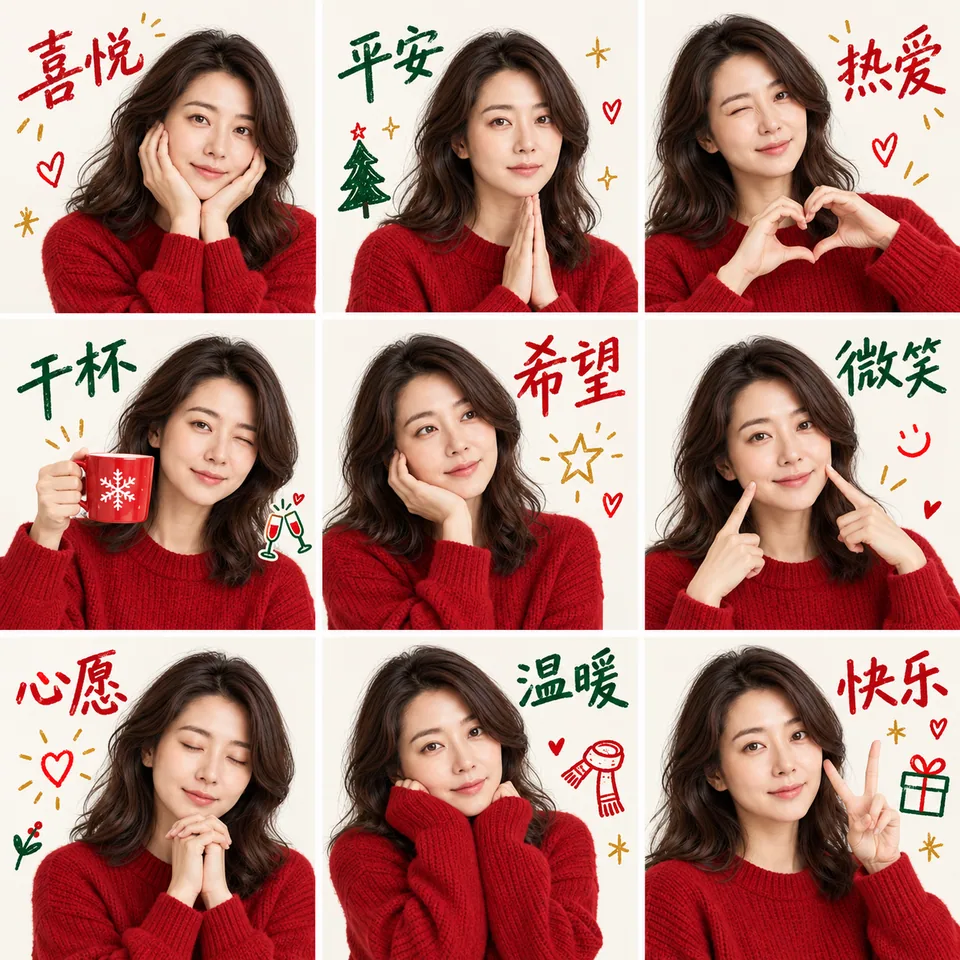</a> Nine holiday portraits · p_148 Input: <a href="./public/media/a_214/editorial-cover-portrait-reference-card-c939d7778efa.webp">portrait photo</a>

Show prompt
<pre><code>Make a square nine-panel holiday portrait sheet from the uploaded photo. Keep the same face, hairstyle and red knit outfit in every panel while varying natural expressions and playful hand poses. Use a plain ivory studio backdrop, subtle festive doodles and these nine exact short greetings, in reading order: 喜悦; 平安; 热爱; 干杯; 希望; 微笑; 心愿; 温暖; 快乐. Ensure each greeting is readable and the grid spacing is consistent.</code></pre>
</td>
  </tr>
  <tr>
    <td valign="top"><a href="./content/prompts/p_136/">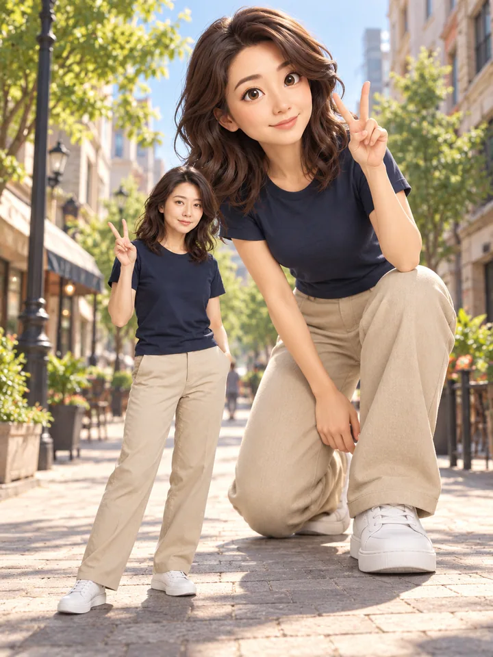</a> You and your giant 3D double · p_136 Input: <a href="./public/media/a_214/editorial-cover-portrait-reference-card-c939d7778efa.webp">adult portrait photo</a>

Show prompt
<pre><code>Using the uploaded portrait, create a playful scene where the same adult person appears as both a realistic human and a towering stylized 3D companion. Match their face, hairstyle, outfit colors and gesture. Place both on the same sunlit street, with correct contact shadows and perspective. Give the larger character friendly proportions while keeping the smaller person photographic. The giant companion must be unmistakably a sculpted animated-film 3D character: enlarged expressive eyes, rounded simplified face, matte stylized skin and clean simplified hair clumps. Do not render the giant as a photorealistic enlarged human. Keep the smaller person fully photographic.</code></pre>
</td>
    <td valign="top"><a href="./content/prompts/p_135/">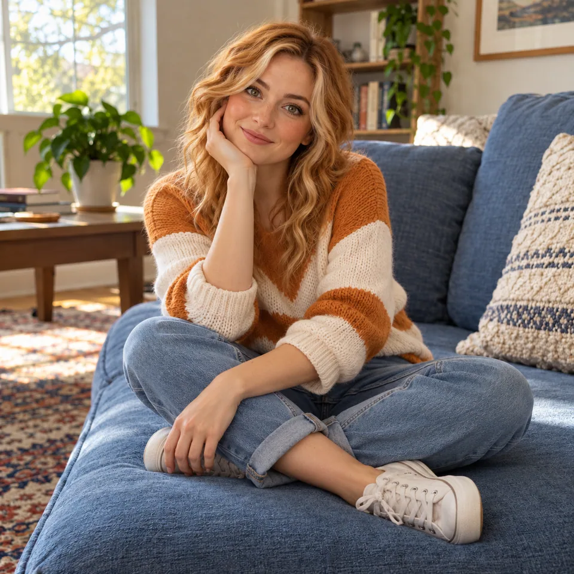</a> Your pet as a person · p_135 Input: <a href="./public/media/a_244/pet-as-human-reference-card-e56f2b0de4ae.webp">pet photo</a>

Show prompt
<pre><code>Imagine the pet in this photograph as a fully human character. Translate the pet's expression, posture, energy and distinctive markings into a believable hairstyle, clothing palette and personal style. Keep the camera angle, lighting and surrounding room consistent with the source. The person should be an adult in their thirties and convey calm, curious and slightly mischievous. Use realistic human anatomy with no animal ears, muzzle, paws or tail. Make the resemblance come from attitude and visual details rather than an animal-human hybrid. Remove every trace of animal anatomy from the final image, including any tail behind the body. Clothing must be ordinary woven human clothing without fur, tail-shaped fabric or animal costume elements. Show the full seated human silhouette clearly.</code></pre>
</td>
  </tr>
  <tr>
    <td valign="top"><a href="./content/prompts/p_133/">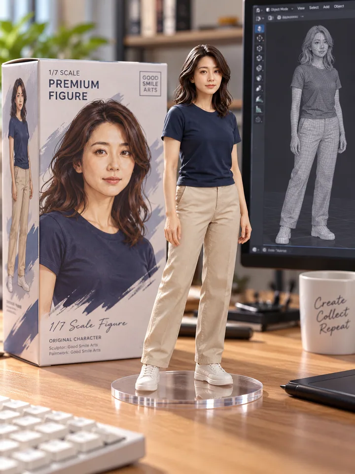</a> Desktop collectible figure · p_133 Input: <a href="./public/media/a_214/editorial-cover-portrait-reference-card-c939d7778efa.webp">subject photo</a>

Show prompt
<pre><code>Convert the subject in the uploaded photo into a realistic painted collectible figure displayed on a desk. Preserve distinctive facial features, outfit and pose while making the materials clearly miniature resin and plastic. Place it on a clear circular stand, with a matching illustrated retail box nearby and a monitor showing the same figure as a modeling wireframe. Use natural desktop lighting.</code></pre>
</td>
    <td valign="top"><a href="./content/prompts/p_197/">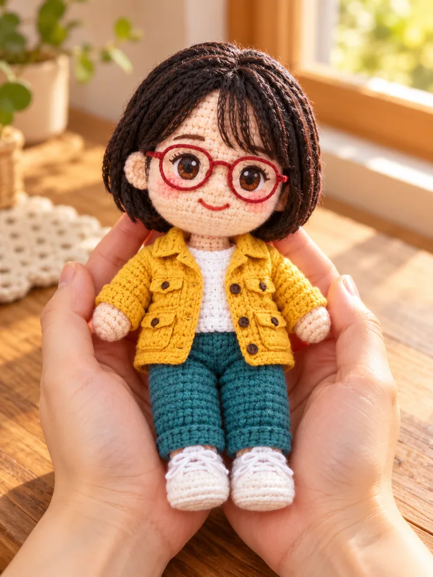</a> Portrait to crochet doll · p_197 Input: <a href="./public/media/a_345/design-top60-49-reference-card-72af9a106233.webp">character reference</a>

Show prompt
<pre><code>把上传合成人物转成被双手捧着的手工钩织Q版玩偶，保留短黑发、红圆眼镜、黄外套、白上衣、青绿裤和白鞋。强调鲜明配色和真实纱线针脚，完整玩偶被两只自然成人手轻托，木桌和窗边暖光，亲切工艺摄影。3:4，无文字。</code></pre>
</td>
  </tr>
  <tr>
    <td valign="top"><a href="./content/prompts/p_137/">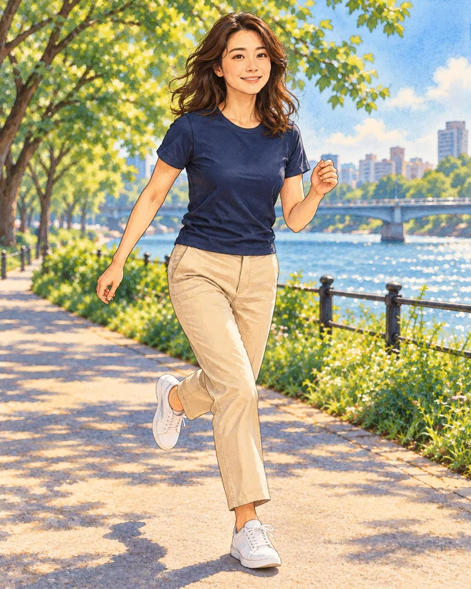</a> Everyday photo to animation · p_137 Input: <a href="./public/media/a_247/cozy-hand-drawn-photo-reference-card-8bf991f506b7.webp">everyday photo</a>

Show prompt
<pre><code>Redraw the uploaded photograph as a warm hand-painted animated-film frame. Keep the same people, recognizable facial proportions, clothing, gestures, camera position and important background objects. Use expressive clean outlines, soft watercolor scenery, carefully painted light and shade, and a quiet everyday atmosphere. Preserve each person's distinct expression. Avoid glossy 3D shading, excessive skin smoothing and a uniform yellow filter.</code></pre>
</td>
    <td valign="top"><a href="./content/prompts/p_119/">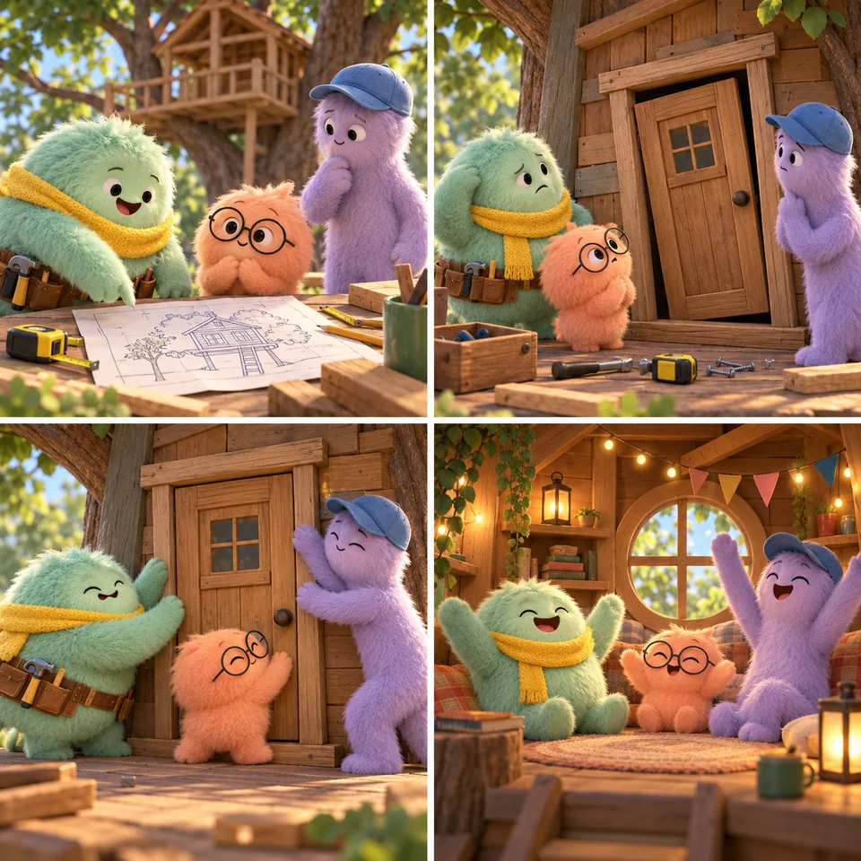</a> Four-panel character story · p_119 Input: text only

Show prompt
<pre><code>Draw a four-panel comic featuring three original fluffy creatures: a round mint-green builder with a yellow scarf, a small peach helper with round glasses, and a tall lavender helper with a blue cap. The four panels in reading order show: the three plan a tiny treehouse; they accidentally install a crooked door; they cooperate to straighten the door; they celebrate inside the cozy finished treehouse. Keep each character’s size, colors and accessories consistent. Use clear visual storytelling, soft lighting and no speech bubbles unless text is provided.</code></pre>
</td>
  </tr>
  <tr>
    <td valign="top"><a href="./content/prompts/p_102/">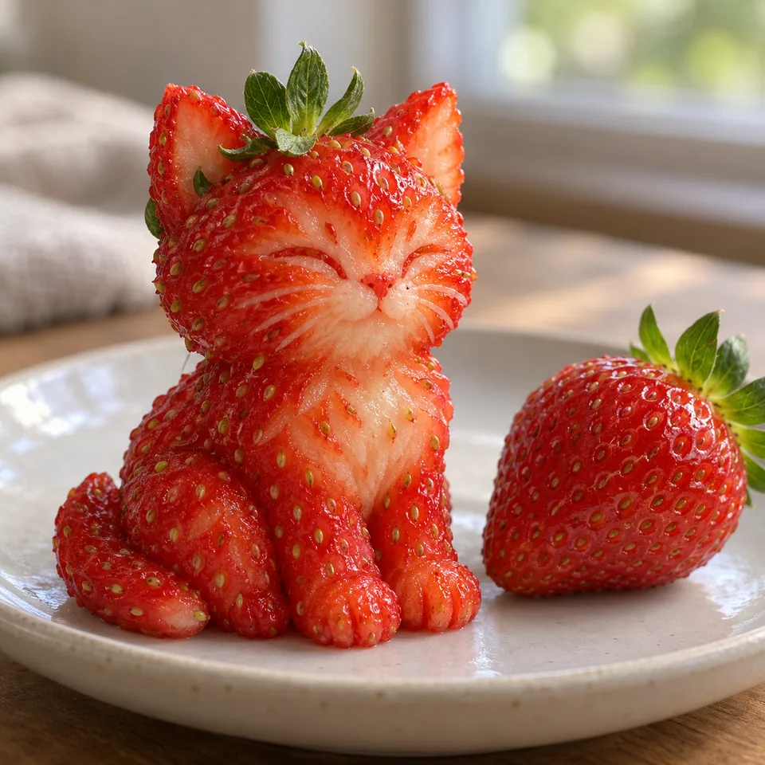</a> Fruit animal miniature · p_102 Input: text only

Show prompt
<pre><code>Create a macro photograph of a tiny tabby kitten made entirely from one ripe strawberry. Its silhouette, ears and paws are formed naturally from the fruit flesh, while the skin texture, seeds and leaves remain convincingly edible. The creature sits on a plain ceramic plate beside one normal fruit for scale. Gentle window light, shallow depth of field, playful but physically coherent construction, no eyes pasted on, clean square composition.</code></pre>
</td>
    <td valign="top"><a href="./content/prompts/p_109/">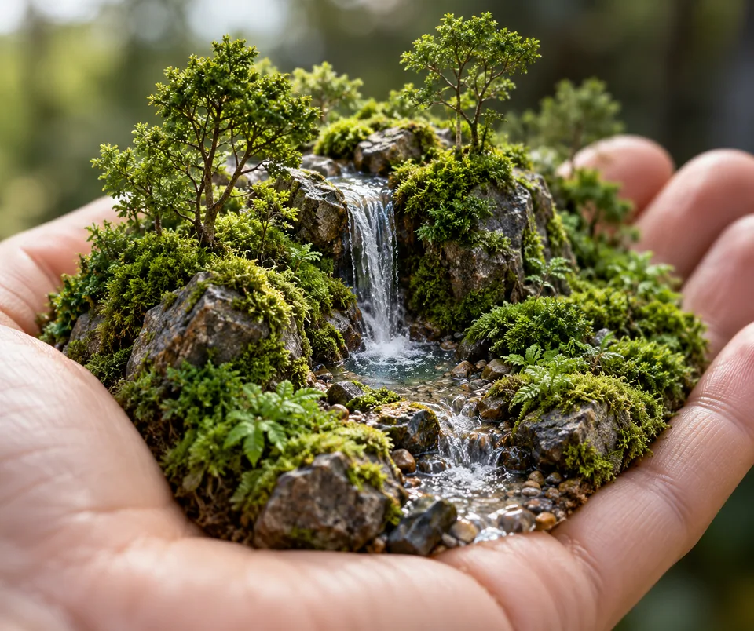</a> Miniature world in a palm · p_109 Input: text only

Show prompt
<pre><code>A tiny self-contained mossy forest with a tiny waterfall resting in an open human palm, built like an exquisite miniature ecosystem. Include small trees, textured rocks and a narrow stream, with convincing scale differences between the landscape and the fingers. Photograph it with a macro lens, gentle daylight, shallow depth of field and rich natural colors. Keep the miniature crisp and the background soft. No buildings, labels or fantasy creatures; the wonder comes from scale alone.</code></pre>
</td>
  </tr>
</table>

### Categories

<table>
  <tr>
    <td valign="top"> Landscape · p_001

Show prompt
<pre><code>Flat vector landscape of four layered mountain ridges at dusk under a low pale sun, peach and violet dusk colours, smooth curved silhouettes without outlines, soft gradient sky, generous negative space, 4:5 aspect ratio.</code></pre>
</td>
    <td valign="top"> Landscape · p_004

Show prompt
<pre><code>Flat vector seascape of a small sailboat on the water at sunset, peach and violet dusk colours, the sun resting on the horizon, horizontal reflection lines on calm water, no outlines, 2:3 aspect ratio.</code></pre>
</td>
  </tr>
  <tr>
    <td valign="top"><a href="./content/prompts/p_002/">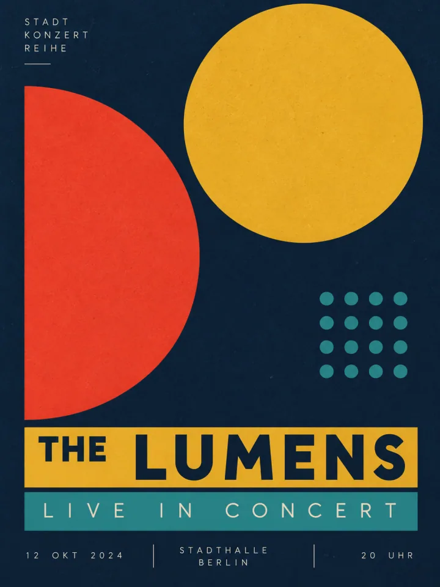</a> Poster · p_002

Show prompt
<pre><code>Bauhaus-inspired poster: a concert poster with the disc in the upper right and the half circle on the left, mustard, tomato red and teal on navy, a large disc, a half circle, a small dot grid and two solid title bars, flat colours with fine paper grain, 3:4 aspect ratio.</code></pre>
</td>
    <td valign="top"><a href="./content/prompts/p_022/">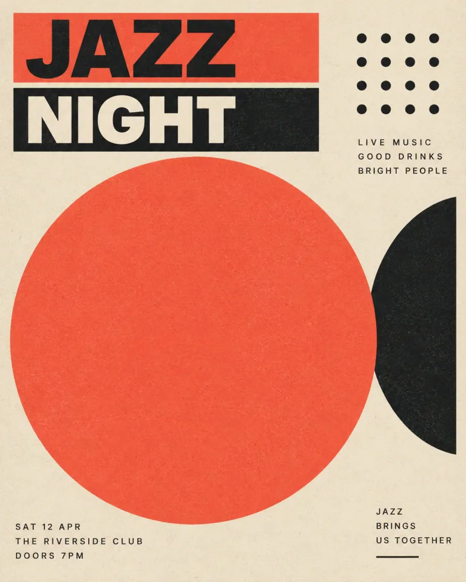</a> Poster · p_022

Show prompt
<pre><code>Bauhaus-inspired poster: a jazz night poster, coral, cream and ink, a large disc, a half circle, a small dot grid and two solid title bars, flat colours with fine paper grain, 4:5 aspect ratio.</code></pre>
</td>
  </tr>
  <tr>
    <td valign="top"><a href="./content/prompts/p_003/">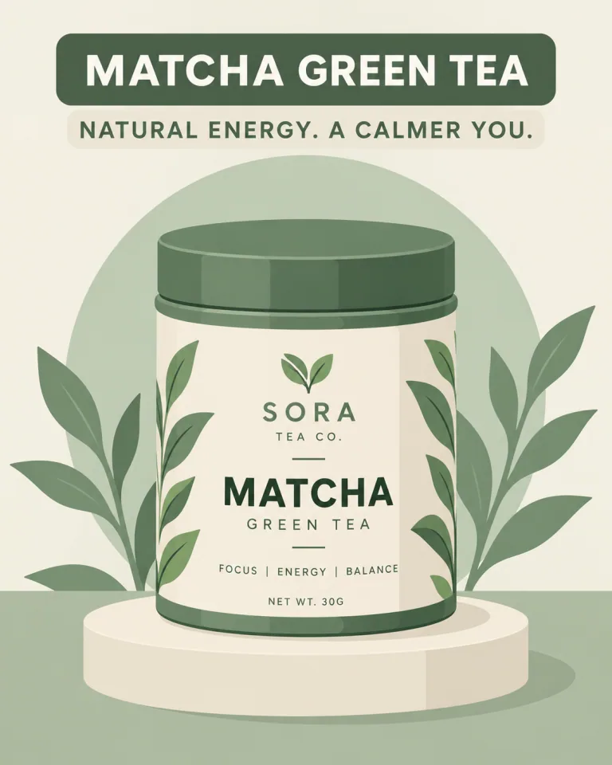</a> Product · p_003

Show prompt
<pre><code>Render the product itself and the entire scene as a two-dimensional flat vector illustration: simple solid-colour shapes, crisp contours and minimal flat shading.
Clean flat-vector product illustration of a cylindrical tea can with a cream paper label and two headline bars above, centred on a pale plinth in front of a soft circular backdrop, sage green and cream, gentle contact shadow, 4:5 aspect ratio.</code></pre>
</td>
    <td valign="top"><a href="./content/prompts/p_010/">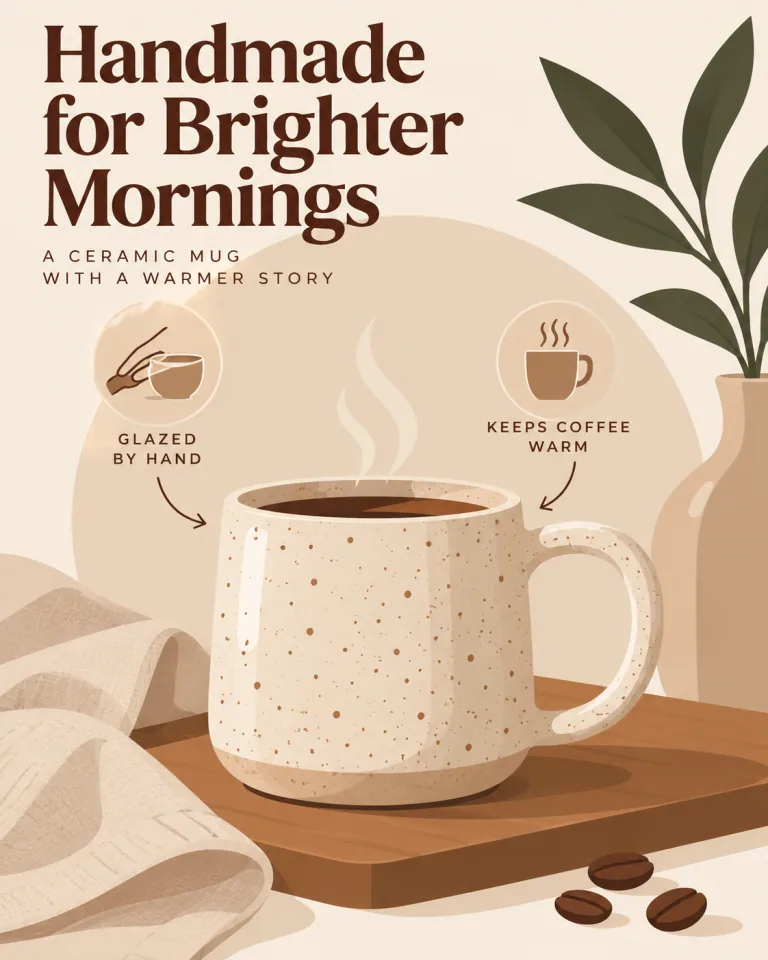</a> Product · p_010

Show prompt
<pre><code>Render the product itself and the entire scene as a two-dimensional flat vector illustration: simple solid-colour shapes, crisp contours and minimal flat shading.
Create an editorial product poster for a speckled handmade ceramic mug, shown as a clean flat-vector illustration on a soft circular backdrop.
Key selling points to suggest visually: glazed by hand; keeps coffee warm.
Palette: warm neutral.
Aspect ratio: 4:5.
Keep the product silhouette clear and the visual hierarchy readable.</code></pre>
</td>
  </tr>
  <tr>
    <td valign="top"><a href="./content/prompts/p_005/">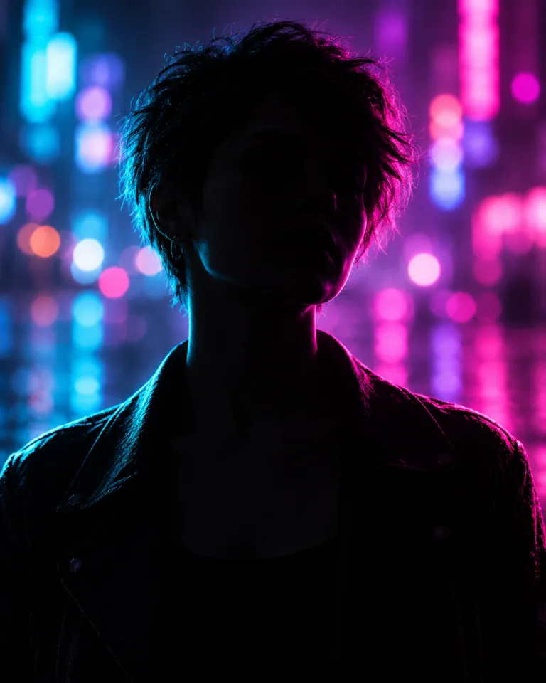</a> Portrait · p_005

Show prompt
<pre><code>Moody portrait of a person with short hair, cyan on the left and pink on the right as a dark silhouette, rim-lit on each side in two colours, blurred bokeh lights behind, violet, cyan and magenta neon, face kept in shadow, 4:5 aspect ratio.</code></pre>
</td>
    <td valign="top"> Portrait · p_019

Show prompt
<pre><code>Moody portrait of a centred head-and-shoulders figure, amber on the left and teal on the right as a dark silhouette, rim-lit on each side in two colours, blurred bokeh lights behind, midnight blue with silver light, face kept in shadow, 1:1 aspect ratio.</code></pre>
</td>
  </tr>
  <tr>
    <td valign="top"><a href="./content/prompts/p_007/">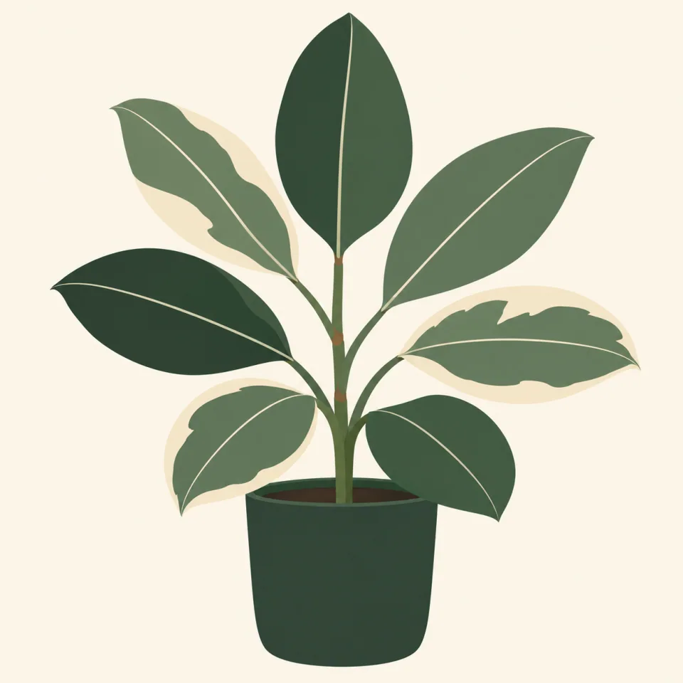</a> Illustration · p_007

Show prompt
<pre><code>Flat vector botanical illustration of a rubber plant with seven broad leaves in a dark green pot, broad leaves with a single midrib line, sage green and cream, plain background, 1:1 aspect ratio.</code></pre>
</td>
    <td valign="top"><a href="./content/prompts/p_012/">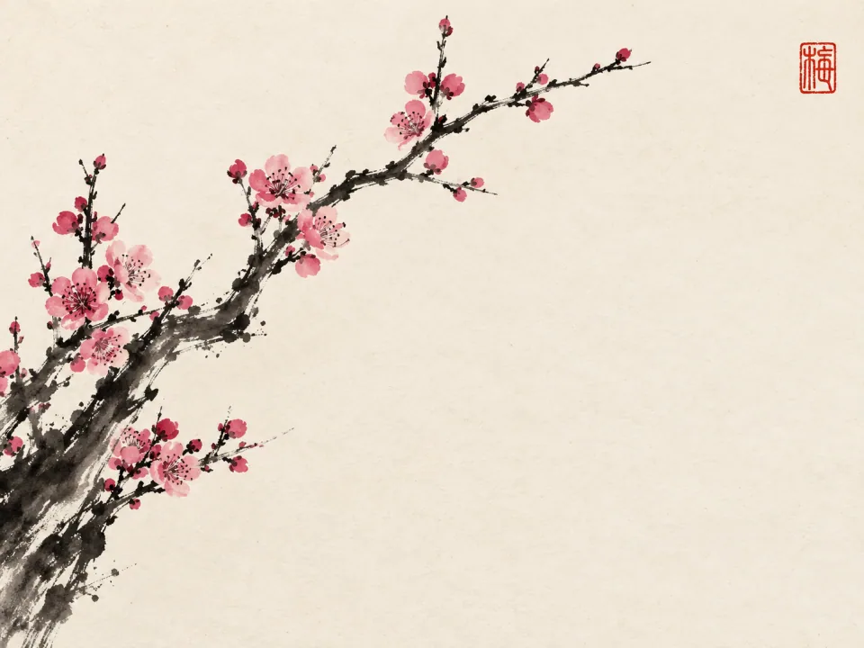</a> Illustration · p_012

Show prompt
<pre><code>Minimal ink painting of a plum branch reaching up from the lower left, dark dry-brush strokes, pink plum blossoms clustered along the branch, a small red seal in the upper right corner, warm off-white paper, wide empty space, 4:3 aspect ratio.</code></pre>
</td>
  </tr>
  <tr>
    <td valign="top"><a href="./content/prompts/p_008/">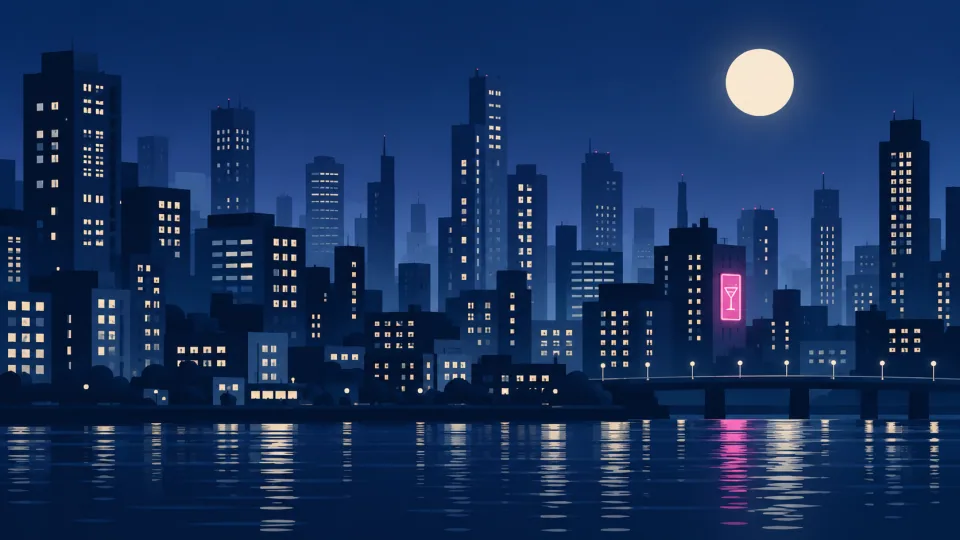</a> Architecture · p_008

Show prompt
<pre><code>Flat vector cityscape of a city at night with lit windows and a single pink neon sign, block buildings with rows of small windows, midnight blue with silver light, a round moon or sun, no outlines, 16:9 aspect ratio.</code></pre>
</td>
    <td valign="top"><a href="./content/prompts/p_013/">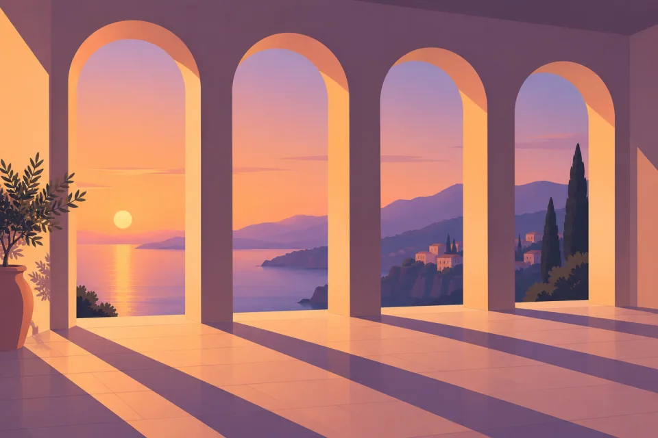</a> Architecture · p_013

Show prompt
<pre><code>Flat vector architecture: a sunlit arcade of four arches in late afternoon light from the left, tall rounded arches casting diagonal shadows, peach and violet dusk colours, clean geometry, 3:2 aspect ratio.</code></pre>
</td>
  </tr>
  <tr>
    <td valign="top"><a href="./content/prompts/p_009/">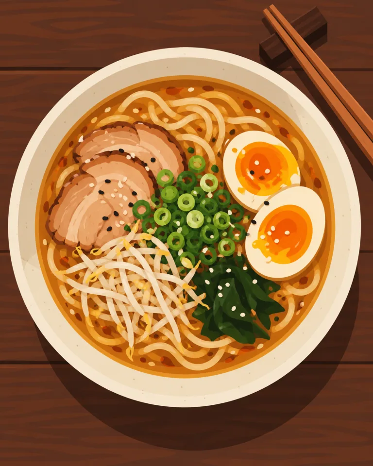</a> Food · p_009

Show prompt
<pre><code>Render the entire scene as a two-dimensional flat vector illustration: simple solid-colour shapes, crisp contours and minimal flat shading.
Top-down flat illustration of a bowl of miso noodles with a soft-boiled egg on a dark wooden table, a cream ceramic bowl, wooden chopsticks resting at the top right, warm wood browns, 4:5 aspect ratio.</code></pre>
</td>
    <td valign="top"><a href="./content/prompts/p_014/">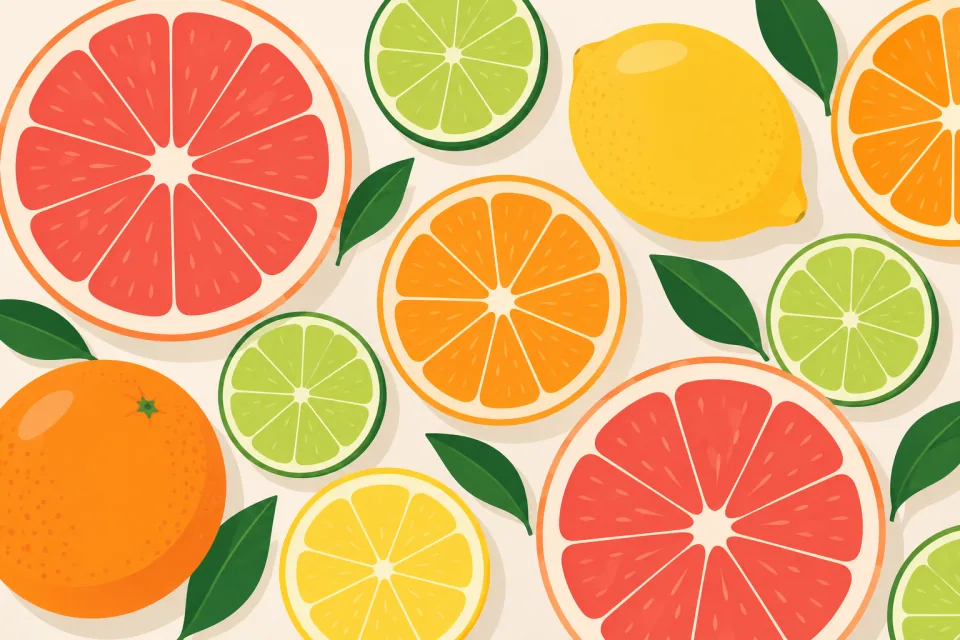</a> Food · p_014

Show prompt
<pre><code>Render the entire scene as a two-dimensional flat vector illustration: simple solid-colour shapes, crisp contours and minimal flat shading.
Flat lay illustration of grapefruit and lime slices, slices seen from above with visible segments, lemon, orange and lime, plain soft background, 3:2 aspect ratio.</code></pre>
</td>
  </tr>
  <tr>
    <td valign="top"><a href="./content/prompts/p_011/">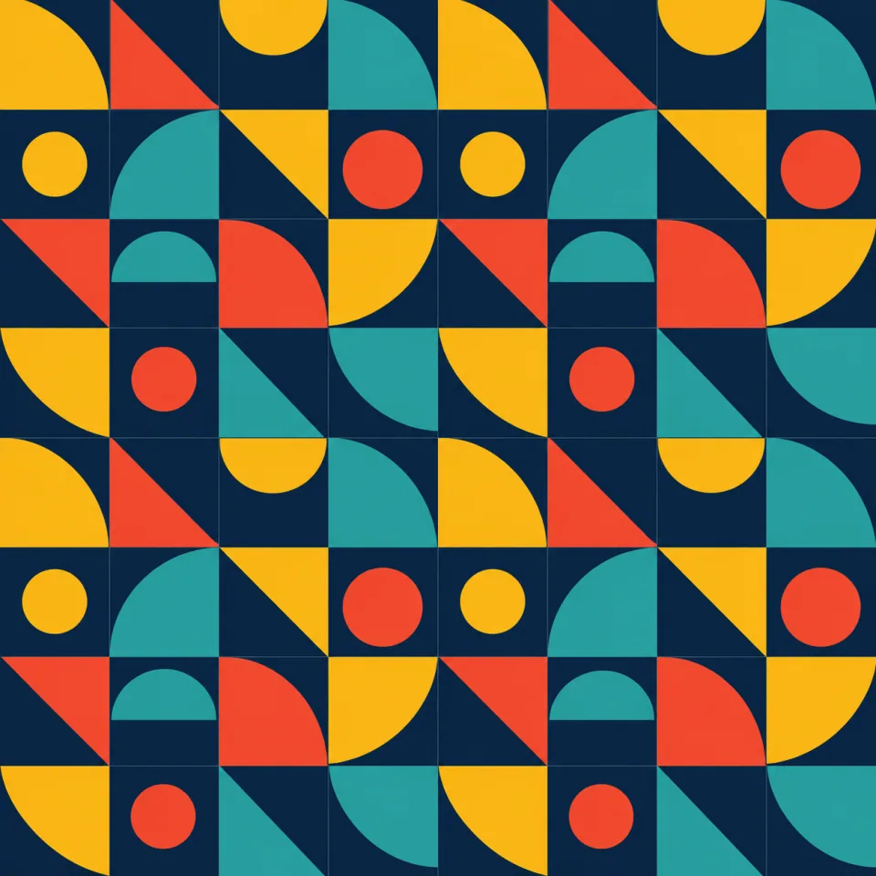</a> Pattern · p_011

Show prompt
<pre><code>Seamless geometric tile pattern of mid-century tiles: quarter circles, triangles, half circles and dots on square tiles, mustard, tomato red and teal on navy, flat colours, 1:1 aspect ratio.</code></pre>
</td>
    <td valign="top"><a href="./content/prompts/p_025/">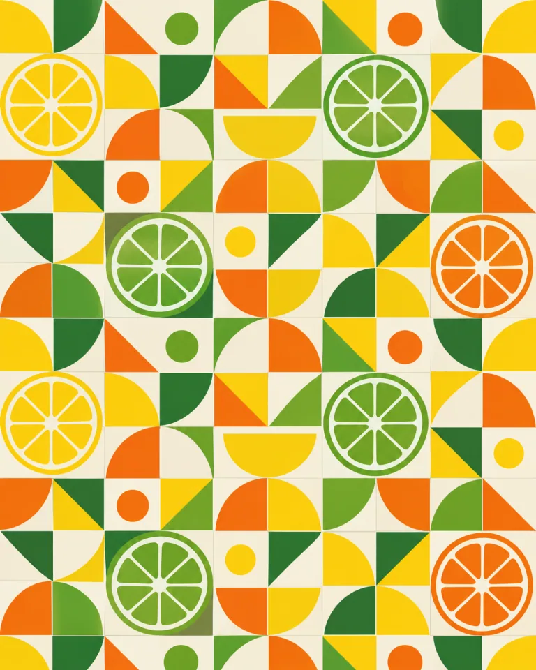</a> Pattern · p_025

Show prompt
<pre><code>Seamless geometric tile pattern of sunny kitchen tiles: quarter circles, triangles, half circles and dots on square tiles, lemon, orange and lime, flat colours, 4:5 aspect ratio.</code></pre>
</td>
  </tr>
</table>

### Style tags

<table>
  <tr>
    <td valign="top"><a href="./content/prompts/p_006/">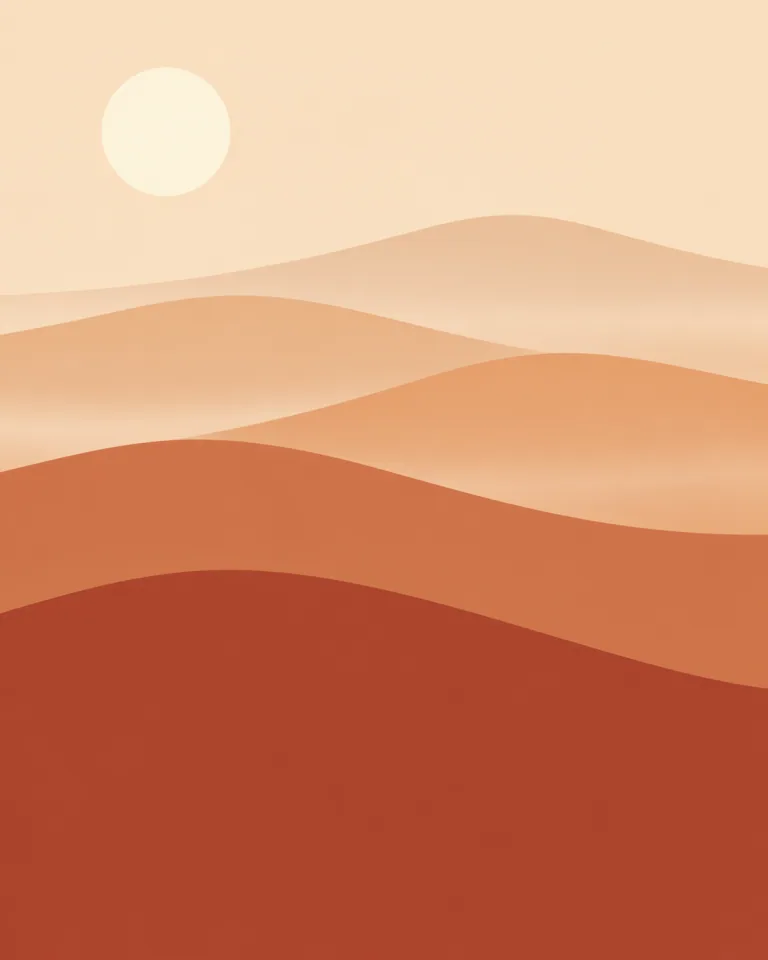</a> Flat vector · p_006

Show prompt
<pre><code>Flat vector desert landscape of five rolling dunes, warm sand and terracotta from pale at the top to rust at the bottom, a soft cream sun in the upper left, faint horizontal haze between the dunes, no outlines, 4:5 aspect ratio.</code></pre>
</td>
    <td valign="top"> Flat vector · p_017

Show prompt
<pre><code>Render the product itself and the entire scene as a two-dimensional flat vector illustration: simple solid-colour shapes, crisp contours and minimal flat shading.
Clean flat-vector product illustration of a coral glass bottle with a cream label and two dark headline bars, centred on a pale plinth in front of a soft circular backdrop, coral, cream and ink, gentle contact shadow, 1:1 aspect ratio.</code></pre>
</td>
  </tr>
  <tr>
    <td valign="top"> Gradient · p_016

Show prompt
<pre><code>Flat vector landscape of five hills fading into morning mist with a pale rising sun on the left, pale rose and gold dawn colours, smooth curved silhouettes without outlines, soft gradient sky, generous negative space, 16:9 aspect ratio.</code></pre>
</td>
    <td valign="top"> Gradient · p_018

Show prompt
<pre><code>Flat vector landscape of a wide panorama of five blue mountain ridges receding into haze, deep blues with a pale sun, smooth curved silhouettes without outlines, soft gradient sky, generous negative space, 21:9 aspect ratio.</code></pre>
</td>
  </tr>
  <tr>
    <td valign="top"><a href="./content/prompts/p_038/">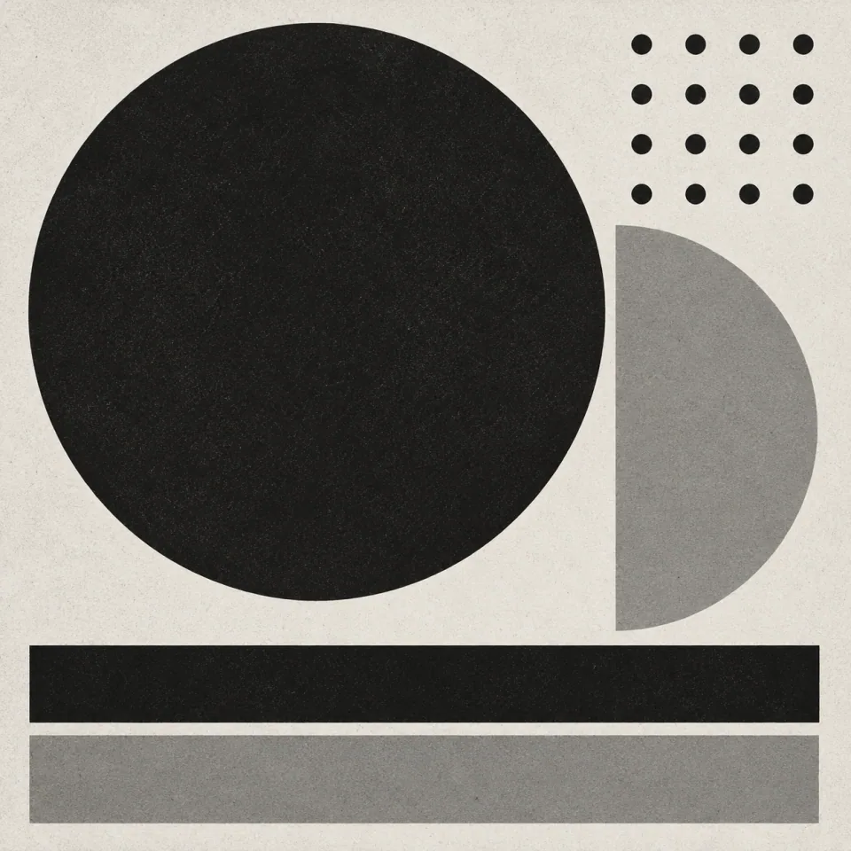</a> Bauhaus · p_038

Show prompt
<pre><code>Bauhaus-inspired poster: a monochrome study, black, white and grey, a large disc, a half circle, a small dot grid and two solid title bars, flat colours with fine paper grain, 1:1 aspect ratio.</code></pre>
</td>
    <td valign="top"><a href="./content/prompts/p_045/">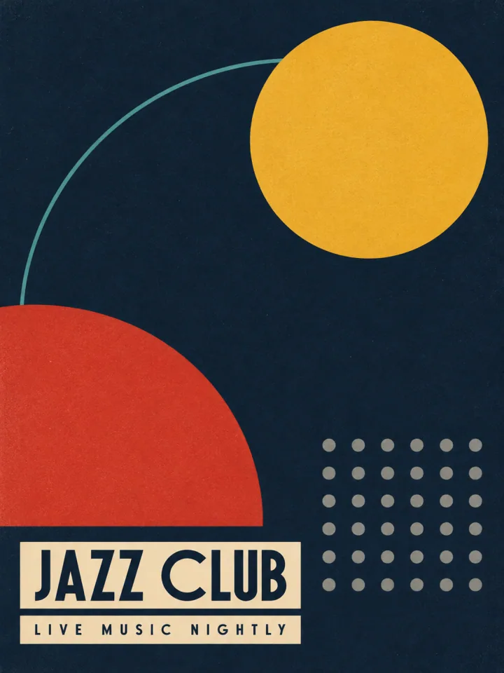</a> Bauhaus · p_045

Show prompt
<pre><code>Bauhaus-style jazz club poster on a deep navy background: a large mustard sun disc in the upper right, a thin teal arc sweeping behind it, a red half circle resting on the left, a grid of small grey dots in the lower right, two cream title bars at the bottom left, flat colours with fine paper grain, 3:4 aspect ratio.</code></pre>
</td>
  </tr>
  <tr>
    <td valign="top"><a href="./content/prompts/p_040/">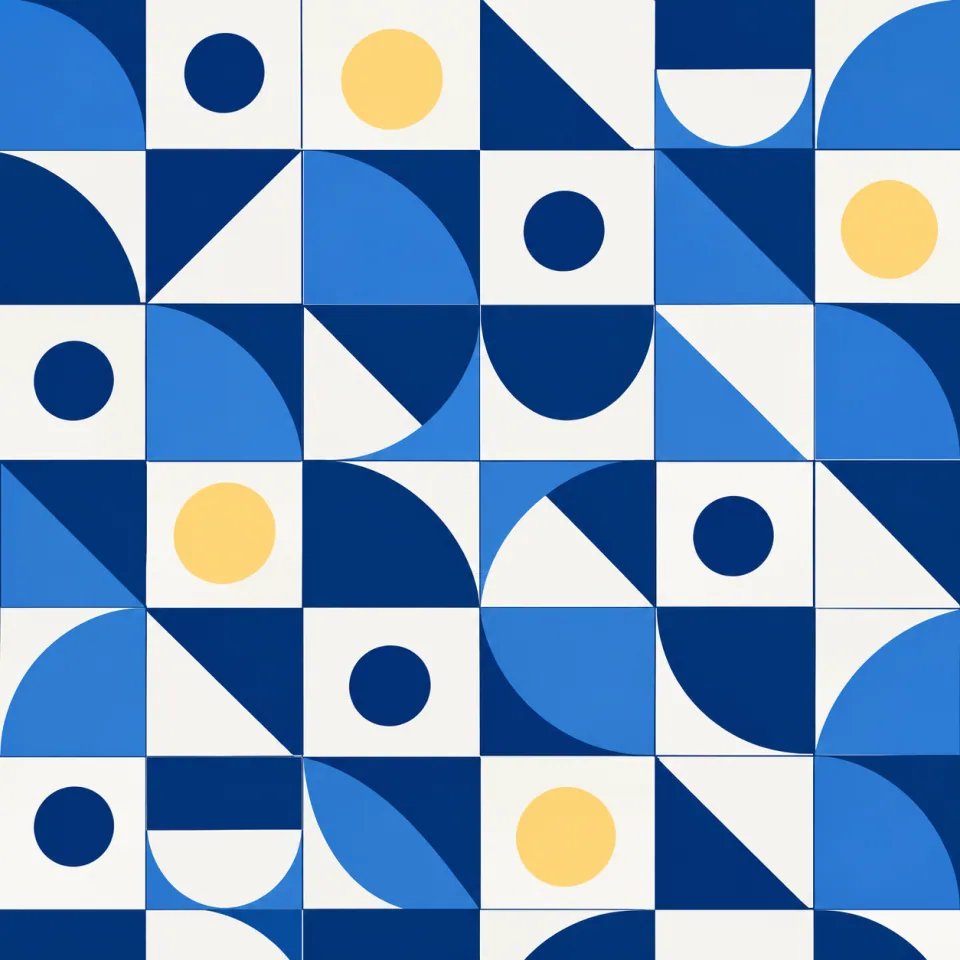</a> Geometric · p_040

Show prompt
<pre><code>Seamless geometric tile pattern of blue and white tiles: quarter circles, triangles, half circles and dots on square tiles, deep blues with a pale sun, flat colours, 1:1 aspect ratio.</code></pre>
</td>
    <td valign="top"><a href="./content/prompts/p_051/">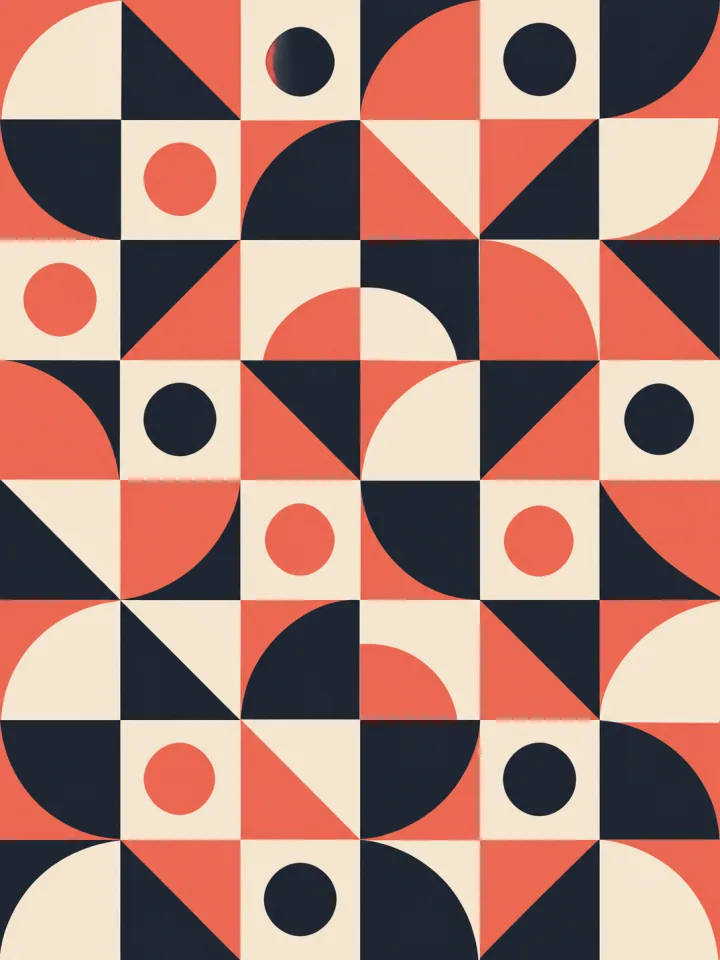</a> Geometric · p_051

Show prompt
<pre><code>Seamless geometric tile pattern of coral and cream tiles: quarter circles, triangles, half circles and dots on square tiles, coral, cream and ink, flat colours, 3:4 aspect ratio.</code></pre>
</td>
  </tr>
  <tr>
    <td valign="top"><a href="./content/prompts/p_015/">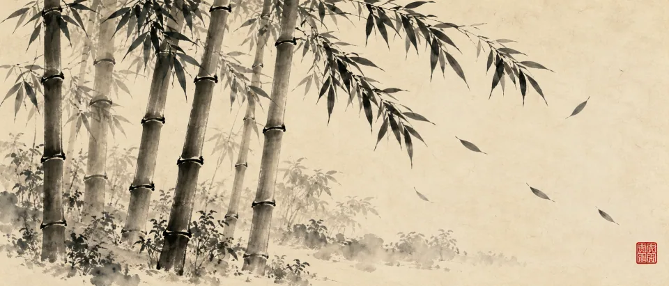</a> Minimal · p_015

Show prompt
<pre><code>Traditional Chinese ink painting of a bamboo grove in summer, on warm rice paper with generous empty space.
Brushwork: soft grey washes with crisp dark nodes.
Details: five tall stalks, drifting leaves.
Mark the corner with a small red artist's seal.
Aspect ratio: 21:9.</code></pre>
</td>
    <td valign="top"><a href="./content/prompts/p_024/">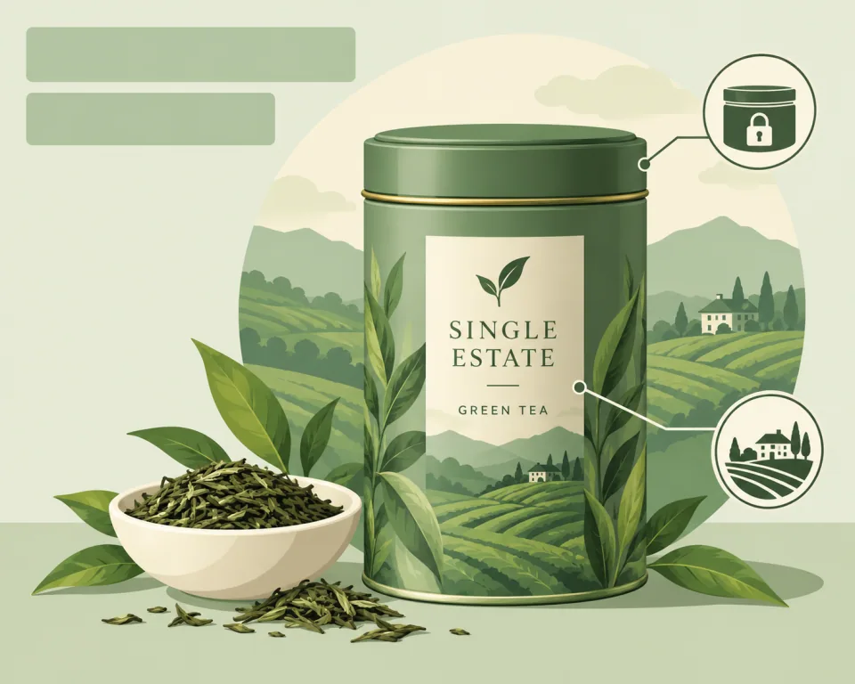</a> Minimal · p_024

Show prompt
<pre><code>Render the product itself and the entire scene as a two-dimensional flat vector illustration: simple solid-colour shapes, crisp contours and minimal flat shading.
Create an editorial product poster for a loose-leaf green tea tin, shown as a clean flat-vector illustration on a soft circular backdrop.
Key selling points to suggest visually: airtight lid; single estate.
Palette: sage green.
Aspect ratio: 5:4.
Reserve the top left for two short headline bars and keep the product silhouette clear.
Headline text to render exactly when supplied: &quot;&quot;. If the headline is empty, leave the bars blank.</code></pre>
</td>
  </tr>
  <tr>
    <td valign="top"><a href="./content/prompts/p_032/">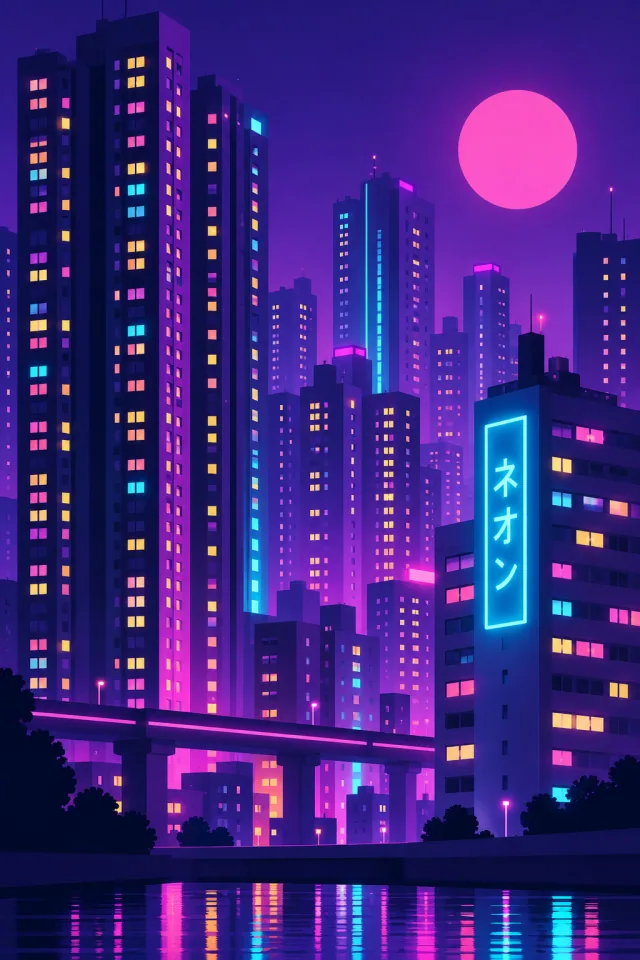</a> Neon · p_032

Show prompt
<pre><code>Flat vector cityscape of tall tower blocks at night with lit windows and a cyan neon sign, block buildings with rows of small windows, violet, cyan and magenta neon, a round moon or sun, no outlines, 2:3 aspect ratio.</code></pre>
</td>
    <td valign="top"><a href="./content/prompts/p_036/">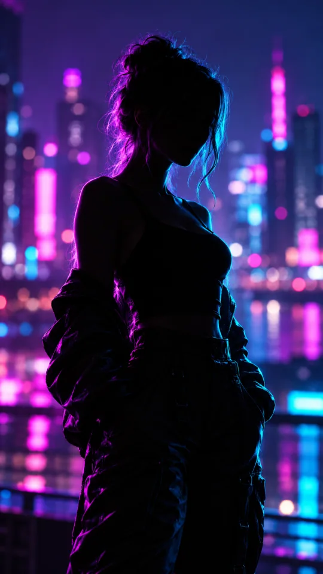</a> Neon · p_036

Show prompt
<pre><code>Moody portrait of a tall phone wallpaper of a figure in violet and cyan rim light as a dark silhouette, rim-lit on each side in two colours, blurred bokeh lights behind, violet, cyan and magenta neon, face kept in shadow, 9:16 aspect ratio.</code></pre>
</td>
  </tr>
  <tr>
    <td valign="top"><a href="./content/prompts/p_031/">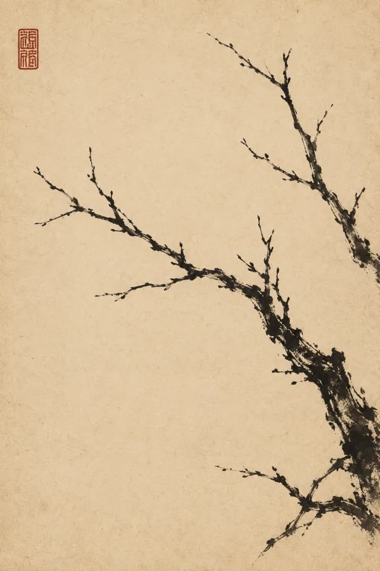</a> Ink · p_031

Show prompt
<pre><code>Minimal ink painting of a bare winter branch without blossoms, the seal in the upper left, dark dry-brush strokes, warm paper tones with ink black, a small red seal in the corner, wide empty space on warm paper, 2:3 aspect ratio.</code></pre>
</td>
    <td valign="top"><a href="./content/prompts/p_042/">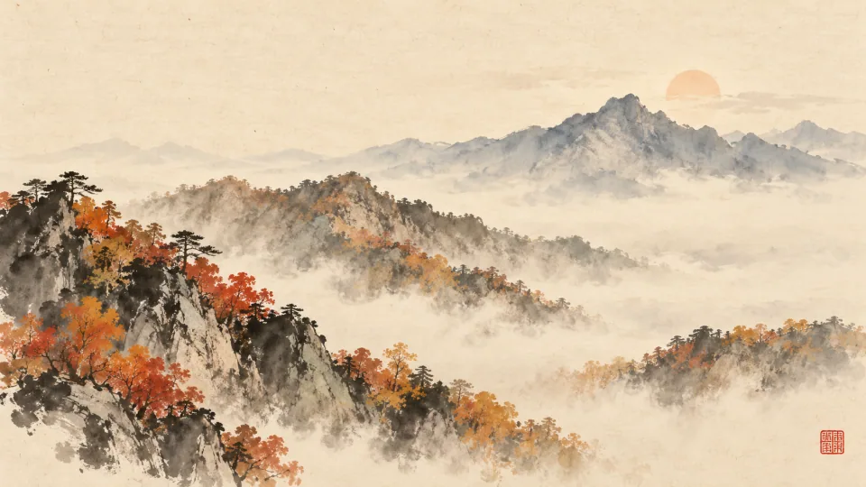</a> Ink · p_042

Show prompt
<pre><code>Traditional Chinese ink painting of misty mountain ridges in autumn, on warm rice paper with generous empty space.
Brushwork: loose wet washes.
Details: five receding ridges, a pale sun behind the far range.
Mark the corner with a small red artist's seal.
Aspect ratio: 16:9.</code></pre>
</td>
  </tr>
  <tr>
    <td valign="top"><a href="./content/prompts/p_033/">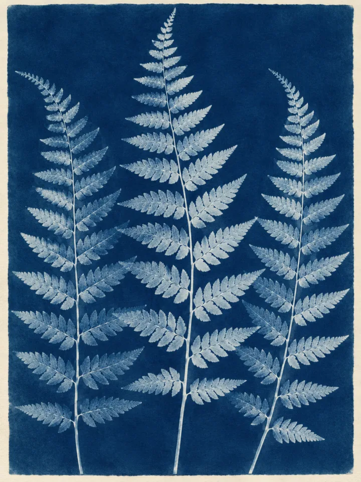</a> Cyanotype · p_033

Show prompt
<pre><code>Cyanotype-style botanical print of three tall fern fronds in white on deep Prussian blue, a pale paper border, symmetrical leaflets in varying tints, subtle paper grain, 3:4 aspect ratio.</code></pre>
</td>
    <td valign="top"><em>More examples will be added as the collection grows.</em></td>
  </tr>
</table>

### Use-case tags

<table>
  <tr>
    <td valign="top"> Wallpaper · p_026

Show prompt
<pre><code>Flat vector seascape of a quiet harbor at noon with a high pale sun, deep blues with a pale sun, the sun resting on the horizon, horizontal reflection lines on calm water, no outlines, 16:9 aspect ratio.</code></pre>
</td>
    <td valign="top"><a href="./content/prompts/p_027/">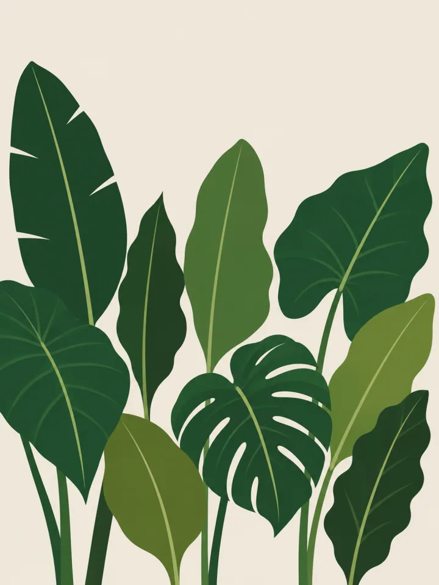</a> Wallpaper · p_027

Show prompt
<pre><code>Flat vector botanical illustration of nine tropical leaves rising from the bottom edge, broad leaves with a single midrib line, forest greens and moss, plain background, 3:4 aspect ratio.</code></pre>
</td>
  </tr>
  <tr>
    <td valign="top"><a href="./content/prompts/p_069/">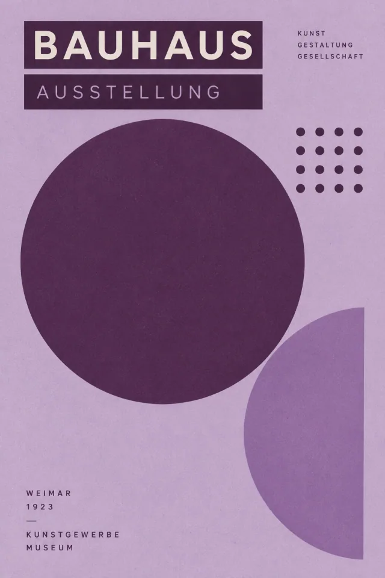</a> Event poster · p_069

Show prompt
<pre><code>Bauhaus-inspired poster: a lilac exhibition poster, lavender and plum, a large disc, a half circle, a small dot grid and two solid title bars, flat colours with fine paper grain, 2:3 aspect ratio.</code></pre>
</td>
    <td valign="top"><a href="./content/prompts/p_076/">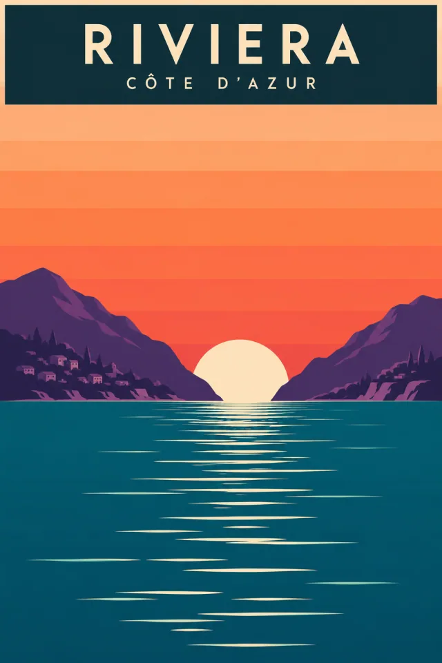</a> Event poster · p_076

Show prompt
<pre><code>Retro flat vector travel poster: a striped peach and orange sunset sky, a pale sun setting between two violet mountains, a deep teal sea with thin white reflection lines, a dark title bar at the top, 2:3 aspect ratio.</code></pre>
</td>
  </tr>
  <tr>
    <td valign="top"><a href="./content/prompts/p_021/">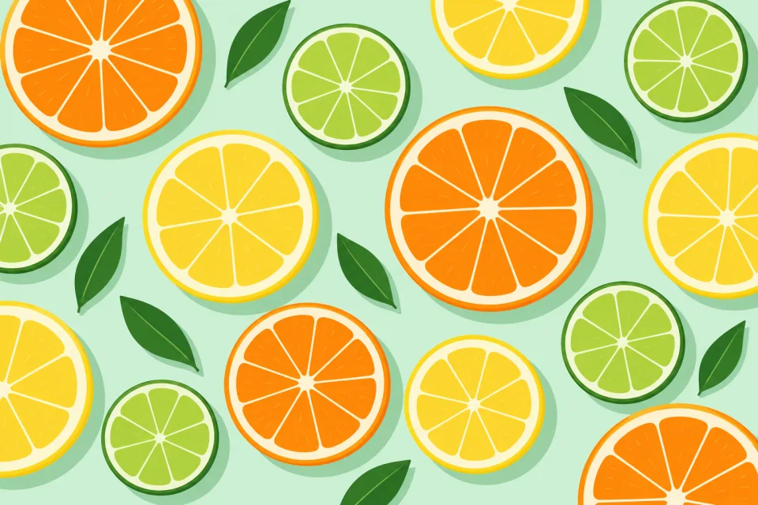</a> Packaging · p_021

Show prompt
<pre><code>Render the entire scene as a two-dimensional flat vector illustration: simple solid-colour shapes, crisp contours and minimal flat shading.
Flat lay illustration of orange, lemon and lime slices scattered on a pale mint background, slices seen from above with white segment lines, a few thin green leaves, soft drop shadows, 3:2 aspect ratio.</code></pre>
</td>
    <td valign="top"><a href="./content/prompts/p_029/">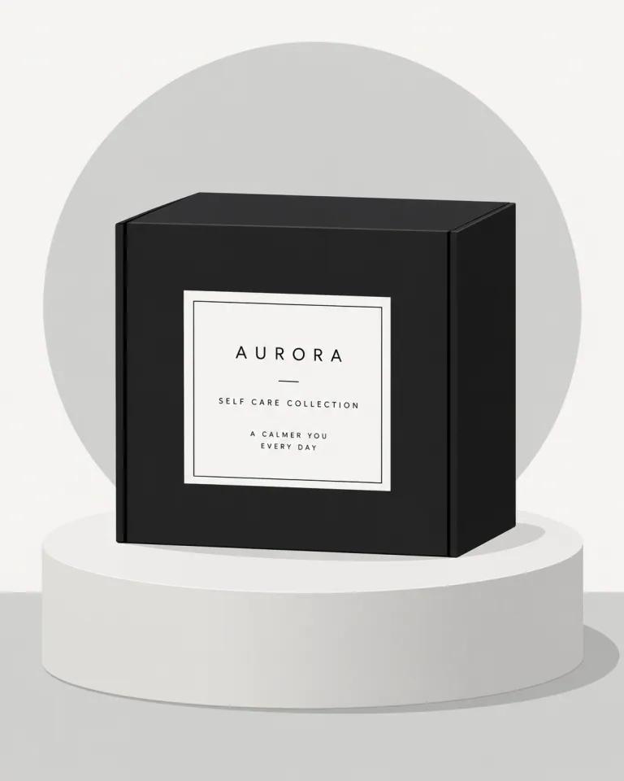</a> Packaging · p_029

Show prompt
<pre><code>Render the product itself and the entire scene as a two-dimensional flat vector illustration: simple solid-colour shapes, crisp contours and minimal flat shading.
Clean flat-vector product illustration of a matte black gift box with a white label, centred on a pale plinth in front of a soft circular backdrop, black, white and grey, gentle contact shadow, 4:5 aspect ratio.</code></pre>
</td>
  </tr>
  <tr>
    <td valign="top"><a href="./content/prompts/p_030/">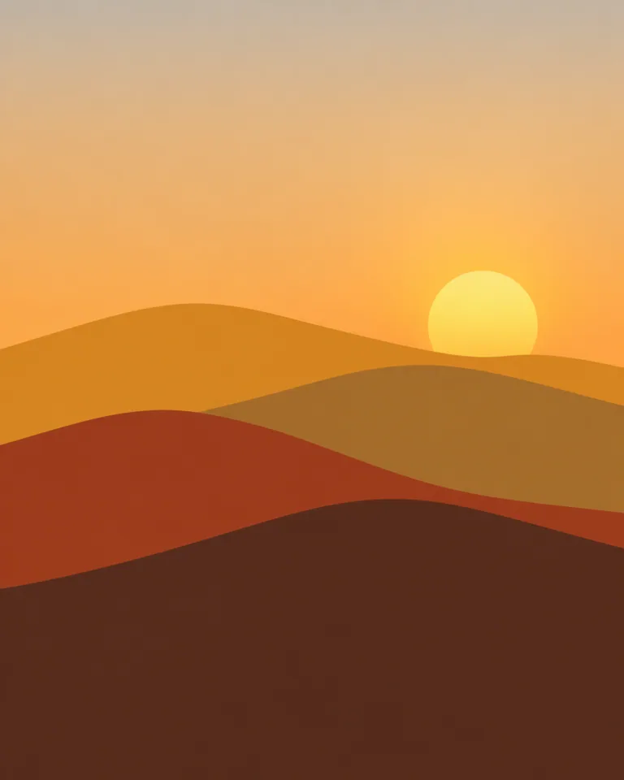</a> Art print · p_030

Show prompt
<pre><code>Flat vector landscape of exactly four autumn hills under a low amber sun. Draw exactly four separate solid-colour hill silhouettes, each with one rounded crest: one amber hill in the back, one ochre hill, one rust hill, and one dark brown hill in front. Keep the four crests clearly countable. Smooth curved silhouettes without outlines, soft gradient sky, generous negative space, 4:5 aspect ratio.</code></pre>
</td>
    <td valign="top"> Art print · p_041

Show prompt
<pre><code>Flat vector seascape of a sailboat on a lavender evening sea, lavender and plum, the sun resting on the horizon, horizontal reflection lines on calm water, no outlines, 4:5 aspect ratio.</code></pre>
</td>
  </tr>
  <tr>
    <td valign="top"> Avatar · p_044

Show prompt
<pre><code>Flat vector cityscape of monochrome city blocks, block buildings with rows of small windows, black, white and grey, a round moon or sun, no outlines, 1:1 aspect ratio.</code></pre>
</td>
    <td valign="top"> Avatar · p_050

Show prompt
<pre><code>Moody portrait of a young musician as a dark silhouette, rim-lit in cyan and magenta against soft bokeh lights.
Mood: quiet focus
Aspect ratio: 4:5.
Keep the face in shadow so the outline carries the likeness.</code></pre>
</td>
  </tr>
  <tr>
    <td valign="top"> Editorial · p_020

Show prompt
<pre><code>Flat vector cityscape of a morning skyline with a soft sun above the towers, block buildings with rows of small windows, pale rose and gold dawn colours, a round moon or sun, no outlines, 4:5 aspect ratio.</code></pre>
</td>
    <td valign="top"> Editorial · p_060

Show prompt
<pre><code>Flat vector city crossing at night in the rain, a wide zebra crossing in perspective, small figures with umbrellas, dark buildings with pink and cyan neon signs, coloured reflections on the wet road, thin diagonal rain, 3:2 aspect ratio.</code></pre>
</td>
  </tr>
  <tr>
    <td valign="top"> Social post · p_023

Show prompt
<pre><code>Render the entire scene as a two-dimensional flat vector illustration: simple solid-colour shapes, crisp contours and minimal flat shading.
Top-down flat illustration of a summer salad bowl with tomatoes and greens on a dark wooden table, a cream ceramic bowl, wooden chopsticks resting at the top right, warm paper tones with ink black, 1:1 aspect ratio.</code></pre>
</td>
    <td valign="top"> Social post · p_028

Show prompt
<pre><code>Flat vector illustration of overlapping monstera-like leaves entering from the top left corner, three shades of green, thin pale veins, small white oval holes, plain pale green background on the lower right, 1:1 aspect ratio.</code></pre>
</td>
  </tr>
  <tr>
    <td valign="top"> Book cover · p_034

Show prompt
<pre><code>Flat vector architecture: a colonnade of three arches in soft light, tall rounded arches casting diagonal shadows, lavender and plum, clean geometry, 4:5 aspect ratio.</code></pre>
</td>
    <td valign="top"> Book cover · p_055

Show prompt
<pre><code>Flat vector night alley between two dark buildings, glowing neon sign outlines in violet, amber, cyan and pink, thin rain streaks, a magenta glow at the far end, coloured reflections on the wet ground, 2:3 aspect ratio.</code></pre>
</td>
  </tr>
</table>

Cyanotype currently has one available example; a second one will be added when the collection has
another eligible output.

## Image models

The collection will include prompts and actual generated outputs from these concrete model
versions. A contribution should record the provider, exact model ID or version, prompt, inputs,
parameters, output asset and review notes.

| Provider          | Models to collect                                                                                                                                                                                                                                                                                                                                                                                                                                                                                                                                      |
| ----------------- | ------------------------------------------------------------------------------------------------------------------------------------------------------------------------------------------------------------------------------------------------------------------------------------------------------------------------------------------------------------------------------------------------------------------------------------------------------------------------------------------------------------------------------------------------------ |
| OpenAI            | GPT Image 2.6 (`gpt-image-2.6`), [GPT Image 2.6 Sunburst](https://developers.openai.com/api/docs/models/gpt-image-2.6-sunburst) (`gpt-image-2.6-sunburst`), [GPT Image 2.6 Flare](https://developers.openai.com/api/docs/models/gpt-image-2.6-flare) (`gpt-image-2.6-flare`), [GPT Image 2.5 Sunburst](https://developers.openai.com/api/docs/models/gpt-image-2.5-sunburst) (`gpt-image-2.5-sunburst`), [GPT Image 2.5 Flare](https://developers.openai.com/api/docs/models/gpt-image-2.5-flare) (`gpt-image-2.5-flare`), GPT Image 2 (`gpt-image-2`) |
| Google            | [Nano Banana 2.1](https://deepmind.google/models/model-cards/nano-banana-2-1/), Nano Banana 2 / Gemini 3.1 Flash Image, Nano Banana Pro / Gemini 3 Pro Image, Nano Banana 2 Lite / Gemini 3.1 Flash-Lite Image, Imagen 4                                                                                                                                                                                                                                                                                                                               |
| Black Forest Labs | [FLUX.2 max](https://bfl.ai/models/flux-2), FLUX.2 pro, FLUX.2 flex, FLUX.2 klein 4B/9B, FLUX.2 dev, FLUX.1 Kontext pro/max                                                                                                                                                                                                                                                                                                                                                                                                                            |
| Midjourney        | [V8.1 and V8.2](https://docs.midjourney.com/hc/en-us/articles/32199405667853-Version)                                                                                                                                                                                                                                                                                                                                                                                                                                                                  |
| Ideogram          | [Ideogram 4.0](https://ideogram.ai/models/4.0/) (`ideogram-v4`, Turbo/Default/Quality)                                                                                                                                                                                                                                                                                                                                                                                                                                                                 |
| Recraft           | [Recraft V4.1](https://www.recraft.ai/ai-models/recraft), V4.1 Pro, V4.1 Flash, V4 Vector, V4 Pro Vector                                                                                                                                                                                                                                                                                                                                                                                                                                               |
| Stability AI      | [Stable Diffusion 3.5 Large](https://stability.ai/stable-image/), 3.5 Large Turbo, 3.5 Medium, Stable Image Ultra                                                                                                                                                                                                                                                                                                                                                                                                                                      |
| ByteDance Seed    | [Seedream 5.0 Pro](https://seed.bytedance.com/en/seedream5_0_pro), Seedream 5.0 Lite                                                                                                                                                                                                                                                                                                                                                                                                                                                                   |
| Qwen              | [Qwen-Image-3.0](https://qwen.ai/blog?id=qwen-image-3.0), [Qwen-Image-2.1](https://qwen.ai/blog?id=qwen-image-2.1)                                                                                                                                                                                                                                                                                                                                                                                                                                     |

The model name is part of each prompt record. If a provider releases a new version, add a new
model entry instead of silently changing the old label.

## Contributing

The most useful contributions are **new prompts and the images they actually produce**. A strong
contribution is a small, reproducible case that another creator can understand and reuse.

### Contribute a prompt

Include:

- the exact prompt text that was sent to the model;
- a short title, description and intended use;
- category, style and use-case tags;
- the model provider, model/version, date and relevant parameters;
- reference-image roles and permissions when references are used;
- notes explaining what the important phrases control;
- the source and license of any adapted prompt or reference material.

### Contribute an image

Include the output generated from the submitted prompt, the original file when possible, a useful
English and Simplified Chinese alt description, focal point, credit and per-file license. Images
must be original, openly licensed or accompanied by permission for repository redistribution. Do not
submit unlicensed screenshots, private reference photos, or third-party logos and characters.

### Review checklist

1. The recorded prompt matches the prompt used to generate the image.
2. The output matches the declared subject, style, composition and reference inputs.
3. Text inside the image is checked for legibility and accidental claims.
4. The image has complete credit, license and alt metadata.
5. The content passes `content:validate` before the pull request is opened.

The content format, media metadata and review rules are documented in [`content/README.md`](content/README.md).

## Verification and machine-readable content

Prompt Seen keeps the human-facing page and machine-readable version on the same content model.
The site publishes structured data, sitemaps, Markdown detail pages and `llms.txt`, making the
collection easier to search, cite and reuse in AI-assisted workflows.

Project facts:

- Static multilingual Next.js site
- Prompts, templates, collections and taxonomy pages
- Real generated media with per-file credits and licenses
- Code: [MIT](LICENSE); prompt text: [CC BY 4.0](content/LICENSE)

## Documentation

- [`content/README.md`](content/README.md): how to write and publish content, for maintainers.
- [Engineering conventions](docs/engineering-conventions.md): how code in this repository is organised and extended.
- [Operations](docs/operations.md): production setup, deploying, rolling back, search engines, analytics.
- [General localization and German launch specification](docs/general-localization-spec.md): reusable locale policies, translation tooling, browsing and indexing rules, implementation steps and acceptance criteria.
- [Portuguese localization specification](docs/portuguese-localization-spec.md): full Brazilian Portuguese coverage, translation and review workflow, search acceptance and release gates.
- [Spanish localization specification](docs/spanish-localization-spec.md): staged rollout, translation batches, Spanish search behavior, review evidence and production acceptance.
- [Japanese localization specification](docs/japanese-localization-spec.md): full content coverage, translation workflow, acceptance checks and launch requirements.
- [Contributing](CONTRIBUTING.md), [code of conduct](CODE_OF_CONDUCT.md), [security](SECURITY.md), [changelog](CHANGELOG.md).

## Licenses

Code: [MIT](LICENSE). Prompt text and descriptions: [CC BY 4.0](content/LICENSE). Images are
licensed per file. Bundled fonts: [SIL OFL 1.1](src/styles/fonts/OFL.txt). The name and brand are
not licensed for reuse.
