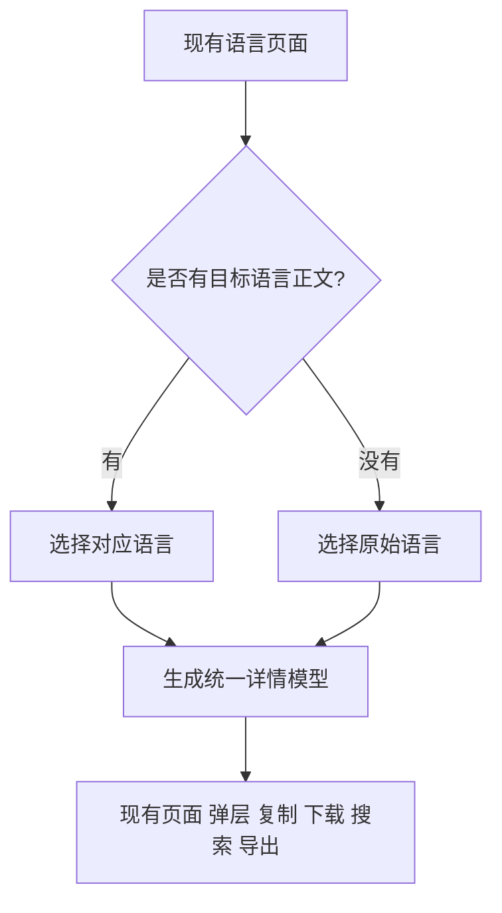

# Prompt 与模板正文多语言设计

状态：已实现，包含普通 Prompt、模板和派生 Prompt 的中英双语试点。更新日期：2026-11-05。

同一条 Prompt 或模板共用一个 ID 和 slug。当前网站语言有对应正文就使用对应正文，没有就使用原始正文。正文多语言完全可选，单语言案例沿用当前创建方式。显示、复制和下载使用同一个结果，保持现有 UI 布局和操作路径。

译文随代码合并生效，合并即表示内容已经确认可用。正文不建立审核、草稿、过期或归档状态，不用来源哈希决定译文能否展示。JSON 导出直接采用新结构，只维护当前一种格式。

首版内容以英语、简体中文为试点，数据模型支持现有语言注册表。继续使用静态内容构建，无需数据库或在线翻译服务。

## 1. 确定的产品规则

| 已有正文 | 当前网站语言 | 展示和复制的正文 |
| --- | --- | --- |
| 只有中文原文 | 中文、英文或其他语言 | 中文原文 |
| 中文原文及英文译文 | 英文 | 英文译文 |
| 中文原文及英文译文 | 中文或没有对应正文的语言 | 中文原文 |
| 只有英文原文 | 中文、英文或其他语言 | 英文原文 |

以上选择发生在现有可访问的语言页面内。页面标题、说明、SEO 发布及缺失翻译路由保持现有规则；本次增加 Prompt 正文回退，不扩展为缺少页面说明时也自动生成该语言页面。页面说明的现有翻译元数据不用于判断 Prompt 正文是否可用。

对语言正文采用注册表 code 精确匹配，如 `zh-Hans`；没有匹配时回到该条目的原文，不固定回退英语，也不隐式将简体中文匹配为繁体中文。

正文指令语言与画面文字可以不同。例如英文 Prompt 可以要求图片中出现中文标题。翻译指令时保留有意指定的画面文案、品牌、代码和专有名词；是否改变画面文案在同次内容合并中确定。

新增案例只需要一种正文。没有其他语言文件是正常情况，不产生缺译警告，也不阻止发布；只有实际添加译文时才校验该译文。

## 2. UI 和交互约束

保留现有 Prompt 区域、复制按钮、快捷键、移动操作栏、字符统计、长文本展开收起、模板编辑器、收藏、弹层及分享入口。

- 不增加“查看原文”“复制原文”、原文对照区或独立正文语言选择器。
- 不增加翻译审核、过期、回退等提示条；实际语言名称和语言差异说明复用现有 `PromptSheet` 展示位置。
- 主区域显示什么正文，现有复制按钮、快捷键和下载就输出什么正文。折叠状态仍复制完整内容。
- 不新增弹层切换语言后强制跳到详情页的规则；路由、关闭、返回和滚动恢复按现有交互处理。
- 模板切换语言时保留已填参数，不因为更换语言就清空输入或强制换成另一套草稿。
- 原有短语高亮和图像区域联动在译文中继续工作，不能通过隐藏这些功能来完成翻译适配。

翻译可能改变正文长度，布局继续使用现有自适应、折行和长文本折叠规则。布局结构与操作方式保持不变，不要求不同语言占用完全相同的像素高度。

## 3. 文件结构

保留原文文件位置，新增可选 `prompt-locales/`。现有 `locales/` 负责页面标题和说明；新增目录只负责实际可复制的 Prompt 内容。

### 3.1 普通 Prompt

```text
content/prompts/p_217/
  entry.yaml                      # promptSource.language: zh-Hans
  prompt.txt                      # 唯一原始正文
  locales/...
  prompt-locales/
    en/
      prompt.txt                  # 可选英文正文
      annotations.yaml            # 仅有短语注释时需要
```

语言由目录名决定。原始语言继续取自 `promptSource.language`，禁止在新增目录中重复声明原始语言。一个不带注释的普通 Prompt 增加一种语言，只需要增加对应的 `prompt.txt`。

没有 `status`、`reviewStatus`、`sourceHash` 或单独的译文发布元数据。新增、修改或删除语言文件在代码合并时生效。修改正文或译文时更新现有 `entry.yaml.updatedAt`，不依赖文件修改时间。

### 3.2 模板

```text
content/templates/t_001/
  entry.yaml                      # promptLanguage: en
  locales/...
  versions/v3/
    body.txt
    fields.yaml
    inputs.yaml
    samples/default.yaml
    prompt-locales/zh-Hans/
      body.txt
      variant.yaml                # 只保存渲染所需的本地化值
```

各语言共享字段名、字段类型、必填规则、长度约束、enum 稳定值和样本名称。语言变体可替换正文、自由文本默认值、样本参数、列表连接符和 enum 实际输出文字，不能改变字段契约。占位符顺序可以改变，字段集合必须相同。

`variant.yaml` 的结构片段如下；实际配置须覆盖该模板需要本地化的值：

```yaml
defaults:
  product: 带斑点的陶瓷马克杯
enumText:
  palette:
    warm neutral: 暖色中性
    sage green: 鼠尾草绿
  aspectRatio: source
separators:
  sellingPoints: "；"
samples:
  default:
    product: 带斑点的陶瓷马克杯
    sellingPoints: [手工釉面, 厚实握柄]
    palette: warm neutral
    aspectRatio: "4:5"
    headline: 清晨的一杯
```

每个 enum 提供完整输出映射，或通过 `source` 明确沿用稳定值，例如比例。自由文本默认值、有值的样本和列表连接符明确本地化，有意保留的品牌或画面文字可以填写相同值。所有样本仍使用同一组稳定字段和选项值，并通过现有字段约束。

没有添加某种语言时，使用完整原文配置；已经添加的语言配置必须完整有效，缺字段、缺选项或无法渲染时构建报错。不能把错误的译文当作不存在，也不能静默混用未维护的原文默认值。

### 3.3 模板生成的 Prompt

```text
content/prompts/p_XXX/
  entry.yaml                      # 固定模板 ID、version 和原始 values
  locales/...
  prompt-locales/zh-Hans/
    variant.yaml                  # values，以及有注释时的 annotations
```

此类条目继续由模板渲染，不保存另一份可编辑 `prompt.txt`。语言变体保存该条目的完整 `values`，enum 使用原来的稳定值；正文取自同一个固定模板版本的相应语言变体，不自动跟随 `currentVersion`。

只有模板译文、没有该 Prompt 的语言参数文件时，这条 Prompt 仍使用原文。已经声明语言参数文件、但依赖模板没有对应语言时，属于内容结构错误，构建报错。添加翻译在同一次变更中补齐依赖，不引入待审核或过期状态。

## 4. 短语高亮保持原有交互

原文注释已经包含短语、图片区域和各页面语言的说明。译文增加短语对应关系，复用原有说明、图片区域和交互逻辑。

普通 Prompt 的 `annotations.yaml` 与派生 Prompt 的 `variant.yaml.annotations` 使用同一结构：

```yaml
annotations:
  - sourcePhrase: a single red seal stamp in the lower right
    phrase: 右下角的一枚红色印章
```

原文有注释时，该语言文件须覆盖原文的全部注释；原文无注释时无需添加此文件。构建校验源短语存在、译文短语存在且定位明确、映射完整、范围不重叠，然后根据译文中的实际位置生成现有 `Annotation` 模型。不得复用原文字符偏移，也不得因译文缺少映射而关闭高亮。

图片继续使用现有封面和生成记录，区域坐标绑定对应图片。短语映射用于解释该区域与指令的关系，不表示图片一定由当前译文生成。现有证据判断仍按真实提示词执行。

## 5. 模块和解析流程

在 `scripts/lib/content/` 增加 `prompt-variants.ts` Module，通过少量 Interface 集中完成语言选择、模板配置组合、注释定位及生成证据匹配。文件读取留在 `read.ts`，纯模板渲染留在 `src/modules/template/`。

```text
resolvePrompt(content, promptRecord, locale)
  -> 当前正文、实际语言、字符统计、注释及匹配生成记录

resolveTemplate(content, templateRecord, version, locale)
  -> 当前 body/fields/samples、实际语言及渲染契约
```



内容校验先于选择执行。构建只验证数据格式、引用和渲染能否成立，不检测 Git 合并状态，不判断译文是否经过人工审核，不比较来源哈希触发过期回退。发布所用的代码版本就是可用内容集合。

`detail.prompt` 保持为当前正文的 `text`、`language`、`characters`、`lines`。模板的 `version.body/fields/samples/defaultPrompt` 全部来自同一选中变体。字段标签继续按页面语言取值，正文可以按原文回退。

删除原方案中的 `prompt.original`、翻译状态、回退原因和可选语言菜单数据。原文只在构建输入中保留，译文详情无需为原文对照功能额外携带整份原文。历史生成记录仍按现有模型携带真实提示词。

全页、弹层和各 emitter 使用同一模型。列表只带选中正文的摘要和实际语言，不携带所有语言全文。生成任务默认明确使用原文；显式指定语言的任务按该语言生成，缺少指定语言时报告配置错误，避免实际生成了另一种语言。

## 6. 模板编辑、草稿和分享

### 6.1 纯渲染

运行时 `EnumOption` 增加可选 `renderText`，`value` 继续作为稳定参数值。验证参数后，enum 输出 `renderText ?? value`。例如选项值保持 `warm neutral`，中文变体输出“暖色中性”。原始字段文件与旧原文渲染语义保持不变。

构建将语言配置合成为有效的 `TemplateVersionSpec`。`renderTemplate(spec, values)` 仍为纯函数，不读取 locale 或翻译文件。默认 HTML、实时预览、复制、下载和样本导出都使用这一函数。

### 6.2 保留已有参数

继续以模板 ID 和版本管理已有草稿，不引入按语言和哈希拆分的第二套草稿，也不增加迁移提示。没有用户输入或草稿时，初始值来自当前语言默认样本；已有输入、草稿或分享参数时，按现有优先级恢复并保留这些值。

切换语言时更新模板正文和 enum 输出映射，已填写的自由文本保持原样，不翻译、不清空。用户主动选择样本或重置时，再使用当前语言对应的样本。正文语言表示指令语言，不承诺用户自己填写的所有内容属于同一种语言。

语言切换前保存最新输入，避免现有延迟写入丢失最后一次编辑。路由复用或重新挂载时，确保参数保持、预览更新，复制读取最新渲染结果；不能因切换语言覆盖用户输入。

### 6.3 保持分享方式

沿用现有“当前页面地址 + 模板版本 + 参数”的分享方式及 fragment 编解码格式。页面地址中的 locale 决定正文选择，fragment 继续保存参数，不增加原文锁定、额外语言锁定或契约哈希错误界面。

分享打开后仍按现有顺序处理模板版本匹配、参数恢复和字段校验。相同页面语言、模板版本、参数及内容版本应渲染相同正文。代码中内容更新后，分享链接读取当前内容，和普通页面保持一致。

正文、语言标签、字符统计、复制和下载在参数恢复后同步更新。模板版本不匹配、输入无效和存储不可用等情况沿用现有反馈。

## 7. 保留生成事实和现有内容

代码合并代表译文可以展示，不代表它已经用于生成图片。两者不设置成同一状态。译文不需要生成记录也可以正常显示、复制、下载。

现有 run 的真实正文、`promptSha256`、输出图片和生成参数不改写。新 run 记录实际 `promptLanguage`，模板 run 同时记录对应模板版本和参数。缺少语言的历史 run 可在原文精确匹配时推导；无法确认时保留未知。

当前正文的测试信息只取精确匹配的生成记录。译文没有匹配 run 时，使用现有测试信息区域的“未测试”或“未验证”表现，不添加新的翻译提示条；原文生成记录继续在现有示例区展示。封面、画廊选择和布局不因译文切换额外改动。

已有运行记录的 `contractHash` 保持不变。旧算法包含显示文案；日语接入使用经逐条旧记录核验的 `contract-baseline.yaml`，将旧哈希对应到排除标签、帮助文字及输入说明的语义哈希。只有当前语义仍匹配基线时才接受该旧哈希。新记录使用语义哈希，正文、默认值、约束、枚举输出值、分隔符及槽位契约继续冻结。语言配置存放在独立目录，避免修改 schema 默认值意外改变旧哈希。新翻译模板 run 可增加 `template.variantHash`，覆盖实际译文正文、输出映射及有效默认值；`contractHash` 仍检查其固定源模板契约。哈希只用于生成事实和模板冻结，不用于译文审核或失效判断。

已用于生成的模板版本及语言变体继续保持可复现；需要改变其渲染含义时创建新模板版本。可以给旧版本新增尚不存在的语言，不因此修改原文契约。普通 Prompt 的历史 run 则继续保存各次实际文本。

## 8. 输出和搜索

同一语言页面默认状态下满足：

```text
显示正文 = 主复制内容 = 主下载内容 = 弹层正文
         = index.md 主代码块 = JSON prompt.text
         = CreativeWork.text
```

模板编辑后的预览、复制和下载使用当前参数；静态 HTML、Markdown、JSON、搜索和 JSON-LD 使用该语言默认样本。用户编辑后的文本不要求与静态默认样本相同。

搜索索引、列表的 `promptOpening` 和模板 `bodyExcerpt` 从同一选中变体生成。实际语言同步写入现有语言标签、正文 `lang/dir` 和提示词对应的 `CreativeWork.inLanguage`。WebPage、canonical、hreflang 和页面发布集合继续遵循现有页面语言规则。

JSON 导出直接改为当前详情模型需要的结构，`prompt.text/language`、模板字段和测试信息都表示实际选中正文。内部消费者和测试在同次改动中更新；只维护一个当前格式，不实现旧格式适配、双版本导出或迁移流程。若保留格式版本字段，它只标识当前格式。

语言正文更新使用条目现有 `updatedAt`，构建结果同步反映到页面、站点地图、结构化数据和导出。

## 9. 新增内容与内容校验

单语言创建流程、默认参数和原有命令继续工作，无需新增翻译目录或审核配置。多语言是逐条可选增强；多维护一种语言，仅增加那种语言实际需要的正文、模板参数或注释映射。

| 情况 | 校验结果 |
| --- | --- |
| 没有译文或没有目标语言 | 正常，使用原文 |
| 原文或译文改变 | 不产生审核、过期状态；相关内容一致性在同次合并中处理 |
| 译文为空、语言非法、重复原文语言或文件结构错误 | 构建错误 |
| 模板字段、占位符、选项或样本不完整 | 构建错误 |
| 派生 Prompt 声明译文但缺少对应模板变体 | 构建错误 |
| 译文缺少已有注释映射或短语无法定位 | 构建错误 |
| 译文没有对应生成图片 | 正常可展示，不标为已有精确生成结果 |
| run 的正文哈希或已冻结模板契约不一致 | 保留现有生成证据校验，构建错误 |

`content:new`、`content:produce`、`media:generate` 默认继续创建和使用原文。只有显式新增某语言的生成或内容任务，才读取、写入该语言目录；实际运行的语言与收据、run 一致，不覆盖其他语言。

可以提供可选的语言文件脚手架，帮助创建目录、列出字段和注释映射。它不生成审核元数据，也不成为创建单语言案例的必经步骤。CI 校验结构与渲染，内容确认沿用代码合并流程。

## 10. 实施顺序

| 步骤 | 主要位置 | 完成标准 |
| --- | --- | --- |
| 1. 可选内容格式 | `schemas.ts`、`read.ts`、内容类型 | 旧内容不改即可构建；可读取普通、模板和派生 Prompt 的语言文件 |
| 2. 语言解析与渲染 | 新增变体 Module、`render.ts`、`build-index.ts`、`validate.ts` | 有目标语言用目标语言，否则原文；不引入审核或过期判断 |
| 3. 注释和生成事实 | 注释定位、样本匹配、run 和生产脚本 | 保留高亮交互及历史记录，译文不冒用原文生成结果 |
| 4. 所有显示与输出 | 详情、弹层、编辑器、搜索、Markdown、JSON、SEO | 显示和复制一致；现有布局及操作路径不变；JSON 直接更新 |
| 5. 参数连续性与试点 | 编辑器状态、草稿/分享调用方、三类双语案例 | 切换语言不丢输入；单语言录入不增加步骤；各渠道可验收 |

先完成数据和展示链路，再合并双语试点内容。试点包含普通 Prompt、带选项和自由文本的模板、依赖模板的 Prompt；其中至少一个有短语注释，至少一个译文没有生成记录。使用现有图片验证显示关系，无需为发布译文额外生成图片。

实施时同步更新主设计文档涉及的正文格式和渲染规则、`content/README.md`、template/content Module README；页面说明原有发布机制保持其既有范围。

## 11. 验收用例

1. 单语言案例在每个现有语言页面显示、复制同一原文，不要求其他正文文件。
2. 增加目标语言文件后对应页面使用译文，其他语言继续使用原文。
3. 更新原文不会使现存译文被运行时标记过期或自动回退；合并后的文件直接可用。
4. 语言切换、弹层、收藏、长文展开、快捷键及移动复制保持现有操作路径；没有新增原文操作入口或翻译提示条。
5. 模板 enum 稳定值不变，输出随正文语言改变；新页面默认样本本地化，用户已填值保留。
6. 派生 Prompt 使用固定模板版本和对应参数，不跟随 `currentVersion`；错误依赖在构建时明确失败。
7. 注释在原文和译文中均能正确高亮并联动原图，译文字符偏移重新计算。
8. 显示、复制、下载、弹层、Markdown、JSON、搜索摘要和结构化数据使用一致的默认正文。
9. 已填参数、草稿和分享恢复不因切换语言而被清空或强制换成默认值；快速切换不丢最后输入。
10. 旧内容、实际生成记录和源模板契约仍有效；译文无需生成记录即可发布，但不继承原文的测试结果。
11. JSON 所有消费者和测试使用唯一的新结构，没有旧版兼容分支。
12. 正文实际语言、RTL 方向、字符统计和移动折行正确；页面发布及缺失翻译路由保持原行为。

验证覆盖 resolver 和 renderer 的单元测试、内容构建集成测试、静态产物 HTTP 测试及语言切换/复制的浏览器测试。UI 对照现有页面结构和操作进行回归，允许正文长度变化产生自然折行。按改动范围运行内容校验、Vitest、typecheck、lint、静态 build 和 Playwright。

## 首页与浏览摘要

普通作品卡片展示已发布的页面语言 description，不展示实际提示词开头；模板用途说明始终显示，仅正文语言匹配时显示参数摘录。首页作品和自动模板插段遵循[首页语言规格](./home-language-seo-spec.md)的统一语言优先规则。真实正文仍由本设计的 resolver 选择，FeatureShowcase 标明实际正文语言，复制、下载、标注与验证记录继续使用该正文。缺少目标页面版本时不借用另一语言卡片，语言切换重建列表、收藏和弹窗状态。
