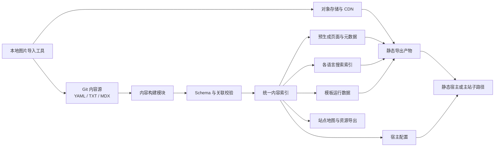
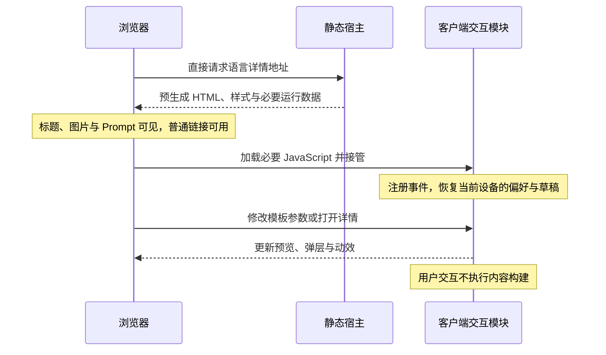
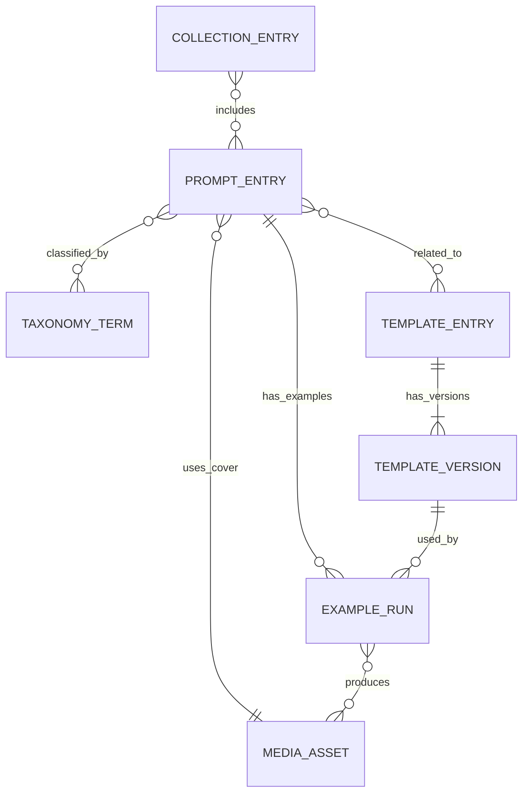
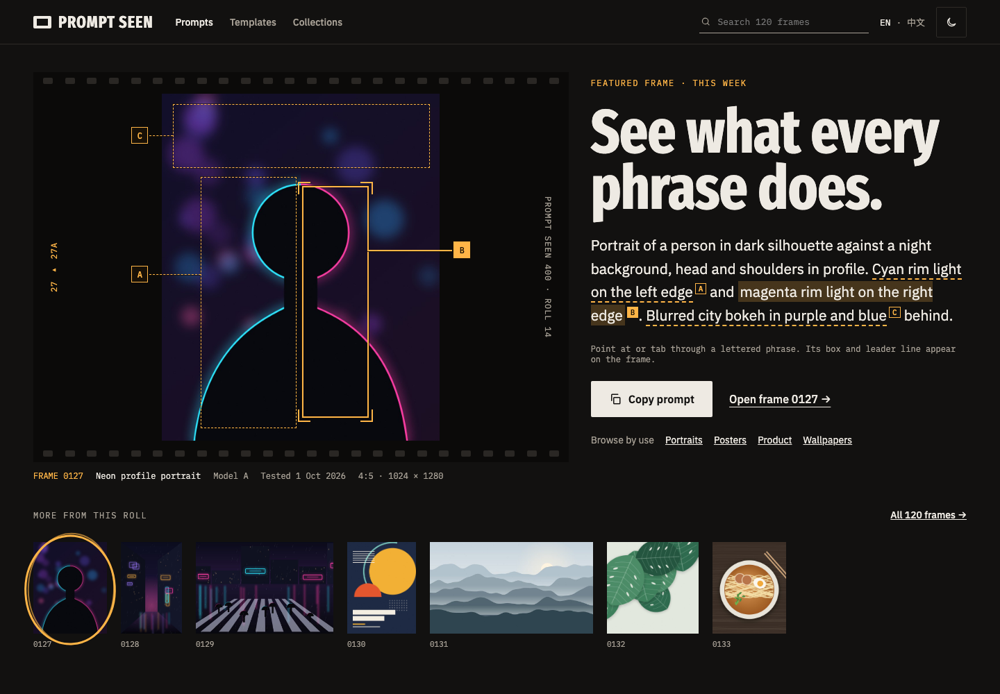
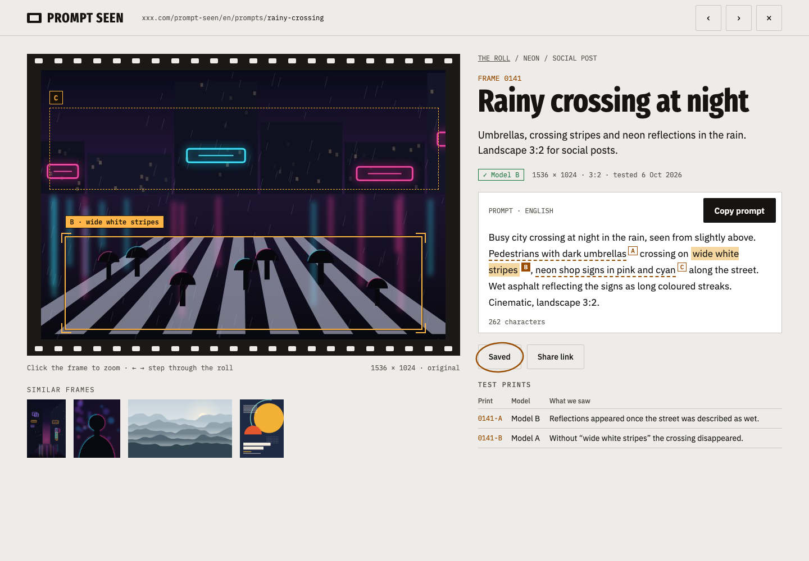

# Prompt 与图片模板网站：详细架构设计

> 文档版本：1.20  
> 设计日期：2026-10-14（1.3–1.8 修订：2026-10-15；1.9–1.12 修订：2026-10-16；1.13–1.15 修订：2026-10-17；1.16–1.17 修订：2026-10-18；1.18–1.19 修订：2026-10-25；1.20 修订：2026-10-26）  
> 状态：开发设计方案，尚未实施  
> 已确认约束：覆盖主流语言；开发者主要通过 Git 和文件维护内容；项目计划开源，并可挂载到已有主站的子路径（如 `xxx.com/prompt-seen`）；挂载后仍作为独立作品呈现，有自己的首屏焦点与视觉辨识度。  
> 推荐覆盖：分两批启用 13 个 locale，详见第 8 章与《语言覆盖评估》。  
> 1.2 增补：预渲染与客户端分工、前端状态、页面过渡、主题与动效规范，以及性能验收。  
> 1.3 增补：GEO 与 AI 可见性（9.10）、结构化数据与图片搜索（9.6–9.9）、完整视觉系统与关键页面设计（11.1、11.8）、细节交互与快捷键（11.9–11.11）、子路径部署与开源实例配置（15.4–15.5）。  
> 1.4 增补：样稿评审结论（11.12）——列表改为连续滚动、所有站内展示保持原始比例、建立品牌层与反模板化检查（11.1.8）、首页与列表页首屏展示（11.8.1–11.8.2）。  
> 1.5 增补：选定视觉方向——暗房（A）加校样（C）的字母标注；功能层与品牌层 token、字体、形状与品牌元素规格（11.1.9），对应资产保存在 `design/` 目录。  
> 1.6 修订：第 17 章改为实施步骤与会话图（开工前提、各步骤范围与通过条件、共享文件约定、会话简报清单、样例内容与检查点）；`tokens-check` 与“未验证”徽标的引用统一到第 11.1.9 节；补入配套的《语言覆盖评估》文件。部署方案 A 与 B 仍待原型验证（第 17.1 节）。  
> 1.7 修订：采用方案 B（静态导出、预生成详情页加 pushState 弹层），依据《子路径部署决策》第 7 节的原型验证结果；按该备忘第 6 节修改第 3–5、7–9、11、14–18、20、21 章的相关内容，并把原型发现的实现细节写入第 4.1、9.5、11.3.1、14.2、15.4.3、15.4.4 与 16.3 节。  
> 1.8 修订：步骤 1a 的决定——工程位于仓库根目录，文档移入 `docs/`；预览与生产托管选用 Cloudflare Pages；代码 MIT、内容 CC BY 4.0；国际化消息库选用 next-intl；语言注册表增加 `preview` 字段与 `BUILD_MODE` 构建模式；补充第 4 章的实际目录、配置生成与输出注册机制，以及《工程约定》（第 4.1、8.2、15.4.2、17.1、17.3、20 章）。  
> 1.9 修订：步骤 1b 的决定——内容文件格式与维护说明 `content/README.md`；专题页说明的位置及其发布条件（该语言至少 3 条可见 Prompt）；`redirects.yaml` 与已删除清单的格式；译文 `sourceHash` 的计算方式；受限 MDX 组件（`Figure`、`Callout`）与按 ID 书写的站内链接；图片 `credit.copyrightNotice`、展示规格格式与本地媒体驱动的存放位置；`.generated/content/` 的内容模型与读取模块；样例内容的性质（第 4、4.1、5.2–5.5、6.2、8.4、9.1、9.5、10.2、14.1、14.3、17.3、17.6 章）。  
> 1.10 修订：步骤 1c 的决定——token 以 `src/styles/tokens/` 中的 CSS 文件为唯一来源，`design/tokens/` 移除；`tokens-check` 的 44 组组合逐项列出，并增加补充组合；字体子集、按文字的 `unicode-range` 与中日韩引号处理；主题首绘脚本、根元素属性与 `theme-color` 的所有权；页眉主题按钮与页脚、菜单中的三选一；语言选择显示母语名称；外壳与区块注册表；交互专用代码按需加载、`src/ui/` 按文件导入（第 4、4.1、11.1.2、11.1.3、11.1.9、11.6.3、15.5.2、17.3 章）。版本号跳过 1.9：1.9 是并行进行的步骤 1b 的修订，两者合并时保留各自条目。  
> 1.11 修订：步骤 2 的决定——详情正文由可序列化详情模型渲染、服务端与弹层共用的写法；`seo` 模块与页面调用方式，条目页的 x-default 指向默认语言版本，Open Graph locale 映射；面包屑只链接本次构建已有的页面；提示词标注的实现（字母为生成内容、引线侧的选择、窄容器只显示当前框）；中日韩展示字体的构建期子集与 `DISPLAY_MESSAGE_KEYS`；首次必要 JavaScript、首屏图片与字体的实测（第 4.1、9.3、11.1.2、11.1.9、11.8.3、16.1、17.3 章）。  
> 1.12 修订：步骤 3a 的决定——列表数据（`public/generated/{locale}/feed/` 的分页 JSON 与精简元数据索引）与列表页由同一份数据渲染；`site.yaml` 的 `feed.showcase` 与 `feed.interludes` 结构；编辑段落每页一个、按配置轮换，极端比例作品在所在位置成为特写行；“精选”排序的定义；比例筛选的分档与参考图筛选；等高行在窄屏的起始宽度；`content-visibility` 只在支持滚动锚定的浏览器启用；静态导出下单页列表的分页参数；返回恢复的快照与 `history.scrollRestoration`；排序不按设备记住；十批以上连续滚动的实测（第 3.5、4.1、9.4、11.1.4、11.8.2、11.9、15.4.2、16.4、17.3 章）。  
> 1.13 修订：步骤 3b 的决定——sitemap index 与按 locale 的 `sitemap-pages.xml`（Next.js 保留 `…/sitemap.xml` 路由名）及其收录与 `lastmod` 规则；只为已启用 locale 中已发布的版本生成 sitemap 条目、`index.md`、`llms.txt` 与导出（`isIndexable`）；结构化数据的页面写法、面包屑与可见面包屑同源、作者与许可的映射、列表 `ItemList` 的编号；robots 规则只覆盖本站地址，根域部署时 `robots.txt` 即主机文件，子路径部署另生成合并片段；Markdown 版本的内容、措辞来源与宿主响应头；`llms.txt` 的结构；`content:export` 的 JSON 与 Markdown 格式（第 4、4.1、9.3、9.6、9.7、9.10.2、9.10.4、14.1、17.3、20 章）。  
> 1.14 修订：步骤 3c 的决定——模板详情页以编辑器为主体（字段 5 列、吸附的预览 7 列），字段表由表单取代；控件选择规则（比例、色块、不超过 4 项的分段控件可换行、更多选项用下拉）；错误的显示时机；预览中的空变量以字段名占位且不进入复制文本；草稿的存储键与保存时机、不跨标签页实时同步；分享填写结果的 fragment 格式与读取后移除；“用模板改写”带参数的条件；手机端预览为同一元素的底部停靠面板；模板列表页（第 11.6.2、11.8.3、11.8.4、17.3 章）。  
> 1.15 修订：步骤 3d 的决定——每个构建 locale 一份 MiniSearch 索引及其字段与权重，Prompt 正文进入低权重字段；按文字的分词（拉丁等字母文字折叠大小写与重音、阿拉伯语字形归一，中日韩以字对检索，查询用不重叠字对）；术语别名写在分类词汇文件中，并以其他语言的标签互为别名；Worker 查询与主线程回退、带构建版本与序号的请求；快速搜索面板（↑ ↓ 之前不预选结果）、每个语言页面页眉中的搜索入口与 `/`、⌘K 快捷键（`/` 受单字符快捷键偏好控制）；搜索页的 `?q=`、按组逐步显示与无结果建议；最近搜索的存储（第 4.1、11.8.6、11.10、13、17.3 章）。  
> 1.16 修订：步骤 3e 的决定——语言入口的版式、推荐语言与“继续使用”（偏好增加 `language` 字段）；分类、风格与用途专题页以等高行展示作品，人工合集的条目图文交替，新增合集索引页 `/{locale}/collections/`；关于与许可页位于 `/{locale}/{slug}/`，其 slug 不得与站点路由同名；页脚链接本语言已有的关于与许可页；404、410 与缺少译文页的内容与做法（缺少译文页 `/{locale}/translation-missing/` 由语言菜单以地址片段传入来源页与已有语言）；某语言没有专题、合集或内容页时的占位参数；宿主配置的生成（参考 nginx、Cloudflare Pages、Netlify、Vercel 与 meta refresh 页面）与打包检查；页眉在 768–1023 px 收紧间距（第 8.2、9.1、9.5、11.6.1、11.8.5、11.8.7、17.3 章）。  
> 1.17 修订：步骤 4a 的决定——弹层用原生 `<dialog>` 的 `showModal()`，其中的提示框与弹出层经 `PortalScope` 渲染到对话框内；画廊以 `PopupHost` 包裹，列表按阅读顺序登记作品（`usePopupList`），上一条与下一条到达已加载内容末尾时请求下一批；共享图片以 Web Animations API 的替身图片实现，不用 Motion 的 `layoutId`；关闭不带本站标记的详情历史项时替换回画廊地址；手机端左右滑动与下滑关闭的阈值；专题页的作品同样在弹层中打开。
> 1.18 修订：步骤 4b 的决定——`site.yaml` 的 `home.featured` 结构与展出顺序（已开始的日期最新者在前，无日期者在后），只展出该语言可见且带标注的作品，没有时取“精选”顺序中第一件带标注的作品；“换一件”的顺序、焦点与播报；首屏桌面以片边承载作品、手机端改为作品、引述与“复制提示词”在前，标题与搜索在后，图片最大高度约为三分之一屏高；显影只在接管时图片仍在加载才发生，以模糊的缩略图为底、只改变不透明度，列表展示带同样采用；首页的作品在弹层中打开；首页元数据以展出作品为分享图（第 11.1.9、11.8.1、11.8.2、17.3 章）。
> 1.19 修订：首次必要 JavaScript 的实测与归因——HTML 引用的脚本与空闲后的总量分开记录，后者包括空闲预载与页眉链接的路由预取；列表筛选栏的条件面板、已选条件与排序列表，以及模板编辑器的下拉，改为按需加载；测量脚本 `scripts/measure-first-load.ts`；其余可减项及其代价见《首次加载 JavaScript》（`docs/first-load-js.md`）（第 4.1、16.1 节）。版本号 1.18 是并行进行的步骤 4b 的修订。  
> 1.20 修订：步骤 4c 的决定——收藏记录 `prompt-library:favorites:v1` 的格式（ID、类型与收藏时间）、损坏与禁用存储时的退路、导出文件格式与导入合并规则；收藏按钮（卡片角落的图标、详情与模板页的“收藏 / 已收藏”、移动端操作栏）与帧号的圈选记号；一次性提示与撤销的位置（外壳的 Toast，收藏页内原位撤销）；页眉在 1024 px 起显示收藏入口，更窄时在菜单与页脚；`explore` 页复用列表的精简索引、分页文件、连续列表与弹层，宽屏为侧栏筛选；`C`、`S` 与 `?` 通过页面按钮的 `data-shortcut` 生效，快捷键列表与单字符开关位于页脚（第 4.1、9.4、11.5、11.8.3、11.10、17.3 节）。  
> 核心目标：SEO 与 AI 搜索友好、资源容易更新、视觉有辨识度且交互流畅易用、可独立部署或挂载到已有站点子路径。

## 1. 项目定位与设计目标

网站是一座可以浏览、搜索、理解和改写的图片 Prompt 资源库。用户通过效果图发现内容，通过说明理解用法，通过模板变量生成适合自己任务的提示词。

保留参考项目中的案例、模板、分类和使用指导，进一步建立明确的数据模型与发布流程。每个 Prompt、模板、图片和专题都有稳定标识；网站页面、搜索索引、资源数量和导出文件从同一份内容源生成。

### 1.1 必须实现的目标

| 目标 | 设计要求 | 验收方式 |
| --- | --- | --- |
| SEO 友好 | 每条已发布内容有独立地址，初始 HTML 包含完整主要内容 | 检查 HTML、元数据、站点地图及状态码 |
| 多语言 | 主流语言按条目独立发布，正确关联语言版本 | 检查语言切换、canonical、hreflang、RTL |
| 资源易维护 | 一条内容一个目录，分类与图片通过 ID 关联 | 新增内容无需修改页面代码 |
| 模板可复用 | 正文、字段定义共同生成表单和实际 Prompt | 校验预览、复制和导出的内容一致 |
| 图片管理清晰 | 原图与展示图有资源清单，文件地址可追溯 | 验证尺寸、版本、引用和可访问性 |
| AI 可见性（GEO） | AI 搜索与答案引擎可抓取、可准确摘录和引用页面 | 检查 AI 爬虫策略、边缘防火墙、Markdown 版本与 AI 引荐流量 |
| 视觉规范完整 | 色彩、字体、栅格、组件状态均有 token 与样本，对比度经过计算 | 设计走查、token 对比度校验、WCAG 2.2 AA 检查 |
| 首屏与辨识度 | 作为独立作品呈现：首屏有编辑策划的焦点，视觉不落入通用模板 | 按第 11.1.8 节检查表评审视觉方向，按第 16.5 节验收首屏 |
| 交互流畅 | 支持筛选、详情弹层、参数编辑和反馈动画 | 桌面、移动端、键盘交互测试 |
| 更新可审查 | PR 预览、自动校验、合并发布、版本回滚 | 跑通一次新增、修改与回滚流程 |
| 可移植部署 | 根域名或子路径部署，实例差异只在配置中 | 在 `/prompt-seen` 子路径构建下验证路由、元数据、站点地图与资源地址 |

### 1.2 第一版范围

第一版包含首页、Prompt 列表与详情、模板列表与编辑器、专题页、多语言搜索、语言切换、图片放大、复制、本地收藏，以及关于、测试方法与许可页面。语言注册表支持扩展；首批建议启用英语、简体中文、西班牙语、巴西葡萄牙语、日语、韩语、德语和法语。

账户体系、云端收藏、在线生图、支付和社区投稿列为后续能力。第一版的数据与页面设计应允许接入这些能力，但不提前引入相应业务系统。

用于验收的起始内容规模建议为：20 条 Prompt、3 套模板、2 个人工策划专题，以及首批启用语言的介绍和说明。Prompt 正文与图片跨语言复用。25 个内容条目在 8 个 locale 中对应 200 个本地化内容单元；扩至 13 个 locale 后为 325 个。单元数量用于估算维护量，不代表用户覆盖率。

## 2. 用户与核心使用流程

### 2.1 用户类型

| 用户 | 主要需求 | 关键体验 |
| --- | --- | --- |
| 寻找灵感的创作者 | 快速发现符合风格和用途的图片 | 图片网格、分类、专题、相关推荐 |
| 需要直接使用 Prompt 的用户 | 确认用法并复制完整提示词 | 独立详情、模型信息、输入要求、复制反馈 |
| 需要改写模板的用户 | 填入产品、人物或场景变量 | 字段表单、即时预览、默认示例 |
| 内容维护者 | 批量新增、校验、预览和发布资源 | 内容脚手架、图片导入、PR 检查 |

### 2.2 发现并使用一个 Prompt

1. 用户从搜索结果、专题或画廊进入网站。
2. 浏览效果图、标题和简短用途。
3. 打开详情，查看完整 Prompt、输入要求和注意事项。
4. 查看相近示例或关联模板。
5. 复制提示词，或进入模板编辑器改写。

从画廊打开详情时保留浏览位置；通过分享链接访问时展示完整详情页。

### 2.3 使用模板

1. 打开模板详情，阅读适用场景与示例。
2. 按字段填写主体、风格、比例和画面文字。
3. 在右侧或下方查看实时生成的 Prompt。
4. 复制、下载或重置参数。

字段标签随界面语言切换；提示词正文遵循模板自身语言，不因界面语言变化而自动翻译。

### 2.4 发布内容

1. 运行内容脚手架，创建资源目录。
2. 导入图片，生成图片清单。
3. 填写元数据、Prompt 和目标语言说明。
4. 本地校验与预览。
5. 提交 PR，检查自动生成的预览部署。
6. 合并后构建并发布。

## 3. 总体架构

采用一个代码仓库、一个以静态导出方式构建的 Next.js 网站和一个图片对象存储。内容在构建阶段编译为统一索引，再用于页面、搜索和资源导出。构建产物是静态文件，连同生成的宿主配置交给任意静态宿主提供。



### 3.1 技术选择

| 层级 | 建议技术 | 选择理由 |
| --- | --- | --- |
| 网站框架 | Next.js App Router + TypeScript，静态导出 | 内容预生成、独立路由与元数据；产物是静态文件，线上不需要运行时 |
| 部署形态 | `output: 'export'`、构建时固定的 `basePath`、`trailingSlash: true`；构建同时生成宿主配置 | 宿主只需提供静态文件，可部署到根域名或主站子路径，见第 15.4 节 |
| 内容元数据 | YAML | 可读、可审查，适合开发者编辑 |
| Prompt 正文 | UTF-8 TXT | 保持换行、符号和完整正文，便于复制 |
| 说明文章 | Markdown / MDX | 支持长文与受控的展示模块 |
| 数据校验 | Zod | 统一字段规则，提供明确错误 |
| 界面消息 | next-intl（只用于 ICU 消息格式化） | 支持复数与选择消息，服务端与客户端共用；语言路由仍由注册表与 `url` 模块负责，见第 4.1 节 |
| 图片处理 | Sharp | 导入时获取尺寸并生成展示规格 |
| 图片存储 | Cloudflare R2，或团队已有的 S3 兼容存储 | 图片独立管理，通过 CDN 分发 |
| 搜索 | MiniSearch | 构建时生成索引，浏览器按需查询 |
| 动效 | CSS + Motion | 微交互与复杂布局过渡分别处理 |
| 样式 | CSS 自定义属性 + CSS Modules，`@layer` 管理层叠顺序 | token 单一来源、零运行时、兼容 Server Components，实例换肤只改变量 |
| 无障碍组件基元 | React Aria Components | Dialog、Select、Combobox、Tabs、Toast 的焦点与 ARIA 行为，内置 RTL 与多语言日期数字处理 |
| 图标 | Lucide，按需导入 | 开源许可，统一 24 px 网格与线宽 |
| 组件状态样本 | Storybook | 维护 loading、empty、error、success 与明暗、RTL、减少动效样本 |
| 无障碍检查 | axe-core（集成到 Playwright） | 自动发现对比度、标签与角色问题，人工走查补充 |
| 访问分析 | 不使用 Cookie 的隐私友好分析，如 Plausible 或 Vercel Web Analytics | 避免同意横幅，可统计搜索与 AI 引荐来源 |
| CI 与发布 | GitHub Actions + Cloudflare Pages（第 17.1 节），参考 nginx 用于测试 | 内容校验、PR 预览、参考 nginx 状态码测试与静态产物部署 |
| 质量验证 | 单元测试 + Playwright + Lighthouse | 验证模板、路由、交互与性能 |

项目初始化时选择相互兼容的稳定版本，并提交锁文件。具体依赖版本在实施阶段确定，不以本文中的技术名称推断版本兼容性。

### 3.2 页面渲染策略

| 页面或数据 | 策略 |
| --- | --- |
| 首页、Prompt 详情、模板详情、专题页 | 构建时预生成 HTML |
| 普通内容列表与分页 | 预生成，初始 HTML 包含可点击资源链接；浏览器中以连续滚动自动加载后续分页 |
| 搜索界面 | 静态页面，搜索索引在用户使用搜索时加载 |
| 任意组合筛选 | 浏览器交互，使用精简元数据索引 |
| 模板参数编辑 | 浏览器计算，默认 Prompt 同时出现在初始 HTML 中 |
| 收藏 | 第一版本地存储，按稳定 ID 保存 |
| 详情弹层 | 预生成详情页加客户端弹层：画廊内点击用 `history.pushState` 更新为真实详情地址，弹层数据来自构建生成的 JSON |

内容发布通过 Git 合并触发构建，第一版不需要 CMS 发布事件或内容数据库。

第一版采用静态导出：`output: 'export'`，配合构建时固定的 `basePath` 与 `trailingSlash: true`，产物为 `/a/index.html` 形式的静态文件。所有动态段使用 `generateStaticParams` 并设 `dynamicParams = false`。页面是否实际静态生成以构建输出检查为准。

静态导出不支持拦截路由、`next.config` 的 redirects/rewrites/headers、Proxy、ISR、Server Actions、读取请求的 Route Handler、cookies 与默认 loader 的图片优化。第一版只用到其中的重定向、响应头与拦截路由：重定向与 410 由构建生成的宿主配置提供（第 9.5、15.4 节），noindex 用 meta 标签输出，详情弹层改用 pushState（第 11.3 节）。图片在导入时已生成各规格并经 CDN 提供，不依赖默认 loader。

该决定依据《[子路径部署决策](./subpath-hosting-decision.md)》：备忘比较了方案 A（保留拦截路由，以 Node.js 服务加反向代理部署）与方案 B（静态导出），2026-10-15 的两项原型验证（basePath 下弹层的历史行为、参考 nginx 下的状态码与地址前缀）全部通过，结果见该备忘第 7 节。宿主因此只需提供静态文件，开源自托管者不需要运行和修补 Node.js 服务。以后需要请求期能力（如第 19.2 节在线生图或账户）时，放到独立 API 服务，或去掉导出改为服务器运行；前提是代码一直遵守导出限制。

### 3.3 预渲染与客户端交互的分工

预渲染负责提供完整可阅读的初始页面；客户端接管负责用户操作与动态呈现。内容是否预生成与页面能否交互是两个维度。

| 界面或任务 | 预渲染 / Server Components | 客户端 / Client Components |
| --- | --- | --- |
| 标题、介绍、Prompt 正文 | 输出完整 HTML 与语义结构 | 复制、选中文本、折叠长内容 |
| 效果图 | 输出图片地址、尺寸、说明与加载提示 | 放大、缩放、对比和高分图切换 |
| 列表 | 输出首批卡片与正常分页链接 | 组合筛选、结果反馈、浏览位置保存 |
| 模板 | 输出默认样本、字段标签、默认 Prompt | 参数输入、校验、即时计算、复制和重置 |
| 详情路由 | 每个详情地址预生成完整详情页 | 画廊内点击以 pushState 打开弹层并播放过渡；刷新、直接访问与新标签页由宿主返回完整页 |
| SEO | 生成元数据、canonical、语言关联与结构化数据 | 不依赖操作后补齐主要 SEO 内容 |
| 本地偏好 | 提供一致的初始界面 | 接管后读取收藏与草稿，应用用户选择 |
| 动效 | 输出稳定、可见的初始状态 | 按事件、布局或进入视口触发动画 |

`'use client'` 表示客户端模块的编译边界，不等于该模块首次只在浏览器输出。客户端模块仍可参与初始 HTML 生成，随后附加事件和状态。[Next.js 渲染与客户端接管说明](https://nextjs.org/docs/app/getting-started/server-and-client-components)

页面和布局默认保留服务端职责。将搜索、复制按钮、编辑器、图片比较和动画容器设置为局部客户端模块，服务端正文可通过 `children` 传入客户端容器。共享状态 Provider 放在实际需要的区域，不把整个内容树改成客户端数据加载。

浏览器调整模板参数、筛选资源、切换收藏和播放动画均不触发网站构建。维护者修改内容文件并发布时，才重新生成对应部署。

### 3.4 首次加载、接管与后续导航



客户端首次输出必须与预渲染输出一致。收藏初始状态、模板默认值和控件结构采用可确定的初始快照；本地草稿与收藏在接管后恢复。

响应式布局优先由 CSS 决定，不在首次 render 中读取 `window.innerWidth` 改变 DOM。随机值、当前时间和设备专属数据不能参与需要一致的首次输出。主题首绘有单独的受控初始化约定，见第 11.6 节。

JavaScript 尚未接管时，普通链接、图片、正文和手动选择文本仍可使用。依赖 JavaScript 的控件提供必要的准备状态或普通入口，例如详情卡片保留真实链接，复制提供可选中的文本。

后续站内导航使用 Next.js 客户端路由更新页面；画廊到详情的弹层使用 pushState，见第 11.3 节。动效用于表达内容变化，不强制每次导航重新加载整份 HTML，也不把数据可用性与动画完成回调绑定。

### 3.5 客户端数据契约

- 画廊接收当前批次摘要、资源 ID、封面规格、标签与地址，不接收整个资源库正文。
- 连续列表的后续批次来自构建生成的精简 JSON，按 locale、排序方式与页码拆分（如 `public/generated/{locale}/feed/latest/{n}.json`），内容与对应分页地址的 HTML 一致。
- 实施细节（1.12）：列表页在服务端读取的正是这些 JSON，HTML 与 JSON 因而不会分歧。最新顺序之外的排序与筛选不另生成分页文件：浏览器用精简元数据索引 `feed/index.json`（每条的风格、用途、画幅、是否需要参考图、所在页码，以及“精选”顺序与编辑段落）算出结果，再按所需页码取上述分页 JSON 拼出批次。条目的弹层 JSON 位于 `public/generated/{locale}/prompts/{slug}.json`，由步骤 3a 生成并按意图预取，步骤 4a 渲染。
- 详情弹层接收按条目、按 locale 生成的 JSON（如 `public/generated/{locale}/prompts/{slug}.json`），在卡片悬停或聚焦时预取。完整页与弹层从同一个可序列化的详情模型渲染同一个 `PromptDetailBody`；MDX 说明在构建时编译为可序列化形式（受限组件集输出的 HTML 或 AST），浏览器不编译 MDX。
- 模板编辑器接收当前版本的正文、字段定义、合法默认样本与必要的本地化标签。
- 图片查看器接收当前资源的图片规格和说明；高分图按需加载。
- 数据来自同一构建版本。语言切换只加载目标语言的界面与内容，保留适用的共享参数。
- 服务端文件读取、MDX 编译、资源导入和对象存储凭据均不进入客户端依赖图。
- 参数渲染和轻量校验使用可在构建与浏览器共用的纯函数。
- 通过构建体积与运行网络请求验证契约，不能只凭文件中是否写有 `'use client'` 判断实际成本。

## 4. 代码与内容目录

以下是拟实施的目录结构，并非当前工作区中已存在的项目。

```text
prompt-library/
├── content/
│   ├── prompts/
│   │   └── p_001/
│   │       ├── entry.yaml
│   │       ├── prompt.txt
│   │       └── locales/
│   │           ├── en.mdx
│   │           ├── zh-Hans.mdx
│   │           ├── es.mdx
│   │           └── ...
│   ├── templates/
│   │   └── t_001/
│   │       ├── entry.yaml
│   │       ├── locales/
│   │       │   ├── en.mdx
│   │       │   ├── zh-Hans.mdx
│   │       │   └── ...
│   │       └── versions/
│   │           └── v1/
│   │               ├── body.txt
│   │               ├── fields.yaml
│   │               └── samples/
│   │                   └── default.yaml
│   ├── examples/
│   │   └── x_001/
│   │       ├── run.yaml
│   │       └── prompt.txt
│   ├── media/
│   │   └── a_001.yaml
│   ├── collections/
│   │   └── c_001/
│   │       ├── entry.yaml
│   │       └── locales/
│   │           ├── en.mdx
│   │           ├── zh-Hans.mdx
│   │           └── ...
│   ├── taxonomy/
│   │   ├── categories.yaml
│   │   ├── styles.yaml
│   │   ├── use-cases.yaml
│   │   ├── field-groups.yaml
│   │   └── categories/{id}/locales/*.mdx   # 专题页说明；styles/、use-cases/ 同理
│   ├── pages/
│   │   ├── about/locales/*.mdx
│   │   └── license/locales/*.mdx
│   ├── locales.yaml
│   ├── redirects.yaml
│   ├── site.yaml
│   ├── README.md                 # 内容格式与维护命令
│   └── LICENSE
├── src/
│   ├── app/
│   │   ├── layout.tsx
│   │   ├── (entry)/
│   │   │   ├── layout.tsx
│   │   │   └── page.tsx
│   │   ├── [locale]/
│   │   │   ├── layout.tsx
│   │   │   └── (public)/
│   │   │       ├── layout.tsx
│   │   │       ├── page.tsx
│   │   │       ├── 404/page.tsx
│   │   │       ├── 410/page.tsx
│   │   │       ├── prompts/
│   │   │       │   ├── page.tsx
│   │   │       │   ├── [slug]/
│   │   │       │   │   ├── page.tsx
│   │   │       │   │   └── index.md/route.ts
│   │   │       │   └── page/[page]/page.tsx
│   │   │       ├── templates/
│   │   │       │   ├── page.tsx
│   │   │       │   └── [slug]/
│   │   │       │       ├── page.tsx
│   │   │       │       └── index.md/route.ts
│   │   │       ├── categories/[slug]/page.tsx
│   │   │       ├── styles/[slug]/page.tsx
│   │   │       ├── use-cases/[slug]/page.tsx
│   │   │       ├── collections/[slug]/page.tsx
│   │   │       ├── search/page.tsx
│   │   │       ├── explore/page.tsx
│   │   │       ├── favorites/page.tsx
│   │   │       ├── about/page.tsx
│   │   │       ├── license/page.tsx
│   │   │       └── sitemap-pages.xml/route.ts
│   │   ├── not-found.tsx
│   │   ├── icon.svg
│   │   ├── llms.txt/route.ts
│   │   ├── sitemap.xml/route.ts
│   │   └── robots.txt/route.ts
│   ├── config/
│   │   ├── schema.ts
│   │   ├── load.ts
│   │   ├── index.ts
│   │   └── generated/
│   ├── modules/
│   │   ├── content/
│   │   ├── template/
│   │   ├── media/
│   │   ├── search/
│   │   ├── url/
│   │   ├── seo/
│   │   └── geo/
│   ├── ui/
│   │   ├── primitives/
│   │   ├── brand/
│   │   ├── gallery/
│   │   ├── prompt-detail/
│   │   ├── detail-popup/
│   │   ├── template-editor/
│   │   ├── navigation/
│   │   ├── feedback/
│   │   └── motion/
│   ├── state/
│   │   ├── favorites/
│   │   └── preferences/
│   ├── i18n/
│   │   ├── request.ts
│   │   └── messages/{locale}/{namespace}.json
│   └── styles/
│       ├── tokens/
│       ├── fonts/
│       └── base/
├── scripts/
│   ├── config-gen.ts
│   ├── content-new.ts
│   ├── content-validate.ts
│   ├── content-build.ts
│   ├── emitters/
│   ├── lib/content/              # 读取、校验、MDX 编译与内容模型
│   ├── lib/media/                # 图片处理与存储驱动
│   ├── dev.ts
│   ├── package.ts
│   ├── deploy-cloudflare.ts
│   ├── media-import.ts
│   ├── content-export.ts
│   ├── tokens-check.ts
│   └── indexnow-ping.ts
├── design/
│   ├── tokens/
│   └── visual-direction/
├── docs/
├── deploy/
│   ├── nginx/host-server.conf
│   └── generated/
├── tests/e2e/
├── public/generated/
├── public/media/                 # 本地媒体驱动的存储，提交到仓库
├── .generated/
├── dist/
├── .storybook/
├── .github/workflows/
├── next.config.ts
├── package.json
├── LICENSE
└── README.md
```

### 4.1 目录职责

- `content/` 是人工编辑的内容源，提交到 Git。内容使用独立许可文件，与代码许可分开，见第 15.5 节。
- `src/config/` 读取 `content/site.yaml` 与环境变量，输出站点源、基础路径、URL 模式、品牌与功能开关。代码其他位置不直接读取环境变量。`load.ts` 只在 Node 中运行（脚本与 `next.config.ts`）；`npm run gen` 把校验后的配置与 locale 字面量类型写入 `generated/`，应用代码只通过 `@/config` 使用这些常量。lint 禁止 `src/` 中直接读取 `process.env`，以及在 `url` 模块以外使用 `origin`、`basePath` 与 `urlPattern`。
- 可覆盖 `site.yaml` 的环境变量：`SITE_ORIGIN`、`BASE_PATH`（根部署时为空）、`URL_PATTERN`、`BUILD_MODE`、`BUILD_ID` 与 `CONTENT_DIR`。`BUILD_MODE` 为 `production` 或 `preview`，默认 `preview`：预览构建的全部页面带 `noindex`，并额外生成注册表中标记 `preview: true` 的 locale（第 8.2 节）；生产构建只生成已启用的 locale。
- `src/i18n/` 使用 next-intl，只负责 ICU 消息格式化（第 11.11 节）；locale 前缀、路由与 hreflang 来自语言注册表与 `url` 模块，不使用 next-intl 的中间件（静态导出不能运行）。消息按功能拆分为 `messages/{locale code}/{namespace}.json`，文件名即命名空间；客户端模块只接收所需的命名空间。`content:validate` 检查 ICU 语法、缺失的键，以及各语言与英语的参数是否一致。
- `src/app/layout.tsx` 只透传子节点；`<html lang dir>` 由 `[locale]/layout.tsx` 与语言入口的 `(entry)/layout.tsx` 输出，使每个页面带有自己的语言与方向（第 8.6 节）。`[locale]` 下的页面调用 `notFound()` 时，需要不输出 `<html>` 的 `[locale]/not-found.tsx`。
- `src/modules/` 封装内容读取、模板渲染、资源选择、搜索与 SEO 规则。`url/` 是生成所有对外地址的唯一模块；`geo/` 负责 Markdown 版本、`llms.txt` 与 AI 爬虫规则输出。
- `src/ui/primitives/` 封装 React Aria 组件基元与项目样式，业务组件只使用这一层，不直接拼装 ARIA 属性。
- `src/ui/brand/` 是品牌层元素（片边、帧号、裁切标记、占位字标）；`src/ui/motion/` 是动效 Provider 与预设；`src/ui/navigation/` 是根文档与可替换外壳（第 15.5.2 节）。
- 实施细节（1.10）：`src/ui/` 与 `src/state/` 不设汇总导出文件（barrel），按文件导入（如 `@/ui/primitives/Button`）。服务端组件从汇总文件导入时，其中每个 `'use client'` 模块都会成为客户端入口，整组基元会进入每个页面的首次加载。只在交互时需要的部分按需加载：页眉语言列表在首次使用时加载，窄屏菜单在首次打开时加载，Toast 区域在页面空闲后加载。外壳使首次必要 JavaScript 增加约 36 KiB（gzip，1a 的空站点为 183.5 KiB，1c 为 219.5 KiB），其中约 12 KiB 是客户端消息格式化，步骤 2 的客户端模块本来也需要。
- `src/ui/` 负责画廊和编辑器等用户界面。
- 实施细节（1.11）：步骤 2 新增 `src/ui/prompt-detail/`（`PromptDetailBody` 与图片舞台、Prompt 纸张、测试信息、生成示例、来源许可、相关作品行、移动端操作栏）、`src/ui/template-detail/`、`src/ui/annotation/`（标注状态、文本短语、图上标注框、说明列表与纯函数布局）、`src/ui/showcase/`（`FeatureShowcase` 与 `toShowcase`，供 3a、4b 复用）、`src/ui/rich-text/`（构建期 MDX 树的渲染）、`src/ui/feedback/`（`CopyButton`、`ShareButton`）、`src/ui/navigation/Breadcrumb.tsx`，以及 `src/modules/seo/`。详情正文组件不读文件、不用请求状态、不导入服务端模块，只接收详情模型、locale 与 `detail` 消息命名空间，因此完整页在服务端渲染，步骤 4a 的弹层可在浏览器中用同一份 JSON 渲染同一组件。`'use client'` 文件导出的普通函数在服务端组件中会变成客户端引用、无法调用，共用的纯函数因此放在不带该指令的文件中（如 `src/ui/prompt-detail/language.ts`）。
- 实施细节（1.13）：步骤 3b 新增 `src/modules/seo/` 的结构化数据（`structured-data.ts`、`JsonLd.tsx`）、sitemap（`sitemap.ts` 生成 XML，`sitemaps.ts` 决定收录）与 `indexing.ts`（`isIndexable`、`PageSections`）；`src/modules/geo/`（`markdown.ts`、`llms.ts`、`robots.ts`，以及供 Route Handler 与脚本共用的 `documents.ts`）；`src/i18n/translator.ts`（React 渲染之外的消息格式化）；`src/ui/prompt-detail/crumbs.ts`（可见面包屑与 `BreadcrumbList` 共用）；Route Handler `sitemap.xml`、`[locale]/(public)/sitemap-pages.xml`、`robots.txt`、`llms.txt` 与两个 `index.md`；`scripts/emitters/robots.ts`、`scripts/content-export.ts` 与 `scripts/lib/export.ts`。`build.json` 的 locale 增加 `enabled`，端到端测试据此区分公开与仅预览的 locale。Next.js 把根以下任何以 `sitemap.xml` 结尾的路由当作元数据路由，动态段会以占位参数预渲染而失败，因此按 locale 的 sitemap 命名为 `sitemap-pages.xml`。
- 实施细节（1.15）：步骤 3d 新增 `src/modules/search/`（分词 `tokenize.ts`、构建与浏览器共用的引擎 `engine.ts`、构建期文档 `documents.ts`、Worker `search.worker.ts` 及其可在主线程运行的处理逻辑 `worker-core.ts`、页面端 `client.ts`）、`scripts/emitters/search.ts`、`src/ui/search/`（页眉入口 `SearchLauncher`、快速搜索面板、搜索页、结果行与无结果建议）与路由 `[locale]/(public)/search/`。偏好记录增加 `singleKeyShortcuts`（第 11.10 节），`ClientMessages` 可显式传入 locale，供外壳这类不调用 `enterLocale` 的共享组件使用。
- 实施细节（1.12）：步骤 3a 新增 `src/modules/feed/`（列表数据的类型、构建期编排 `compose.ts`、构建与浏览器共用的批次编排 `assemble.ts` 与筛选计数 `query.ts`、服务端读取模块）、`src/ui/gallery/`（Card、编辑段落、展示带、筛选栏、`Feed` 与 `ListProvider`）、`scripts/emitters/feed.ts` 与 `prompt-json.ts`，以及 `content:validate` 中的 `validate-feed.ts`。卡片与编辑段落不带 `'use client'`，服务端渲染第一页、浏览器追加后续批次时用同一组件。
- 实施细节（1.17）：步骤 4a 新增 `src/ui/detail-popup/`（`PopupHost` 与 `usePopupList`、`DetailPopup`、历史项与地址存储 `history.ts`、纯函数 `logic.ts`、共享图片 `flight.ts`、手机手势 `useSwipe.ts`）与基元 `src/ui/primitives/PortalScope.tsx`；`PromptDetailBody` 增加 `heading` 与 `coverPreview` 参数，`ImageStage` 增加 `preview`（已加载的小图垫在大图之下）；列表的 `src/ui/gallery/prefetch.ts` 增加同步读取已取得数据的 `peekJson`。
- 实施细节（1.18）：步骤 4b 新增 `src/modules/home/`（展出顺序 `featured.ts`、首页编排的纯函数 `compose.ts`）、`src/ui/home/`（服务端的 `HomeBody` 与客户端的首屏 `HomeHero`）、`src/ui/showcase/DevelopImage.tsx` 与 `content:validate` 中的 `validate-home.ts`；`site.yaml` 的 `home.featured` 改为正式结构。`FeatureShowcase` 增加 `film`、`develop`、`intro`、`footer` 与 `captionHint` 参数，`AnnotationCaption` 增加未选中时的提示，列表模板条的卡片抽出为 `TemplateCards`，`@/modules/seo` 增加 `homeMetadata`。展示组件中点按短语后把图片滚动到可见，原先只在详情页生效（找不到图片舞台），现在以标注层为目标。
- 实施细节（1.20）：步骤 4c 新增 `src/state/favorites/`（收藏 store、解析、导出与导入合并）、`src/ui/favorites/`（`FavoriteButton`、页眉的 `FavoritesLink`、外壳中负责一次性提示与撤销的 `FavoritesFeedback`、事件 `events.ts`、收藏页 `FavoritesBody` 与 `FavoritesList`、纯函数 `resolve.ts`）、`src/ui/explore/`（`ExploreBody`、`ExploreFilters`）、`src/ui/shortcuts/`（`KeyboardShortcuts`、按需加载的 `ShortcutsDialog`、纯函数 `keys.ts`）、品牌元素 `src/ui/brand/CircleMark.tsx`，以及路由 `[locale]/(public)/favorites/` 与 `explore/`。列表的 `ListProvider` 增加 `listPath` 与 `pageAddresses`，筛选项抽出为 `FilterGroups`（列表的面板与 explore 侧栏共用）；`Card` 默认在角落放收藏按钮，`actions={null}` 时留空；`CopyButton` 与 `PromptSheet` 增加快捷键参数，`IconButton` 增加 `hint`（提示框文字与名称不同时使用）；偏好记录增加 `favoritesNoteSeen`。
- 实施细节（1.19）：列表筛选栏的条件面板（`FilterPanel`）、已选条件（`RemovableChips`）与排序列表在指针或焦点到达筛选栏时开始下载，首次使用时挂载；排序在此之前是外观与名称相同的按钮（`SortSelect`），按下或按 ↑ ↓ 时换成已获得焦点并展开的 `Select`，Esc 后焦点回到它。模板编辑器的 `Select` 以 `React.lazy` 引入：服务端照常输出，代码到达后水合；样例模板没有超过四个普通选项的字段，因此目前不加载。
- `design/` 保存已选定视觉方向的参考页面与截图（第 11.1.9 节），只作视觉参考。步骤 1c 已把 token 原稿 `design/tokens/darkroom.css` 迁入 `src/styles/tokens/`，`design/tokens/` 随之移除。
- `src/styles/tokens/` 是视觉与动效 token 的唯一来源，生成 CSS 自定义属性；`scripts/tokens-check.ts` 在 CI 中校验第 11.1.9 节列出的颜色组合对比度。
- 实施细节（1.10）：token 直接写成 CSS 文件——`color.css`（功能层与品牌层颜色，浅色、跟随系统的深色、用户选择的深色三块，以及 `prefers-contrast: more`）、`type.css`（字号、字重、按 `lang` 切换的字体栈与行高）、`layout.css`（间距、断点相关值、容器宽度、圆角、层级、焦点环、触控目标）、`motion.css`（动效 token 与减少动效）。全局样式按 `@layer reset, tokens, base, components, utilities` 排序，组件样式为 CSS Modules 并放在 `components` 层。代码需要的少量数值（动效、断点、`theme-color`）有 TypeScript 镜像，单元测试保证与 CSS 一致；`src/` 中媒体查询与容器查询只允许第 11.1.3 节的断点。字体在 `src/styles/fonts/`（第 11.1.2 节）。`.storybook/` 展示各组件状态，工具栏切换浅色、深色、并排两种主题、语言与方向、减少动效。
- `.generated/` 保存构建阶段需要的完整索引、MDX 导入映射和反向关联，不直接对外公开。
- `.generated/content/` 是内容模型：`manifest.json`（构建、语言、重定向与 410 清单）、`{locale}/index.json`（该语言可见内容的摘要）与 `{locale}/{kind}/{key}.json`（详情模型）。类型定义在 `src/modules/content/types.ts`，页面通过服务端模块 `@/modules/content` 读取；构建期代码（读取 `content/`、MDX 编译、校验）位于 `scripts/lib/content/`。
- `public/media/` 是本地媒体驱动的存储，随仓库提交，使全新克隆无需云端凭据即可显示全部图片（第 10.1、15.5.3 节）；文件只由 `media:import` 写入。
- `content/README.md` 是维护者的内容格式与命令说明，随 Schema 更新（第 14.1 节）。
- `public/generated/` 只保存明确允许公开的精简搜索索引与导出资产。
- 生成目录不手工修改，加入 `.gitignore`，在本地开发和 CI 中重新生成。
- `next.config.ts` 设置 `output: 'export'`、`trailingSlash: true` 与来自 `src/config/` 的 `basePath`。
- 导出的 `out/` 不含 basePath 目录层级，构建后打包到 `dist/{basePath}/`（如 `dist/prompt-seen/`），使文件路径与对外地址一致；`dist/` 是交给宿主的产物。
- `deploy/` 保存宿主接入模板（如 nginx server 块示例）与构建生成的宿主配置（nginx include、`_redirects`、`vercel.json`、`robots-snippet.txt`），生成部分不手工修改，见第 15.4 节。手写模板在 `deploy/nginx/`，生成部分在 `deploy/generated/`。
- `content:build` 的每种输出是 `scripts/emitters/` 下的一个文件，默认导出 `defineEmitter({ name, description, run })`，由注册表自动发现；输出只经 `ctx.write` 写入 `public/generated/`、`.generated/` 或 `deploy/generated/`（第 17.4 节）。`_` 开头的文件是辅助模块。
- `scripts/package.ts` 把 `out/` 打包到 `dist/{basePath}/`，并检查每个已生成 locale 的首页与错误页都存在；`scripts/deploy-cloudflare.ts` 在此基础上组装 Cloudflare Pages 的上传目录。
- `docs/` 保存本文、《子路径部署决策》《语言覆盖评估》与《工程约定》（`engineering-conventions.md`）。
- 每种语言的错误页预生成在 `/{locale}/404/` 与 `/{locale}/410/`，由宿主的错误页规则引用；根 `not-found.tsx` 生成未知语言使用的 `404.html`；根 `page.tsx` 是语言入口（第 8.2 节）；`icon.svg` 使站点图标带基础路径（第 15.4.3 节）。
- `index.md` 等 Route Handler 不在 `[locale]` layout 之下，拿不到父级参数，其 `generateStaticParams` 必须同时返回 `locale` 与 `slug`，否则导出报错。

## 5. 核心内容模型

### 5.1 模型及关系

| 模型 | 作用 | 主要关联 |
| --- | --- | --- |
| PromptEntry | 一条可独立访问的 Prompt 内容 | 分类、风格、用途、封面、关联模板 |
| TemplateEntry | 模板介绍与当前推荐版本 | 一个或多个 TemplateVersion |
| TemplateVersion | 确切模板正文和字段规则 | 参数样本、生成记录 |
| MediaAsset | 原图、展示规格与资源信息 | 被 Prompt、专题和生成记录引用 |
| ExampleRun | 一次实际生成或编辑记录 | Prompt ID、模板版本、实际提示词快照、图片 |
| CollectionEntry | 人工策划的专题 | 排序后的 Prompt 或模板 ID |
| TaxonomyTerm | 分类、风格和用途词汇 | 多个内容条目 |
| LocalizedContent | 对应语言的标题、说明与发布状态 | 附属于 Prompt、模板或专题 |

分类、模板和图片使用稳定 ID 关联，不使用标题作为外键。面向用户的 `slug` 可以在必要时变更，变更时必须保留旧地址重定向。



反向关联由构建生成。例如，模板的实际案例从 `ExampleRun.templateRef` 推导，不要求维护者同时修改两份案例编号列表。

### 5.2 Prompt 元数据示例

```yaml
id: p_001
slug: ink-portrait
createdAt: 2026-10-14
updatedAt: 2026-10-14

promptSource:
  type: literal
  file: prompt.txt
  language: en

categoryId: illustration
styleIds:
  - ink
useCaseIds:
  - portrait

coverAssetId: a_001
relatedTemplateIds:
  - t_001

model:
  displayName: null
  providerModelId: null
  verification: unknown

inputRequirements:
  referenceImage: optional

source:
  author: null
  url: null
  license: null

annotations:
  - phrase: "a single red seal stamp in the lower right"
    region: { x: 0.80, y: 0.82, w: 0.12, h: 0.12 }
    note:
      zh-Hans: 印章的位置和颜色由这句话控制
      en: This phrase sets the seal's position and colour
```

说明：

- `annotations` 是可选的提示词标注，用于首页展出、特写行与详情（第 11.1.8、11.8.1 节）。`phrase` 必须逐字出现在 `prompt.txt` 中，构建时校验；`region` 是相对原图宽高的 0–1 坐标；`note` 按 locale 提供，发布某 locale 时校验其说明完整。
- 标注是编辑依据测试记录得出的观察，最好有对照的 `ExampleRun`（如去掉该短语后的结果）支撑，不凭猜测添加。
- 首页展出与特写行的编排在 `content/site.yaml` 中按资源 ID 配置，只能选择带标注的条目。

- 上述模型名称为空是合法状态，不因仓库主题推断图片使用了某个模型。
- `model.verification` 取 `verified`、`unverified` 或 `unknown`；标为 `verified` 时必须写明 `displayName`。
- 标注短语不得互相重叠，最多 5 个，按在提示词中出现的顺序自动编为 A–E。
- 源语言不另设字段：没有 `translation` 块的语言文件就是源文件，每个条目恰好一个。
- 图片生成参数如果已确认，应在具体 `ExampleRun` 中记录。
- 普通 Prompt 使用 `literal`，正文只从 `prompt.txt` 读取。
- 由模板生成的 Prompt 可使用 `promptSource.type: template`，保存模板 ID、固定版本和参数。此时不再维护另一份可编辑 Prompt 正文，条目目录中没有 `prompt.txt`。
- 浏览器列表只获得标题、封面、分类、简述和地址等必要字段，完整正文按详情路由加载。

### 5.3 本地化说明示例

`locales/zh-Hans.mdx`：

```mdx
---
title: 水墨风格肖像
description: 通过主体轮廓、留白和纸张质感控制水墨肖像。
status: published
updatedAt: 2026-10-14
translation:
  sourceLocale: en
  sourceHash: sha256-of-source-localized-content
  reviewStatus: reviewed
---

## 适合什么任务

适用于人物肖像、个人头像与具有纸张质感的插画。

## 使用方式

先明确人物身份和构图，再调整笔触与留白。
```

`locales/en.mdx`、`locales/es.mdx` 等采用相同字段结构，各语言正文独立编辑。内容语言状态为 `draft`、`published` 或 `archived`。源语言可以是英语或简体中文；翻译文件记录来源和审核状态，源语言文件不需要声明自己是翻译。修改源语言时通过哈希识别待更新译文。

说明正文在构建时编译为可序列化的详情模型（受限组件集输出的 HTML 或 AST），完整详情页与弹层使用同一份结果，浏览器不编译 MDX，见第 3.5 节。

实施细节（1.9）：可序列化形式为受限节点树 `RichBlock`（`src/modules/content/types.ts`）。正文允许 Markdown（`##`–`####` 标题、列表、引用、代码、表格、强调与链接）以及两个组件 `<Figure asset="a_012" caption="…" />` 与 `<Callout>`；原始 HTML、import/export、`{表达式}` 与其他组件是构建错误，并指出行号。站内链接按 ID 书写，如 `prompt:p_001`、`template:t_001`、`collection:c_001`、`page:about`、`category:landscape`，构建时解析为同一语言的地址，不受 slug 变更与基础路径影响；链接到该语言未发布的条目时，发布错误。`sourceHash` 为 `sha256:` 加标题、描述与正文 SHA-256 的前 16 位十六进制；源文件变化时 `content:validate` 打印新值，审核后写入。合集的语言文件用 `reasons` 按条目 ID 写推荐理由（第 11.8.5 节）。

SEO 标题、描述、图片说明默认使用该语言的正文信息；只有确有需要时，才额外设置 `seoTitle`、`seoDescription` 等覆盖字段。

### 5.4 图片模型

```yaml
id: a_001
contentHash: sha256-of-original-file
mimeType: image/png
width: 1536
height: 1024

original:
  key: media/a_001/ink-portrait-original-content-hash.png

variants:
  thumbnail:
    key: media/a_001/ink-portrait-thumbnail-content-hash.webp
    width: 480
    height: 320
    mimeType: image/webp
  detail:
    key: media/a_001/ink-portrait-detail-content-hash.webp
    width: 1536
    height: 1024
    mimeType: image/webp
  og:
    key: media/a_001/ink-portrait-og-content-hash.jpg
    width: 1200
    height: 630
    mimeType: image/jpeg

focalPoint: { x: 0.5, y: 0.38 }
placeholder:
  color: "#D9D4CC"

alt:
  zh-Hans: 留白背景中的水墨人物肖像
  en: An ink portrait against a minimal background

credit:
  creator: null
  creditText: null
  sourceUrl: null
  license: null
  licenseUrl: null
  acquireLicenseUrl: null

provenance:
  digitalSourceType: trainedAlgorithmicMedia
  contentCredentials: unknown
```

资源清单保存对象键，资源模块根据环境中的 CDN 域名生成地址。图片域名不需要在每条内容中重复维护。

实施细节（1.9）：`credit` 增加 `copyrightNotice`（第 9.7 节的 Copyright Notice）；可选的 `caption` 按 locale 提供图注。对象键形如 `media/a_001/{slug}-{规格}-{哈希前 12 位}.{扩展名}`，哈希取自该规格文件本身，因此修改焦点或署名后重新生成的规格得到新键，不覆盖已发布地址（第 10.4 节）。

- 对象键中的可读词在导入时由当时的 slug 生成，之后 slug 变更不重命名已发布对象，避免破坏缓存与外部引用。
- `focalPoint` 只用于站外分享图（`og` 规格）的裁切。站内所有展示位置（首页展出、列表、特写行、详情、相关推荐）都按原始比例完整显示，见第 11.12 节。
- `placeholder.color` 是导入时提取的主色，用作卡片加载前的底色，见第 11.9 节。
- `provenance` 记录图片来源类型。AI 生成图片使用 IPTC `trainedAlgorithmicMedia`；`contentCredentials` 记录原文件是否带 C2PA 内容凭证（`present`、`absent`、`unknown`）。
- `credit` 字段同时用于页面署名、结构化数据与图片内嵌 IPTC 元数据，见第 9.7 节。

同一图片在不同页面具有不同用途时，允许在使用位置覆盖图片说明。图片主体说明与周围正文共同构成上下文。

### 5.5 生成示例与历史快照

`ExampleRun` 用于记录一次实际结果，应包含：

- 稳定 ID 与所属 Prompt ID。
- 使用的模板 ID、版本和参数；未使用模板时为空。
- 实际发给生成工具的 Prompt 快照和 SHA-256。
- 参考图片 ID、输出图片 ID、尺寸和已知参数。
- 实际提供方、模型标识与记录日期；未知字段使用 `null`。
- 人工观察，例如文字是否准确、主体是否保持一致。

示例目录中的 `prompt.txt` 是不可随模板更新而改变的历史快照。它用于说明图片生成条件，不作为当前 Prompt 的第二份编辑源。

实施细节（1.9）：`run.yaml` 的字段为 `promptId`、`template`（`id`、`version`、`sample`、`values`）、`promptSha256`、`referenceAssetIds`、`outputAssetIds`、`provider`、`model`、`recordedAt`、`parameters` 与按 locale 的 `notes`，`promptId` 与 `template` 至少有一个。构建校验 `prompt.txt` 的哈希；带模板的记录要求该版本以记录的参数重新渲染后与 `prompt.txt` 完全一致，所用样本也不得改变，以此落实第 6.4 节“已用于公开生成示例的版本保持固定”。最近一次记录的日期即“最后测试于”。

## 6. 模板系统

### 6.1 模板的唯一内容源

每个版本由两部分组成：

1. `body.txt`：包含占位符的真实提示词正文。
2. `fields.yaml`：字段类型、默认值、校验限制与各语言标签。

页面字段表、参数表单、默认 Prompt、复制内容和导出文件均从这两部分生成。使用指导放在各语言说明中，不再被前端拼装成另一份模板正文。

### 6.2 字段定义示例

```yaml
fields:
  - name: product
    type: string
    group: subject
    required: true
    maxLength: 120
    labels:
      zh-Hans: 商品名称
      en: Product name
    help:
      zh-Hans: 写清品类与材质，如“手工陶瓷马克杯”
      en: Name the item and material, e.g. "handmade ceramic mug"

  - name: sellingPoints
    type: string-list
    group: subject
    required: true
    minItems: 1
    maxItems: 3
    separator: "; "
    labels:
      zh-Hans: 核心卖点
      en: Selling points

  - name: palette
    type: enum
    group: style
    required: true
    default: warm-neutral
    options:
      - value: warm-neutral
        swatch: ["#D8C3A5", "#8E8D8A", "#EAE7DC"]
        labels:
          zh-Hans: 暖色中性配色
          en: Warm neutral
      - value: monochrome
        swatch: ["#111111", "#777777", "#EEEEEE"]
        labels:
          zh-Hans: 单色
          en: Monochrome
    labels:
      zh-Hans: 配色
      en: Palette

  - name: aspectRatio
    type: enum
    group: style
    required: true
    default: "4:5"
    options:
      - value: "4:5"
        labels: { zh-Hans: "4:5", en: "4:5" }
      - value: "1:1"
        labels: { zh-Hans: "1:1", en: "1:1" }
    labels:
      zh-Hans: 画面比例
      en: Aspect ratio
```

正文示例：

```text
Create an editorial product poster for {{product}}.
Key selling points: {{sellingPoints}}.
Palette: {{palette}}.
Aspect ratio: {{aspectRatio}}.
Keep the product silhouette clear and the visual hierarchy readable.
```

样本参数存放于 `samples/default.yaml`，用于默认展示和渲染测试；同目录下的其他样本供编辑器“换个示例”按固定顺序循环。

实施细节（1.9）：字段类型为 `string`（`default`、`minLength`、`maxLength`、`multiline`）、`string-list`（`default`、`minItems`、`maxItems`、`itemMaxLength`、`separator`）与 `enum`（`default`，`options` 含 `value`、`labels` 与可选 `swatch`）；`help` 可选。长度按用户可见字符（字素簇）计算。正文中的每个占位符都要有字段定义，每个字段都要在正文中使用，每个样本都必须能完整渲染，否则构建失败并指出位置。

`group`、`help` 与 `swatch` 只影响编辑器呈现（分组、帮助文字与色块），不参与 Prompt 渲染，修改它们不需要创建新的模板版本。`group` 的取值与各语言名称在 `content/taxonomy/field-groups.yaml` 中维护。

### 6.3 渲染规则

| 事项 | 规则 |
| --- | --- |
| 占位符 | 第一版支持 `{{fieldName}}`，字段名采用固定合法格式 |
| 未定义字段 | 内容构建失败，并指出正文位置 |
| 必填值缺失 | 返回字段错误，不输出声称完整的 Prompt |
| 默认值 | 从字段定义读取，用户修改后使用修改值 |
| 数组 | 使用字段声明的分隔符序列化 |
| 枚举 | 使用稳定 `value`；界面只翻译显示标签 |
| 可选字段 | 空值替换为空字符串；模板作者负责保证句子仍合理 |
| 替换过程 | 单次替换，不对用户输入中的占位符再次解释 |
| 执行能力 | 只做文本替换和校验，不执行字段内的表达式或代码 |
| 输出 | 保持 UTF-8 与 LF 换行，预览、复制、下载使用同一结果 |

### 6.4 版本策略

- `entry.yaml` 指定推荐版本，如 `currentVersion: v1`。
- 已用于公开生成示例的版本，其正文、参数默认值和渲染含义保持固定。
- 修改会影响实际 Prompt 输出的内容时创建新版本。
- 修改说明文章或界面标签可以独立更新，但应保留 Git 记录。
- 历史示例始终引用原版本；切换推荐版本不会自动重写历史示例。

## 7. 模块职责与接口

模块将内容规则集中到少量接口中，页面无需了解文件解析、路径规则或生成索引细节。

| 模块 | 对外接口示意 | 内部职责 |
| --- | --- | --- |
| Content | `getEntry(id, locale)`、`listEntries(query)`、`getDetailModel(id, locale)` | 读取构建结果、过滤发布状态、查询关联内容；返回可序列化的详情模型，供完整页与弹层 JSON 共用 |
| Template | `renderTemplate(id, version, values)` | 校验参数、填充默认值、生成 Prompt 与摘要 |
| Media | `getImage(assetId, preset)` | 选择展示规格、生成 CDN 地址、返回尺寸与描述 |
| Search | `searchEntries(query, locale)` | 加载索引、分词、排序与生成结果摘要 |
| SEO | `buildMetadata(entry, locale)` | 标题、描述、canonical、语言关联及结构化数据 |

接口与实现的具体形式可以是函数，不要求每个模块都采用类或单独部署。

建议将模板渲染实现为纯函数，便于浏览器预览和构建测试共用。内容解析留在构建过程；浏览器只接收当前页面需要的公开数据。

## 8. 主流语言覆盖、本地化与发布状态

### 8.1 评估口径与推荐范围

语言选择考虑公开网络内容规模、项目已确认的中文基础、地域与文字覆盖，以及长期翻译、检索和界面维护成本。阶段优先级是本项目的产品建议，不是统计机构对 Prompt 市场的排名。

W3Techs 2026-10-14 的统计衡量已识别语言的网站占比。该指标不等于互联网用户数、搜索流量或 AI 创作需求，也不区分中文简繁体或葡语地区变体，因此不能把若干占比相加称为用户覆盖率。详细来源、候选评估与局限见 [语言覆盖评估](./language-coverage-assessment.md)。

建议分两批启用以下 13 个 locale，覆盖 12 种语言及中文的两种文字版本：

| 批次 | 语言或变体 | locale / URL 前缀 | 主要覆盖方向 | 特别要求 |
| --- | --- | --- | --- | --- |
| 第一批 | 英语 | `en` / `/en/` | 英语用户及跨地区共同入口 | 不先拆英美地区版本 |
| 第一批 | 简体中文 | `zh-Hans` / `/zh-hans/` | 简体中文读者 | 中文分词、术语与字体 |
| 第一批 | 西班牙语 | `es` / `/es/` | 西班牙及西语拉美读者 | 使用泛西语表达，暂不按国家拆分 |
| 第一批 | 巴西葡萄牙语 | `pt-BR` / `/pt-br/` | 巴西葡语读者 | 明确巴西用语，不标成通用 `pt` |
| 第一批 | 日语 | `ja` / `/ja/` | 日语读者 | 日语检索、排版和术语审核 |
| 第一批 | 韩语 | `ko` / `/ko/` | 韩语读者 | 韩文检索与术语审核 |
| 第一批 | 德语 | `de` / `/de/` | 德语读者 | 长词、复合词与控件伸缩 |
| 第一批 | 法语 | `fr` / `/fr/` | 法语读者 | 重音、标点和术语规范 |
| 第二批 | 俄语 | `ru` / `/ru/` | 俄语读者 | 西里尔字母、词形与复数消息 |
| 第二批 | 繁体中文 | `zh-Hant` / `/zh-hant/` | 繁体中文读者 | 独立术语审校，转换文字后仍需审核 |
| 第二批 | 意大利语 | `it` / `/it/` | 意大利语读者 | 使用说明与术语审核 |
| 第二批 | 印度尼西亚语 | `id` / `/id/` | 印尼语读者 | 不与马来语混为同一 locale |
| 第二批 | 阿拉伯语 | `ar` / `/ar/` | 阿拉伯语读者 | 现代标准阿拉伯语、RTL、混合方向文本 |

荷兰语 `nl`、波兰语 `pl`、土耳其语 `tr`、越南语 `vi`、泰语 `th` 和印地语 `hi` 列入后续评估。公开网络规模、实际搜索曝光、内容审核能力或当地推广策略出现明确理由时，再调整启用顺序。对印度受众不能把印地语视为覆盖所有语言的替代品。

### 8.2 语言注册表与 URL

在 `content/locales.yaml` 集中维护 locale、URL 前缀、语言名称、HTML 语言、方向、启用状态、字体与检索配置。构建时生成运行配置和合法 locale 类型，避免在路由、搜索、SEO 与工具中分别维护语言列表。URL 前缀统一小写；文件名、HTML 与 hreflang 使用规范语言标签。本文路径里的 `{locale}` 表示注册表中的 `pathPrefix`，通过注册表映射为规范 locale。

```yaml
defaultLocale: en
locales:
  - code: en
    pathPrefix: en
    nativeName: English
    htmlLang: en
    direction: ltr
    enabled: true
    phase: 1
  - code: zh-Hans
    pathPrefix: zh-hans
    nativeName: 简体中文
    htmlLang: zh-Hans
    direction: ltr
    enabled: true
    phase: 1
  - code: ar
    pathPrefix: ar
    nativeName: العربية
    htmlLang: ar
    direction: rtl
    enabled: false
    preview: true   # 只在预览构建中生成，用于 RTL 测试
    phase: 2
```

上例只展示三个注册项。完整实施应填写推荐范围内的全部项。`enabled` 表示具备对外启用条件；单条内容是否发布由该 locale 的说明文件决定，两者不能混为一谈。`preview: true` 的 locale 只在预览构建（`BUILD_MODE=preview`，第 4.1 节）中生成，用于尚未启用语言的版式与方向测试，如步骤 2 的阿拉伯语草稿；生产构建只生成 `enabled` 的 locale。步骤 1a 时注册表已填写全部 13 项：英语与简体中文已启用，日语与阿拉伯语为预览，其余待内容与审核就绪后启用。

URL 前缀、文件名与语言标签保持规范映射，如 `/zh-hans/prompts/ink-portrait`、`locales/zh-Hans.mdx`、`hreflang="zh-Hans"`。本文 1.0 的 `/zh/` 示例改为 `/zh-hans/`；项目尚未实施。如实施时已有 `/zh/` 链接，再配置永久重定向。非规范大小写的已知地址重定向到唯一小写地址；重定向由构建生成的宿主配置逐条列出，只覆盖已知地址，不对任意大小写做通配处理。

各语言共用稳定 ID 与英文 slug，标题和正文独立维护。泛英语、西语和法语先使用语言级标签；巴西葡语使用地区标签。需要葡萄牙本地用语时新增 `pt-PT`，不复制未经本地化的巴西版本。BCP 47 允许的标签与搜索引擎接受的 hreflang 范围要分别验证；第一版西语使用 `es`，不使用 Google 当前未支持的 `es-419` 作为 hreflang。

根地址 `/` 提供语言入口，可作为 `x-default`。该页面返回 200，包含项目简介、各语言入口和少量精选图片，不按 `Accept-Language` 或 IP 自动跳转：搜索引擎抓取通常不携带语言偏好，自动跳转会使其只能看到一种语言。页面可根据浏览器语言在客户端突出推荐语言，用户点击后保存偏好；再次访问根地址时显示“继续使用 {语言}”的明确入口，仍不强制跳转。用户可主动选择语言并保存偏好；不依据 IP 强制跳离其直接访问的语言地址。语言菜单使用语言名称而非仅以国旗代表语言。

实施说明（1.16）：语言入口由站名、一句话定位、语言列表与一组最新作品的印样条组成；每种语言以母语名称和该语言的一句介绍列出，带 `lang` 与 `dir`。推荐语言按浏览器的语言列表依次匹配注册表（先完整标签，再去掉地区，再取同一语言的其他变体；无文字子标签的中文按地区区分简繁），只在接管后加“根据浏览器语言推荐”标记。在入口或语言菜单中选择语言时，偏好存储的 `language` 字段记录该 locale；再次访问入口时显示“继续使用 {语言}”的按钮，以该语言书写。首次输出对所有访问者相同，任何情况下都不跳转。

子路径部署时，全部地址的前缀为 `{basePath}/{locale}/`；“根地址”与 `x-default` 指基础路径本身，如 `xxx.com/prompt-seen/`，见第 15.4 节。

### 8.3 三种不同的语言覆盖

| 层级 | 要本地化的内容 | 发布含义 |
| --- | --- | --- |
| 界面语言 | 导航、操作、字段标签、反馈与错误 | 用户可以操作，但不自动产生可收录资源页 |
| 内容语言 | 标题、描述、用途、操作说明、专题、图片说明与关键词 | 经审核后形成独立 SEO 页面 |
| Prompt 与图片文字语言 | 实际提示词正文、画面中要求出现的文字 | 单独记录版本及验证情况，不由界面语言推断 |

Prompt 默认保留已验证的原始语言，网站覆盖 13 个 locale 并不意味着生图工具已经验证了这 13 种语言。需要翻译实际 Prompt 时，应保存独立变体和验证标记；不得把原图描述为该翻译版的实测输出。

### 8.4 翻译、审核与发布判断

建议流程：源内容 → 自动翻译草稿 → 术语与语义审核 → 页面预览 → 按 locale 发布。

源语言按条目声明，通常为英语或简体中文。翻译文件记录 `sourceLocale`、`sourceHash` 和 `reviewStatus`。审核状态可为 `machine-draft`、`reviewed` 或 `outdated`，与页面的 `draft`、`published`、`archived` 状态分别管理。

一个语言页面可发布，需要同时满足：

1. locale 已启用，该语言说明状态为 `published`。
2. 翻译已审核，或该文件本身是源语言内容。
3. 标题、描述、主要使用说明与必要图片说明完整。
4. 本地化内容达到最低独有内容要求：一句话用途摘要、使用步骤或调整建议至少一节，以及本地化图片说明。各语言共享的 Prompt 正文通常是英文，如果本地化部分只有标题和描述，不同语言页面主体几乎相同，搜索引擎可能把它们合并处理。
5. 元数据、资源引用、模板运行数据及该语言字段标签有效。
6. 地址、canonical 和语言关联可以正确生成。

未经审核的机器翻译不发布，避免批量生成低价值页面。

实施规则（1.9）：标为 `published` 的 `machine-draft` 译文是发布错误。源文件变化后，已审核的译文显示为 `outdated` 并给出警告，但保持发布（第 8.5 节）。预览构建（`BUILD_MODE=preview`）同时显示草稿与 `preview: true` 的语言，供维护者检查；生产构建只显示满足全部条件的版本。`archived` 的版本在两种构建中都不显示，其地址列入 410 清单（第 9.5 节）。

仅翻译导航、或用英文说明填充其他语言路径，不生成该语言的资源详情页。缺失译文时提示可用语言，让用户明确跳转到原语言地址；不在目标语言路径静默输出 fallback 正文。

每条内容的 hreflang 只包含实际发布的版本，并保持双向关联；不同语言页面使用自引用 canonical。缺少翻译不会阻止已有合法版本发布，也不会为缺失语言制造空页面。

### 8.5 翻译变更与维护成本

源说明发生变化时，构建比较 `sourceHash` 并报告过期译文。涉及输入要求、模板字段或关键操作变化的更新，要同步审核受影响的已发布说明；普通文案修改不强制等待所有 locale 更新。

已发布内容与新翻译草稿可同时存在于 Git 历史中。源变更不自动把旧译文覆盖成机器生成文本，实际影响发布与否由内容变更性质决定。

字段标签、分类名称和术语表按 locale 管理。例子中的中英文标签仅用于说明数据结构；对外发布某 locale 的模板页时，校验该 locale 所需字段的标签。

维护工作量按“内容单元 × 已发布 locale 数 × 变更频次”估算。图片和原始 Prompt 通常可以复用，说明、关键词和审核持续产生工作量。优先翻译核心模板、重点专题和高需求条目，再扩大长尾内容。

### 8.6 RTL、字体、排版与检索

- 从项目开始即使用 CSS logical properties 表达起止边距、对齐和位置，避免依赖固定 left/right。
- 阿拉伯语页面设置 `lang="ar" dir="rtl"`。英文 Prompt、代码、URL 和比例值在独立块中设置正确的语言与 `dir="ltr"`；未知方向用户输入可用 `dir="auto"`。
- 使用合适的双向隔离处理混合文本；仅翻转布局不能解决文本方向问题。
- 导航、面板过渡和键盘交互按方向验收；图片对比拖动采用明确的图像坐标，不能机械镜像所有图像与控件。
- 字体按当前 locale 和页面需求加载，避免首屏同时下载全部 CJK、阿拉伯与西里尔字体。
- 复数、日期和数值采用 locale 格式化及结构化消息，不以英文句子拼接处理所有语言。
- 分类和查询样本覆盖中日韩、拉丁字母、西里尔字母与 RTL。具体搜索规则见第 13 章。

RTL 规则依据 [W3C 的方向与结构标记说明](https://www.w3.org/International/questions/qa-html-dir)。语言及地区标签依据 [Google 的本地化页面说明](https://developers.google.com/search/docs/specialty/international/localized-versions)。

### 8.7 分批上线与效果评估

第一批 8 个 locale 完成核心内容和界面；第二批新增 5 个 locale，按审核能力逐个发布。第二批开始前必须验证至少一个真实 RTL 页面，不以截图镜像替代测试。

按 locale 分别统计收录页面、搜索曝光、点击、AI 引荐访问、站内搜索、模板使用、复制操作和翻译更新时间。点击率、用户行为与审核成本共同决定后续投入，不单按语言人口或网页比例排列。AI 引荐的统计口径见第 9.10.6 节。

技术上可以注册更多 locale。对外声明覆盖范围时，明确区分“界面已启用”“核心内容已发布”和“完整内容覆盖”，避免把配置表里的数量当成已经交付的内容。

## 9. SEO、GEO 与信息架构

### 9.1 页面类型

| 页面 | 路径 | 默认收录策略 | 主要内容 |
| --- | --- | --- | --- |
| 语言首页 | `/{locale}` | 收录 | 项目定位、精选、分类与模板入口 |
| Prompt 列表 | `/{locale}/prompts` | 收录 | 分类介绍与资源链接 |
| Prompt 详情 | `/{locale}/prompts/{slug}` | 收录 | 图片、完整 Prompt、说明、测试记录、来源与相关推荐 |
| 模板列表 | `/{locale}/templates` | 收录 | 模板类型与使用入口 |
| 模板详情 | `/{locale}/templates/{slug}` | 收录 | 适用任务、默认 Prompt、字段、样例和编辑器 |
| 分类专题 | `/{locale}/categories/{slug}` | 经过编辑后收录 | 类别说明、代表案例和相关风格、用途入口 |
| 风格专题 | `/{locale}/styles/{slug}` | 经过编辑后收录 | 风格说明、精选案例和使用建议 |
| 用途专题 | `/{locale}/use-cases/{slug}` | 经过编辑后收录 | 场景说明、方案选择与资源组合 |
| 人工合集 | `/{locale}/collections/{slug}` | 经过编辑后收录 | 有序资源、介绍与推荐理由 |
| 关于与测试方法 | `/{locale}/about` | 收录 | 项目定位、编辑原则、Prompt 测试方法与维护者 |
| 许可 | `/{locale}/license` | 收录 | 代码、Prompt 文本与图片的许可与署名要求 |
| 搜索页 | `/{locale}/search` | `noindex` | 搜索与结果 |
| 组合筛选 | `/{locale}/explore` | `noindex` | 多维筛选与浏览 |
| 收藏 | `/{locale}/favorites` | `noindex` | 当前设备保存的资源 |
| Markdown 版本 | `/{locale}/prompts/{slug}/index.md` 等 | 不单独收录，HTTP `Link` 头 canonical 指向 HTML 页面 | 供 AI 与 Agent 读取的纯文本版本，见第 9.10.4 节 |
| `llms.txt` | `/llms.txt`（子路径部署时位于基础路径下） | 不在 sitemap 中 | 站点概要与主要入口 |

分类词汇不自动等同于可收录专题。只有配置完整说明、相关案例和发布状态的分类、风格或用途，才生成独立 SEO 页面。三类专题共用同一页面模板与发布规则；未达到发布条件的分类只作为列表筛选项存在。分类专题通常对应搜索量最大的类别词，如“Logo Prompt”“动漫风格 Prompt”，应优先编辑。

发布条件（1.9）：专题页说明放在 `content/taxonomy/{categories|styles|use-cases}/{id}/locales/{locale}.mdx`；某语言的专题页在该说明已发布、且该语言至少有 3 条可见 Prompt 使用该词时生成。人工合集在某语言已发布、且至少 2 个条目在该语言可见时生成。

### 9.2 Prompt 详情结构

采用“先给答案，再给细节”的顺序，使用户与 AI 摘录都能在开头获得完整信息：

1. 面包屑与标题。
2. 一句话用途摘要：说明生成什么、适合什么任务，脱离上下文也能单独成立。
3. 测试信息条：已验证模型、测试日期、画面比例、是否需要参考图，以可见文本呈现。
4. 清晰的效果图和图片说明。
5. 可直接复制的完整 Prompt。
6. 使用步骤、调整建议与常见限制，标题采用问题式表述，如“适合哪些模型”“如何调整笔触”。
7. 实际生成示例与参数记录，参数用 HTML 表格。
8. 来源、作者和已知许可信息。
9. 相关模板与相近案例。

正文、图片和资源关联形成页面价值。不会仅为了增加页面数量，把标题替换后生成大量相似页面。`ExampleRun` 中的实测记录（模型、日期、观察结论）是本站区别于普通 Prompt 列表的原创信息，在详情页显著呈现，不折叠到页面末尾。

### 9.3 元数据规则

- 每页有明确且对应内容的 `title` 和 `description`。
- 每个已经发布的语言页面使用自引用 canonical。
- hreflang 只指向已发布、可访问的语言版本，并保持双向关联。
- canonical、hreflang、Open Graph、sitemap 与结构化数据中的地址一律为绝对地址，由 `url` 模块根据站点源、基础路径和 URL 模式生成，见第 15.4 节。`metadataBase` 设为 `origin + basePath`，以 `/` 开头的元数据字段从其末尾拼接，不会出现双重前缀。
- URL 规范：路径统一小写，全站使用带结尾斜杠的形式（`trailingSlash: true`），静态宿主直接映射 `index.html`。不带斜杠的目录地址由宿主 301 到规范地址，已知的大小写变体由生成的宿主配置永久重定向。本文的路径示例省略结尾斜杠。`index.md`、`llms.txt`、`sitemap.xml` 与 `robots.txt` 是同名文件，不受 `trailingSlash` 影响。
- 只有生产主机名是规范主机。部署平台默认域名等其他主机应返回 `noindex`，由宿主的 `X-Robots-Tag` 响应头配置提供；宿主不支持时依靠指向规范主机的 canonical，并尽量限制对平台域名的直接访问。
- Open Graph 分享图使用效果图的 `og` 规格（1200 × 630，按焦点裁切），不直接使用竖版原图；输出 `og:locale` 与已发布语言的 `og:locale:alternate`，并设置 `twitter:card` 为 `summary_large_image`。
- 已发布页面加入 sitemap，草稿和搜索页不加入。13 个 locale 时按 locale 拆分并输出 sitemap index。sitemap 位于基础路径下（如 `/prompt-seen/sitemap.xml`），作用范围正好覆盖本项目地址；子路径部署时由主站根 robots.txt 的 `Sitemap:` 行声明，或在 Search Console 提交，见第 15.4.3 节。
- `lastmod` 使用内容实际修改时间；普通重新部署不改变全部页面的时间。
- 不设置限制性的 `nosnippet`、`max-snippet` 或 `max-image-preview`；搜索结果摘要与 AI 摘要都依赖可用片段。
- 结构化数据按第 9.6 节的映射生成，描述页面真实内容，不承诺特定富媒体搜索展示。
- 实施细节（1.11）：页面的 `generateMetadata` 只调用 `@/modules/seo`（`promptMetadata`、`templateMetadata`、`pageMetadata`），不自行组装 title、canonical、hreflang 与 Open Graph；规则在纯函数 `buildPageMetadata` 中并有单元测试。文档标题为“{标题} · {类型} · {站名}”，类型名按 locale 来自消息文件。条目页的 hreflang 列出本次构建中该条目的全部版本（含自身），有多个版本时 x-default 指向默认语言版本；默认语言没有该条目时不输出 x-default。语言首页仍以语言入口为 x-default（第 8.2 节）。`og:locale` 使用 `language_TERRITORY`，如 zh-Hans → `zh_CN`、zh-Hant → `zh_TW`、ar → `ar_AR`。分享图使用 `og` 规格的实际尺寸：原图小于 1200 px 时不放大（样例中有 900 × 473），因此尺寸不一定是 1200 × 630。
- 实施细节（1.13）：sitemap index 位于 `{basePath}/sitemap.xml`，列出每个已启用 locale 的 `/{locale}/sitemap-pages.xml`。只收录已启用 locale 中已发布的版本：预览构建中的草稿与仅预览的 locale（如日语、阿拉伯语草稿）不进入。语言入口随默认语言的 sitemap 列出（sitemap 经 robots.txt 或 Search Console 提交，不受文件所在目录的范围限制）。条目页的 `lastmod` 为该版本的 `updatedAt`；列表分页取该页作品中最新的 `updatedAt`；语言首页与语言入口没有内容日期，不输出 `lastmod`。sitemap 只列出本次构建已有的页面类型，由 `src/ui/navigation/sections.ts` 的标志决定（`pageSections()`）：新增列表、专题、合集、关于与许可页的步骤翻转对应标志即可。预览构建中条目页的 hreflang 也指向草稿版本（预览页全部 `noindex`），生产构建没有草稿，二者一致。页面有 Markdown 版本时输出 `<link rel="alternate" type="text/markdown">`。

### 9.4 分页、筛选与链接

- Prompt 列表默认每页 24 条，可在实际图片体积测试后调整。
- 分页路径采用 `/{locale}/prompts/page/{n}`。
- 每页包含普通链接，搜索引擎无需触发滚动即可找到资源。
- 每个有效分页页面使用自己的 canonical，不统一指向第一页。
- 第一页的重复地址（`/page/1`）由生成的宿主配置永久重定向到主列表；不存在的页码返回 404。实施细节（1.12）：该重定向写入 `manifest.json` 的 `redirects`，由步骤 3e 生成宿主规则；在此之前该地址不存在、返回 404。静态导出要求每个语言的 `[page]` 段至少生成一个参数，只有一页的语言（如预览中的阿拉伯语草稿）借用其他语言的第 2 页参数，由 Next.js 合并去重；所有语言都只有一页时生成的占位页在打包时删除。
- 连续滚动建立在分页能力之上：每个分页地址独立可访问，服务端输出该页卡片与真实分页链接；浏览器中接近列表底部时自动加载下一页，并用 `history.replaceState` 把地址更新为当前所在分页，刷新与分享时定位一致。不使用手动“加载更多”按钮，详见第 11.8.2 节。
- 爬虫不需要滚动或执行脚本，即可通过分页链接遍历全部资源；分页链接在客户端接管后保留在列表末尾的状态行中，用户无需点击。
- 任意组合筛选在 `explore` 中进行，筛选条件可用 URL fragment 保存，避免生成无界的可抓取地址组合。实施细节（1.20）：`/{locale}/explore/` 每个语言一个静态页面（`noindex`，不进入 sitemap），HTML 含列表第一页的作品与普通链接。条件的格式、计数与结果与列表相同（`@/modules/feed/query`），读取同一精简索引与分页文件，结果同样连续加载并可在弹层中打开；地址始终是 explore 本身加 fragment，不随滚动改为分页地址。1024 px 起筛选在左侧吸附的侧栏中全部展开（排序、结果数、风格单选与其余多选、清除），更窄时使用列表的筛选栏。列表筛选栏在宽屏上有“探索”链接，带着当前条件进入 explore。
- `noindex` 以 meta 标签输出，在任何宿主上都有效；这些页面应允许搜索引擎读取该指令，不同时用 robots.txt 阻止。子路径部署时本项目的 robots.txt 不生效，规则由主站根 robots.txt 合并（第 15.4.3 节）。

### 9.5 地址变更与归档

- 修改 slug 时，维护 `redirects.yaml`，旧地址永久重定向到新地址。
- `redirects.yaml` 的格式（1.9）：`redirects` 中按 ID 写条目重定向 `{ kind: prompt, from: 旧 slug, to: p_005 }`，用于 slug 变更与合并，在该条目可见的每种语言中生效；或写固定内部路径 `{ from: /zh/, to: /zh-hans/ }`。`gone` 写 `{ kind, slug, reason: removed | license }`。重定向不得指向不存在的条目，也不得遮住现有 slug。构建把它们解析为每种语言的内部地址，写入 `.generated/content/manifest.json`，由步骤 3e 生成宿主配置；`archived` 的语言版本自动加入 410 清单。
- 合并重复条目时重定向到对应替代内容。
- 无替代内容的删除列入已删除清单，返回 410；宿主不支持 410 时退化为 404（Google 对二者的处理相同），不返回空的 200 页面。
- 不存在的语言、条目和模板版本应显示清晰错误，而非跳回首页。
- 重定向与 410 由 `content:build` 根据 `redirects.yaml`、已删除清单与分页规则生成宿主配置实现。参考 nginx 用逐条 `location =` 返回 301 与 410，每个来源同时生成带斜杠与不带斜杠两种形式；Netlify `_redirects`、Vercel `vercel.json` 等按各自能力生成。无配置能力的宿主（GitHub Pages、裸对象存储）在旧地址生成即时 meta refresh 页面。条目达到数千时改用 nginx `map`。
- 宿主配置设置 `absolute_redirect off`，使 `Location` 为带前缀的相对地址。否则 nginx 会用自身的协议与端口拼接地址，对外端口不同或位于 TLS 终止代理之后时，得到错误的 `Location`。
- 每种语言的 404 与 410 页预生成为 `/{locale}/404/` 与 `/{locale}/410/`，宿主用 `error_page`（或等效规则）按路径前缀引用，未知语言使用根 `404.html`。这些错误页地址，以及导出附带的 `404/`、`_not-found/`，在宿主中设为内部地址，直接访问不返回 200。不支持按路径指定错误页的宿主（如 Cloudflare Pages）只能使用根 404。
- 构建检查每条重定向的目标存在于产物中；CI 经参考 nginx 断言 301、410 与 404 状态码（第 15.1 节）。
- 实施说明（1.16）：`content:build` 的宿主配置输出（`deploy/generated/`）：`nginx/prompt-seen.conf`（逐条 `location =`，301 与带该语言 410 页的 410）；`cloudflare/_redirects`（只有 301，超过 Pages 的 2,000 条上限时构建失败；410 退化为该语言的 404 页）；`netlify/_redirects`（301、已删除地址以 404 状态显示该语言的 410 页、按语言的 404 与根 404）；`vercel/vercel.json`（`trailingSlash` 与 301；410 退化为 404）；`static/`（无配置能力的宿主使用的 meta refresh 页面，目录结构与 `dist/` 相同，发布前覆盖到 `dist/` 上；不放入 `dist/`，以免可配置的宿主返回 200 而不是 301）。打包脚本检查每条重定向的目标在产物中存在，且旧地址与已删除地址在产物中没有文件。内部错误页位置也设置 `charset utf-8`，410 响应为 `text/html; charset=utf-8`。

### 9.6 结构化数据映射

| 页面 | 类型 | 关键属性 | 数据来源 |
| --- | --- | --- | --- |
| 语言首页 | `WebSite` + `Organization` | `name`、`url`、`logo`、`inLanguage`、`sameAs`（GitHub 仓库与官方账号） | `site.yaml` |
| 所有页面 | `BreadcrumbList` | 与可见面包屑完全一致 | 路由 |
| Prompt 详情 | `CreativeWork` | `name`、`description`、`text`（Prompt 正文）、`inLanguage`、`datePublished`、`dateModified`、`author`、`license`、`isBasedOn`（来源模板版本页）、`image` | `entry.yaml`、本地化 MDX、`prompt.txt` |
| 详情主图 | `ImageObject`（嵌套于 `image`） | `contentUrl`、`width`、`height`、`caption`、`creator`、`creditText`、`copyrightNotice`、`license`、`acquireLicensePage` | media YAML |
| 模板详情 | `CreativeWork` | 同上，`text` 为默认样本渲染结果，`version` 为当前推荐版本 | 模板版本 |
| 列表、专题、合集 | `CollectionPage` + `ItemList` | `itemListElement` 按页面可见顺序，只列当前页 | 构建索引 |
| 关于页 | `AboutPage` | `mainEntity` 指向站点 `Organization` | about MDX |
| 教程文章 | `Article` | 只用于确实是文章的页面 | MDX |

- 不使用 `HowTo`（Google 已停止该富媒体结果）、`SearchAction`（站内搜索框富媒体结果已停用）与 `FAQPage`（富媒体结果仅限少数权威站点）。不把 Prompt 标成 `Article` 或 `Product`。
- `license` 与 `acquireLicensePage` 同时具备时，Google 图片可显示“可授权”标记；字段未知时省略属性，不填占位值。
- `inLanguage` 取页面语言。Prompt 正文语言不同时，通过可见的“Prompt 语言”标签说明，不在结构化数据中虚构译文。
- 结构化数据由 `seo` 模块从同一内容索引生成；构建测试校验其中的标题、日期、作者和面包屑与可见内容一致。
- 实施细节（1.13）：页面以 `<JsonLd>` 输出一个 `@graph`，函数在 `@/modules/seo`（`promptStructuredData`、`templateStructuredData`、`collectionStructuredData`、`homeStructuredData`、`aboutStructuredData`），映射是纯函数 `structured-data.ts`。面包屑与可见面包屑由同一函数生成（`src/ui/prompt-detail/crumbs.ts`）；Google 要求除最后一项外每项都有地址，中间项只显示文字时不输出 `BreadcrumbList`。内容文件只记录名字：`author`、`creator` 与站名相同时为站点 `Organization`，否则视为 `Person`。许可名称（如 `CC BY 4.0`，大小写与 SPDX 写法均可）映射到许可正文地址，其他名称输出带 `name` 的 `CreativeWork`；`ImageObject.license` 只用已知地址。主图使用 `detail` 规格及其尺寸。列表的 `ItemList` 只列当前页作品，按可见顺序跨页连续编号（第 2 页从 25 起），不含展示带与编辑段落中重复出现的作品。步骤 4b 之前，语言首页的占位页已输出 `WebSite` 与 `Organization`（`logo` 为站点图标）；`sameAs` 在仓库公开后加入（第 20 章）。Google 富媒体结果测试需要公开地址，在步骤 5 部署后运行；本步骤以单元测试与端到端测试校验结构及其与可见内容的一致性。

### 9.7 图片搜索

- **内嵌元数据**：Sharp 生成展示规格时默认不保留 EXIF、IPTC、XMP 等元数据，原图的 C2PA 内容凭证也会在重新编码后失效。导入工具为 `detail`、`og` 规格写入 IPTC 字段：Creator、Credit Line、Copyright Notice、Web Statement of Rights（许可地址）、Licensor URL、Digital Source Type。缩略图可不带元数据，以控制体积。写入方式（Sharp 的元数据接口或 exiftool 等工具）在实施时按版本验证。
- **原图保留**：`original` 规格不重新编码，保留原有元数据与内容凭证；允许下载时提供原图入口。
- **文件名**：对象键包含 slug 可读词，见第 5.4 节。
- **图片 sitemap**：在 sitemap 条目中以 `<image:image>` 列出主图（`detail` 规格，只用 `image:loc`；Google 已停用图片标题与说明字段）。图片位于 CDN 主机时，该主机的 robots.txt 不得阻止图片抓取；本地媒体驱动时图片在本站 `/media/` 下。
- **上下文**：主图紧邻标题与用途摘要；`alt` 描述画面而非堆砌关键词；图片说明可见。
- **尺寸**：来源允许时，`detail` 规格最长边不低于 1200 px，便于大图预览与分享。
- **分享图**：使用 `og` 规格（1200 × 630，按 `focalPoint` 裁切）；模板详情使用默认样本的效果图。

### 9.8 信任与原创信息

- 关于页说明项目维护者、收录标准、Prompt 测试方法（使用哪些模型、记录哪些参数、多久复测）以及报告错误或侵权的方式。
- 详情页的测试信息条与 `ExampleRun` 构成可核实的原创信息；模型或日期未知时明确显示“未验证”，不作推断。
- 详情页同时显示“最后测试于”与“最后更新于”两个日期：前者来自最近一次 `ExampleRun`，后者来自内容修改时间。
- `source.author`、`source.license` 为空的条目可以发布，但页面显示“来源未知”。第三方图片在许可未知时不发布，见第 15.5 节。
- 后续开放投稿时再增加作者页；第一版在关于页列出维护者与联系方式。

### 9.9 搜索引擎覆盖

| 搜索引擎 | 相关 locale 或用途 | 接入方式 |
| --- | --- | --- |
| Google | 全部 | Search Console，按 URL 前缀添加属性，子路径部署同样适用 |
| Bing | 全部；也是多家 AI 搜索产品的检索来源之一 | Bing Webmaster Tools + IndexNow |
| Naver | `ko` | Naver Search Advisor + IndexNow |
| Yandex | `ru` | Yandex Webmaster + IndexNow |
| Baidu | `zh-Hans` | 第一版不专门优化。百度对境外托管、未备案站点的收录有限，需要时单独评估 |

每次生产发布后，`scripts/indexnow-ping.ts` 只提交本次新增、修改和删除的地址，地址列表来自构建的内容差异。IndexNow 密钥文件所在路径决定可提交的地址范围，子路径部署时把密钥文件放在基础路径下即可覆盖本项目地址。

### 9.10 GEO：AI 搜索与答案引擎

#### 9.10.1 目标与原则

用户在 ChatGPT、Perplexity、Claude、Gemini、Copilot 或 Google AI 概览中询问图片 Prompt 时，本站内容应能被抓取、准确摘录并作为来源引用。

- GEO 与 SEO 共用同一基础：完整初始 HTML、清晰结构、真实原创信息。多数 AI 爬虫不执行 JavaScript，第 3.3 节的预渲染分工是 GEO 的前提。
- 不为 AI 单独制造内容或隐藏文本。给机器读取的版本与用户可见内容一致。
- 以实际引荐与引用衡量效果，不以配置项数量衡量。

#### 9.10.2 AI 爬虫策略

| 类别 | 代表 user-agent | 作用 | 建议默认 |
| --- | --- | --- | --- |
| AI 搜索与引用 | `OAI-SearchBot`、`Claude-SearchBot`、`PerplexityBot` | 建立 AI 搜索索引，决定能否被引用 | 允许 |
| 用户触发读取 | `ChatGPT-User`、`Claude-User`、`Perplexity-User` | 用户在对话中要求读取某页 | 允许 |
| 模型训练 | `GPTBot`、`ClaudeBot`、`Google-Extended`、`Applebot-Extended`、`CCBot` | 训练数据收集 | 产品决策，在 `site.yaml` 中配置 |
| 传统搜索 | `Googlebot`、`Bingbot` 等 | 搜索索引；Google AI 概览与 AI 模式使用 Googlebot 抓取的内容 | 允许 |

- `Google-Extended` 只控制 Gemini 等产品对内容的训练与 grounding 使用，不影响 Google 搜索及其 AI 概览。限制 AI 概览只能通过 `nosnippet` 等摘要控制，会同时损害普通搜索展示，本站不采用。
- 部分提供方说明用户触发的读取不一定遵循 robots.txt；需要阻止时应在边缘层处理。
- user-agent 名称与行为以各提供方当前文档为准。robots 规则由 `geo` 模块根据 `site.yaml` 生成，不在代码中硬编码。
- **边缘层检查**：CDN 与托管平台可能在 robots.txt 之外拦截 AI 爬虫，例如 Cloudflare 的 AI 爬虫控制、Vercel 防火墙的 AI 机器人规则集；子路径部署时还包括主站的 CDN 与 WAF。上线检查需确认这些设置与第一行和第二行的策略一致，并通过平台的机器人日志确认已验证爬虫获得 200 和完整 HTML，而不是 403 或挑战页。仅伪造 user-agent 请求不能代表经过 IP 验证的爬虫规则。
- 子路径部署时 robots.txt 由主站控制，本项目输出需要合并的规则片段，见第 15.4 节。
- 实施细节（1.13）：规则由 `src/modules/geo/robots.ts` 生成，只覆盖本站地址（`{basePath}/`）：`User-agent: *`、AI 搜索与用户触发读取为 `Allow`，训练类按 `robots.aiTraining` 为 `Allow` 或 `Disallow`，末尾 `Sitemap:` 指向 sitemap index。根域部署时导出的 `robots.txt` 就是主机的文件，不论 `robots.mode`；子路径部署且 `robots.mode: snippet` 时另外生成 `deploy/generated/robots-snippet.txt`，开头注释说明合并方法：主站已有同一 user-agent 的组时把规则并入该组，因为多数爬虫对同一 user-agent 只采用一组规则。

#### 9.10.3 可引用的内容结构

- 详情页开头的一句话摘要与测试信息条（第 9.2 节）最可能被摘录，单独阅读也必须准确完整。
- 标题层级清晰，问题式小标题与段落一一对应，一段只回答一个问题。
- 参数、模型、比例、日期等事实用 HTML 文本和表格表达，不只出现在图片、tooltip 或交互后才渲染的内容中。长内容折叠只用 CSS 隐藏，正文保留在 HTML 中。
- 专题与用途页提供比较性内容，如“产品海报 Prompt 的三种写法与适用场景”，这类综合回答更容易被引用。
- 实体写法一致：站点名称、项目名与模型名全站统一；模型名使用提供方正式标识，别名在术语表中维护（第 13.2 节）。
- 图片模型更新快，Prompt 的时效性尤为重要。页面可见“最后测试于”日期，复测后更新。

#### 9.10.4 机器可读版本

- **Markdown 版本**：每个 Prompt 与模板详情提供 `index.md`，包含标题、摘要、测试信息、完整 Prompt（代码块）、使用说明、示例参数表、许可和 HTML 页面地址。HTML 页面通过 `<link rel="alternate" type="text/markdown">` 声明；Markdown 响应带 `Link: <HTML 地址>; rel="canonical"` 头，避免作为重复页面收录。Markdown 文件由只处理 GET 的 Route Handler 在构建时生成为同名静态文件；`Content-Type: text/markdown; charset=utf-8` 与 `Link` 响应头由宿主配置提供（nginx 默认的 `mime.types` 没有 `md`），宿主不支持时在 Markdown 开头写明 HTML 原文地址。
- Markdown 与 HTML 由同一内容索引和渲染函数生成，构建测试比对两者的关键字段。
- **`llms.txt`**：从内容索引生成，包含站点简介、各语言入口、模板与专题列表及其 Markdown 地址。该格式是社区提案，Google 已表示不使用，其他 AI 产品的采用情况未经确认；因成本很低而提供，不作为 GEO 的主要手段。
- **导出数据**：第 19.1 节的 Agent 资源导出带许可字段与版本号，公开地址写入 `llms.txt`。
- 以上文件只包含已发布内容，草稿与私有构建数据不进入。
- 实施细节（1.13）：Markdown 版本由 `src/modules/geo/markdown.ts` 从详情模型生成，标题与标签使用页面相同的 `detail` 消息（少数 Markdown 专用文案在 `geo` 命名空间，含按 locale 的“标签：值”标点），措辞因此与 HTML 一致；日期使用 ISO 格式。依次为：标题、摘要、网页地址与其他已发布语言的 Markdown 地址、主图、测试记录、完整 Prompt、模板入口、标注、使用说明、生成示例（参数表、观察、与当前不同时的当时 Prompt）、来源与许可；模板页另有带占位符的模板正文与字段表。只为已启用 locale 中已发布的版本生成：仅预览 locale 的版本在预览构建中即使符合内容规则也不生成，页面也不声明 Markdown 版本。参考 nginx include 与 Cloudflare `_headers`（`{basePath}/*/index.md` 一条 splat 规则）提供 `Content-Type` 与 `Link`。`llms.txt` 使用默认语言：简介、各语言的列表入口、模板与 Prompt 的 Markdown 地址；专题与合集在其页面存在后列出；`Optional` 段为关于、许可页与 sitemap index。`content:export` 输出同一批内容：JSON（每个 locale 一个文件，含 `format: prompt-seen/content-export` 与 `version`，每条记录带页面与 Markdown 地址、许可与许可地址）或与 `index.md` 相同的 Markdown 文件；它自行读取并校验 `content/`，不依赖可能过期的生成文件。公开导出地址写入 `llms.txt` 留给第 19.1 节。

#### 9.10.5 内容许可与引用

- 许可页与每个详情页分别说明 Prompt 文本、说明文字与图片的许可。建议 Prompt 文本与说明使用 CC BY 4.0，图片按实际授权逐张标注。
- 结构化数据中的 `license` 与可见文字一致。
- 明确的许可降低用户与 AI 产品引用、转载的不确定性，并以署名要求带来回链。
- 许可选择属于产品与法律决定，列入第 20 章配置清单。

#### 9.10.6 衡量

| 指标 | 数据来源 |
| --- | --- |
| AI 引荐访问 | 访问分析按来源域名统计：chatgpt.com、perplexity.ai、claude.ai、gemini.google.com、copilot.microsoft.com 等；ChatGPT 链接通常附带 `utm_source=chatgpt.com` |
| AI 爬虫抓取 | 托管平台或 CDN 日志按 user-agent 统计抓取量、状态码与拦截次数 |
| 引用可见性 | 每月用固定问题清单（每个已启用 locale 若干条）在主要 AI 产品中检查本站是否被引用，记录结果与日期 |
| 机器可读版本使用 | `index.md` 与 `llms.txt` 的请求日志 |

部分 AI 应用不传递来源信息，引荐数据会偏低，应观察趋势而非绝对值。

## 10. 图片处理与资源生命周期

### 10.1 导入流程


资源导入工具负责处理图片、上传和输出清单。代码仓库主要保存资源元数据与正文，原图和展示图存放在对象存储中。建议焦点由工具给出初值，维护者可在 YAML 中修改后重新生成裁切规格。

存储层通过驱动接口访问：生产使用 S3 兼容对象存储；开源自托管与本地开发可使用本地文件驱动，把展示规格写入 `public/media/`，无需云端凭据即可完整运行，见第 15.5 节。

### 10.2 展示规格

| 规格 | 建议最长边 | 使用位置 |
| --- | --- | --- |
| thumbnail | 480 px | 小卡片、相关推荐 |
| card | 960 px | 高密度屏幕中的主要卡片 |
| detail | 1600 px 或原图尺寸 | 详情展示与放大 |
| og | 固定 1200 × 630，按焦点裁切 | Open Graph 与社交分享卡片 |
| original | 原始尺寸，不重新编码 | 原图查看或允许的下载 |

上述尺寸是初始配置。保持原始比例，不放大低分辨率来源；按实际设备和质量测试调整。根据需要生成 WebP、AVIF 和兼容回退格式，通过 `srcset` 与 `sizes` 选择适合的规格。

实施细节（1.9）：`thumbnail`、`card`、`detail` 输出 WebP，`og` 输出 JPEG，均不放大；`og` 是按焦点裁切的 1200:630 区域，原图不足时按裁切区域的实际尺寸输出。导入接受 JPEG、PNG、WebP 与 AVIF，拒绝动图与过小图片。工具同时给出主色与建议焦点（libvips 的 attention 策略），维护者可在 YAML 中修改后用 `media:import --refresh` 重新生成。

### 10.3 页面加载规则

- 构建索引中保存宽高，浏览器提前预留空间。
- 详情页主要效果图优先加载，首屏主图不等待入场动画。
- 首屏之外图片使用懒加载。
- 图片加载前以 `placeholder.color` 作为画框底色，加载完成后短淡入，不使用闪烁的灰色骨架。
- 站内所有位置都按原始比例完整显示图片，不加黑边、不裁切；列表使用等高行布局，见第 11.1.4 节。唯一的裁切发生在站外分享图（`og` 规格）。
- 详情图保持原始比例，允许放大查看。
- 失败图片显示占位与重试，正文和复制功能仍然可用。

### 10.4 缓存与替换

- 文件名包含哈希，替换内容生成新对象键。
- 内容哈希地址可以长期缓存。
- 不覆盖同一个已公开地址对应的图片内容。
- 上传成功并验证资源后再提交引用，避免部署出现缺图。
- 旧资源保留以支持内容回滚；清理前从当前与保留的历史版本计算引用。
- 第一版清理采用明确执行的维护命令，不在发布过程中自动删除旧文件。

## 11. 页面与交互设计

### 11.1 视觉方向：展柜与工作台

将网站定义为“创作者的图像档案与 Prompt 工作台”。界面有两种气质，共用一套 token：

| 模式 | 出现位置 | 气质 | 视觉手段 |
| --- | --- | --- | --- |
| 展柜 | 首页、画廊、专题、详情的图片区 | 安静、舒展，作品是唯一主角 | 深色画布（浅色主题为相纸）、片边与帧号、展签式图注、充足留白 |
| 工作台 | Prompt 正文、模板编辑器、筛选与搜索 | 精确、紧凑，工具清楚说明状态 | 白色“纸张”面板、等宽变量标记、字段分组、即时反馈 |

调性为舒展、精确、轻盈：图片吸引注意，控件说明操作，动效帮助理解空间关系。

样稿评审确认，只有功能层（token、栅格、组件）的界面会显得通用（第 11.12 节）。最终视觉以第 11.1.8 节的品牌概念“看见提示词”为核心，在功能层之上建立品牌层。

识别度来自四个贯穿全站的标志性细节，而不是装饰：

1. **展签式图注**：每张作品下方是两行图注：标题，以及一行等宽小字的测试信息，如 `{模型} · 4:5 · 2026-10-02`。它既构成档案感，也提供第 9.10.3 节要求的可见事实。
2. **Prompt 纸张**：Prompt 正文放在纸张面板中，左上角标明 Prompt 语言，右上角是唯一的主按钮“复制”。长内容用渐隐折叠，复制始终复制全文。
3. **变量色彩**：模板字段与正文中的变量片段使用同一种变量色，形成“填哪里、变哪里”的对应关系，见第 11.8.4 节。
4. **主色画框**：图片加载前显示其主色，弱网下画廊也保持作品的色彩节奏。

首页呈现精选案例、业务用途和模板入口。默认浏览顺序支持最新和人工精选，不将全部资源一次加载到首屏。

| 设计方向 | 实施要求 |
| --- | --- |
| 图片优先 | 真实作品作为视觉主体，标题与标签保持扫读性，操作不覆盖作品关键区域 |
| 统一而有节奏 | 首页精选可采用不同图片尺度，资源列表保持一致的卡片与阅读顺序 |
| 清楚的层级 | 每个任务有一个主要操作，例如模板页的复制；次要操作保持明确但不竞争 |
| 自然的语言 | 按 locale 使用简短、直接的操作文案，同一操作使用同一名称 |
| 安静的动态 | 静止时页面稳定，操作时及时响应，图片展开和布局变化有连贯过渡 |
| 明暗一致 | 浅色、深色保留相同层级，整页应用同一主题，作品颜色不随主题修改 |

密度、布局变化与动效强度按区域设定，不使用全站统一的数值：

| 区域 | 信息密度 | 布局变化 | 动效强度 | 说明 |
| --- | --- | --- | --- | --- |
| 首页与列表首屏 | 低 | 高：一件主展作品配引述，作品按原比例以不同尺度出现 | 中：显影与标注 | 首屏焦点所在，品牌层最集中的区域 |
| 连续列表 | 中高 | 中：等高行为主，每 4–6 行穿插一次编辑段落 | 低 | 浏览效率与节奏变化兼顾，桌面一屏约 3 行作品 |
| 详情 | 中 | 低 | 中：图片展开 | 首屏同时可见图片、摘要与 Prompt 开头 |
| 模板编辑器 | 中高 | 低 | 低：局部高亮 | 字段与预览同屏，减少滚动 |
| 专题、关于与许可 | 低 | 中：图文交替 | 低 | 长文阅读，限制行宽 |

视觉 token、字号、间距、层级和动效 token 集中维护在 `src/styles/tokens/`。只为表达分层使用阴影，图片本身不因 hover 被整体降饱和或加深。

#### 11.1.1 色彩 token

> 视觉方向已选定，实际取值见第 11.1.9 节，`tokens-check` 校验的是第 11.1.9 节的数值。本节保留 token 结构、使用规则与 1.3 版基线数值，供对照。

本节取代 1.2 版初稿。画布采用极轻的暖中性灰，接近展墙，避免冷灰影响对作品色彩的判断；强调色为靛蓝，只用于操作、选中与焦点，不作装饰。品牌确定后可以替换数值，但必须重新通过对比度校验。

| token | 浅色 | 深色 | 用途 |
| --- | --- | --- | --- |
| `canvas` | `#F6F5F3` | `#131312` | 页面背景 |
| `surface-raised` | `#FFFFFF` | `#1D1D1B` | Prompt 纸张、详情层、菜单、输入框 |
| `surface-sunken` | `#EDECE8` | `#0D0D0C` | 详情图片舞台、筛选栏、标签底色 |
| `text-primary` | `#1C1B19` | `#ECEAE6` | 标题与正文 |
| `text-secondary` | `#5C5953` | `#A8A49C` | 图注、辅助说明、占位文字 |
| `border-subtle` | `#E2E0DB` | `#2D2C29` | 分隔线，只作装饰 |
| `border-control` | `#8A857D` | `#75716A` | 输入框、复选框等控件边界 |
| `accent` | `#3A52C4` | `#9AAEFF` | 主按钮、链接、选中态、焦点环 |
| `accent-hover` | `#2F45AE` | `#B5C3FF` | 主按钮悬停与按下 |
| `accent-subtle` | `#E9EDFB` | `#222A4A` | 已选筛选标签、当前导航底色 |
| `on-accent` | `#FFFFFF` | `#131312` | 实心主按钮文字 |
| `danger` / `danger-subtle` | `#B3261E` / `#FCEBE9` | `#FF8A7E` / `#3A1714` | 字段错误、操作失败 |
| `success` / `success-subtle` | `#1B7340` / `#E5F3EA` | `#6CCF95` / `#12301F` | 复制成功、已保存 |
| `warning` / `warning-subtle` | `#8F5300` / `#FBF1DE` | `#F0B458` / `#33240C` | 未验证、来源未知、草稿预览 |
| `scrim` | `rgb(20 19 17 / 0.56)` | `rgb(0 0 0 / 0.64)` | 详情弹层遮罩 |
| `image-hairline` | `rgb(0 0 0 / 0.06)` | `rgb(255 255 255 / 0.06)` | 图片内描边，防止浅色作品融入画布 |

模板变量色共 6 组，前景用于变量文字，背景用于变量片段与字段标记：

| token | 浅色 背景 / 文字 | 深色 背景 / 文字 |
| --- | --- | --- |
| `var-1` 靛 | `#E7EBFC` / `#2C3F9E` | `#232B52` / `#C3CEFF` |
| `var-2` 青 | `#DDF2EF` / `#0F5F57` | `#113532` / `#9EE3D9` |
| `var-3` 琥珀 | `#FBEED5` / `#7A4A00` | `#3A2A0C` / `#F6CF8A` |
| `var-4` 玫红 | `#FBE4EA` / `#9A2346` | `#3F1A26` / `#F7B3C6` |
| `var-5` 紫 | `#EFE6FB` / `#5B2EA0` | `#2E1F4A` / `#D5C0FA` |
| `var-6` 橄榄 | `#E9F0D9` / `#4A5C12` | `#273011` / `#C9DE96` |

以上组合已按 WCAG 2.2 公式计算（文字 ≥ 4.5:1，控件边界与焦点 ≥ 3:1），浅色与深色共 62 组全部通过。关键结果：

| 组合 | 浅色 | 深色 |
| --- | --- | --- |
| `text-primary` / `canvas` | 15.8:1 | 15.5:1 |
| `text-secondary` / 三种背景中的最低值 | 5.9:1 | 6.8:1 |
| `accent` 作为链接 / 三种背景中的最低值 | 5.6:1 | 7.9:1 |
| `on-accent` / `accent`（主按钮） | 6.6:1 | 8.7:1 |
| `border-control` / 三种背景中的最低值 | 3.1:1 | 3.5:1 |
| 状态色 / 对应 `-subtle` 背景中的最低值 | 5.1:1 | 7.0:1 |
| 变量色文字 / 背景中的最低值 | 6.3:1 | 8.8:1 |

使用规则：

- `scripts/tokens-check.ts` 在 CI 中按上表组合复核，数值变化未通过时阻止合并。
- 状态色始终与图标和文字一起出现，不单独用颜色表达成功或错误。
- 字段按 `fields.yaml` 顺序循环分配变量色。颜色不是唯一的区分方式：变量片段同时带虚线下划线，悬停或聚焦时显示字段名。
- 作品图片不叠加主题色、滤镜或透明度变化；暗色模式不调暗图片。
- `prefers-contrast: more` 时，`border-subtle` 提升为 `border-control`，焦点环加粗到 3 px。
- 一个视图通常只有一个实心主按钮，强调色只占很小的面积。

#### 11.1.2 字体与排版

> 字体已选定：Fira Sans Extra Condensed（展示）、IBM Plex Sans（正文）、IBM Plex Mono（等宽），中日韩展示改用粗黑体，见第 11.1.9 节。本节的角色划分、字体栈结构与按文字调整的排版规则继续有效。

| 角色 | 用途 | 规则 |
| --- | --- | --- |
| 展示（必选） | 首屏主标题与提示词引述、专题标题、帧号 | 有明确个性的西文展示字体，如覆盖拉丁与西里尔字母的衬线体（候选 Literata、Source Serif 4）或有性格的窄体怪诞体；在视觉方向评审中确定，核对字符覆盖与开放许可 |
| 界面与正文 | 导航、正文、表单、卡片标题 | 有性格但易读的无衬线（候选 IBM Plex Sans，其阿拉伯、日、韩姊妹字族便于多文字统一）；不以 Inter 或系统默认无衬线作为整站唯一字体 |
| 等宽 | 帧号、测试信息条、变量名、尺寸与比例等元数据 | 与正文同族或气质相近（候选 IBM Plex Mono、JetBrains Mono），回退 `ui-monospace` |
| Prompt 正文 | 可复制的提示词 | 使用正文字体而非等宽。Prompt 是长段自然语言，等宽字体降低可读性，中日韩与阿拉伯语的等宽字体质量也较差；只有 `{{变量}}` 使用等宽 |

| 文字 | 字体栈 | 加载方式 |
| --- | --- | --- |
正文字体栈（`--font-text` 表示选定的正文西文字体）：

| 文字 | 字体栈 | 加载方式 |
| --- | --- | --- |
| 拉丁、西里尔 | `var(--font-text), system-ui, -apple-system, "Segoe UI", Roboto, sans-serif` | Web 字体，按需子集 |
| 简体中文 | `var(--font-text), "PingFang SC", "Hiragino Sans GB", "Microsoft YaHei", "Noto Sans CJK SC", sans-serif` | 中文正文使用系统字体，不下载 |
| 繁体中文 | `var(--font-text), "PingFang TC", "Microsoft JhengHei", "Noto Sans CJK TC", sans-serif` | 同上 |
| 日语 | `var(--font-text), "Hiragino Sans", "Hiragino Kaku Gothic ProN", "Yu Gothic UI", Meiryo, "Noto Sans CJK JP", sans-serif` | 同上 |
| 韩语 | `var(--font-text), "Apple SD Gothic Neo", "Malgun Gothic", "Noto Sans CJK KR", sans-serif` | 同上 |
| 阿拉伯语 | `"IBM Plex Sans Arabic", "Noto Sans Arabic", "Segoe UI", sans-serif` | Web 字体，按需子集；各系统自带阿拉伯字体质量差异较大 |

展示字体按文字分别处理，使中文、日文、韩文与阿拉伯语页面同样有展示性的标题，而不是退回系统黑体：

| 文字 | 展示字体候选 | 加载方式 |
| --- | --- | --- |
| 拉丁、西里尔 | Fira Sans Extra Condensed（已选定） | Web 字体，按需子集 |
| 简体、繁体中文 | Noto Sans SC、TC 粗体（已选定；原宋体候选不再采用） | 构建时按页面实际使用的标题与引述字符子集化 |
| 日语、韩语 | Noto Sans JP、Noto Sans KR 粗体 | 同上 |
| 阿拉伯语 | Noto Kufi Arabic 粗体（候选） | 同上，并检查连写与变音符号 |

- 中日韩正文 Web 字体通常有数 MB，系统字体已足够清晰，不下载。正文字体栈以西文正文字体开头，使混排的英文模型名与数字字形统一。
- 中日韩展示字体只用于构建期已知的文字（页面标题、首屏引述、专题标题）。构建时收集这些字符生成子集，单页字体文件可控制在几十 KB；卡片标题、搜索结果和用户输入等动态文字使用正文字体，不依赖子集。
- 中日韩页面为西文正文字体声明的 `@font-face` 通过 `unicode-range` 排除 U+2018–U+201F 等引号，使中文引号使用全角字形，不被渲染成窄的西文引号。
- 字体加载使用 `font-display: swap` 与尺寸匹配的回退字体（`size-adjust` 等），切换时不产生明显位移。
- 实施细节（1.10）：字体文件取自 Fontsource 5.3.0（SIL OFL 1.1），以 `next/font/local` 自托管在 `src/styles/fonts/`：Fira Sans Extra Condensed 600/700、IBM Plex Sans 400/500/600、IBM Plex Mono 400/500 各含 latin、latin-ext、cyrillic 子集，IBM Plex Sans Arabic 400/500/600 只含阿拉伯文字子集（拉丁字符落到 IBM Plex Sans）。每个子集是带 `unicode-range` 的独立 `@font-face`，页面只下载用到的子集；只预加载正文 400 与展示 700 的 latin 文件。正文与展示字体各有一个由 `next/font` 按字体度量生成的 `size-adjust` 回退字体（本地 Arial），等宽字体不生成（只能模拟 Arial 或 Times New Roman）。中日韩页面使用同一批文件声明的 “… for CJK” 字体族，其 `unicode-range` 去掉 U+2014、U+2018–U+201F 与 U+2026，破折号、引号与省略号使用全角的中日韩字形。
- 实施细节（1.11）：中日韩展示字体由 `content:build` 的 `display-fonts` 输出生成。来源是 Fontsource 的可变字体包 `@fontsource-variable/noto-sans-{sc,tc,jp,kr}` 5.3.0（SIL OFL 1.1，开发依赖，不随产物分发全量字体）。每个已构建的中日韩 locale 收集条目标题与 `DISPLAY_MESSAGE_KEYS` 列出的界面消息（目前只有窄屏菜单的区块链接 `shell.nav`）中需要中日韩字形的字符，按 Fontsource 的切片分组，用 harfbuzz（`subset-font`）把每个切片裁到这些字符并固定在 700 字重，输出 `public/generated/fonts/{code}/` 与带精确 `unicode-range` 的 `{code}.css`；`[locale]/(public)/layout.tsx` 链接该样式表，页面只下载自己标题用到的切片。新增使用展示字体的界面文字时，在 `src/styles/fonts/display-cjk.ts` 中加入对应消息键。样例内容下，简体中文与日语详情页的展示字体约 64 KiB（3–6 个文件）；子集按 locale 生成，标题增多后每个切片文件会变大，届时可改为按页面生成子集。

| token | 字号 / 行高（拉丁文字） | 用途 |
| --- | --- | --- |
| `text-xs` | 12 / 16 px | 等宽元数据、徽标；不用于正文 |
| `text-sm` | 14 / 20 px | 图注、标签、辅助说明 |
| `text-base` | 16 / 26 px | 正文、Prompt、表单 |
| `text-lg` | 18 / 28 px | 摘要、导语 |
| `text-xl` | 20 / 28 px | 卡片组标题、弹层标题 |
| `text-2xl` | 24 / 32 px | 区块标题 |
| `text-3xl` | `clamp(28px, 2.2vw + 18px, 36px)` / 1.2 | 页面标题 |
| `text-display` | `clamp(36px, 4vw + 20px, 60px)` / 1.08 | 首页与专题主标题 |

按文字调整的排版规则：

- **行高**：拉丁与西里尔正文 1.6，中日韩正文 1.75，阿拉伯语正文 1.8；中日韩标题 1.35。
- **字距**：拉丁大标题 −0.02 em；中日韩不使用负字距；阿拉伯语任何字号都不加字距，以免破坏字母连写。
- **行宽**：拉丁正文 60–72 字符；中日韩每行约 35–42 字；Prompt 纸张最宽 72 字符。
- **字重**：正文 400，标签与按钮 500，标题 600；除展示字体外不使用 700 以上。
- **大小写**：不使用 `text-transform: uppercase`。德语 ß、土耳其语 i 等会出错，非拉丁文字没有大小写，大小写由各语言文案决定。
- **强调**：不用斜体表达强调。中日韩与阿拉伯语没有真正的斜体，统一用字重。
- **断行**：标题 `text-wrap: balance`，正文 `text-wrap: pretty`；中日韩启用 `line-break: strict`，标点挤压 `text-spacing-trim` 作为渐进增强；日语标题可启用 `font-feature-settings: "palt"`。德语等长词启用 `hyphens: auto` 并依赖正确的 `lang`；URL、模型名与 Prompt 使用 `overflow-wrap: anywhere`，防止撑破布局。
- **数字**：计数、尺寸和日期使用 `font-variant-numeric: tabular-nums`，数值变化时不抖动；数字与日期按 locale 格式化。

#### 11.1.3 栅格、断点与间距

| 断点 | 最小宽度 | 典型设备 | 页面边距 | 画廊间距 | 等高行目标高度 |
| --- | --- | --- | --- | --- | --- |
| `xs` | 0 | 手机竖屏 | 16 px | 6 px | 160 px |
| `sm` | 480 px | 大屏手机、横屏 | 20 px | 8 px | 190 px |
| `md` | 768 px | 平板 | 24 px | 12 px | 220 px |
| `lg` | 1024 px | 笔记本 | 32 px | 14 px | 250 px |
| `xl` | 1280 px | 桌面 | 40 px | 16 px | 280 px |
| `2xl` | 1600 px | 大屏 | 48 px | 16 px | 300 px |

- 内容容器最大宽度：画廊与首页 1520 px，详情 1280 px，长文阅读区按第 11.1.2 节行宽约 720 px。
- 页面布局使用 12 列栅格；卡片、详情侧栏等组件内部使用容器查询，根据组件自身宽度而不是视口调整。
- 间距 token 以 4 px 为单位：4、8、12、16、20、24、32、40、48、64、80、96。区块之间 64–96，组件之间 24–32，组件内部 8–16。
- 边距与间距使用逻辑属性（`margin-inline`、`padding-block`），RTL 自动镜像。
- 固定导航高度 56 px，页面设置相同的 `scroll-padding-top`，锚点跳转与键盘聚焦的元素不被导航遮挡。暗房方向稿的桌面页眉为 64 px，实现以本条为准。
- 底部操作栏与全屏层使用 `env(safe-area-inset-*)`，不被刘海和系统手势条遮挡。

#### 11.1.4 画廊布局：等高行

作品比例混合（4:5、1:1、3:2、16:9 等）。固定画框完整显示会出现大面积空白边，瀑布流又会打乱从左到右（RTL 时从右到左）的阅读顺序和键盘焦点顺序。画廊因此采用等高行（justified rows）：

- 同一行图片高度相同，宽度按原始比例分配并填满行宽；图片完整显示，不裁切、不留空白边。
- 视觉顺序与 DOM 顺序一致，键盘、读屏器和 RTL 都按行顺序移动。
- 纯 CSS 实现，首次渲染不读取视口：宽高来自资源清单，服务端输出即为最终布局，不产生 hydration 差异或布局位移。
- 最后一行用伪元素占位，避免少量图片被拉伸得过大；单张图片的拉伸上限约为目标行高的 1.4 倍。
- 宽高比超过 2:1 或低于 1:2 的极端图片同样不裁切。它们在等高行里会被压成过矮的横条或过窄的竖条，因此构建时标记，由列表编排模块放入特写行（第 11.8.2 节），以原比例大尺寸展示并配提示词引述。
- `xs` 断点每行通常 2 张，超宽图独占一行。
- 列表通过连续滚动增长，等高行逐批追加；新批次只影响末尾的行，已显示的行不重新排布。
- 实施细节（1.12）：整个列表是一个 flex 容器，编辑段落占满一行；每个段落之前与末尾各有一个大增长系数的占位元素，结束该段的最后一行，使其保持接近目标行高。按行宽贪心换行时，窄屏上一张方图或竖图后接一张宽图常常放不下，只能独占一行并被拉得过大，因此起始宽度在 `xs` 为目标行高的 0.7 倍、`sm` 为 0.85 倍，行填满后高度回到目标附近。

```css
/* 示意：--w、--h 由服务端按图片尺寸输出，--row-h 与 --gallery-gap 来自 token */
.gallery { display: flex; flex-wrap: wrap; gap: var(--gallery-gap); }
.gallery::after { content: ""; flex-grow: 10; }
.card { --r: calc(var(--w) / var(--h)); flex: var(--r) 1 calc(var(--row-h) * var(--r)); }
.card-frame { aspect-ratio: var(--w) / var(--h); background: var(--placeholder); }
```

图注高度固定（标题 1 行 + 元数据 1 行），因此同一行的卡片底部对齐。

#### 11.1.5 形状、层级与阴影

> 选定方向的圆角改为按钮、输入框与图片 2 px、面板 4 px，深色主题不用阴影，见第 11.1.9 节。本节的图片描边、层级与半透明规则继续有效。

- **圆角**：控件 8 px，图片与卡片 12 px，详情层与面板 16 px；胶囊形只用于筛选标签与徽标。嵌套元素满足“内圆角 = 外圆角 − 内边距”，避免圆角视觉不同心。
- **图片描边**：图片画框上叠加一层 1 px `image-hairline` 内描边伪元素，浅色作品在浅色画布上仍有清晰边界；描边不改变图片颜色。
- **阴影**：`elevation-1`（菜单、浮动工具条）为 `0 1px 2px rgb(0 0 0 / 0.06), 0 4px 12px rgb(0 0 0 / 0.08)`；`elevation-2`（详情层、底部面板）为 `0 12px 40px rgb(0 0 0 / 0.18)`。暗色模式中阴影几乎不可见，改用更亮的抬升面加 1 px `border-subtle` 描边表达层级。
- **层级**：页面 0、固定导航 10、浮动菜单 20、详情遮罩 40、详情内容 50、反馈层 60。
- **半透明**：固定导航可使用背景模糊；在 `prefers-reduced-transparency: reduce` 或不支持 `backdrop-filter` 时改为不透明 `canvas`。

#### 11.1.6 图标与插图

- 使用 Lucide 图标：界面控件 20 px，密集元数据 16 px，线宽 1.75，颜色继承文字色。
- 主要操作使用“图标 + 文字”。仅图标按钮（关闭、收藏、更多）必须有可访问名称，并有延迟约 500 ms 出现的 tooltip。
- 箭头、返回、上一条与下一条等方向性图标在 RTL 中镜像；复制、搜索、心形等非方向性图标不镜像。
- 空状态与错误页不使用通用插画素材，而用排版与本站作品构成，如空画框、按原比例排列的作品缩略图，保持档案气质并减少资源体积。

#### 11.1.7 组件清单与状态

| 组件 | 变体 | 要点 |
| --- | --- | --- |
| Button | primary、secondary、ghost、icon | 每个视图通常一个 primary；loading 时保持宽度并显示进度 |
| CopyButton | 默认、成功、失败 | 宽度固定，按各 locale 最长文案计算；成功态约 1.6 秒后复原 |
| Chip | filter（含计数）、tag、removable | 计数为 0 的筛选项禁用并说明原因 |
| SegmentedControl | 2–4 个选项 | 主题选择、选项较少的枚举字段 |
| Select / Combobox | 普通、可搜索 | 语言选择使用可搜索的 Combobox |
| TextField / TextArea | 默认、计数、错误 | 达到上限的 80% 时显示字数 |
| TokenInput | 字符串列表字段 | 回车或分隔符添加，退格删除最后一项，显示剩余可添加数量 |
| AspectRatioPicker、SwatchPicker | 比例与配色枚举 | 用比例小方框和色块直接展示选项 |
| Card | prompt、template、collection | 图片与标题是同一个链接，收藏按钮独立 |
| PromptSheet | 只读、模板预览 | Prompt 语言标记、复制、折叠、变量片段 |
| VarChip | 6 种变量色 | 正文变量与字段双向定位 |
| Dialog | 详情弹层、确认框 | 基于 React Aria Modal，管理焦点与 Esc |
| BottomSheet | 移动端预览、筛选 | 可拖拽停靠，也可用按钮和键盘操作 |
| Toast | 信息、成功、可撤销 | 只用于非原位操作，`aria-live="polite"` |
| Tooltip | 文字说明 | 不承载必要信息，触屏操作不依赖 tooltip |
| Feed、FeedSentinel、FeedStatus | 加载中、加载失败、已全部加载 | 连续加载建立在真实分页链接上；没有手动加载按钮，失败时才提供重试 |
| FeatureShowcase | 首页展出、列表展示带、特写行 | 原比例大图、展签、提示词引述与标注 |
| AnnotatedPrompt | 标注短语 | 悬停、聚焦或点按短语，图上以裁切标记框出对应区域 |
| Breadcrumb | — | 与结构化数据一致 |
| EmptyState、ErrorState | 无结果、加载失败、404、410 | 必须给出下一步操作 |
| Skeleton | 文本行、画框 | 画框使用主色底，不使用闪烁动画 |

所有交互组件定义并在 Storybook 中展示这些状态：default、hover（仅在 `@media (hover: hover)` 下）、pressed、focus-visible、selected、disabled、loading、invalid。每个状态分别在浅色、深色、RTL 和减少动效下检查。

- **焦点环**：`outline: 2px solid var(--accent); outline-offset: 2px`，只在 `:focus-visible` 时显示。图片卡片的焦点环包围画框，不与图注重叠。
- **禁用态**：禁用控件仍可辨认，并用辅助文字或 tooltip 说明不可用的原因，如“还需填写 2 项”。
- **触控目标**：主要点击目标至少 44 × 44 CSS px；密集元数据中的次要链接至少满足 WCAG 2.2 的 24 × 24 px 要求。

#### 11.1.8 品牌层与反模板化要求

第 11.1.1–11.1.7 节是功能层：可读、可用、对比度合格。样稿证明只有功能层的界面会落入“通用后台”外观（第 11.12 节）。最终实现在功能层之上增加品牌层，两层分开维护：品牌调整不降低功能层的对比度，品牌层元素同样通过 `tokens-check` 校验。

**品牌概念：看见提示词。** 站名 Prompt Seen 就是产品价值：用户不只看到作品，还能看见每句提示词在画面里起了什么作用。视觉语言取自暗房印样与博物馆展签，每个元素都对应本站的真实内容：

| 品牌元素 | 表现 | 出现位置 |
| --- | --- | --- |
| 帧号 | 作品编号以等宽帧号呈现，如 `№ 0127`，来自稳定资源 ID 的顺序号 | 展签、特写行、详情 |
| 裁切标记 | 卡片悬停或聚焦时四角出现细裁切标记；提示词标注也用同样的标记框出区域 | 卡片、首屏标注、特写行 |
| 圈选记号 | 收藏以记号笔圈选的笔触表现；减少动效时为静态描边 | 收藏按钮、收藏页 |
| 展签 | 标题、帧号、测试模型与日期组成统一的标签排版 | 所有作品图注 |
| 显影 | 首屏主图由主色占位经模糊预览过渡到清晰图，像照片在显影液中浮现；这本身就是渐进加载，不延迟主图出现 | 首页展出、列表展示带 |
| 提示词标注 | 精选作品的提示词短语可悬停、聚焦或点按，图上以裁切标记框出该短语影响的区域并附一行说明 | 首页展出、特写行、详情 |

- **字体承担个性**：展示字体为必选（第 11.1.2 节），用于首屏标题、提示词引述、专题标题与帧号；标题不能只是默认无衬线加粗。
- **版式有节奏**：首屏有明确焦点；连续列表每 4–6 行穿插一次编辑段落；不允许整页同权重卡片无限重复。
- **品牌记号色**：已选定安全灯琥珀（`mark`，第 11.1.9 节）。功能操作改用单色（`accent`）。记号色只用于帧号、字母标签、标注框、圈选记号与当前位置下划线，不用于按钮、链接文字或错误状态；`warning` 因此不再使用琥珀色。作为图形元素，记号色在两种主题下与背景的对比度均不低于 3:1。
- **克制**：品牌元素集中在首屏、特写行与作品标签；筛选、表单等工具区保持安静清楚。

**不得采用的通用套路**：紫蓝渐变首屏；每个区块都套圆角阴影卡片；所有内容居中；以 emoji 作为分区标记；通用素材插画；只用一种默认无衬线字体；均匀重复、毫无层级的卡片网格。

**流程**：组件实现之前，先产出 2–3 个视觉方向的高保真稿，覆盖首页首屏、连续列表（含一个编辑段落）与详情，各含桌面与手机、浅色与深色。按下表评审，选定一个方向后再更新品牌层 token 与组件样式。2026-10-15 已完成：三个方向（暗房、展厅、校样）的方向稿评审后选定暗房，并采用校样的字母标注，结果见第 11.1.9 节。后续品牌调整仍按下表复核：

| 检查项 | 通过标准 |
| --- | --- |
| 去标识测试 | 遮住站名与 Logo 后，截图仍能认出是本站，而不像任意素材站或后台模板 |
| 主题相关 | 至少三处视觉元素来自本站主题（帧号、展签、裁切标记、显影、提示词标注），而非通用装饰 |
| 首屏焦点 | 首屏有一个明确的视觉焦点和一个主要操作，3 秒内能看出本站提供什么 |
| 节奏 | 连续滚动五屏之内至少出现一次版式变化 |
| 字体 | 展示字体与正文字体形成清楚对比，中日韩与阿拉伯语页面也有展示性标题 |
| 作品优先 | 品牌元素不遮挡作品关键区域，不改变作品颜色 |
| 可用性不退化 | 第 11.7 节与第 16.5 节的易用性、无障碍要求全部满足 |

#### 11.1.9 选定方向：暗房（A）与字母标注（C）

> 决定日期：2026-10-15。依据：视觉方向稿 [Prompt Seen Visual Directions](https://claude.ai/artifact/EiDg5dKjQdvb8dZQPp21UE) 中的 A 暗房方向；提示词标注改用 C 校样方向的字母标签与高亮。B、C 的其余元素不采用。本节取值取代第 11.1.1 节的基线数值，`tokens-check` 以本节为准。
>
> 资产：[`design/`](../design/README.md) 目录保存本方向的 token 原稿（[`darkroom.css`](../design/tokens/darkroom.css)、[`darkroom.tokens.json`](../design/tokens/darkroom.tokens.json)）、可在浏览器打开的首页、列表、详情与手机页面（[`design/visual-direction/darkroom/`](../design/visual-direction/darkroom/home.html)，已改用本节的字母标注），以及深浅两种主题的截图。





选择理由：

- 深色画布让作品成为画面中最亮的部分，适合以图片为主体的浏览。
- 帧号、片边与显影都来自“冲洗并看见图像”的过程，辨识度最高，且显影与渐进加载的技术行为一致。
- C 的字母标签与高亮最清楚地说明“哪句话改变了哪里”，字母也不会与四位数字帧号混淆。

**主题**：以深色为设计起点，浅色主题是“相纸”；主题默认仍跟随系统（第 11.6.3 节）。胶片片边在两种主题下都保持深色，像相纸上印出的黑色片边。

**功能层 token**（取代第 11.1.1 节的数值，结构不变）：

| token | 深色 | 浅色 | 用途与变化 |
| --- | --- | --- | --- |
| `canvas` | `#121110` | `#EDECE8` | 页面背景 |
| `surface-raised` | `#1C1A17` | `#FFFFFF` | Prompt 纸张、详情层、菜单 |
| `surface-sunken` | `#0B0A09` | `#E0DEDA` | 图片舞台、筛选栏 |
| `text-primary` | `#EEEAE3` | `#151413` | 标题与正文 |
| `text-secondary` | `#A8A196` | `#57534D` | 图注、辅助说明 |
| `border-subtle` | `#2E2B27` | `#CBC8C2` | 分隔线 |
| `border-control` | `#7A7368` | `#7D7871` | 输入框等控件边界 |
| `accent` | `#EEEAE3` | `#151413` | 主按钮、链接与焦点环。操作改为单色（象牙白 / 墨黑），不再使用靛蓝 |
| `accent-hover` | `#FFFFFF` | `#2B2926` | 主按钮悬停 |
| `on-accent` | `#121110` | `#F6F5F2` | 主按钮文字 |
| `accent-subtle` | `#2A2724` | `#DEDCD7` | 已选筛选项、当前导航底色 |
| `danger` | `#FF8A7E` | `#B3261E` | 不变 |
| `success` | `#6CCF95` | `#1B7340` | 不变 |
| `warning` | — | — | 不再单独设色。“未验证”“来源未知”用 `text-secondary` 描边徽标加图标表示，琥珀色只留给品牌记号 |
| `scrim`、`image-hairline`、`var-1`–`var-6` | 沿用第 11.1.1 节 | 沿用 | 模板变量色不变 |

**品牌层 token**：

| token | 深色 | 浅色 | 用途 |
| --- | --- | --- | --- |
| `mark` | `#FFB547` | `#9A4D00` | 安全灯琥珀：帧号、字母标签、当前位置下划线、圈选记号 |
| `mark-text` | `#1A1206` | `#FFFFFF` | 实心字母标签上的文字 |
| `mark-soft` | `#46351C` | `#F5D7A1` | 当前标注短语的高亮底色 |
| `film` | `#0B0A09` | `#1A1917` | 胶片片边 |
| `film-hole` | `#2A2724` | `#EDECE8` | 片孔；浅色主题中透出相纸色 |
| `film-mark` | `#FFB547` | `#FFB547` | 片边上的帧号，以及图片上的标注框、引线与标签（两种主题都用亮琥珀） |
| `film-print` | `#A8A196` | `#A8A196` | 片边印字 |
| `overlay-outline` | `rgb(26 18 6 / 0.85)` | 同左 | 图片上标注元素的 1 px 深色描边 |

以上组合按 WCAG 2.2 公式计算，深浅两套与片边共 44 组全部通过（实施细节（1.10）：每套主题 22 组——`text-primary`、`text-secondary`、`accent`（链接与焦点环）、`border-control`、`mark` 各自在 `canvas`、`surface-raised`、`surface-sunken` 上，`on-accent` / `accent`，`danger` / `danger-subtle`，`success` / `success-subtle`，`mark-text` / `mark`，`text-primary` / `mark-soft`，`film-mark` / `film`，`film-print` / `film`；文字与印字按 4.5:1，`border-control` 按 3:1。`tokens-check` 另外校验补充组合：悬停的主按钮、已选标签上的两级文字、三种背景上的字段错误、6 组变量色，以及白色作品区域上的标注描边与琥珀线；补充组合未通过同样阻止合并。两块深色 token 不一致时也失败）。关键结果（深色 / 浅色）：`text-secondary` 最低 6.78 / 5.68；`border-control` 最低 3.70 / 3.26；`mark` 作为文字最低 9.88 / 4.55；字母标签 10.55 / 6.11；高亮短语文字 9.80 / 13.25；片边上的琥珀与印字不低于 6.86。琥珀直接叠在作品的白色区域上只有 1.76:1，因此图片上的标注元素一律带 `overlay-outline` 描边（深色描边对白色 18.5:1）。

**字体**（取代第 11.1.2 节的候选）：

| 角色 | 拉丁、西里尔 | 中日韩 | 阿拉伯语 |
| --- | --- | --- | --- |
| 展示 | Fira Sans Extra Condensed 600 / 700 | Noto Sans SC / TC / JP / KR 粗体，构建期子集化 | Noto Kufi Arabic 粗体（候选，核对连写） |
| 正文（`--font-text`） | IBM Plex Sans 400 / 500 / 600 | 系统字体（第 11.1.2 节字体栈） | IBM Plex Sans Arabic |
| 等宽 | IBM Plex Mono 400 / 500 | — | — |

- 展示字体是窄体无衬线，中日韩展示字体相应改为粗黑体，不再使用第 11.1.2 节的宋体候选。
- 展示字号：`text-display` 为 `clamp(44px, 4.6vw + 22px, 88px)`，行高 0.92；页面标题为 `clamp(40px, 2.4vw + 26px, 64px)`，行高 0.95。正文字号与行高沿用第 11.1.2 节。
- 片边印字与英文标签中的全大写写在文案里，不用 `text-transform`（第 11.1.2 节规则不变）；没有大小写的语言照常书写。
- 实施前核对 Fira Sans Extra Condensed 与 IBM Plex 字族对已启用 locale 的字符覆盖；两者均为 SIL Open Font License。

**形状与层级**（取代第 11.1.5 节的圆角数值）：

- 按钮、输入框与图片圆角 2 px，像相片与片夹；详情层与面板 4 px；不使用胶囊形。
- 风格筛选以带等宽计数的文字标签呈现，当前项用 `mark` 色下划线；用途与画幅筛选面板中的 Chip 组件改为 2 px 圆角。
- 深色主题不用阴影，以 `surface-raised` 与 `border-subtle` 区分层级；浅色主题沿用 `elevation-1`、`elevation-2`。

**品牌元素规格**：

| 元素 | 规格 |
| --- | --- |
| 片边 | 首屏展出与详情舞台上下各一条 `film` 片边；片孔 14 × 9 px、圆角 2 px、均匀分布；两侧竖排印字（如 `27 ▸ 27A`、`PROMPT SEEN 400`），装饰性，`aria-hidden` |
| 帧号 | 四位等宽数字（如 `0127`），由资源顺序号生成，以 `mark` 色显示在图注、卡片与详情 |
| 圈选记号 | 收藏状态用手绘感椭圆圈住帧号或按钮：两道略错开的 SVG 描边，`vector-effect: non-scaling-stroke`；减少动效时直接显示 |
| 裁切标记 | 卡片悬停或聚焦、当前标注框的四角 L 形标记，14–16 px、2 px，`film-mark` 色并带深色描边 |
| 显影 | 第 11.1.8 节的显影过程：主色 → 模糊预览 → 清晰图 |
| 状态行 | 连续加载状态用等宽小字，保留胶片隐喻，如“Developing frames 49–72… · Frames 1–48 of 120”，各语言在文案中本地化 |

实施细节（1.18，显影）：`src/ui/showcase/DevelopImage.tsx`，`FeatureShowcase` 以 `develop` 参数启用。画框底色是主色；其下垫一张 `thumbnail` 规格的图片作为模糊预览（静态的 `blur`，不做动画）；清晰图在脚本接管时若已加载完成，或脚本尚未运行，就直接显示，不做任何处理。只有接管时仍在加载的图片（慢网下的首次访问，或“换一件”后的下一件）先保持透明，加载完成后在 `--duration-develop`（500 ms）内淡入，只改变不透明度，不逐帧改变大面积模糊（第 12.3 节）。减少动效时 `--duration-develop` 为 0，加载完成即显示。动画结束后移除预览图；页面不渲染帧时（隐藏的标签页）由计时器兜底。首页展出与列表展示带都使用。

**提示词标注**（采用 C 的字母与高亮）：

- 标注按在提示词中出现的顺序编为 A、B、C…，最多 5 个；字母由顺序自动生成，不写入 `annotations` 数据。
- 文本中：当前短语以 `mark-soft` 高亮，后接实心字母标签（`mark` 底、`mark-text` 字）；其他短语为 `mark` 色虚线下划线，后接描边字母标签。
- 图片上：当前标注为 2 px 实线框加四角裁切标记，用水平引线连到图片外侧边距中的实心字母标签；其他标注为 1.5 px 虚线框与描边标签。引线选离区域较近的一侧，不穿过其他标注框。图片外侧没有边距时（手机），标签贴在框的外角，并只显示当前标注的框。
- 图上所有标注元素使用 `film-mark` 并带 `overlay-outline` 描边。
- 与当前标注框重叠的其他标注框暂时隐藏，只在文本中保留描边字母，避免框线互相叠压。
- 无障碍：每个标注短语可聚焦，`aria-describedby` 指向该标注的说明；图上的框只是视觉辅助，说明始终以文字可读。键盘按阅读顺序遍历短语，Esc 取消当前标注。
- 实施细节（1.11）：短语是行内按钮，鼠标悬停、键盘聚焦或按下时成为当前标注，触屏点按切换，并在需要时把图片滚动到可见；字母由 CSS 生成内容显示，不属于文本，手动选择复制只得到提示词本身。引线所在一侧取离区域较近、且水平引线不穿过其他框的一侧（`src/ui/annotation/layout.ts`，有单元测试）。图片两侧的标签边距为 28 px，只在图片所在容器不窄于 480 px 时出现；更窄时只显示当前框，字母贴在框角。详情页在 Prompt 纸张下列出全部说明；`FeatureShowcase` 只显示当前说明的一行，完整说明列表对辅助技术保留。

**方向稿中不带入实现的部分**：

- 程序生成的图片、示意模型名与示例数字（如“120 frames”“Roll 14”）都是占位。
- 方向稿用静态标记表示悬停、当前与收藏状态，交互行为以第 11.8 节为准。
- B、C 方向的其余元素（衬线展示字体、展签卡片、导览编号、CMYK 色条、套准标记、品红按钮）不采用。

### 11.2 桌面与移动布局

| 页面 | 桌面端 | 移动端 |
| --- | --- | --- |
| 画廊 | 顶部吸附的筛选栏（含计数），等高行图片 | 顶部搜索，筛选在底部面板中，每行约 2 张 |
| Prompt 详情 | 7 : 5 双栏，图片栏随滚动吸附，右栏为摘要、Prompt 与说明 | 图片在上，正文在下；底部固定操作栏提供复制、收藏与分享 |
| 模板编辑器 | 5 : 7 双栏，左侧字段，右侧吸附的 Prompt 预览 | 字段纵向排列；预览为底部停靠面板，默认露出前两行与复制按钮 |
| 详情弹层 | 大图与文本双区，外部保留画廊，可切换上一条与下一条 | 全屏详情层，左右滑动切换、下滑关闭 |

各页面的具体结构见第 11.8 节。

### 11.3 同地址的详情页与弹层

画廊卡片是指向预生成详情页的普通链接。在画廊中点击时，客户端阻止默认跳转，用 `history.pushState` 把地址栏更新为真实详情地址并打开弹层；修饰键点击、在新标签页打开或 JavaScript 不可用时，进入完整详情页。

刷新、直接访问或通过搜索结果进入时，宿主返回预生成的完整详情页。两种展示从同一个可序列化的详情模型渲染同一个 `PromptDetailBody`，避免维护两份内容。

行为要求：

- 关闭弹层和浏览器后退返回原浏览位置。
- 浏览器前进可以再次打开对应内容。
- 切换到其他路由时清空弹层，避免旧内容滞留。
- 弹层支持 Esc、明确关闭按钮和键盘焦点管理。
- 关闭后焦点回到原卡片。
- 桌面动画可以从卡片图过渡到详情图；移动端采用简洁的全屏过渡。
- 弹层内可切换上一条与下一条：按钮、键盘 ← →（RTL 中方向与阅读顺序一致）和移动端左右滑动。切换时用 `history.replaceState` 替换当前历史记录，浏览二十条内容不会产生二十条历史记录，一次后退即回到画廊。
- 关闭时，画廊滚动到最后查看的那一条（而非最初打开的卡片），焦点落在该卡片上。
- 移动端下滑超过阈值或速度足够时关闭；图片放大状态下停用滑动切换与下滑关闭，避免与双指缩放冲突。自定义手势不从屏幕边缘约 20 px 内开始，保留系统返回手势。

#### 11.3.1 路由与动效生命周期

地址是当前内容的权威来源。弹层是否打开，由“当前路径是本语言的详情地址，且画廊已挂载”推导，不另存状态；本站写入的历史项在 `history.state` 中带弹层标记。弹层容器由应用挂载在画廊所在的布局中，导航到其他路由时画廊与弹层一起卸载，不需要默认页或 catch-all。Next.js 接管原生 `pushState` 与 `replaceState`，`usePathname` 随之同步。[Next.js 原生 History API 说明](https://nextjs.org/docs/app/getting-started/linking-and-navigating#native-history-api)

实现约定（《子路径部署决策》第 7 节的原型已验证）：

- 卡片是指向预生成详情页的普通 `<a href>`。只拦截未按修饰键的主键点击：`preventDefault()` 后写入带本站标记的历史项，再打开弹层。
- 点击处理中用 `flushSync` 同步打开对话框。`usePathname` 由 Next.js 在 transition 中更新，比点击事件晚一拍；只依据它打开时，点击后立即按 Esc 可能早于对话框打开。弹层组件用 `useSyncExternalStore` 读取 `location.pathname`，`usePathname` 只用于一致性校验；弹层状态仍然只由地址推导。
- 迟到的弹层 JSON 不能重新打开已关闭的弹层，也不能覆盖较新的目标。
- 对话框语义按 WAI-ARIA Dialog 模式实现（第 11.1.7 节 Dialog；原型使用原生 `<dialog>` 的 `showModal()` 验证），Esc 与关闭按钮走同一套关闭逻辑；打开、切换与关闭时自行设置和恢复 `document.title`。
- 与路由的同步依赖 Next.js 对原生 History API 的接管：Next.js 16.4 改写后的 `pushState` 会把 `__NA` 与内部路由树写入本站的 `history.state`，popstate 时用它恢复画廊，缺少时整页重载。这些字段属于框架内部实现，升级 Next.js 时必须通过弹层回归测试（第 16.3 节）。

| 触发 | 路由行为 | 过渡及状态要求 |
| --- | --- | --- |
| 点击画廊中的详情链接 | `pushState` 到真实详情地址，画廊保持挂载；当前历史项已是本站弹层项时改用 `replaceState` | 使用来源图与目标图的对应关系，保留滚动与焦点来源 |
| 直接访问、刷新或修饰键点击 | 宿主返回完整详情页 | 主图立即可见，不依赖画廊来源元素 |
| 点击关闭或 Esc | 当前历史项带本站标记时调用 `history.back()`；否则进入当前语言列表 | 可播放短退出，完成或取消都要释放滚动和焦点 |
| 浏览器后退或前进 | 立即尊重浏览器历史；前进时用已缓存的 JSON 重新打开弹层 | 呈现尽量连续，不推迟历史变更等待动画 |
| 点击另一资源或相关 Prompt | 采用最新的有效导航；弹层已打开时用 `replaceState`，一次后退仍回到画廊 | 打断旧动画、取消过期加载，最终地址与内容一致 |
| 导航到其他路由 | 由 Next.js 客户端路由更新内容区，画廊卸载，弹层随之关闭 | 保持公共导航，目标内容短入场；首版不强制旧页退出 |
| 切换语言 | 导航到相同资源的已发布语言地址 | 更新文案与方向，不使图片和模板参数无故重置 |

弹层节点由应用自己掌控生命周期，可以用 `AnimatePresence` 播放退出动画。普通页面之间的导航不能假定在 Next.js 路由出口外包一层就能保留全部旧页面；不采用框架私有路由上下文延长旧页生命周期。

显式关闭可以播放不超过 180 ms 的退出后提交返回导航，但必须能被新操作取消。浏览器历史操作直接提交相应路由；动画无法保留旧节点时采用即时关闭或短淡出。滚动锁、事件监听和焦点恢复必须在卸载或取消时清理，不能仅依靠动画完成回调。

实施弹层时（第 17 章步骤 4a），先用真实路由完成图片展开、退出、快速连续点击和浏览器前进后退的验证，再确定共享元素动画的具体实现。不同 locale 布局或来源元素不存在时使用稳定的淡入替代形变。

滚动恢复由一处模块统一管理，优先使用路由已有能力，需要补充时再使用会话记录，避免两套恢复逻辑互相跳转。原卡片已不存在时，把焦点恢复到合理的列表标题或邻近资源。画廊在弹层期间保持挂载，打开与关闭本身不需要恢复滚动。关闭时滚动到最后查看的卡片必须推迟一帧（`requestAnimationFrame`）执行：Chrome 在同文档后退时，会在 popstate 之后恢复该历史项保存的滚动位置，覆盖同步执行的 `scrollIntoView`。

实施细节（1.17）：

- 结构：`src/ui/detail-popup/`。`PopupHost` 包裹画廊区域（列表页的展示带、筛选栏与连续列表，专题页的作品行），在捕获阶段接管指向本语言详情地址的普通点击；修饰键、`target`、`download` 与站外地址不接管。弹层内用 `next/link` 写的相关 Prompt 因此也由它处理，并替换当前历史项。列表用 `usePopupList({ items, hasMore, loadMore })` 按阅读顺序登记作品：连续列表登记卡片与极端比例的特写行，编辑特写重复已有作品，不计入；专题页用 `<PopupWorks>`。不在登记列表中的作品（展示带、相关 Prompt）照常在弹层中打开，但没有上一条与下一条。
- 对话框：原生 `<dialog>` 加 `showModal()`，打开后焦点落在关闭按钮。对话框位于浏览器顶层，React Aria 默认渲染到 `body` 的提示框会被遮在其后，所以内容包在 `PortalScope`（`react-aria` 的 `UNSAFE_PortalProvider`；`react-aria` 新增为直接依赖，版本与 `react-aria-components` 锁定的一致）中。弹层中的作品标题是二级标题并为对话框命名（`PromptDetailBody` 的 `heading` 参数），页面自己的 h1 不变。
- 关闭：当前历史项带本站标记时调用 `history.back()`。不带标记的详情地址（由其他代码写入）用 `replaceState` 换回画廊打开时的地址，而不是导航到列表：画廊此时仍挂载，回到它本身才是“返回原浏览位置”。原卡片已不在时，焦点落到页面的 h1。
- Esc：标注短语上的 Esc 先取消当前标注并 `preventDefault()`，不同时关闭弹层，再按一次才关闭。浏览器在没有用户激活时跳过 `cancel`、直接关闭对话框，这种情况走同一套关闭逻辑。
- 与列表的协作：弹层打开期间，连续列表不更新所在分页的地址；它替换历史项时保留弹层标记（`siteState()`），返回快照因此也能存放在弹层的历史项上。
- 数据：弹层 JSON 经列表的 `loadJson` 读取；`peekJson` 让已预取的模型在点击的同一次提交中渲染，不闪现加载状态。模型未就绪时先显示被点击的画框、标题与状态行；加载失败时给出重试与完整页面的链接。
- 键盘：← → 只在焦点不在文本输入、可编辑区域与滑块上，没有修饰键（Alt+← 是浏览器后退），且不在输入法组合中时生效；RTL 中方向互换。
- 手机：左右滑动按阅读方向切换（朝行首方向是下一条），弹层滚到顶部时下滑关闭。横向超过约 60 px（或视口宽度的 18%）、下滑超过 120 px，或距离短但速度足够时生效；从屏幕边缘 20 px 内开始、双指、页面已缩放，以及在滑块和可横向滚动的行上开始的手势不处理。面板跟随手指，未达阈值时回弹。工具栏始终保留上一条、下一条与关闭按钮，手势不是唯一的操作方式（WCAG 2.5.1）。
- 回归测试：`tests/e2e/popup.browser.spec.ts` 覆盖第 12.8 节场景 1–5 与 8、批次边界上的上一条与下一条、相关 Prompt、离开弹层再后退、RTL、手机手势与无 JavaScript 回退，同时是 Next.js 原生 History API 行为的回归测试（第 16.3 节）。

#### 11.3.2 图片展开的体验

- 点击后的最早反馈是选中状态或弹层框架，网络较慢也能确认操作已接收。
- 使用已加载缩略图开始过渡，高分图异步解码后切换；不会等待原图下载才打开。
- 只对图片或图片容器进行共享形变，正文、标签和按钮保持稳定字号。
- 有来源元素时从其位置扩展，无来源时直接进入详情布局。
- 加载失败保留已可用的预览，显示重试和原图入口，Prompt 正文仍可使用。
- 遮罩保持足够对比，图片和文字区域可以独立阅读，但避免多层嵌套滚动。

### 11.4 模板编辑器状态

| 状态 | 界面行为 |
| --- | --- |
| 初始 | 显示合法默认样本及完整 Prompt |
| 编辑 | 即时更新预览，保留输入焦点 |
| 参数不合法 | 在对应字段显示错误，指出缺失或超限原因 |
| 可复制 | 使用已经校验的渲染结果 |
| 不可复制 | 复制按钮显示“还需填写 N 项”；点击后滚动到并聚焦第一个错误字段，而不是无反应的禁用按钮 |
| 复制成功 | 图标和文字短暂反馈，不改变布局 |
| 换个示例 | 在 `samples/` 的样本间按固定顺序循环；首次渲染始终使用 `default` 样本 |
| 重置 | 恢复当前模板版本的默认样本，提供撤销 |

参数可暂存到本地，存储键包含模板 ID 和版本。模板版本变化时使用新存储键，不把旧参数无条件套入新的字段规则。

### 11.5 收藏

第一版收藏保存在浏览器本地，记录资源 ID 和资源类型。页面应明确说明收藏保存在当前设备。

收藏展示使用当前内容索引补全标题和图片；资源已删除时显示不可用状态，允许用户移除。

- 收藏页位于 `/{locale}/favorites`（`noindex`），按收藏时间倒序，可按类型筛选。
- 取消收藏后提供约 5 秒的撤销入口，收藏页中被取消的卡片保留原位并变为半透明，直到撤销期结束。
- 收藏页提供导出与导入（JSON 文件，只含资源 ID、类型与时间），用于更换设备或清理浏览器数据前备份。
- 首次收藏时用一次性的轻提示说明“收藏保存在此设备”，之后不再打扰。

实施细节（1.20，步骤 4c）：

- **记录**：`prompt-library:favorites:v1` 为 `{ items: [{ id, kind, at }] }`，`kind` 为 `prompt` 或 `template`，`at` 为 ISO 时间；同一 ID 只保留最新一条，最多 2000 条。不是 JSON 或结构不符时读作空列表，下次收藏时覆盖；单条无效记录只丢弃该条。存储被禁用或写入失败时，本次访问内的收藏照常生效。其他标签页通过 `storage` 事件同步。
- **按钮**：卡片角落为圆形半透明底的心形图标按钮（`aria-pressed`，名称始终为“收藏”）；详情与模板页的次要操作中为“收藏 / 已收藏”文字按钮，两种文字共用一个格子，宽度不变；移动端操作栏为图标按钮。首次输出一律为未收藏，接管后显示存储状态。收藏后心形填为文字色（记号色不用于按钮）；同一 `data-save-scope` 中的帧号由 `CircleMark` 圈出，只在本次按下时描画，已收藏的作品载入时直接显示，减少动效时不描画。模板没有帧号，只显示按钮状态。
- **提示与撤销**：首次收藏时外壳显示一次 Toast（“收藏保存在此设备”，带“查看收藏”），偏好记录 `favoritesNoteSeen` 记住已显示；在收藏页之外取消收藏时显示约 5 秒的撤销 Toast，撤销以原收藏时间恢复，回到原位置。收藏页内取消时不出 Toast：卡片原位变淡并显示“撤销”，约 5 秒后移除。
- **收藏页**：服务端只输出页头与“仅保存在此设备”的说明，列表在接管后出现，没有收藏时显示空画框、说明与“浏览精选”（列表的“精选”排序）。Prompt 卡片取自列表的精简索引与分页文件，与列表中的卡片相同，并可在弹层中打开；模板的卡片数据随页面输出（模板数量少）。当前内容中没有的 ID 显示“已不可用”与“移除”（可能已删除，或该语言未发布）。类型筛选为“全部 / 提示词 / 模板”及数量，没有该类型时禁用。
- **导出与导入**：导出文件为 `{ format: "prompt-seen-favorites", version: 1, exportedAt, items }`，文件名按本地日期。导入接受该格式或条目数组，与现有收藏合并：已收藏的作品保留自己的时间，新作品使用文件中的时间；完成后 Toast 报告新增、已存在与无法读取的数量。
- **入口**：页眉的收藏链接（心形与数量，1280 px 起显示文字）只在 1024 px 起出现，更窄时页眉放不下第五个控件；窄屏菜单与每个语言页面的页脚都有“收藏”链接。

### 11.6 状态管理与持久化

#### 11.6.1 每类状态只有一个权威来源

| 状态 | 权威来源 | 实现与持久化 |
| --- | --- | --- |
| 当前语言、资源、模板版本、列表页码 | URL 与内容索引 | 由路由解析，不再维护一份不同步的全局选中 ID |
| 搜索词 | 搜索页 URL 查询参数 | 客户端接管后读取；第一版搜索页保持静态，避免服务端读取查询词改变渲染策略 |
| explore 筛选与排序 | URL fragment | 在本地更新并支持分享与历史恢复，不生成可收录的组合路径 |
| 结果列表 | 当前索引与查询条件 | 派生计算，不和查询条件分别长期保存 |
| 模板参数、字段错误、预览区域选择 | 编辑器局部状态 | 使用 `useState` 或 `useReducer`，离开后可保存草稿 |
| 渲染后的 Prompt | 模板版本与参数 | 由共用纯函数计算，不通过额外 effect 维护第二份正文状态 |
| 收藏 | 轻量本地收藏 store | 以资源 ID 保存，必要时通过选择性订阅跨卡片与详情共享 |
| 语言与主题偏好 | 浏览器偏好存储 | 只控制提示和界面偏好，已访问语言地址仍由 URL 决定；语言偏好只用于语言入口的“继续使用”（1.16） |
| 弹层是否打开 | URL 与 `history.state` | 由当前路径是否为详情地址、画廊是否挂载与本站标记推导，不另存 |
| 弹层 opening / open / closing | 动效容器局部状态 | 为呈现服务，不覆盖当前路由事实 |
| 已加载批数、滚动位置、来源元素、过渡测量 | 会话状态与 refs | 按完整列表地址和构建版本保存，返回时恢复相同批数与位置 |
| 拖动位置、缩放和动画进度 | Motion values / refs | 高频更新避免逐帧触发整个 React 树重渲染 |
| 搜索与高分图加载 | 独立异步状态 | idle / loading / success / error，处理取消与过期结果 |

第一版不引入全局内容 store。跨模块共享仅限收藏与必要偏好；有实际订阅需求时，可用 `useSyncExternalStore` 封装小型 store，确保初始快照稳定、快照可缓存且订阅可清理。[React 外部状态订阅说明](https://react.dev/reference/react/useSyncExternalStore)

#### 11.6.2 本地存储规则

- 使用版本化键，如 `prompt-library:favorites:v1`、`prompt-library:preferences:v1`。
- 模板草稿键包含模板 ID 与版本；同一版本切换页面语言可以保持参数，字段标签随语言变化。
- 存储最少必要字段。收藏只保存 ID，草稿保存参数，不保存完整图片或资源库。
- 读写异常、损坏数据与禁用存储时退回当前会话内状态，浏览、编辑和复制继续可用。
- 草稿与偏好写入可以防抖，输入与预览不因存储写入延迟。
- 同标签页操作立即更新 store，其他标签页通过 `storage` 事件同步。
- Schema 或模板版本不兼容时明确重置或迁移，不把失效数据静默套入新字段。

#### 11.6.3 主题与首次输出一致性

主题提供系统、浅色、深色三个选择，默认遵循系统。颜色全部通过语义 CSS 变量应用，主题切换不重建内容或重新获取资源。

普通首次输出采用确定的默认快照，接管后恢复收藏与参数。主题是受控首绘例外：若需恢复手动主题，使用小型首绘前初始化只设置根元素主题属性，再由 ThemeProvider 接管；脚本与根属性的所有权、初始值和 CSP 配置在实现时明确验证，不靠页面级隐藏或广泛抑制 hydration 警告掩盖问题。

主题切换保留焦点和当前编辑内容。只对颜色做短过渡，避免整页遮罩或同时重放图片入场。减少动效模式直接切换主题。

实施细节（1.10）：

- 偏好保存在 `prompt-library:preferences:v1`（JSON，`theme` 为 `system`、`light` 或 `dark`），未知字段原样保留；存储被禁用或数据损坏时退回本次会话。
- 只有明确选择浅色或深色时，`<html>` 才带 `data-theme`。`<head>` 中的首绘脚本在任何样式绘制前写入该属性，ThemeProvider 在接管后与每次变化时用同一规则写入；React 从不渲染这个属性。`<html>` 上的 `suppressHydrationWarning` 只覆盖该元素自身的属性；首绘脚本由一个客户端组件输出，客户端渲染为不执行的 `text/plain`，另一处豁免只是该 `<script>` 自身的 `type`。
- `theme-color` 默认由视口元数据按系统输出两条（带 `media`）；明确选择时，首绘脚本在 `<head>` 最前插入一条不带 `media` 的覆盖项。覆盖项的颜色写成 `rgb()`：React 按 `content` 认领 `<head>` 中的 `<meta>`，与视口元数据同为 `#edece8` 时会把覆盖项当作自己的节点，之后移除它会使下一次客户端导航出错。
- 首次输出与主题有关的界面差异全部由 CSS 决定（`.when-dark`、`.when-light`），如页眉按钮的图标与名称，因此不受存储内容影响、不产生 hydration 差异。显示当前偏好的控件在接管后再显示存储值。
- 页眉为单个主题按钮，在浅色与深色之间切换（以当前显示的主题为准）；“跟随系统、浅色、深色”三选一位于页脚与窄屏菜单。
- 静态导出无法使用 CSP nonce；Next.js 本身也输出内联数据脚本，首绘脚本不增加新的 CSP 要求（第 15.4.3 节）。

#### 11.6.4 异步与连续操作

- 搜索请求或 Worker 消息携带当前 locale、构建版本和序列号，仅提交仍有效的最新结果。
- 关闭图片层或切换资源时取消不再需要的请求和监听。
- 导航、图片加载与动画可以并行；网络数据未就绪时使用与最终尺寸一致的占位。
- 浏览器历史变化、按 Esc 和重置参数都可打断正在进行的动画。
- 表单输入立即更新；只有经过测量的昂贵结果计算才用 `useDeferredValue`、transition 或 Worker 降低优先级。延迟计算与防抖请求是不同机制，按需要选择。
- 异步或延迟预览携带参数修订号。复制与下载只能使用与当前参数一致、且通过校验的结果；更新中不能把旧结果当作新参数对应的 Prompt。
- 中日韩输入法组合期间保留输入，不按每个未完成拼音或字符片段重置字段、触发校验跳转。

### 11.7 直觉性与易用性要求

| 场景 | 必须提供的体验 |
| --- | --- |
| 卡片操作 | 图片与标题是详情链接；收藏等按钮独立，避免链接内嵌套按钮或双重触发 |
| 搜索与筛选 | 显示当前条件、结果数量、清除入口；无结果时保留条件并给出可执行建议 |
| 筛选计数 | 每个筛选项显示在当前条件下的结果数；会导致零结果的选项禁用，避免走进死路 |
| 分享 | 移动端调用系统分享面板，桌面端复制链接；分享当前语言的规范地址 |
| 触屏浏览 | 主要操作始终可见，不依赖 hover 才出现；滑动不误触进入详情 |
| 表单 | 标签在字段外持续可见，错误在对应字段附近，保留已填写内容 |
| 复制 | 成功后原位反馈，失败时给出手动选择文本的方法 |
| 关闭详情 | 可见关闭按钮、Esc、后退都可用；不会只能通过点遮罩退出 |
| 内容加载 | 相同尺寸的占位、明确错误与重试；慢网时保留仍可操作的区域 |
| 语言选择 | 使用母语名称、支持检索，不用国旗代替语言；保留相同资源的上下文 |
| 键盘操作 | 按阅读顺序移动焦点，聚焦状态明显，固定导航不遮挡焦点 |
| 移动操作 | 主要点击目标建议至少 44 × 44 CSS px，密集标签也保留足够间距 |

弹层采用符合语义的 Dialog：开启后焦点进入弹层、Tab 在其中移动、背景不可被误操作、关闭后恢复合理焦点。[WAI-ARIA Dialog 模式](https://www.w3.org/WAI/ARIA/apg/patterns/dialog-modal/)

模板重置涉及用户已编辑内容时提供确认或可撤销机会。列表筛选和语言切换不无故清空编辑器草稿。反馈使用文字或图标配合颜色，不能只用颜色表达成功或错误。

从画廊使用一条现有 Prompt 的主要路径保持为“打开详情 → 复制”两步。用户不需要先理解资源 ID、模板版本或文件格式才能完成任务；这些信息在有帮助的位置提供，不占据主要操作流程。

### 11.8 关键页面设计

以下线框只表达结构与优先级，不代表最终视觉。整页详情与弹层详情共用同一结构。

#### 11.8.1 首页

首页是独立作品的门面。即使挂载在主站之下、使用主站页眉，首屏也保留本项目自己的品牌焦点（第 15.4.3 节）。首屏的任务是在不滚动的情况下展示本站最独特的价值：一件作品、它的提示词，以及每句提示词在画面里的作用。

```text
+--------------------------------------------------------------------------+
| Name   Prompts  Templates  Collections         [/ Search]   EN   Theme   |
+--------------------------------------------------------------------------+
|                                                                          |
|  +-------------------------------------+   No. 0127 . Ink wash           |
|  |                                     |                                 |
|  |   FEATURED WORK                     |   Ink wash portrait of a young  |
|  |   original ratio, large             |   woman, soft graded washes for |
|  |                                     |   the face, a single _red seal_ |
|  |                       +--+          |   _stamp_ in the lower right ...|
|  |        marked region  |  |          |                                 |
|  |                       +--+          |   [Copy prompt]   View details  |
|  +-------------------------------------+                                 |
|  Ink portrait . Model A . 2 Oct 2026       Tested image prompts.         |
|                                            See what each phrase does.    |
|  [w1] [ w2 ] [w3] [  w4  ] [w5]  more featured works, original ratio     |
+--------------------------------------------------------------------------+
```

首屏（桌面 1440 × 900 与手机 390 × 844 下都在不滚动时成立）：

1. **展出作品**：一件编辑精选的作品按原始比例大尺寸展示（桌面约占首屏宽度的 55–60%），下方是展签：帧号、标题、测试模型与日期。主图使用 `detail` 规格并优先加载，作为 LCP 元素直接可见；显影只作用于加载中的占位，不延迟主图。
2. **提示词引述**：作品旁排出提示词的开头几句，其中 3–5 个标注短语按第 11.1.9 节以字母标签与高亮呈现。悬停或聚焦短语时，图上以裁切标记框出该短语影响的区域，并用引线连到对应字母，显示一行说明；键盘可依次遍历短语，触屏点按切换。主操作“复制提示词”，次操作“查看详情”。
3. **一句话定位与搜索**：例如“经过实测的图像提示词，看见每句话的作用”，下接搜索框与 3–5 个常用用途标签。
4. **更多展出**：首屏底部露出一行 4–6 件精选作品（原比例等高行），提示下面还有内容。

- 展出作品由编辑在 `content/site.yaml` 的精选列表中配置（带开始日期），构建时确定，首次输出稳定。用户可以点“换一件”在精选列表中切换；不自动轮播。
- 只有带 `annotations` 的条目（第 5.2 节）可以成为首页展出作品；标注由编辑依据测试记录确认，不凭猜测。
- 手机端：作品在上，宽度占满，高度约为三分之一屏高（实施细节（1.18）：原写“最大高度约 60vh”，会把引述与“复制提示词”挤出首屏）；引述与操作在下。点按标注短语时，图上的框出现并在需要时把图片滚动到可见。
- 减少动效时，显影与标注框直接显示，不做过渡。

实施细节（1.18，步骤 4b）：

- **展出列表**：`home.featured` 是若干 `{ prompt, from }`，`from` 可省略。构建当天已开始的条目按日期从新到旧排列，无日期的条目排在其后，同日期保持文件中的顺序；尚未到日期的条目等待，重复的作品只计一次。某个语言中只展出该语言可见且带标注的作品；一件都没有时，取列表“精选”顺序（第 11.8.2 节）中第一件带标注的作品，再没有时取最新的作品。`content:validate` 检查每个 ID 存在且带标注，重复条目给出警告。顺序规则在 `src/modules/home/featured.ts`，站点、单元测试与端到端测试共用。
- **换一件**：在上述顺序中循环，到末尾回到第一件，不自动轮播，也不记住选择；只有一件时不显示该按钮。切换时整个展示区按新作品重建（标注从无当前项开始），焦点留在“换一件”上，礼貌型实时区域播报“正在展出：第 {帧号} 格，{标题}”。每件展出作品的图片都立即加载（不使用 `loading="lazy"`：隐藏的标签页不会开始懒加载图片）。
- **桌面首屏**：作品放在 `film` 片边上，片边占展示区约 7/12；两侧竖排印字为“{帧号} ▸ {帧号}A”与“{站名大写} 400”，与详情页一致。图片最大高度为 `100svh − 导航 − 19rem`（不低于 16rem、不高于 46rem），1440 × 900 下展签与“更多展出”的标题和图片顶部同在首屏。文字栏依次为：琥珀色等宽小字“本周展出”、展示字体的一句话定位（页面 `h1`）、提示词引述、未选中短语时的操作提示（选中后换成该短语的说明）、“复制提示词”“查看第 {帧号} 格”“换一件”、搜索框与 4 个作品最多的用途链接。
- **手机首屏**：图片最大高度 `min(32svh, 20rem)`，引述用正文字号；文字栏只在视觉上调整顺序：引述、提示与操作在前，“本周展出”、定位标题与搜索在后，DOM 中标题仍是第一个标题，焦点顺序不变。390 × 844 下作品、展签、带 5 个标注的完整引述与“复制提示词”同在首屏。这与 1.5 版手机方向稿（标题在引述之前）不同：方向稿的引述是截短的，完整引述放不下。
- **搜索**：普通 GET 表单，提交到搜索页 `?q=`，脚本接管前同样可用；`/` 与 ⌘K 仍打开快速搜索面板（第 11.8.6 节），首页的输入框不登记为页面搜索框。
- **更多展出**：其余展出作品，再按“精选”顺序补足，最多 6 件，不含当前作品；与列表相同的卡片，等高行目标高度 140 px（手机 120 px）。
- **首屏之下**：按用途浏览最多 8 个用途，按作品数从多到少；封面取“精选”顺序中带该用途的作品，各用途尽量不重复；有专题页时链接专题页，否则链接按该用途筛选的列表；桌面上全部用途排成一行等高的封面，宽度不够时一起按比例缩小。最新收录为最新的 12 件作品与“浏览全部作品”；模板为前 3 套模板的正文开头与彩色变量，与列表模板条共用 `TemplateCards`；专题合集为前 2 个合集的封面、标题与导语。页脚沿用外壳。
- **弹层**：首页上所有指向 Prompt 详情的链接在弹层中打开（第 11.3 节）；上一条与下一条的顺序为展出作品、更多展出、最新收录，去掉重复。
- **元数据**：文档标题“{站名} · {一句话定位}”，描述来自 `home` 消息；hreflang 列出全部已构建语言的首页，x-default 为语言入口（第 8.2 节）；分享图为构建时首件展出作品的 `og` 规格。结构化数据仍为 `WebSite` 与 `Organization`。
- **显影**：见第 11.1.9 节“品牌元素规格”的实施细节。首页与列表展示带都采用。

首屏之下依次为：

5. **按用途浏览**：6–8 个用途入口，每个以一张代表作品（原比例小图）为封面，显示名称与数量。
6. **最新收录**：连续列表的前几行，以及进入完整列表的入口。
7. **模板**：卡片直接展示模板正文片段及其彩色变量，让用户在进入前就理解“填空即可生成”。
8. **专题合集**：大图、标题与一句导语。
9. **页脚**：关于、测试方法、许可、GitHub、全部已启用语言（母语名称链接）与主题切换。

#### 11.8.2 画廊与连续列表

列表页同样是从主站进入的常见落地页，首屏不能只是标题、筛选栏和依次排列的卡片。

- **页面头**：标题、结果数量与 2–3 行分类介绍（承担 SEO 正文）；移动端介绍折叠为一行，可展开。
- **首屏展示带**：页面头之下、筛选栏之上是“本周精选”展示带：一件大尺寸作品配提示词引述与标注，旁边两件中等尺寸作品，全部按原比例显示。用户应用筛选或搜索后，展示带收起，结果直接置顶；清除条件后恢复。
- **筛选栏**：吸附在导航下方。依次为排序（最新、精选），带计数的筛选标签（风格、用途、比例、是否需要参考图）和“清除筛选”；已选条件显示为可移除标签。移动端为一个“筛选 (2)”按钮，打开底部面板，面板底部按钮实时显示“显示 36 个结果”。
- **卡片**：主色底画框加内描边，下方两行图注。收藏按钮位于画框右上角：触屏设备常显（半透明圆形底），指针设备在悬停或聚焦时显示，已收藏的条目始终显示。
- **悬停**：卡片上浮 2 px，四角出现裁切标记，标题出现下划线，元数据行换成提示词开头一句（等宽小字）；图片不变暗、不缩放。触屏不依赖悬停，提示词开头在详情中查看。
- **预取**：卡片悬停或聚焦约 150 ms 后预取该条目的弹层 JSON，不预取详情页与高分图。

连续加载（替代样稿中的“加载更多”按钮）：

- **自动加载**：列表末尾前约 1.5 个视口高度处放置哨兵元素，进入视口时自动请求下一批（每批即下一个分页，默认 24 条）。用户不需要点击任何按钮。
- **加载中**：列表末尾显示与真实比例一致的占位画框，不用转圈图标代替内容。
- **失败**：在末尾显示错误条与“重试”；网络恢复（`online` 事件）或再次接近底部时自动重试。已加载内容不清空。
- **地址同步**：用户滚动进入下一批内容时，用 `history.replaceState` 把地址更新为对应分页（`/page/{n}`）。刷新或分享时从该页开始，向上滚动接近顶部时自动加载前一页。
- **返回恢复**：关闭弹层或浏览器后退时，恢复已加载的批数与滚动位置（第 11.6.1 节）。弹层中“下一条”到达已加载内容末尾时，后台加载下一批，切换不中断。
- **结束与页脚**：全部加载后显示结束标记（如“已显示全部 120 条”）和推荐专题，页脚此时才出现。关于、许可、语言等页脚链接同时放在页眉菜单中，连续列表中也能到达。
- **SEO**：服务端输出的每个分页地址都包含该页卡片与真实分页链接（第 9.4 节）；客户端接管后，分页链接保留在列表末尾的状态行中，作为进度显示，用户无需点击。
- **无障碍**：列表采用 WAI-ARIA Feed 模式（`role="feed"`，每项为带 `aria-posinset`、`aria-setsize` 的 `article`，加载时设置 `aria-busy`）。新增内容通过礼貌型实时区域播报“已加载 24 条”，不移动焦点；列表前提供“跳过列表”链接。
- **性能**：每行设置 `content-visibility: auto` 与按行高估算的 `contain-intrinsic-size`；超过约 300 张卡片时再引入窗口化（移除远离视口的行并保留占位高度）。图片懒加载，只预取下一批 JSON。
- **筛选与搜索**：结果同样连续加载，规则一致；筛选条件变化时回到顶部并重新开始。

编辑节奏（解决“图片只是依次排列”的问题）：

- 连续列表按配置每 4–6 行穿插一个编辑段落，类型轮换：
  - **特写行**：一件作品大尺寸、原比例展示，配提示词引述与标注；极端比例作品（第 11.1.4 节）固定在这里出现。
  - **模板条**：2–3 个模板卡片，直接展示正文片段与彩色变量。
  - **专题横幅**：专题封面、标题与导语。
- 编辑段落是独立的全宽区块，位于两组等高行之间，不参与等高行计算。
- 段落顺序由 `content/site.yaml` 中的编排配置决定，构建时生成，首次输出稳定。筛选或搜索结果中只保留与条件相关的段落，没有相关段落时不插入。

实施细节（1.12，步骤 3a）：

- **展示带配置**：`feed.showcase` 是若干组 `{ from, lead, works }`；构建当天已开始的组中日期最新的一组生效，没有日期的组始终可用。`lead` 必须带标注（`content:validate` 检查），`works` 最多两件。展示带只出现在 `/prompts/` 第一页，筛选时收起，排序变化时保留。
- **编辑段落配置**：`feed.interludes` 按顺序列出 `feature`（指定 Prompt）、`templates`（2–3 个模板，省略时取前三个）与 `collection`（指定合集）。每个长度不少于 8 条的批次插入一个，按配置轮换；位置选在两张卡片之间、离批次中点最近处，并尽量让两侧各留至少 3 张卡片。宽高比超过 2:1 或低于 1:2 的作品在其所在位置成为特写行，与轮换无关。编辑特写的作品已在同一批次中时不重复插入。专题横幅只在合集页已生成时出现（步骤 3e 之前不出现）。筛选时只保留作品符合条件的特写；排序为“精选”且无筛选时保留全部段落。
- **精选排序**：已生效展示带组中的作品在前（新组在前），其后依次为带标注、已验证与其余作品，各组内按最新排列。
- **筛选维度**：风格（文字标签，一次一个）、用途（多选）、画幅（竖幅、方形、横幅、全景；全景指宽于 2:1，窄于 1:2 的作品归入竖幅）与参考图（纯文字、需要参考图）。同一维度内为“或”，维度之间为“且”；条件与排序写在地址 fragment 中（如 `#style=ink&use=poster&sort=featured`），以 `replaceState` 更新，地址路径回到 `/prompts/`。窄屏的筛选面板暂用 Dialog 的 `sheet` 变体，步骤 3c 的 BottomSheet 完成后可替换。
- **加载与地址**：哨兵在视口上下约 1.5 屏处；除 IntersectionObserver 外，每个滚动帧也检查一次，批次加载后哨兵仍在近处时继续加载。向上加载只在访问者向上滚动之后进行，插入后用被固定作品的位置修正滚动，在没有滚动锚定的浏览器中同样不跳动。重试时请求绕过 HTTP 缓存。
- **返回恢复**：点击链接前与 `pagehide` 时，把已加载的页码范围、构建版本与视图顶部作品的位置写入当前历史项的 `history.state.feed`；回到该历史项时按此恢复。列表挂载期间 `history.scrollRestoration` 设为 `manual`，以免浏览器按批次未加载时的高度先行恢复。
- **页脚**：仍有批次未加载时，页脚由 CSS（`#main:has([data-feed-more]) + footer`）隐藏；未执行脚本时页脚始终显示。

#### 11.8.3 Prompt 详情

```text
+--------------------------------------------------------------------------+
| Name   Prompts  Templates  Collections         [/ Search]   EN   Theme   |
+--------------------------------------------------------------------------+
| Home / Prompts / Illustration                                            |
|                                                                          |
| +--------------------------------------+  Ink portrait                   |
| |                                      |  One-sentence summary of what   |
| |                                      |  it makes and when to use it.   |
| |          IMAGE STAGE (sticky)        |  {model} . 4:5 . tested 10-02   |
| |      surface-sunken, full image      |                                 |
| |                                      |  +---------------------------+  |
| |                                      |  | Prompt . English   [Copy] |  |
| |                                      |  | Prompt text on the paper  |  |
| |                                      |  | sheet ...    Show all (v) |  |
| +--------------------------------------+  +---------------------------+  |
|  Caption . 1536 x 1024 . Original ->      [Customize] [Save] [Share]     |
|                                                                          |
|                                           How to use / Tips / Runs       |
+--------------------------------------------------------------------------+
```

- **左栏（7 列）**：`surface-sunken` 图片舞台，图片完整显示，随滚动吸附，最大高度为视口高度减去导航。下方图注行显示说明、尺寸与原图入口；有多张 `ExampleRun` 图时，下方缩略图条用于切换。
- **右栏（5 列）**：标题、一句话摘要、测试信息条（等宽小字；未验证时显示 `text-secondary` 描边徽标加图标“未验证”，见第 11.1.9 节）、Prompt 纸张、次要操作（用模板改写、收藏、分享），然后是问题式小标题的使用说明、实际生成示例（参数表与对比滑块）、来源与许可。
- **底部全宽**：相关模板与相近案例，一行等高行。
- **首屏要求**：1280 × 800 视口下，图片、标题、摘要与 Prompt 前 4 行同时可见，复制按钮无需滚动即可点击。
- **移动端**：图片（最大 70vh）→ 标题、摘要、测试信息 → Prompt 纸张 → 说明。底部固定操作栏包含主按钮“复制提示词”及收藏、分享图标按钮；纸张自身的复制按钮进入视口时，底部栏隐藏，避免两个相同按钮同时出现。
- **弹层版**：结构相同；右上角关闭，两侧垂直居中的上一条、下一条按钮。

Prompt 纸张的细节：

- 界面语言与 Prompt 语言不同时，左上角始终显示“Prompt · English”，tooltip 说明“提示词保持原始语言；翻译后生成效果可能不同”。
- 超过 12 行时折叠，底部渐隐并显示“展开全文（共 N 行）”。折叠只用 CSS 实现，全文保留在 HTML 中。
- 纸张底部显示字符数，便于判断是否超出工具的长度限制。
- 不在纸张上绑定“点击即复制”，用户可以正常拖选、双击选词和三击选段。
- 复制成功后按钮变为“✓ 已复制”，纸张背景以 `success-subtle` 轻闪一次；减少动效模式只切换按钮。

实施细节（1.11）：

- 面包屑为“首页 / 提示词 / 分类”，只链接本次构建已有的页面：列表页在步骤 3a 把 `src/ui/navigation/sections.ts` 中的 `prompts` 设为可用后才链接，分类专题在步骤 3e 把 `linkedPages.topics` 设为可用后才链接；在此之前显示为文字。
- “用模板改写”在 Prompt 由模板生成时出现。1.14：Prompt 所用的模板版本仍是推荐版本时，链接为带参数的编辑器地址（`/{locale}/templates/{slug}/#v2=…`，第 11.8.4 节），编辑器打开即填入该 Prompt 的参数；版本已更换时链接到编辑器本身，显示默认示例，不出现“版本不匹配”提示。收藏按钮（1.20，步骤 4c）位于次要操作之首，移动端操作栏另有图标按钮；帧号在收藏后被圈出（第 11.5 节）。
- 图片舞台在有多张生成结果时显示缩略图条；图片加载失败显示重试，正文与复制不受影响。放大查看与生成示例的对比滑块不在本步骤实现，原图入口提供完整分辨率。
- 生成示例逐条列出：帧号加字母的样张编号、模型、记录日期、提供方、观察、参考图与结果、参数表；当时的提示词与当前提示词不同时，以可展开区块显示。
- 移动端底部操作栏在页面接管后才出现，纸张的复制按钮在视口内时隐藏；宽度不小于 1024 px 时不显示。
- 测试信息条只在已验证且有模型名时显示模型徽标，否则显示中性的“未验证”徽标（第 11.1.9 节）。

#### 11.8.4 模板编辑器

```text
+--------------------------------------------------------------------------+
| Product poster                             v1 . 4 fields    [Reset]      |
+------------------------------+-------------------------------------------+
| Subject                      |  Prompt . English              [Copy]     |
| |1 Product name              |  +-------------------------------------+  |
| | [ Ceramic mug          ]   |  | Create an editorial product poster  |  |
| |2 Selling points   2 / 3    |  | for [Ceramic mug]1. Key selling     |  |
| | [handmade x][matte x]      |  | points: [handmade; matte]2.         |  |
|                              |  | Palette: [warm neutral]3.           |  |
| Style                        |  | Aspect ratio: [4:5]4.               |  |
| |3 Palette                   |  +-------------------------------------+  |
| | (#) Warm neutral  ( ) Mono |  [Another sample]  [.txt]  [Share link]   |
| |4 Aspect ratio              |                                           |
| | [4:5] [1:1]                |  Image from the default sample            |
+------------------------------+-------------------------------------------+
```

- **字段分组**：按 `fields.yaml` 中可选的 `group`（主体、风格、画面、文字）分组，组内按定义顺序排列；`help` 提供各语言的一行帮助文字。
- **变量色对应**：每个字段左侧有对应变量色的竖条，预览中的变量片段使用同色背景（线框中的数字表示颜色编号）。
- **双向定位**：聚焦字段时，预览中对应片段加深并滚动到可见；点击预览中的片段，聚焦对应字段。
- **局部反馈**：输入时只有对应片段以变量色短暂高亮，其余文字保持静止。
- **控件选择**：不超过 4 个选项的枚举用分段控件；比例枚举用按真实比例绘制的小矩形；配色枚举如果在 `options` 中提供 `swatch` 色值，则用色块展示；字符串列表用 TokenInput 并显示“2 / 3”。
- **必填标注**：多数字段必填时只标注“可选”，反之只标注“必填”，不只依靠星号或颜色。
- **预览区**：桌面端吸附在视口内，顶部标明 Prompt 语言；下方依次为复制（主操作）、下载 `.txt`、换个示例、分享填写结果。
- **分享填写结果**：参数编码在链接的 fragment 中（如 `#v1=…`），不发送到服务器；打开后预填字段。模板版本不匹配时提示并改用默认样本。
- **示例图说明**：预览下方的效果图标注“此图对应默认示例”，不暗示修改参数后会得到同样结果。
- **草稿恢复**：存在本地草稿时，顶部提示“已恢复上次填写的内容”，并提供“恢复默认”。
- **移动端**：字段纵向排列。预览是底部停靠面板，默认露出前两行与复制按钮，上拉或点击展开到约 85% 高度，收起后继续编辑。

实施细节（1.14）：

- **页面结构**：模板详情页依次为面包屑、标题与摘要、编辑器（工具条显示版本与字段数、状态提示与“恢复默认”）、使用说明与生成示例（阅读宽度）、相关作品。步骤 2 的字段说明表由表单取代：编辑器在服务端以默认样本渲染，初始 HTML 包含每个字段的标签、帮助、默认值和默认 Prompt（第 3.3 节）。页面级“分享”并入预览区的“分享填写结果”：参数等于默认样本时分享的是页面本身的地址。
- **控件选择**：选项值全部形如 `4:5` 时用比例小矩形；任一选项带 `swatch` 时用色块；其余不超过 4 项用分段控件，标签较长时换行；超过 4 项用下拉选择。比例与色块是单选组，当前项与分段控件一样带安全灯下划线。
- **长度**：上限按字素簇计数，超出时不截断输入，计数显示“84 / 80”，并在字段下说明“不能超过 80 个字符（当前 84）”。
- **错误显示**：超限、过多、条目过长等越界错误立即显示；缺少必填值在离开字段后显示，或在点击被阻止的复制、下载后全部显示。复制按钮显示“还需填写 N 项”，点击后滚动到并聚焦第一个有问题的字段；下载按钮同样处理。复制按钮为这段文字预留宽度，有效与无效之间切换时宽度不变。
- **预览中的变量**：每个字段的值以其变量色和虚线下划线显示；聚焦字段时对应片段加深并在桌面端滚动到可见；值改变时只有该字段的片段短暂描边。为空的变量以字段名占位，占位文字用 CSS 生成内容，不会被选中或复制；无效值以 `danger` 虚线框标出。点击片段（未在选择文字时）聚焦对应字段。
- **字符串列表**：回车或输入分隔符添加，粘贴含分隔符的文字时拆分，退格删除最后一项，离开字段时把输入框中剩余的文字作为一项加入；达到上限时多出的文字留在输入框中。输入法组合期间按键不添加或删除条目。
- **草稿**：键为 `prompt-library:template-draft:v1:{模板 ID}:{版本}`，内容只有参数与保存时间；变化后约 400 ms 写入，等于默认样本时删除。打开页面时先读取链接中的参数，再读取草稿；“恢复默认”立即删除草稿。草稿不跨标签页实时同步：另一个标签页的输入会覆盖正在编辑的字段，重新打开页面时读取最新草稿（第 11.6.2 节同步规则的例外）。
- **分享填写结果**：fragment 为 `#{版本}={参数}`，参数是 UTF-8 JSON 的 base64url 编码，按字段顺序排列。读取时只保留该模板的字段与对应类型，文字与条目数有上限。读取后用 `history.replaceState` 从地址中移除 fragment，刷新时由草稿保留内容。版本不同时显示“这个链接对应版本 v1，已改用版本 v2 的默认示例”，且不改动该版本已有的草稿。
- **换个示例与恢复默认**：两者替换已编辑的内容时，以可撤销的 Toast 提示；没有编辑过时只通过读屏器播报当前示例序号。
- **移动端**：预览只在 HTML 中出现一次。宽度小于 1024 px 时，同一元素是底部停靠面板（`BottomSheet`）：收起时露出把手、Prompt 语言与复制按钮和前两行；拖动把手、点击或按 Enter、空格展开到约 85% 高度，Esc 收起；键盘焦点进入屏幕外的部分时自动展开；点击预览中的变量时收起并聚焦字段。宽度不小于 1024 px 时它是吸附的预览栏。
- **模板列表**：`/{locale}/templates/` 列出该语言可见的全部模板，每张卡片显示默认样本的效果图（原始比例，最高 200 px）、标题、版本与字段数、用途与带变量色的正文开头；图片与标题是同一个链接并覆盖整张卡片。结构化数据为 `CollectionPage` 加 `ItemList`。页眉的“模板”入口、模板详情面包屑、sitemap 与 `llms.txt` 随之启用。

#### 11.8.5 专题页

- 封面作品按原始比例完整显示（横幅区域高度随作品比例变化，不裁切），下接展示字体标题与导语。
- 正文与作品交替：每个条目一张完整显示的大图、序号、标题、2–3 行推荐理由与“查看提示词”链接。
- 桌面端右侧吸附目录，标出当前阅读位置；移动端不显示目录。
- 文末列出相关专题。

实施说明（1.16）：分类、风格与用途专题页与人工合集共用页头（面包屑、记号色眉题、展示字体标题、导语，封面在宽屏位于右侧，高度不超过 55svh）与正文（受限 MDX，两个以上二级标题时在 1024 px 以上显示右侧吸附目录，当前小节以 `mark` 竖线标出，到页面底部时最后一节为当前）。专题页的作品数量不固定，以列表的等高行与卡片展示全部可见作品，不使用图文交替；风格与用途专题提供“在列表中按此专题筛选”的链接（列表筛选不含分类）。人工合集按编辑顺序图文交替：大图完整显示、两位序号与帧号（模板条目标为“模板”）、标题、推荐理由（缺省时用条目描述）与“查看提示词”或“打开模板”。新增合集索引页 `/{locale}/collections/`，为页眉的“专题合集”入口；该语言没有合集时显示空状态并设为 `noindex`。关于与许可页位于 `/{locale}/{slug}/`，页面 slug 不得使用站点路由已占用的段（`RESERVED_PAGE_SEGMENTS`，`content:validate` 检查）；关于页输出 `AboutPage`，许可页只输出面包屑。页脚以一行链接本语言已有的关于与许可页。某语言没有任何专题、合集或内容页时，路由导出一个占位参数 `_none`（静态导出不接受空参数列表），打包时删除，该地址返回 404。

#### 11.8.6 搜索与快速搜索

- **快速搜索面板**：在任意页面按 `/` 或 `⌘K` / `Ctrl+K` 打开（React Aria Combobox + Dialog）。输入即在当前语言索引中搜索，结果按 Prompt、模板、专题分组，每项带小缩略图；↑ ↓ 选择，Enter 打开，底部“查看全部结果”进入搜索页。索引在面板打开时加载，悬停搜索按钮时可预加载。
- **空输入**：显示本地保存的最近搜索（可清除）与热门用途。
- **搜索页**：大输入框、按类型分组的结果与数量；匹配词用 `<mark>` 和 `accent-subtle` 底色高亮。
- **无结果**：显示“没有找到“xxx””，并给出建议：更宽泛的词、术语表中的相近标签，以及其他语言内容中的结果数（如“英文内容中有 5 个结果”），由用户主动切换，不静默混入。

实施细节（1.15）：

- **入口**：页眉在每个 locale 页面放一个搜索入口：未接管或没有 JavaScript 时是指向搜索页的普通链接（第 3.4 节），接管后主键点击打开面板；宽屏显示图标、文字与 `/` 键提示，窄屏只显示图标（文字保留为可访问名称）。面板代码在页面空闲时加载，索引仍只在悬停入口或打开面板时请求。
- **面板**：React Aria Autocomplete 加 ListBox（焦点留在输入框，↑ ↓ 以 `aria-activedescendant` 移动）。结果异步到达，输入后不自动预选第一项：否则 Enter 打开哪一项取决于结果到达的先后。按 ↑ ↓ 选中后 Enter 打开该项；未选中时 Enter 进入搜索页。每组最多 5 条，最后一项是“查看全部 N 个结果”。空输入显示本设备最近搜索（可清除）与该语言条目最多的 6 个用途，用途链接到按该用途筛选的列表（`/prompts/#use=…`）。窄屏面板占满屏幕。
- **搜索页**：`/{locale}/search/` 是静态 `noindex` 页面，每个构建 locale 各一个，hreflang 互相关联以便语言切换停留在搜索页；不进入 sitemap。查询词在接管后从 `?q=` 读取，输入停顿 300 ms 后以 `replaceState` 写回地址。指针设备上自动聚焦输入框，触屏不聚焦以免弹出键盘（第 11.9 节）。每组先显示 24 条，接近组末时自动追加，不用按钮（第 11.12 节）。在搜索页按 `/` 或 ⌘K 聚焦本页输入框，不再打开面板。
- **最近搜索**：`prompt-library:recent-searches:v1`，按 locale 各保留 6 条，大小写不同的同一查询只保留最新一次；在打开结果、“查看全部”或在搜索页按 Enter 时记录。
- **无结果**：依次给出单独能找到结果的词（查询含多个词时）、与查询相近的分类标签（前缀、包含或一两个字符的差异），以及其他已构建语言中同一查询的结果数，链接到该语言的搜索页；最后是浏览全部 Prompt 的链接。其他语言的索引只在出现无结果时加载。
- **失败**：索引加载失败时显示错误与重试；索引的构建版本与页面不同（打开页面期间网站已更新）时提示重新加载。

#### 11.8.7 收藏、空状态与错误页

- **收藏为空**：空画框、“还没有收藏”、“浏览精选”按钮，以及“收藏保存在此设备”的说明。
- **404**：“页面不存在”、搜索框、3 个用途入口和最新的 6 张作品；返回 HTTP 404。
- **410**：说明内容已移除及原因（如已合并或许可问题），推荐替代内容；返回 HTTP 410。
- **缺少译文**：从语言菜单切换到没有该条目的语言时，显示已有语言列表与“前往英文版”，不自动跳转。

实施说明（1.16）：404 与 410 页由同一正文组成：错误编号、标题与说明、普通 GET 表单的搜索框（提交到搜索页的 `?q=`，未接管时也可用）、按可见数量排序的前 3 个用途（有专题页时链接专题，否则链接按该用途筛选的列表）、最新 6 件作品（列表的卡片与等高行）以及该语言首页。410 页附带该语言的已删除地址与原因清单，接管后按地址栏显示原因（已移除、许可无法确认、该语言已下线）；未接管时只显示通用说明。缺少译文页为每种语言预生成的 `/{locale}/translation-missing/`（`noindex`，不进入 sitemap）：语言菜单在当前页面声明了 hreflang 但不含目标语言时，以地址片段 `#from={来源路径}&have={已有 locale}` 打开目标语言的该页；页面以目标语言说明情况，主按钮前往默认语言版本（无则第一个已有版本），并列出全部已有版本。片段中的地址只接受本站已知语言前缀下的内部路径。当前页面没有 hreflang 时（如错误页），语言菜单仍进入目标语言首页。
- **局部失败**：在出错区域显示错误条与重试，不替换整个页面；已加载的正文和复制功能继续可用。

### 11.9 细节清单

| 细节 | 规则 |
| --- | --- |
| 主色占位 | 画框以 `placeholder.color` 为底，图片解码后约 160 ms 淡入；减少动效时直接显示 |
| 图片描边 | 第 11.1.5 节的 1 px 内描边，浅色作品不融入画布 |
| 按钮宽度稳定 | 复制、收藏等状态切换不改变按钮宽度，按最长 locale 文案预留 |
| 数字不跳动 | 计数、尺寸和日期使用等宽数字 |
| 绝对日期 | 测试与更新日期使用按 locale 格式化的绝对日期。页面是预生成的，“3 天前”这类相对时间会随缓存过时 |
| 浏览器界面配色 | 输出 `<meta name="color-scheme" content="light dark">` 与按主题设置的 `theme-color`，使滚动条、原生控件和移动浏览器地址栏与主题一致 |
| 选中文字 | `::selection` 使用 `accent-subtle` 背景 |
| 悬停效果 | 只在 `@media (hover: hover) and (pointer: fine)` 下生效，触屏不出现“粘住”的悬停态 |
| 横向滚动 | 使用 scroll-snap 与边缘渐隐提示还有内容，同时提供可见的前后按钮 |
| 标题截断 | 卡片标题用 CSS 单行截断，DOM 中保留完整标题，读屏器读取全文 |
| 列表末尾 | 加载中显示比例一致的占位画框；全部加载后显示结束标记，不出现空白或长时间转圈 |
| 复制内容 | 复制纯文本，统一 LF 换行，去除首尾空白，不附加站点推广文字 |
| 加载指示 | 300 ms 内完成的操作不显示加载指示，避免闪烁；超过后显示局部进度 |
| 自动聚焦 | 只在搜索页和快速搜索面板自动聚焦输入框；其他页面不抢焦点，移动端不自动弹出键盘 |
| 文档标题 | `<title>` 为“{标题} · {类型} · {站名}”；弹层打开与切换时同步更新 |
| 外部链接 | 显示 ↗ 图标；默认在当前标签页打开，原图查看除外 |
| 记住偏好 | 主题、快捷键开关按设备记住；筛选条件与排序只保存在 URL 中。（1.12：排序不按设备记住——预生成的分页是最新顺序，接管后改按记住的排序会替换已显示的内容） |
| 一次性提示 | 收藏位置、快捷键等说明只出现一次，可关闭，不重复打扰 |

### 11.10 键盘快捷键

| 按键 | 作用 | 生效范围 |
| --- | --- | --- |
| `/` | 打开快速搜索 | 全站 |
| `⌘K` / `Ctrl+K` | 打开快速搜索 | 全站 |
| `←` `→` | 上一条、下一条（RTL 中与阅读方向一致） | 详情弹层 |
| `Esc` | 关闭弹层、面板或菜单 | 弹层与面板 |
| `C` | 复制当前提示词 | 详情与模板编辑器 |
| `S` | 收藏或取消收藏 | 详情 |
| `?` | 显示快捷键列表 | 全站 |

- 单字符快捷键只在焦点不在可编辑元素时生效；输入法组合期间（`isComposing`）一律忽略。
- 偏好设置中可以关闭单字符快捷键，满足 WCAG 2.1.4。
- 快捷键在对应按钮的 tooltip 中提示，如“复制（C）”，不在界面上额外堆叠说明。
- 不覆盖浏览器与读屏器的常用组合键。
- 实施细节（1.20）：`C`、`S` 与 `?` 由外壳中的 `KeyboardShortcuts` 处理，规则在纯函数 `src/ui/shortcuts/keys.ts`：带 Ctrl、⌘、Alt 或 Shift（`?` 除外）、重复按键、`isComposing` 或 keyCode 229、焦点在文本输入、文本区、下拉框、可编辑元素或组合框中时都不生效。按键按下页面上标有 `data-shortcut="copy"` 或 `"save"` 的按钮（详情与模板编辑器的 Prompt 纸张复制按钮、详情与模板页的收藏按钮），反馈、播报与撤销与点击相同；有打开的模态（详情弹层）时只在其中查找，被模态隐藏（`aria-hidden`、`inert`）或不可见的按钮跳过。这些按钮带 `aria-keyshortcuts`，单字符快捷键开启时提示框显示“复制提示词（C）”“收藏（S）”。快捷键列表是按需加载的对话框，由 `?` 或页脚的“键盘快捷键”按钮打开，其中的“单字符快捷键”复选框写入偏好 `singleKeyShortcuts`；关闭后 `/`、`C`、`S`、`?` 都不生效，页脚按钮仍可打开列表重新开启。语言入口与根 404 不挂载快捷键。
- 实施细节（1.15）：`/` 与 ⌘K / Ctrl+K 由步骤 3d 实现：`/` 在焦点位于文本输入、文本区、下拉框或可编辑元素时照常输入，并读取偏好记录的 `singleKeyShortcuts`（默认开启，开关界面在步骤 4c）；⌘K / Ctrl+K 在任何位置都打开面板。入口链接以 `aria-keyshortcuts` 声明这些按键。

### 11.11 文案与语气

- 短、直接、以动词开头。称呼方式与敬语由各语言审核人在术语表中确定，如中文用“你”、德语 du 或 Sie、日语敬体。
- 同一操作全站同名，在术语表中按 locale 维护：

| 操作 | 简体中文 | English |
| --- | --- | --- |
| 复制提示词 | 复制提示词 | Copy prompt |
| 复制成功 | 已复制 | Copied |
| 进入模板编辑 | 用模板改写 | Customize |
| 收藏 | 收藏 / 已收藏 | Save / Saved |
| 恢复默认参数 | 恢复默认 | Reset |
| 清除筛选 | 清除筛选 | Clear filters |
| 未经验证 | 未验证 | Not verified |

- 中文界面统一使用“提示词”。中文页面标题与描述可同时出现“提示词”和“Prompt”，覆盖两种常见搜索说法。
- 错误文案说明“发生了什么”和“如何解决”，如“产品名称不能超过 120 个字符（当前 134）”；不使用“错误！”“操作失败”这类没有信息的文案。
- 空状态文案总是给出下一步。
- 资源 ID、版本哈希、locale 代码等技术词不出现在主要文案中；模板版本号只作为次要信息。
- 链接文字自身说明去向，不使用“点击这里”。
- 数量使用复数消息格式（ICU MessageFormat），不拼接句子。

### 11.12 样稿评审结论（2026-10-15）

可点击样稿（[Prompt Seen Mockup](https://claude.ai/artifact/UDAb5p94tJaFCEP9kYxZ6Q)）用于验证浏览、弹层、复制与模板编辑的交互流程，整体功能已确认可行。样稿的视觉风格与列表加载方式不作为最终方案。以下结论对最终实现具有约束力：

| 编号 | 评审意见 | 最终实现要求 | 相关章节 |
| --- | --- | --- | --- |
| 1a | 图片按原始比例显示是正确方向 | 站内所有展示位置都按原始比例完整显示，不裁切、不加空白边；只有站外分享图按焦点裁切 | 5.4、10.3、11.1.4 |
| 1b | 不需要手动点击加载下一页 | 列表采用连续滚动，接近底部时自动加载；最终界面不出现“加载更多”按钮 | 9.4、11.8.2 |
| 2 | 样稿界面过于通用，缺乏设计感 | 在功能层之上建立品牌层，视觉方向通过反模板化检查后再进入组件实现 | 11.1、11.1.2、11.1.8 |
| 3 | 首屏缺少亮点，图片只是依次排列 | 作为独立作品呈现：首页与列表页首屏都有编辑策划的展示区，连续列表中穿插特写与专题段落；挂载到主站时同样保留 | 11.8.1、11.8.2、15.4.3 |

样稿中**不得带入最终实现**的做法：

- 手动“加载更多”按钮，以及以页码按钮为主的翻页方式。
- 列表中对极端比例图片的自动裁切（样稿把 21:9 长卷裁成了 2:1）。
- 首屏只有标题、筛选栏和均匀排列的卡片，没有编辑策划的视觉焦点。
- 只靠通用无衬线字体（Inter）、灰色画布、单一蓝色强调色、胶囊筛选标签和分段控件构成的“通用后台”外观。
- 所有卡片同等权重、同一节奏，连续滚动多屏没有任何版式变化。
- 程序生成的示意图片与示意模型名（Model A、Model B），它们只是样稿占位。

样稿中**保留**的做法：原比例等高行、主色占位、展签式图注、Prompt 纸张、变量色双向定位、弹层的前进后退与上一条下一条、明暗主题与中英文切换。

同日完成视觉方向评审：选定暗房方向，提示词标注采用字母与高亮，取值与规格见第 11.1.9 节。

## 12. 动效系统

### 12.1 动效用途与时长

| 场景 | 设计 | 初始时长目标 |
| --- | --- | --- |
| 按钮与卡片反馈 | 按下缩至约 0.98，卡片抬升 2 px，图像保持可读 | 120–160 ms |
| 标签与筛选切换 | 选中状态滑动，当前可见结果短淡入 | 180–240 ms |
| 图片展开 | 从可用缩略图进入详情位置，正文独立入场 | 280–360 ms |
| 图片关闭 | 缩回可用来源位置或轻淡出，导航有取消路径 | 120–180 ms |
| 弹层内上一条 / 下一条 | 内容沿阅读方向 24 px 位移并交叉淡入，RTL 方向相反；连续切换时打断旧过渡 | 200–240 ms |
| 底部面板停靠 | 跟随拖动，松手后按速度停靠到收起、半开或展开 | 跟随输入，停靠使用第 12.4 节弹簧 |
| 普通页面入场 | 主内容 6–10 px 的轻位移，关键首屏内容持续可见 | 180–240 ms |
| 模板预览更新 | 更新区域或对应变量片段轻微高亮 | 150–220 ms |
| 复制与收藏 | 原位图标与文案切换，不改按钮宽度；复制成功时 Prompt 纸张背景轻闪一次 | 120–160 ms，纸张轻闪 220 ms |
| 图片加载完成 | 从主色画框淡入，不缩放 | 160 ms |
| 首屏显影 | 主色占位 → 模糊预览 → 清晰图；预览本身即时可见，不把主图藏起来再显示 | 400–600 ms，减少动效时直接显示 |
| 标注框 | 裁切标记从标注区域四角收拢出现，说明文字短淡入 | 180–220 ms |
| 连续加载 | 新批次卡片短淡入，已有内容不移动 | 180–220 ms |
| 图片对比 | 拖动时直接跟随手势 | 跟随输入，不额外延迟 |

这些时长是设计起点，应结合真实页面和移动设备调整。

### 12.2 技术分工

- CSS 处理颜色、阴影、简单 transform 和按钮微交互。
- Motion 处理布局变化、共享元素和进出场。
- 动画逻辑集中在 `src/ui/motion/`，提供有限的可复用呈现模块与 token，业务页面不分别硬编码曲线和延迟。
- 使用 `LazyMotion` 与轻量 `m` 模块时，按需要加载功能。`domAnimation` 适用于基础进出场；拖动与布局动画需要 `domMax`。共享元素展开所在的完整测量树应具备对应功能，不用基础包假装提供布局能力。
- 首屏简单反馈用 CSS；较重的图片比较、缩放和扩展动画功能在相关页面或明确用户意图出现时加载。
- Motion Provider 与必要公共动画容器不包揽全部数据状态，正文和 SEO 内容继续由预渲染提供。
- 原生 View Transition 可作为后续增强，基础路由和操作不依赖其可用性。

实施细节（1.17）：详情弹层的共享图片不用 Motion 的 `layoutId`：两端分别在列表与原生对话框（浏览器顶层）两棵树中。实现方式是一张替身图片：用卡片已加载的图片文件，以 Web Animations API 从卡片位置飞到图片舞台（`duration-expand`、`ease-enter`），期间舞台上的图片隐藏；只移动图片，正文与按钮不缩放。点击后 450 ms 内模型仍未就绪时不再飞行，内容直接淡入。显式关闭时反向飞回最后查看的卡片（`duration-exit`，不超过 180 ms），面板与遮罩同时淡出，结束后才提交返回；期间的新历史变化或再次关闭会立即结束退出。宽度小于 768 px 时改用全屏淡入加短距离上移；减少动效时不飞行、不位移，只保留短淡入（第 12.7 节）。辅助函数 `src/ui/detail-popup/flight.ts` 只服务于弹层，因此没有放进 `src/ui/motion/`。

功能加载的事实依据为 [Motion 功能包与按需加载说明](https://motion.dev/docs/react-reduce-bundle-size)。实际包体积以项目构建分析为准。

### 12.3 性能和无障碍规则

- 动画以 transform 和 opacity 为主，避免持续触发大面积重排。
- 颜色反馈使用 CSS 短过渡；大区域模糊、阴影与纹理不得连续逐帧变化。
- 首屏关键内容直接可见，不依赖 JavaScript 把透明度从 0 改为 1。
- 列表变化不对整个资源库逐项播放动画。
- 动画可被新操作打断，不锁住用户输入。
- 尊重 `prefers-reduced-motion`，使用淡入或直接切换替代大幅位移。
- 不劫持滚动，不要求用户等待动画结束才能复制或关闭。
- 图片比较控件具备键盘操作和清晰标签。
- 操作结果通过合适的辅助技术提示反馈，焦点状态始终可见。

### 12.4 动效语言与统一 token

将动效分为反馈、连续性和层级三类。反馈确认动作已经发生；连续性帮助用户理解图片和列表去了哪里；层级帮助区分内容与工具层。每种动效明确承担其中一种用途。

| token | 初始值或区间 | 使用约定 |
| --- | --- | --- |
| `duration-instant` | 0–80 ms | 拖动反馈、极短状态变化 |
| `duration-feedback` | 140 ms | 按钮、复制和收藏 |
| `duration-content` | 220 ms | 结果切换、短入场 |
| `duration-expand` | 320 ms | 图片展开与详情层进入 |
| `duration-exit` | 160 ms | 显式关闭的退出 |
| `ease-enter` | `cubic-bezier(0.16, 1, 0.3, 1)` | 轻快起步、自然收尾 |
| `ease-exit` | `cubic-bezier(0.4, 0, 1, 1)` | 快速结束短退出 |
| `distance-reveal` | 8 px | 次要内容出现 |
| `distance-hover` | 2 px | 卡片 hover 提示可操作 |
| `scale-press` | 0.98 | 按下反馈 |
| `stagger-step` | 30 ms | 少量新增内容按顺序出现 |
| `stagger-max-delay` | 120 ms | 最后一项等待的上限 |

共享布局可以使用临界阻尼弹簧，初始参数建议 `stiffness: 320`、`damping: 32`、`mass: 0.8`，再按真实元素尺寸调整。这组参数的阻尼比 ζ = 32 / (2 × √(320 × 0.8)) = 1.0，没有过冲，约 290 ms 收敛到 2% 以内，与 `duration-expand: 320ms` 一致。需要轻微回弹时，阻尼比不低于 0.8。弹簧收敛时间不等于固定 duration，必须实测；文字、工具条或大图不能明显反复摆动。

动效 token 在浅色、深色和不同 locale 中保持同一套节奏。RTL 根据语义调整横向进入方向，时长和强度不随语言变化。

### 12.5 各页面的动效编排

| 位置 | 编排与触发 | 需要保持稳定的内容 |
| --- | --- | --- |
| 首页 | 精选图片是主要视觉；次级介绍、分区和操作提供轻入场 | 首屏主图、标题和入口直接可见 |
| 画廊 | hover / focus 提示；筛选后可见卡片短过渡；自动加载的新增内容短淡入，已有内容不动 | 当前焦点、页面位置和已加载内容 |
| Prompt 详情 | 主图展开或立即显示；正文按层级轻进入 | Prompt、按钮字号和复制内容 |
| 模板编辑器 | 字段输入立即响应，预览变化以局部高亮表示 | 光标、滚动和用户已填参数 |
| 专题页 | 用图片尺度和阅读节奏组织；次要段落在进入视口时轻显露 | 正文顺序、普通滚动和链接 |
| 搜索页 | 输入立即反馈；索引或结果更新时显示局部状态 | 输入框焦点，旧结果在新结果准备期间可保留 |

首屏内容的进入感优先来自结构和短 transform，而非先把关键内容隐藏。正文已经在 HTML 中时不重新逐字播放；滚动显露只作用于合适的次级区域，通常一次即可。

### 12.6 布局动画与图片测量

- 使用稳定资源 ID 作为列表 key，共享图片 ID 包含必要的资源与场景范围，避免多个无关元素抢同一 `layoutId`。
- 只对发生可见布局变化的元素启用 `layout` 或 `layoutId`，不对整篇 MDX 和静态页面树启用测量。
- 图片宽高来自资源清单，过渡前可以确定目标比例。
- DOM 测量与样式写入分阶段处理，避免每帧读取尺寸后再改变布局。
- 嵌套滚动场景验证图片位置与坐标系；不能把视口坐标直接当局部容器坐标。
- 屏幕旋转或窗口尺寸变化时重新建立目标布局，可取消旧过渡，不强行沿用旧测量。
- 源卡片因分页或筛选不存在时，关闭动画使用短淡出，路由与焦点恢复依然正确。

### 12.7 减少动效、弱设备与降级

| 模式或情况 | 动效处理 | 功能保持 |
| --- | --- | --- |
| 正常模式 | 应用标准 token，局部共享图片和布局过渡 | 全部核心操作 |
| 减少动效 | 停止形变、弹簧、滚动显露和大位移，短淡入或直接切换 | 相同内容、导航、焦点与反馈 |
| 复杂动画包尚未加载 | CSS 即时反馈，详情正常打开 | 不等待动画包才能导航 |
| 移动设备实测卡顿 | 降低并行动画数量与测量范围，复杂共享形变退为淡入 | 保持响应与数据正确 |
| 高分图尚未就绪 | 使用已有缩略图与稳定框架 | 查看文字、复制和关闭 |
| 浏览器不支持扩展过渡能力 | 使用基础 CSS / Motion 或直接切换 | 普通路由和交互 |

减少动效采用统一配置与 CSS media query。降级不降低内容完整性、不删除操作入口，也不通过用户代理字符串武断判断设备能力。

### 12.8 动效验收场景

以下场景需在桌面、触屏、浅色、深色以及 RTL 样本上复核：

1. 卡片进入详情时图片位置连贯，文字不被放大缩小。
2. 快速连续点击两个资源，最终只展示最后一个有效目标。
3. 打开后立即按 Esc，退出和滚动锁清理正确。
4. 浏览器后退、前进与页面刷新均展示对应地址的内容。
5. 慢网络打开详情，不出现长时间空白或无法关闭的加载层。
6. 一边输入参数一边切换预览，输入法、光标与参数保持正确。
7. 筛选无结果、请求失败与图片错误都有明确可操作的状态。
8. 开启减少动效后，任务流程与普通模式等价。
9. 切换语言或主题不重放整页动画、不丢失编辑内容。
10. 字体与图片加载完成后，页面没有明显位移或跳动。

## 13. 搜索与筛选

### 13.1 搜索字段

优先检索当前语言的标题、用途描述、标签和模板名称。Prompt 正文可以进入次级全文索引，但应先测试索引体积和搜索质量。

建议排序优先级：标题匹配、分类或用途匹配、描述匹配、正文匹配。具体权重通过已知查询样本调整。

实施细节（1.15）：`scripts/emitters/search.ts` 为每个构建 locale 写出 `public/generated/{locale}/search/index.json`，只含该 locale 本次构建显示的条目（生产构建因而不含草稿），以及空输入时的热门用途和无结果时的候选标签。字段与权重：标题 4、分类词汇（标签、别名与其他语言的标签）2.5、模型显示名与提供方标识 2、描述 1.5、Prompt 或模板正文 0.5。多个词须全部匹配；正在输入的最后一个词按前缀匹配；5 个字符以上的字母文字词允许约 20% 的编辑距离；整词匹配高于前缀（0.5）与容错（0.3）。Prompt 正文进入索引后，样例内容的英语索引约 130 KB、压缩后约 22 KB（99 条 Prompt），中文与日语相近，保留正文字段；正文多为英文，使中文界面也能用英文词与模型名检索（第 16.2 节“混合英文模型名查询”）。合集与专题在其页面存在后（`pageSections()`）进入索引，在面板与搜索页中排在 Prompt 与模板之后。

### 13.2 按语言配置的分词与检索

- 拉丁字母语言分别测试大小写、重音、复合词和专业术语；土耳其语等不能直接复用英文大小写规则。
- 中文与日语采用分别验证的分词或字符组合方案，韩语单独验证词形及查询相关性。
- 西里尔字母和阿拉伯语分别验证字符规范化、词形和混合英文模型名的匹配。
- 后续泰语需要验证无空格文本的词边界和断行；不能统一按空格拆词。
- 构建索引与浏览器查询必须共用同一分词实现和版本。
- 如果使用 `Intl.Segmenter`，需要验证构建环境与目标浏览器的分词差异；不能仅假设默认分词足够。
- 术语表按 locale 维护，并提供英文模型名、技术词与当地查询的别名关联。
- 字符截断、高亮和长度限制按合适的 Unicode 字符簇处理，避免切断重音、组合字符和复杂文字。

实施细节（1.15）：分词在 `src/modules/search/tokenize.ts`，构建与 Worker 共用同一文件。

- 字母、数字与组合符号的连续段为一个词；`gpt-image-2` 为三个词。先做 NFKC（全角字母与半角假名归一），再按该 locale 转小写（土耳其语 İ/ı 正确）；拉丁、希腊与西里尔字母去掉重音（`café` 与 `cafe` 相同），其他文字的组合符号保留（假名浊音点区分词义）；阿拉伯语去掉元音符与延长线，统一 alef 与 yeh 的写法。
- 汉字、假名与谚文不用 `Intl.Segmenter`：其词典随 ICU 版本不同，构建与浏览器可能切分不一致。文档索引每个字和每个相邻字对；查询使用不重叠的字对（奇数长度时最后一对重叠），单字查询用字本身。“霓虹肖像”因此检索“霓虹”与“肖像”，两词在文档中不相邻也能找到；查询“墨”匹配含“墨”的条目。
- 位置指向原文，高亮按同一分词标出整词。中日韩标出查询中整段文字出现的位置（“ポスター”不会让“ベクター”里的“ター”被标出）；整段不出现时才标出其字对，相邻的标记合并。组合符号与代理对不会被切开。
- 术语别名：分类、风格与用途词汇可写 `aliases`（按 locale 的词表，见 `content/README.md`），内容模型的 `Term.aliases` 为该 locale 的别名，加上其他语言的标签与别名，因此英文界面输入“海报”、中文界面输入“poster”都能找到对应条目。模型名以显示名与提供方标识两种写法进入索引。

### 13.3 加载与状态

- 普通页面只渲染必要列表，不加载全站搜索索引。
- 用户聚焦搜索或打开搜索页时加载对应语言索引。
- 较重搜索在 Web Worker 中运行，保持输入响应。
- 结果摘要按页显示；详情正文在访问时加载。
- 搜索索引、页面数据和模板运行数据带同一构建版本号。
- 加载失败时提供重试；用户仍可通过分类和普通链接浏览。

实施细节（1.15）：页面在首次使用搜索时创建一个 Worker（`new Worker(new URL('./search.worker.ts', import.meta.url))`，由 Next.js 打包，basePath 下地址正确）；Worker 不可用时同一处理逻辑在主线程按需加载。每个请求带构建版本、索引地址与序号；索引按地址只加载一次，失败的加载会被遗忘以便重试；索引的 `buildId` 与页面不同则报告“已更新”。界面只采用最新请求的答复，新答复到达前保留旧结果并降低不透明度（第 12.5 节）。输入法组合期间不发出查询，组合结束后检索最终文字（第 11.6.4 节）。构建产物中另有一份 `search.worker.*.ts` 源文件副本（Turbopack 对 `new URL()` 资源的处理），页面不会请求它。

### 13.4 扩展条件

当客户端索引体积、加载耗时或检索质量超出预算时，再评估服务端搜索。接口继续围绕查询、语言、筛选和结果摘要组织，不把外部搜索产品的数据结构暴露给页面。

## 14. 内容维护工具与构建

### 14.1 拟提供的命令

| 命令 | 输入 | 输出 |
| --- | --- | --- |
| `content:new` | 资源类型与 slug | 独立目录、稳定 ID、必要文件 |
| `media:import` | 本地图片及说明 | 展示图片、对象存储文件、media 清单 |
| `content:validate` | 内容目录 | 明确的错误与警告报告 |
| `content:build` | 已校验内容 | 索引、关联映射、可序列化详情模型、列表与弹层 JSON、搜索数据和宿主配置 |
| `build` | 内容构建结果、`BASE_PATH` 与 `SITE_ORIGIN` | 静态导出产物，打包到 `dist/{basePath}/` |
| `content:export` | `--format json\|markdown`、`--locale`、`--kind prompt\|template\|all`、`--out`（默认 `export/`） | 已启用 locale 中已发布内容的 JSON（带格式版本与许可）或与 `index.md` 相同的 Markdown；后续 Agent 参考文件（第 19.1 节） |

新资源使用脚手架创建，ID 自动生成且不得重复。字段示例和 README 跟随 Schema 更新。

实施细节（1.9）：`content:new` 生成的草稿本身通过校验，不阻塞其他内容；`npm run dev` 以 `content:build --watch` 随内容变化重建，失败时保留上一次的结果；`media:import --refresh <id>` 在修改焦点或署名后重新生成规格。格式与命令说明见 `content/README.md`。

### 14.2 构建阶段

1. 读取内容文件并统一换行处理。
2. 校验各资源 Schema。
3. 检查 ID、slug、语言状态和重定向。
4. 验证跨资源引用与图片尺寸。
5. 检查模板占位符和样本参数。
6. 生成发布内容索引与反向关联。
7. 把 MDX 编译为可序列化的详情模型，并生成导入映射。
8. 生成精简列表数据、弹层详情 JSON、已发布语言的搜索索引和导出文件。
9. 静态导出页面、元数据、sitemap、`index.md` 与 `llms.txt`。
10. 生成宿主配置：重定向、410、按 locale 的错误页、Content-Type 与 `Link` 响应头，并检查每条重定向的目标存在于产物中。
11. 把导出产物打包到 `dist/{basePath}/`，检查构建输出与关键页面。

导出时 Route Handler 拿不到 `[locale]` layout 的参数，`index.md` 的 `generateStaticParams` 必须同时返回 `locale` 与 `slug`，否则导出报错（第 4.1 节）。

### 14.3 校验分级

| 严重程度 | 示例 | 处理 |
| --- | --- | --- |
| 构建错误 | 重复 ID、重复地址、图片引用不存在、模板字段未定义、重定向目标不存在 | 阻止发布 |
| 发布错误 | 某语言标记已发布但正文缺失 | 阻止该部署 |
| 警告 | 目标语言尚未翻译、模型参数未知、源说明变化 | 提示维护者，不制造空译文页面 |
| 信息 | 图片可压缩、存在未使用草稿资源 | 输出维护报告 |

合法草稿不因未填完发布字段而阻止其他内容发布，但草稿自身仍应满足基本格式规则。

`content:validate` 与 `content:build` 在出现构建错误或发布错误时失败；警告与信息不阻塞。发布错误的例子还包括：已发布但为机器译文、缺少该语言的封面图片说明、标注说明或字段标签。同一根因只报告一次，例如分类文件无法解析时，不再逐条报告引用它的条目。

### 14.4 生成数据规则

- 数量、分类统计、相关推荐和案例反向关联自动生成。
- 精选顺序通过专题或首页配置中的稳定 ID 维护。
- 生成索引不作为另一份人工编辑的 JSON 数据库。
- 同一次构建输出使用统一版本标识，避免索引与页面不一致。
- 错误报告包含文件路径、字段和修复方向。

## 15. CI、部署与回滚

### 15.1 PR 流程

每个内容 PR 执行：

1. 安装锁定依赖。
2. 类型检查与内容校验。
3. 内容构建与模板渲染测试。
4. 静态导出构建与宿主配置生成，分别以根路径和 `/prompt-seen` 构建。
5. 核心路由与元数据检查；启动参考 nginx 容器，断言重定向、410 与 404 状态码。
6. 生成预览部署。

预览部署使用 `noindex`，只对生产域名生成生产 sitemap。需要展示草稿时显式开启预览构建模式；生产模式始终排除草稿和私有构建数据。生产部署在平台默认域名上同样提供内容，按第 9.3 节对非规范主机输出 `noindex`。

子路径实例的 PR 预览使用与生产相同的基础路径构建，提前暴露路径前缀问题。

### 15.2 生产发布

合并主分支后，从同一提交构建页面、索引与宿主配置，把静态产物部署到生产宿主。部署完成后检查首页、每个已启用语言的代表详情、一个模板、分页与 sitemap。阿拉伯语上线时增加 RTL 导航、混合文本、弹层和编辑器检查。

对象存储凭据用于资源导入或明确配置的上传任务，不放入浏览器公开环境变量。外部贡献 PR 的普通校验任务不需要生产上传凭据。

### 15.3 回滚

- 页面或代码问题：重新部署上一份静态产物，或回退 Git 提交后重新构建。
- 内容问题：通过 Git revert 恢复此前内容。
- 图片问题：恢复此前资源清单，对应旧哈希文件保持存在。
- 模板问题：切换推荐版本，保留已发布示例所引用的版本。

### 15.4 根域名与子路径部署

#### 15.4.1 部署形态

| 形态 | 例子 | 说明 |
| --- | --- | --- |
| 独立域名 | `prompts.example.com`、`example.com` | 本项目拥有主机根路径，自行管理 robots.txt 与 sitemap |
| 主站子路径 | `xxx.com/prompt-seen` | 本项目以 `basePath` 构建，主站把 `/prompt-seen` 与 `/prompt-seen/*` 原样转发或映射到本项目产物 |
| 主站子域名 | `prompts.xxx.com` | 运维最简单，与主站在搜索引擎中相对独立 |

子路径让内容与主站集中在同一主机下，Search Console 与站点信号更集中，但需要主站提供转发或静态映射并合并 robots.txt。主站基础设施无法稳定做到时，使用子域名。

本项目以静态导出部署（《[子路径部署决策](./subpath-hosting-decision.md)》的方案 B），宿主只需提供静态文件；构建同时生成 nginx include、`_redirects`、`vercel.json` 等宿主配置。主站任选一种接入方式，都不需要 Node.js 运行时：

1. 主站服务器把 `/prompt-seen/` 映射到 `dist/prompt-seen/`，并 `include` 生成的 nginx 配置。
2. 把产物合并进主站的静态部署目录，同时合并生成的重定向配置。
3. 本项目单独部署到静态托管，主站用一条转发规则把 `/prompt-seen/*` 转发过去，重定向配置留在本项目的部署中。

重定向与响应头依赖宿主配置，部分宿主的 410 退化为 404（Google 对二者的处理相同），见第 9.5 节。`basePath` 在构建时固定，更换部署路径需要重新构建；独立演示与主站部署分别构建。

#### 15.4.2 实例配置

```yaml
# content/site.yaml，与环境变量合并，环境变量优先
siteName: Prompt Seen
origin: https://xxx.com                 # 规范主机
basePath: /prompt-seen                  # 根部署时留空
urlPattern: "{basePath}/{locale}/{path}" # 主站按语言前缀组织时可改为 "/{locale}{basePath}/{path}"
robots:
  mode: snippet                         # standalone：输出 robots.txt；snippet：输出供主站合并的 robots-snippet.txt
  aiTraining: disallow                  # 第 9.10.2 节训练类爬虫的策略
shell:
  header: default                       # default 或 host：使用与主站一致的页眉、页脚配置
  themeSource: system                   # system，或读取主站主题偏好的存储键、根属性
brand:
  tokens: ./brand/tokens.json           # 覆盖第 11.1 节的品牌相关 token，需重新通过对比度校验
home:
  featured: []                          # 步骤 4b：首页展出（第 11.8.1 节）
feed:
  showcase:                             # 列表首屏展示带（第 11.8.2 节）
    - from: '2026-10-12'                #   已开始的组中日期最新的一组生效
      lead: p_050                       #   带标注的作品
      works: [p_098, p_024]             #   最多两件
  interludes:                           # 连续列表中的编辑段落，每页一个、按序轮换
    - { type: feature, prompt: p_067 }
    - { type: templates }               #   省略 templates 时取前三个
    - { type: collection, collection: c_001 }
```

`src/config/` 校验并输出这些值；`url` 模块是唯一使用 `origin`、`basePath` 与 `urlPattern` 拼接对外地址的位置。Schema 拒绝未知键；`home` 是步骤 1a 为步骤 4b 预留的键，由其收紧结构（第 17.4 节）；`feed` 已由步骤 3a 收紧（1.12）。环境变量 `SITE_ORIGIN`、`BASE_PATH`、`URL_PATTERN` 覆盖对应字段，`BUILD_MODE`、`BUILD_ID` 与 `CONTENT_DIR` 见第 4.1 节。

#### 15.4.3 子路径下需要处理的事项

| 事项 | 子路径下的问题 | 处理方式 |
| --- | --- | --- |
| robots.txt | 爬虫只读取主机根部的 robots.txt，`/prompt-seen/robots.txt` 无效 | `snippet` 模式输出规则片段与 `Sitemap:` 行，由主站合并；本项目不依赖自己的 robots.txt |
| sitemap | 不会被自动发现 | 在主站 robots.txt 中声明完整地址，或在 Search Console 提交；sitemap 位于基础路径下，作用范围正好覆盖本项目 |
| canonical、hreflang、OG、结构化数据 | `basePath` 不会自动加入这些绝对地址 | 设 `metadataBase = origin + basePath`，其余绝对地址由 `url` 模块生成；构建测试检查原始 HTML |
| `public/` 文件、搜索索引、Worker、fetch | 手写的 `/generated/…` 路径不会自动加前缀；`next/image` 使用 `public/` 文件时也需手动加 | 统一使用 `withBasePath()`；`next/link` 与路由会自动处理 |
| 平台默认域名 | `*.vercel.app/prompt-seen/…` 等也提供生产内容 | 按第 9.3 节由宿主响应头输出 `noindex`，或限制对平台域名的直接访问 |
| `_next` 静态资源 | 主站也是 Next.js 时可能冲突 | 资源位于 `/prompt-seen/_next/`，同一条映射或转发规则即可覆盖（原型已确认） |
| 主站按语言前缀组织 | 期望 `xxx.com/ja/prompt-seen/…`，单一 `basePath` 无法表达 | 在 `urlPattern` 中声明对外地址，由主站改写到本项目内部路径；canonical 等只使用对外地址 |
| 代理行为 | 主站可能改写状态码或响应头 | 原样转发 301/308、404、410 与 `Location`、`Link`、`X-Robots-Tag`、缓存头；主站 CDN 不得把 404 改写成主站首页 |
| 产物目录 | 导出的 `out/` 不含 basePath 目录层级 | 打包到 `dist/prompt-seen/` 后交给宿主，文件路径与地址一致 |
| 重定向地址 | nginx 默认用自身的协议与端口拼接 `Location`；对外端口不同或位于 TLS 终止代理之后时，地址出错 | 宿主配置设置 `absolute_redirect off`，`Location` 为带前缀的相对地址 |
| 错误页地址 | 导出附带的 `404/`、`_not-found/` 与各语言的 `/{locale}/404/`、`/{locale}/410/` 直接访问会返回 200 | 宿主配置中设为内部地址，只经错误页规则使用 |
| Content-Type | nginx 默认 `mime.types` 没有 `md`；txt、xml、json 默认不带 charset | 生成配置为 `index.md` 指定 `text/markdown; charset=utf-8` 并加 `Link` 头，设置 `charset_types` |
| 图标请求 | 页面未声明图标时，浏览器请求主机根的 `/favicon.ico`，不带前缀 | 用 `app/icon.svg` 或 metadata `icons` 声明图标，输出带前缀的地址 |
| HEAD 请求 | 导出模式下 `<Link>` 预取先对目标页发 `HEAD` 请求 | 宿主不应对 `HEAD` 返回 405（未经原型验证） |
| 主题 | 主站与本项目各有主题开关，可能不一致 | `shell.themeSource` 读取主站偏好，或只跟随系统 |
| 页眉页脚与品牌 | 用户期望保留主站导航 | 可替换的外壳组件与品牌 token，见第 15.5 节。使用主站页眉时，本项目的品牌标识移入首屏展示区，首屏展出、品牌层与编辑节奏不因外壳替换而省略 |
| Cookie 与本地存储 | 与主站同源 | 本地存储键已有 `prompt-library:` 前缀；如使用 Cookie，设置 `Path=/prompt-seen` |
| CSP | 首绘主题脚本可能被主站 CSP 拦截 | 与主站约定 nonce 或哈希策略，见第 11.6.3 节 |
| IndexNow、`llms.txt` | 文件位于基础路径下 | IndexNow 密钥路径覆盖本项目地址；是否在主站根部汇总 `llms.txt` 由主站决定 |
| AI 爬虫与边缘规则 | robots.txt 与 WAF 由主站控制 | 按第 9.10.2 节与主站约定，并在主站 CDN 上执行边缘层检查 |
| Search Console 与分析 | 需要独立观察本项目 | 为 `https://xxx.com/prompt-seen/` 添加 URL 前缀属性；分析按路径前缀区分 |

#### 15.4.4 子路径验收

- 以 `BASE_PATH=/prompt-seen` 构建并打包，经参考 nginx 运行 Playwright 主流程，包括弹层的前进后退，浏览器覆盖 Chrome、WebKit 与 Firefox。
- 原始 HTML 中所有 canonical、hreflang、Open Graph、JSON-LD 与 sitemap 地址都使用规范主机并带基础路径。
- Network 与宿主访问日志中都没有未加前缀的请求（`/_next/`、`/generated/`、字体、`/favicon.ico` 等）。浏览器的隐式请求不会出现在 Playwright 的请求事件中，必须查访问日志。
- `index.md`、`llms.txt`、`sitemap.xml` 在基础路径下可访问，并返回正确的 `Content-Type`；它们在产物中是同名文件，而不是被 `trailingSlash` 改写成目录。
- 经宿主配置后，重定向、404 与 410（或其退化形式）的状态码符合预期，`Location` 带基础路径，错误页地址本身不返回 200。
- 主站 robots.txt 已合并规则片段与 `Sitemap:` 声明；平台默认域名不被收录。

### 15.5 开源与实例配置

#### 15.5.1 代码、内容与许可分离

| 部分 | 许可建议 | 位置 |
| --- | --- | --- |
| 网站代码、脚本、组件 | MIT 或 Apache-2.0 | 仓库根目录 `LICENSE` |
| Prompt 文本与说明 | CC BY 4.0，或维护者选择的其他许可 | `content/LICENSE` |
| 图片 | 按每张图片的实际授权，记录在 media YAML | 对象存储；仓库只保存清单 |
| 品牌（站名、Logo） | 不随代码许可授予 | 实例配置与品牌目录；公开仓库只提供中性示例品牌 |

- 内容目录可通过 `CONTENT_DIR` 指向其他目录或 Git 子模块。公开仓库附带少量明确可授权的示例内容；主站实例可以使用同一内容，也可以使用私有内容仓库。
- 许可未知（`license: null`）的第三方图片与 Prompt 不进入公开仓库和生产站点；自有生成内容在 `source` 中声明。参考仓库的内容与图片不复制，见第 21 章。

#### 15.5.2 实例差异只在配置

站名、规范主机、基础路径、URL 模式、CDN、启用语言、分析、品牌 token、robots 与 AI 爬虫策略都在 `site.yaml` 与环境变量中设置。主站实例直接从上游仓库部署并注入自己的配置，不长期维护分叉。

外壳组件（页眉、页脚、Logo 区域）通过配置选择默认实现或宿主风格实现；业务页面不直接引用品牌资源。

实施细节（1.10）：外壳在 `src/ui/navigation/Shell.tsx`，输出跳到正文链接、页眉、唯一的 `<main>` 与页脚；页面只渲染 `<main>` 中的内容。`shell.header: default` 为暗房页眉与页脚；`host` 用于由宿主在外层提供页眉页脚的部署，只保留本站必须提供的语言与主题控件，不显示本站字标。宿主页眉页脚的具体接入方式在步骤 5 与主站一起确定。页眉区块来自 `src/ui/navigation/sections.ts` 的注册表，页面存在后才显示，避免链接到 404；建立该页面的步骤在同一 PR 中把对应项设为可用。语言选择显示当前语言的母语名称（方向稿为 “EN · 中文”，按第 11.11 节不在主要文案中出现语言代码），可按母语名称、界面语言中的名称、英文名称或代码检索；页面有该语言版本（hreflang）时保持同一资源，否则进入该语言首页。

#### 15.5.3 降低自托管门槛

- 媒体存储提供本地文件驱动（第 10.1 节），无需云端凭据即可运行完整示例。
- 提供 `.env.example` 与 `site.example.yaml`；安装依赖后一条命令即可启动包含示例内容的站点。
- README 说明三种部署形态与对应的最短步骤。

#### 15.5.4 安全与协作

- 对象存储写入凭据只存在于 CI 与维护者本地；外部贡献者的 PR 只运行无凭据校验（第 15.2 节）。仓库启用密钥扫描。
- 提供 CONTRIBUTING（代码与内容的贡献流程、内容许可确认）、行为准则，以及内容错误、侵权报告和功能建议的 Issue 模板。
- 引擎按语义化版本发布并维护 CHANGELOG；配置或内容 Schema 变更时附带迁移说明，使下游实例可以安全升级。
- 线上没有服务进程，自托管者不需要修补运行时，只需按期升级构建依赖；README 说明这一点。

## 16. 性能与质量验收

### 16.1 性能目标

上线后按移动端与桌面端分别观察真实用户 p75 数据：

| 指标 | 目标 |
| --- | --- |
| LCP | ≤ 2.5 秒 |
| INP | ≤ 200 ms |
| CLS | ≤ 0.1 |

开发阶段使用 Lighthouse 与浏览器性能分析发现问题；实验室测试不能替代上线后的真实用户数据。

初始工程预算建议：普通画廊和详情页首次必要 JavaScript 压缩后控制在 200 KiB 左右，首屏图片总量控制在 600 KiB 左右。搜索索引不进入普通页面首次加载。实际预算在首个可用页面完成后测量并记录。

首个可用页面的实测（1.11，步骤 2，`/prompt-seen` 预览构建，参考 nginx，Chrome，冷缓存；JavaScript 为 HTML 引用的脚本按 gzip 计）：

| 页面 | 首次必要 JavaScript | 首屏图片（桌面 1280 × 800 / 手机 390 × 844） | 字体 |
| --- | --- | --- | --- |
| 语言首页（占位，对照） | 220.8 KiB | — | 123.1 KiB |
| Prompt 详情（英语） | 227.2 KiB | 17.5 / 12.8 KiB | 123.1 KiB |
| 模板详情（英语） | 226.2 KiB | 5.1 / 5.1 KiB | 123.1 KiB |
| Prompt 详情（简体中文） | 227.2 KiB | 21.9 / 8.1 KiB | 187.4 KiB |

详情页只比外壳多约 6 KiB 的 JavaScript；超出 200 KiB 预算的部分来自 1a 与 1c 的共同基础（第 4.1 节）。样例图片是扁平矢量图，首屏图片远低于 600 KiB 预算，真实作品需要重新测量。

再次实测（1.19，2026-10-25，`main` 85541a2 与本次修改；条件同上，gzip 按 6 级计）。每个页面空闲后都下载约 290 KiB，但这不是首次必要 JavaScript：其中约 52 KiB 是页面空闲后预载的快速搜索面板与 Toast 区域，约 49 KiB 是页眉四个栏目链接进入视口后，路由预取时一并下载的这些路由的客户端代码（主要是 Prompt 列表的筛选栏、Feed 与详情弹层）。HTML 引用的脚本：

| 页面 | 修改前 | 修改后 | 空闲 6 秒后（修改前 → 后） |
| --- | --- | --- | --- |
| 语言首页（占位）、模板列表、合集、关于 | 186.3–187.4 KiB | 不变（±0.1） | 287.0 → 269.4 KiB |
| Prompt 列表 | 268.7 KiB | 214.2 KiB | 287.0 → 269.4 KiB |
| 风格专题 | 204.7 KiB | 204.8 KiB | 294.9 → 277.2 KiB |
| Prompt 详情（英语） | 192.7 KiB | 192.8 KiB | 293.4 → 275.8 KiB |
| 模板详情（英语） | 244.9 KiB | 208.8 KiB | 310.6 → 285.9 KiB |
| 搜索页 | 191.5 KiB | 191.6 KiB | 300.8 → 283.2 KiB |

React DOM 与 Next.js 运行时约占每个页面 133 KiB，外壳自身约 54 KiB。列表页与模板页超出预算的部分是只在交互时需要的 React Aria 列表框、弹出层与对话框代码（约 42 KiB），现已按需加载（第 4.1 节）；列表页剩余的约 14 KiB 超出主要来自常驻的详情弹层。按需加载弹层、页眉链接按意图预取、预编译消息等后续可减项及其代价见《首次加载 JavaScript》（`docs/first-load-js.md`）。之后的步骤用 `npx tsx scripts/measure-first-load.ts` 按同一方法测量。

### 16.2 功能验收

| 验收项 | 通过条件 |
| --- | --- |
| 初始 HTML | 包含标题、说明、Prompt、图片和普通链接 |
| 多语言 | 已发布语言页面可访问，切换关联正确，缺失译文不生成替代正文页 |
| 元数据 | canonical、hreflang、分享图及 sitemap 一致 |
| 结构化数据 | 各页面类型按第 9.6 节输出，通过 Schema 校验与 Google 富媒体结果测试，内容与可见文字一致 |
| 图片搜索 | `detail` 与 `og` 规格带 IPTC 元数据；sitemap 列出主图；`og` 图为 1200 × 630 |
| AI 可见性 | robots 规则符合第 9.10.2 节；边缘层不拦截允许的 AI 爬虫；`index.md` 与 HTML 关键字段一致；`llms.txt` 只含已发布内容 |
| 子路径部署 | 按第 15.4.4 节在 `/prompt-seen` 下通过 |
| 宿主状态码 | 经参考 nginx，重定向返回 301 与带基础路径的 `Location`，已删除条目返回 410，各语言 404 与 410 页正确，错误页地址本身不返回 200 |
| 列表与连续加载 | 每个分页地址独立可访问并包含真实分页链接，可遍历全部已发布资源；浏览器中滚动自动加载，界面没有手动加载按钮；地址随所在分页更新；返回时恢复批数与位置；失败可重试；符合 Feed 无障碍模式 |
| 原比例显示 | 首页、列表、特写行、详情与相关推荐中没有任何裁切或空白边；只有站外分享图裁切 |
| 首屏展示 | 首页与列表页首屏有编辑精选的展出作品与主要操作；展出作品带可用的提示词标注，键盘与触屏都能操作 |
| 详情弹层 | 直接访问、刷新与修饰键点击为完整页；画廊点击以 pushState 打开弹层，后退关闭、前进重开；上一条与下一条不增加历史记录；关闭后位置与焦点正确 |
| 模板输出 | 默认样本、编辑预览、复制和导出内容一致 |
| 参数错误 | 不生成错误结果，字段反馈明确 |
| 图片 | 无缺图，尺寸预留正确，详情可查看清晰图 |
| 搜索 | 启用语言的典型查询可找到目标资源，混合英文模型名查询可用 |
| 动效 | 可打断，减少动效模式可用，移动设备输入流畅 |
| RTL | 阿拉伯语文本、输入光标、焦点、导航和动效方向正确，英文 Prompt 块保持 LTR |
| 草稿 | 不进入生产页面、搜索索引、sitemap 或公开导出 |
| 回滚 | 一次内容和图片更新可以恢复到此前版本 |

### 16.3 测试重点

- 单元测试覆盖模板变量校验、默认值、输出稳定性和语言发布规则。
- 构建测试检查完整内容集的引用与地址一致性。
- Playwright 覆盖详情导航、弹层返回、语言切换、模板编辑和复制反馈；针对打包后的导出产物，经参考 nginx 在 basePath 下运行，浏览器覆盖 Chrome、WebKit 与 Firefox。
- 弹层回归测试覆盖 pushState 与 Next.js 路由的同步（第 11.3.1 节）。它依赖框架内部的 `history.state` 字段，升级 Next.js 时必须通过。
- 检查原始 HTML 及 HTTP 状态码，避免只在浏览器完成渲染后验证 SEO。根部署与 `/prompt-seen` 子路径构建各跑一遍。
- Playwright 中集成 axe-core，核心页面在浅色、深色与 RTL 下无严重或关键级别问题；以 WCAG 2.2 AA 为基线，人工补充读屏器与键盘走查。
- `tokens-check` 校验第 11.1.9 节的颜色组合；Storybook 组件状态做视觉回归。
- 典型搜索样本覆盖已启用语言、中日韩文字、西里尔字母、RTL、混合文本和术语别名。
- 动效重点验证行为和性能，不通过逐帧断言绑定实现细节。

### 16.4 前端性能优化要求

| 领域 | 要求 | 检查方式 |
| --- | --- | --- |
| 客户端边界 | 搜索、编辑与动效局部接管，正文不整体转为客户端数据加载 | 检查初始 HTML、RSC 传递数据和依赖图 |
| 数据体积 | 不传全站 Prompt 和全部 locale 字典；按页、按当前模板传必要数据 | Network 与构建资产分析 |
| 功能加载 | 基础 CSS 反馈随页面可用，搜索、比较、缩放等重模块按需加载 | 冷启动不触发无关模块或索引请求 |
| 图片 | 固定宽高、响应式规格、重要图优先、其余懒加载 | 慢网检查主图发现时机与 CLS |
| 字体 | 当前语言字体按需加载，稳定的回退字体和行高 | 首绘截图与字体加载后对比 |
| 输入 | 控件立即响应，昂贵计算单独降级，复制核对参数版本 | 输入法、长文本和性能记录 |
| 连续交互 | 拖动、缩放和滚动进度不逐帧更新整个 React 树 | React Profiler 与浏览器 Performance |
| 布局动画 | 只测量发生变化的可见节点，DOM 读写有序 | Layout / Style recalculation 记录 |
| 列表 | 连续加载按批追加；行级 `content-visibility`，超过约 300 张卡片时窗口化 | 连续滚动十批以上的内存、DOM 节点与帧率记录 |

实测（1.12，步骤 3a）：以 384 条 Prompt 的放大样例（16 页）连续滚动到底，桌面 Chrome，1440 × 900：399 个 article、约 7,300 个 DOM 元素，JS 堆不超过 25 MB，滚动中帧间隔中位数 16.7 ms，没有超过 50 ms 的帧，长任务 1 次（78 ms）。390 × 844 并把 CPU 降速 4 倍：帧间隔中位数仍为 16.7 ms，超过 350 张卡片后追加批次时出现 3 帧超过 50 ms、长任务最长 182 ms。结论：现有内容规模不需要窗口化；超过约 300 张卡片的慢速手机上追加批次开始可感，窗口化留到内容增长时实施。`content-visibility: auto` 只在支持 `overflow-anchor` 的浏览器启用：渲染后的卡片可能与估计高度不同，没有滚动锚定时视图会跳动（WebKit）。
| 本地状态 | 存储写入节制，只有订阅相关变化的模块重渲染 | 收藏与参数更新的 render 范围 |
| 导航预取 | 按明确意图预取弹层 JSON，避免一次预取所有卡片详情与高分图 | 初始与 hover / focus 后请求比较 |
| 分析与日志 | 非必要脚本在主要内容和交互准备后加载 | 第三方请求及主线程任务记录 |

画廊卡片使用普通 `<a>` 而不是 `<Link>`，不为每张卡片预取详情页；悬停或聚焦后只预取该条目的弹层 JSON。其他导航使用 `<Link>` 时检查实际预取行为（导出模式下会先发 `HEAD` 请求，再取分段文件），避免为了过渡效果提前下载全部案例正文。

`ssr: false` 只用于明确浏览器专属且非 SEO 主体的增强模块，并从合法客户端边界加载。主图、正文、默认 Prompt 与普通详情入口保持可预渲染。[Next.js 按需加载说明](https://nextjs.org/docs/app/guides/lazy-loading)

简单派生计算保持同步；有实测瓶颈时再隔离与降低优先级，不为每个字段默认添加延迟或 memo。使用延迟值时，界面要能说明结果正在更新。[React 延迟值说明](https://react.dev/reference/react/useDeferredValue)

持续监听和图片观察有明确清理，隐藏弹层不保留无用的动画与事件任务。`will-change` 只在少量需要提升的元素上短期应用，不为所有卡片永久创建图层。

### 16.5 动效质量与易用性验收

性能数据是设计目标，不是已完成的测量结果。实施时记录测试设备、视口、浏览器、网络、缓存状态和动画模式。

| 验收领域 | 通过条件 |
| --- | --- |
| 风格一致 | 首页、画廊和编辑器使用同一视觉 token 与动效节奏，操作区域和作品有清楚层级 |
| 视觉规范 | 页面只使用第 11.1 节的 token；画廊为等高行且无黑边；第 11.9 节细节清单逐项通过 |
| 首屏信息 | 1280 × 800 下详情页的图片、标题、摘要、Prompt 开头与复制按钮同屏可见 |
| 首屏吸引力 | 桌面 1440 × 900 与手机 390 × 844 下，首页与列表页首屏不滚动即可看到展出作品、提示词引述与主要操作；主图 LCP 达到第 16.1 节目标 |
| 视觉辨识度 | 选定的视觉方向通过第 11.1.8 节全部检查项；第 11.12 节列出的样稿做法没有出现在实现中 |
| 输入响应 | 点击、按下和输入尽早出现反馈，不先等待网络或整段动画 |
| 动画连续 | 参考 60 Hz 设备上以接近 60 fps 为目标，记录明显掉帧并定位测量、解码或绘制成本 |
| 主线程成本 | 交互路径中的长任务有定位与修复或拆分策略，拖动不触发页面级逐帧 render |
| 慢网体验 | 内容先可阅读，增强模块加载期间核心入口仍有效，没有永久空白层 |
| 首次接管 | 控制台无未解释的 hydration 不一致，收藏与草稿恢复不扰乱正文布局 |
| 可打断 | 快速开关、反复筛选、语言切换与历史导航最终状态正确 |
| 易发现 | 用户无需指导即可找到搜索、详情、复制、参数填写与关闭入口 |
| 可恢复 | 返回位置正确，输入未无故丢失，失败可重试，重置有确认或撤销 |
| 明暗与文字 | 浅色、深色和长标签均无截断、低对比或叠压，13 个目标 locale 有代表性检查 |
| 无障碍 | 以 WCAG 2.2 AA 为基线；键盘、焦点、屏幕阅读器语义、触屏与减少动效模式可以完成相同任务；单字符快捷键可关闭 |
| RTL | 使用真实阿拉伯语文本验证方向与混合 Prompt，不只检查镜像截图 |

验收包含两类证据：Playwright 验证状态与导航正确；人工走查、录屏和浏览器性能记录验证节奏与流畅度。自动化通过不能替代对动效品质和操作直觉的实际检查。

首次完整前端验收至少覆盖：中文与英文画廊、德语长标签、日语输入、阿拉伯语 RTL 样本；浅色与深色；正常与减少动效；鼠标、键盘和触屏；冷缓存与慢网。

### 16.6 可复用前端交付物

前端实现阶段应交付：

1. 视觉、排版、层级与动效 token，以及对比度校验脚本。
2. 基于 React Aria 的组件基元与第 11.1.7 节组件清单，在 Storybook 中展示全部状态。
3. 局部客户端交互模块及其输入数据约定。
4. 持续存在的弹层呈现模块和可靠的路由清理。
5. 收藏与偏好 store、版本化持久化、模板局部状态实现。
6. Loading、empty、error、success 的可用样本。
7. 正常、减少动效与功能包未加载时的降级样本。
8. 路由、焦点、滚动和异步取消的行为测试。
9. 首屏资源体积、运行请求和动效性能的记录。

上述是未来开发与验收要求；本文本次更新仅完成设计方案，没有声称网站或动画已经实施。

## 17. 实施步骤与交付标准

本章取代 1.5 版的四阶段划分。实施按会话拆分：每个会话范围明确、只拥有指定文件，以一个 PR 交付。共享基础串行完成；步骤 2 的纵向样例合并后，互不重叠的功能线并行。原四个阶段的交付内容与通过条件已分配到下列步骤中。

### 17.1 开工前提

- **部署方案（步骤 0a′，已完成）**：2026-10-15 采用方案 B，即静态导出、预生成详情页加 pushState 弹层。《子路径部署决策》第 5 节要求的两项原型验证全部通过（该备忘第 7 节）：弹层的 12 项测试在 Chrome 与 WebKit 上各重复 5 次，没有失败；参考 nginx 的 28 项测试全部通过。Firefox 尚未运行，在步骤 1a 的 CI 中补上。本文已按该备忘第 6 节修改，并写入其第 7.4 节的实现细节（1.7 版）。
- **原型代码**：`spikes/option-b/` 是一次性实现，正式工程不直接沿用；其 Playwright 测试可作为步骤 1a 的宿主测试与步骤 4a 弹层回归测试的起点。
- **Git**：仓库托管在 GitHub（私有），主分支 `main`；每个会话使用独立分支，以 PR 交付。
- **维护者已确定的事项**（2026-10-15）：

| 事项 | 决定 | 影响 |
| --- | --- | --- |
| 代码根目录 | 工程位于仓库根目录；本文、《子路径部署决策》与《语言覆盖评估》移入 `docs/`，相对链接已修正 | 根目录保留 README、LICENSE 与工程文件 |
| Git 托管、仓库名与公开时间 | GitHub 私有仓库；公开时间待定 | 公开前需核对第 15.5 节的许可与示例内容 |
| 预览与生产托管 | Cloudflare Pages，在步骤 5 部署时接入，PR 预览随之启用。此前的要求是开源项目在本地完整运行：克隆、安装、开发、构建，以及经参考 nginx 的端到端测试（2026-10-16 维护者决定） | 生成 `_headers` 与 `_redirects`；Pages 不支持 410，退化为 404（第 9.5 节）。CI 的预览任务已就绪，配置密钥前自动跳过 |
| 代码许可与内容许可 | 代码 MIT，Prompt 文本与说明 CC BY 4.0，图片逐张标注，品牌不授权 | 根目录 `LICENSE` 与 `content/LICENSE` |
| 国际化消息库 | next-intl，只用于 ICU 消息格式化 | 见第 4.1 节；语言路由仍由注册表与 `url` 模块负责 |

以下事项可先用占位值，最迟在步骤 5 确定：正式域名与规范主机、Logo（此前用文字标识）、对象存储与 CDN（此前用本地文件驱动）、访问分析、AI 训练类爬虫策略。

### 17.2 会话图

| 步骤 | 会话 | 依赖 | 可同时进行 |
| --- | --- | --- | --- |
| 0a′ | 部署方案原型验证与文档更新（已完成，方案 B） | — | — |
| 1a | 工程脚手架与护栏 | 0a′ | 内容线 |
| 1b | 内容模型与构建管线 | 1a | 1c |
| 1c | 设计系统与页面外壳 | 1a | 1b |
| 2 | 纵向样例：Prompt 详情与模板详情 | 1b、1c | — |
| 3a | 列表与连续加载 | 2 | 3b、3c |
| 3b | SEO 与 GEO | 2 | 3a、3c |
| 3c | 模板编辑器与模板列表 | 2 | 3a、3b |
| 3d | 搜索 | 2 | 3e |
| 3e | 语言入口、专题与错误页 | 2 | 3d |
| 4a | 详情弹层 | 3a | 4b、4c |
| 4b | 首页首屏 | 3a | 4a、4c |
| 4c | 收藏、组合筛选与快捷键 | 3a、3d | 4a、4b |
| 5 | 发布与外部接入 | 3b、3e、4a | — |
| 6 | 全面验收 | 全部 | — |
| — | 内容线（维护者负责，见第 17.6 节） | 1b 的 Schema 与导入工具 | 全程 |

### 17.3 各步骤范围与通过条件

**0a′ 部署方案原型验证（已完成）**

- 范围：在独立的 spike 目录完成《子路径部署决策》第 5 节的两项验证，结果记入该备忘；维护者确认后，按备忘第 6 节修改本文并升版。
- 通过条件：每项检查都有通过或失败的记录与证据；本文不再出现“方案 A 与 B 待定”的表述。
- 结果：2026-10-15 两项验证通过，采用方案 B，本文已更新至 1.7 版。

**1a 工程脚手架与护栏**

- 范围：Next.js App Router 与 TypeScript 工程，提交锁文件（第 3.1 节）；按第 3.2 节配置 `next.config`（`output: 'export'`、`basePath`、`trailingSlash: true`），并加入打包到 `dist/{basePath}/` 的步骤；声明站点图标（第 15.4.3 节）；lint、格式化、单元测试、Playwright 与 axe-core；CI 执行第 15.1 节的安装、类型检查、内容校验、构建与核心路由检查，并分别以根路径和 `/prompt-seen` 构建；经参考 nginx 运行 Playwright，浏览器包括 Chrome、WebKit 与 Firefox；PR 预览部署（`noindex`）。`src/config/` 与 `site.yaml` Schema（第 4.1、15.4.2 节），为首页展出、列表编排、robots、外壳与品牌预留键；`url` 模块与 `withBasePath()`（第 9.3、15.4.3 节）；`locales.yaml` 注册表与生成的 locale 类型（第 8.2 节）；国际化消息库与按功能拆分的消息文件；`content-build` 的输出注册机制（第 17.4 节）；第 4 章目录骨架与生成目录的 `.gitignore`。
- 通过条件：CI 在空站点上通过；两种构建下每个已启用 locale 都输出占位页，原始 HTML 中的 canonical 是带基础路径的绝对地址；经参考 nginx 访问时，访问日志中没有基础路径以外的请求；新增一种构建输出只需新增一个文件。
- 结果（2026-10-15 合并，PR #1；2026-10-16 修正）：工程约定见 `docs/engineering-conventions.md`。站点配置与语言注册表的 Schema 已在本步骤完成（`src/config/schema.ts`），1b 在 `content:validate` 中沿用并补充内容模型、重定向与发布规则。国际化消息库选定 next-intl，只用于 ICU 消息格式化。CI 的根路径构建为生产模式、`/prompt-seen` 构建为预览模式，后者即日后 PR 预览上传到 Cloudflare Pages 的产物；按第 17.1 节，PR 预览推迟到步骤 5，配置密钥前预览任务只提示并跳过。2026-10-16 修正：在全新克隆中验证本地运行时，发现非默认语言页面的正文仍是英语——根 `not-found.tsx` 调用 `setRequestLocale` 覆盖了页面的语言（React 会在每个页面的树中渲染该 not-found 元素）；改为每个 `[locale]` 布局与页面先调用 `enterLocale()`，not-found 与共享组件显式传入 locale，并在端到端测试中逐个 locale 核对标题与正文来自对应的消息文件。`next.config.ts` 同时重新生成 `src/config/generated/`，直接运行 `next dev` 或 `next build` 也不会与应用常量不一致。

**1b 内容模型与构建管线**

- 范围：第 5 章全部模型，以及分类、语言注册表、重定向与站点配置的 Zod Schema；`content:new`、`content:validate`（第 14.3 节的分级）与 `content:build` 主流程（第 14.2 节步骤 1–7）；发布判断与过期译文报告（第 8.4、8.5 节）；标注短语逐字校验与极端比例标记（第 5.2、11.1.4 节）；MDX 在构建时编译为可序列化的详情模型，供整页与弹层共用（第 3.5 节）；模板渲染纯函数与版本规则（第 6.3、6.4 节）；`media:import` 与本地文件存储驱动，生成展示规格、主色与建议焦点，写入 IPTC 字段（第 9.7、10.1、10.2 节）；第 17.6 节的样例内容。
- 通过条件：修改内容文件后重新生成索引；模板渲染的单元测试覆盖第 16.3 节所列规则；错误报告包含文件路径、字段与修复方向；样例内容全部通过校验，图片引用有效；生产模式排除草稿。
- 结果（2026-10-16）：内容 Schema、读取、校验与内容模型位于 `scripts/lib/content/`，页面读取模块为 `@/modules/content`，模板渲染纯函数为 `@/modules/template`，图片地址为 `@/modules/media`；`content:new`、`media:import`（含 `--refresh`）、`content:validate` 与 `content:build`（含 `--watch`）可用。内容格式见 `content/README.md`，实施细节写入第 5、6、8.4、9.1、9.5、10.2、14 章（1.9 版）。样例内容通过校验：100 条 Prompt、3 套模板（`t_001` 有两个版本）、44 条生成记录、101 张图片、2 个合集、4 个专题说明与关于、许可页；生产构建中英语 96 条、简体中文 80 条，预览构建另含日语与阿拉伯语草稿。根路径与 `/prompt-seen` 两种构建的端到端测试通过，并新增图片服务的检查。

**1c 设计系统与页面外壳**

- 范围：把 `design/tokens/darkroom.css` 迁入 `src/styles/tokens/`，此后以后者为唯一来源（第 4.1 节）；`tokens-check` 校验第 11.1.9 节的 44 组组合并接入 CI；Fira Sans Extra Condensed 与 IBM Plex 字体的子集、回退与 `size-adjust`（第 11.1.2、11.1.9 节）；主题首绘、ThemeProvider 与 `color-scheme`（第 11.6.3、11.9 节）；栅格、断点与间距（第 11.1.3 节）；React Aria 基元，即第 11.1.7 节中的 Button、Dialog、Select、Combobox、SegmentedControl、TextField、Tooltip、Toast 与 Chip；Storybook，以及各状态在浅色、深色、RTL 与减少动效下的样本；动效 token 与 `src/ui/motion/` 基础（第 12.2、12.4 节）；可替换的页眉与页脚外壳（第 15.5.2 节）；片边、帧号与裁切标记等品牌元素（第 11.1.9 节）。其余业务组件由使用它的步骤实现。
- 通过条件：44 组组合全部通过，人为改坏一个数值时 CI 失败；Storybook 展示所列组件的全部状态；切换主题无闪烁，控制台没有 hydration 警告；外壳与品牌元素对照 `design/visual-direction/darkroom/` 的页面；第 11.12 节“不得带入最终实现”的做法没有出现。
- 结果（2026-10-16）：44 组组合与 28 组补充组合全部通过，`tokens-check` 在 CI 的 `check` 任务中运行，单元测试改坏一个数值时确认失败；Storybook 在 CI 中构建，展示 9 个基元、品牌元素与动效预设的各状态，工具栏切换浅色、深色、并排主题、语言与 RTL、减少动效；根路径生产构建与 `/prompt-seen` 预览构建经参考 nginx 通过端到端测试，其中包括禁用应用脚本后首绘即为已保存的主题、切换主题后无控制台错误、浅色与深色下的 axe 检查；开发模式下各主题组合无 hydration 警告。决定写入第 4.1、11.1.2、11.1.3、11.1.9、11.6.3 与 15.5.2 节（1.10）。

**2 纵向样例：Prompt 详情与模板详情**

- 范围：Prompt 详情整页（第 9.2、11.8.3 节），使用英语、简体中文、日语，以及只用于预览的阿拉伯语草稿；从 1b 的可序列化详情模型渲染 `PromptDetailBody`，使步骤 4a 的弹层可以直接复用；片边图片舞台、测试信息条、Prompt 纸张与复制、分享（收藏功能在 4c）、移动端底部操作栏、`ExampleRun` 区块；`AnnotatedPrompt` 与 `FeatureShowcase` 基础组件（第 11.1.9 节“提示词标注”），供 3a 与 4b 复用；该资源的语言切换；模板详情页，初始 HTML 包含默认样本的渲染结果（第 6 章、第 9.1 节）；`seo` 模块的基本元数据（title、description、canonical、hreflang、Open Graph）及页面调用方式（第 9.3 节）；中日韩展示字体的构建期子集化（第 11.1.2 节）。
- 通过条件：修改内容文件后可在本地生成页面；模板输出与复制一致；图片引用有效；根路径与 `/prompt-seen` 构建的原始 HTML 地址均正确；满足第 16.2 节“初始 HTML”与第 16.5 节“首屏信息”（1280 × 800 下图片、标题、摘要、Prompt 开头与复制按钮同屏）；标注可用键盘与触屏操作；阿拉伯语草稿页的方向与混合文本正确；视觉对照 `design/visual-direction/darkroom/detail.html`；记录首个可用页面的 JavaScript 与首屏图片体积（第 16.1 节）。
- 检查点：后续会话都沿用本步骤建立的页面、数据与 SEO 写法，合并前由维护者重点审查。
- 结果（2026-10-16）：Prompt 详情页与模板详情页按本节范围完成，实施细节写入第 4.1、9.3、11.1.2、11.1.9、11.8.3 与 16.1 节（1.11 版）。端到端测试新增 `detail.http.spec.ts`（原始 HTML：正文、完整提示词、主图、canonical、hreflang、Open Graph、页面上的链接全部可访问、中日韩字体子集、RTL 页面中的提示词方向）与 `detail.browser.spec.ts`（1280 × 800 首屏、复制、指针与键盘与触屏的标注操作、手动复制不含标注字母、移动端操作栏、语言切换保留资源、RTL 布局与图片坐标、浅色与深色下的 axe）；`tests/e2e/support/a11y.ts` 的 `settle()` 在 axe 检查前等待进入动画结束。根路径生产构建与 `/prompt-seen` 预览构建在 Chrome 与 WebKit 中全部通过；Firefox 由 CI 运行。

**3a 列表与连续加载**

- 范围：Prompt 列表与分页地址（第 9.4 节）；纯 CSS 等高行（第 11.1.4 节）；Feed、FeedSentinel 与 FeedStatus，以及连续加载、地址同步、向上加载与返回恢复（第 11.8.2 节）；按 locale 与页码输出的列表 JSON（第 3.5 节）；页面头与首屏展示带；列表筛选栏，以及它使用的精简元数据索引与计数；编辑段落（特写行、模板条、专题横幅）；Card 的悬停、裁切标记与收藏按钮位置（收藏功能在 4c）；按意图预取。
- 通过条件：第 16.2 节“列表与连续加载”“原比例显示”；列表初始 HTML 完整，等高行在各断点无黑边与布局位移；第 16.4 节“列表”一行（连续滚动十批以上的内存、DOM 节点与帧率记录）；视觉对照 `feed.html`。
- 结果（2026-10-16）：`/{locale}/prompts/` 与 `/page/{n}/`、列表 JSON 与精简元数据索引、展示带、筛选栏与计数、编辑段落、连续加载与返回恢复按本节范围完成，页眉的“提示词”入口与详情面包屑随之启用；实施细节写入第 3.5、4.1、9.4、11.1.4、11.8.2、11.9、15.4.2 与 16.4 节（1.12）。端到端测试新增 `list.http.spec.ts`（每个分页的卡片、canonical、标题与页码链接，HTML 与 JSON 一致，沿分页链接可到达全部已发布 Prompt，`/page/1/` 的重定向记录与越界页码 404）与 `list.browser.spec.ts`（无按钮的自动加载与地址同步、Feed 模式的位置、向上加载时视图不动、返回恢复、失败重试、各断点原比例与等高且无位移、风格筛选与计数、用途与画幅面板、手机筛选、按意图预取、浅色与深色的 axe、各语言文案）。根路径生产构建与 `/prompt-seen` 预览构建在 Chrome 与 WebKit 中全部通过；Firefox 由 CI 运行。步骤 2 的 `FeatureShowcase` 有两处布局问题在列表中暴露并已修正：图片列按图片宽度而非容器撑开，两栏查询查询的是自身（容器不能查询自己）；现在由放置它的元素提供容器，图片列宽为作品在显示高度下的宽度，介于 480 px 与 58% 之间。结构化数据的 `ItemList` 由步骤 3b 提供后接入列表页。

**3b SEO 与 GEO**

- 范围：第 9.6 节的结构化数据，接入详情与模板页，并提供列表与专题页使用的 `CollectionPage`、`ItemList` 输出函数；按 locale 拆分的 sitemap、sitemap index 与图片 sitemap（第 9.3、9.7 节）；`robots.txt` 与 `robots-snippet.txt`（第 9.10.2、15.4.3 节）；`index.md` 与 `<link rel="alternate">`（第 9.10.4 节）；`llms.txt`；`content:export` 的 JSON 与 Markdown 输出（第 14.1 节）；结构化数据、Markdown 与可见内容一致的构建测试。
- 通过条件：第 16.2 节“元数据”“结构化数据”，以及“图片搜索”“AI 可见性”中可以在仓库内验证的部分（边缘层检查在步骤 5）；草稿不进入 sitemap、`index.md` 与 `llms.txt`。
- 结果（2026-10-17）：按本节范围完成，列表页同时接入 `ItemList`，语言首页的占位页接入 `WebSite` 与 `Organization`；实施细节写入第 4、4.1、9.3、9.6、9.7、9.10.2、9.10.4 与 14.1 节（1.13）。端到端测试新增 `seo.http.spec.ts`：sitemap index 只列公开 locale；每个公开 locale 的 sitemap 收录全部已发布条目与列表分页、日期与主图正确、不含草稿，其中每个地址返回 200 且 canonical 等于该地址，hreflang 指向的已发布版本也在 sitemap 中；robots 规则与合并片段一致；`index.md` 的类型、`Link` 头、标题、摘要与 Prompt 与 HTML 一致，草稿与仅预览 locale 没有 `index.md`；`llms.txt` 的链接全部可访问且不含草稿；结构化数据的标题、日期、作者、面包屑、模板正文与列表顺序与页面一致；分享图比例。单元测试覆盖结构化数据、sitemap XML、Markdown 转换、robots 与 `llms.txt`，并以样例内容检查文档与导出的发布规则。根路径生产构建与 `/prompt-seen` 预览构建在 Chrome 中全部通过；Firefox 与 WebKit 由 CI 运行。Google 富媒体结果测试与边缘层检查在步骤 5。

**3c 模板编辑器与模板列表**

- 范围：模板列表页；编辑器的状态、字段分组、变量色双向定位与局部高亮（第 11.4、11.8.4 节）；VarChip、TokenInput、AspectRatioPicker 与 SwatchPicker；本地草稿、换个示例、重置与撤销、以 fragment 分享填写结果（第 11.6.2 节）；移动端底部停靠预览与 BottomSheet。
- 通过条件：第 16.2 节“模板输出”“参数错误”；第 12.8 节场景 6；中日韩输入法组合期间不重置字段；复制与下载只使用与当前参数一致的结果（第 11.6.4 节）。
- 结果（2026-10-17）：模板列表页与模板详情页上的编辑器按本节范围完成，实施细节写入第 11.8.3、11.8.4 节（1.14）。新增 `src/ui/template-editor/`（编辑器、TokenInput、AspectRatioPicker、SwatchPicker 与纯函数模块）、`src/ui/template-list/` 与 `BottomSheet` 基元；CopyButton 增加“还需填写 N 项”状态，TextField 增加只计数不截断的长度上限，SegmentedControl 增加换行与帮助文字。单元测试覆盖参数补全、控件选择、分组、分享链接的编码与容错、草稿读写与存储被禁用、编辑器状态与错误显示时机。端到端测试新增 `templates.http.spec.ts`（列表链接全部模板且结构化数据顺序一致；模板页的 HTML 含每个字段的标签与默认值）与 `editor.browser.spec.ts`（首次渲染即默认样本；预览、复制与下载的文本一致；缺少必填值时阻止复制并聚焦字段、剪贴板不变；超限计数；列表字段的添加、删除与上限；双向定位；换个示例与恢复默认及撤销；草稿恢复与清除；存储被禁用时仍可编辑；分享链接与版本不匹配；“用模板改写”带参数打开；经 Chrome DevTools 协议的输入法组合；浅色与深色的 axe；手机端停靠面板的展开、收起、拖动与点击变量）。根路径生产构建与 `/prompt-seen` 预览构建在 Chrome 中全部通过，预览构建在 WebKit 中通过（Safari 点击按钮不移动焦点，因此展开的面板在文档层面响应 Esc）；Firefox 由 CI 运行。

**3d 搜索**

- 范围：为每个已发布语言生成 MiniSearch 索引，按语言配置分词与术语别名（第 13 章）；Web Worker 查询；快速搜索面板与 `/`、`⌘K` 快捷键（第 11.8.6 节）；搜索页（`noindex`）与无结果建议，包括其他语言内容中的结果数。
- 通过条件：第 16.2 节“搜索”；第 16.3 节的搜索样本；普通页面首次加载不请求搜索索引（第 16.4 节）；过期结果不覆盖最新结果（第 11.6.4 节）。
- 结果（2026-10-17）：按本节范围完成，实施细节写入第 4.1、11.8.6、11.10 与第 13 章（1.15）；分类词汇增加可选的 `aliases`，样例内容为水墨、扁平矢量、海报、肖像、头像与壁纸加了别名。单元测试覆盖分词（大小写、重音、土耳其语、全角、阿拉伯语、中日韩字对、组合符号与代理对、位置）、引擎（字段权重、前缀与容错、多词、别名与其他语言标签、分组与上限、中日韩接缝、无结果建议）、Worker 请求（序号、只加载一次、构建版本不符、失败后重试、其他语言加载失败）、高亮、最近搜索，以及基于样例内容的检索样本（英语、简体中文、日语、中文界面的英文词与模型名、别名）与生产索引不含草稿。端到端测试新增 `search.http.spec.ts`（每个构建 locale 的索引属于本次构建且条目数与内容模型一致；搜索页静态、`noindex`、文案来自该 locale、各语言 hreflang；普通页面不引用索引且搜索入口是普通链接；搜索页不在 sitemap 中）与 `search.browser.spec.ts`（普通页面加载与空闲后都不请求索引、悬停入口才请求；`/` 打开面板、分组、高亮、↓ 与 Enter 打开结果；文本框内的 `/` 照常输入、⌘K / Ctrl+K 打开；Esc 关闭并把焦点还给入口；未选中时 Enter 进入搜索页，最近搜索的显示与清除，热门用途链接；搜索页读取 `?q=`、分组计数、高亮、地址同步与本页聚焦；长组自动追加；无结果时的其他语言结果数与跳转；后发查询优先；索引失败重试与构建版本不符；输入法组合期间不检索；浅色与深色下搜索页与面板的 axe；每个构建语言的文案与检索；手机端入口与全屏面板）。根路径生产构建与 `/prompt-seen` 预览构建在 Chrome 中全部通过，搜索与外壳测试在 WebKit 中通过；Firefox 由 CI 运行。外壳增加搜索入口，属于步骤 1c 的文件，修改集中在 `Shell.tsx` 的一处。

**3e 语言入口、专题与错误页**

- 范围：根语言入口与 `x-default`（第 8.2 节）；分类、风格与用途专题页及其发布条件（第 9.1、11.8.5 节）；人工合集；关于与许可页（第 9.8、9.10.5 节）；404、410 与缺少译文（第 11.8.7 节）；由 `redirects.yaml` 与已删除清单生成宿主配置（参考 nginx include、`_redirects`、`vercel.json`；无配置能力的宿主用 meta refresh），并在 CI 中用参考 nginx 断言状态码（第 9.5 节，《子路径部署决策》第 3.3、7.3 节）。
- 通过条件：未达到发布条件的分类不生成页面；重定向、404 与 410（或其退化形式）在参考宿主下状态码正确；根地址不按语言自动跳转。
- 结果（2026-10-18）：按本节范围完成，实施细节写入第 8.2、9.5、11.6.1、11.8.5 与 11.8.7 节（1.16）。宿主配置除参考 nginx 外生成 Cloudflare Pages、Netlify 与 Vercel 的文件及 meta refresh 页面；打包检查重定向目标存在、旧地址与已删除地址没有文件。启用合集、专题与内容页后，sitemap、`llms.txt` 与搜索索引按第 4 章的标志自动收录这些页面，sitemap 另加合集索引页。页眉增加“专题合集”后在 768 px 溢出 13 px，页眉在 1024 px 以下收紧间距（步骤 1c 的文件，修改集中在 `Shell.module.css` 两处；页脚的关于与许可链接在 `Shell.tsx` 一处）；语言菜单的缺少译文跳转修改 `LanguageCombobox.tsx` 一处。单元测试覆盖宿主规则（两种斜杠形式、按语言的 410 页、根部署、Netlify 与 Vercel 格式、meta refresh 转义）、缺少译文片段（往返、未知语言、外部与非法地址）、推荐语言匹配与偏好的 `language` 字段。端到端测试新增 `pages.http.spec.ts`（不同 `Accept-Language` 下语言入口均为 200 且列出全部语言；每个专题页的作品与 `CollectionPage` 顺序一致；未达到发布条件的词与占位参数为 404；合集索引与合集条目顺序；关于与许可页只在已发布的语言存在，页脚链接一致；404 页的搜索表单、用途与最新作品；缺少译文页 `noindex` 且不在 sitemap；每条重定向两种斜杠形式均为 301 且目标为 200；每个已删除地址两种形式均为 410 并显示该语言的 410 页）与 `pages.browser.spec.ts`（入口按浏览器语言推荐、不跳转并记住选择；语言菜单进入缺少译文页并前往默认语言版本；410 页显示原因；目录随阅读位置更新且手机端隐藏；各语言的入口、合集索引、404、缺少译文、专题、合集与内容页在浅色与深色下通过 axe）。`/prompt-seen` 预览构建与根路径生产构建在 Chrome 中全部通过，新增浏览器测试与外壳测试在 WebKit 中通过；Firefox 由 CI 运行。

**4a 详情弹层**

- 范围：按第 11.3、11.3.1 节以 pushState 实现弹层，遵守其中的实现约定；上一条与下一条替换当前历史记录，到达已加载内容末尾时请求下一批；关闭后滚动到最后查看的条目并恢复焦点；移动端左右滑动与下滑关闭；图片展开的共享形变（第 11.3.2、12.6 节）；文档标题同步（第 11.9 节）。先在真实路由上完成展开、退出、快速连续点击与前进后退的样例，再推广到全站。
- 通过条件：第 12.8 节场景 1–5 与 8；第 16.2 节“详情弹层”；第 16.5 节“可打断”“可恢复”。

**4b 首页首屏**

- 范围：第 11.8.1 节的首页：展出作品与展签、提示词引述与标注、显影、“换一件”、一句话定位与搜索入口、更多展出，以及首屏之下的用途入口、最新收录、模板、专题与页脚；展出列表与编排来自 `site.yaml`。
- 通过条件：第 16.2 节“首屏展示”；第 16.5 节“首屏吸引力”“视觉辨识度”；第 11.1.8 节检查表全部通过；视觉对照 `home.html` 与 `phone.html`。正式验收需要真实的带标注作品（第 17.6 节）。
- 结果（2026-10-25）：按本节范围完成，实施细节写入第 11.1.9、11.8.1 节与第 4.1 节（1.18）。单元测试覆盖展出顺序（日期、未到日期、无日期、重复）、展出作品的筛选与替补、更多展出不含当前作品、用途封面不重复与链接、最新收录、模板变量色、合集只在页面存在时出现，以及 `home.featured` 的配置与内容校验。端到端测试新增 `home.http.spec.ts`（每个构建语言：首屏作品、标题、展签、主图为 `detail` 规格且优先加载、每个标注短语为带字母的按钮、复制与查看详情、搜索表单；canonical、hreflang 与 x-default、分享图与描述；首屏之下的作品、模板与合集链接，以及全部站内链接返回 200）与 `home.browser.spec.ts`（1440 × 900 与 390 × 844 不滚动即可看到作品、展签、引述与“复制提示词”，桌面上片边宽度占 50%–62%、作品保持原比例、“更多展出”露出；指针、键盘与触屏的标注；复制完整提示词；“换一件”循环、焦点与播报；显影：拦截下一件作品的图片时保持透明并显示预览，放行后移除；减少动效时直接显示；作品在弹层中打开、Esc 回到首页；浅色与深色的 axe；各语言文案来自自己的消息文件），`hosting.http.spec.ts` 的占位首页检查改为正式首页。`/prompt-seen` 预览构建与根路径生产构建在 Chrome 中全部通过（预览构建中模板编辑器手机端拖动面板的测试在全量运行时失败一次，单独重复运行通过，与本步骤无关）；Firefox 与 WebKit 由 CI 运行。实验室测量（参考 nginx，禁用缓存）：首页 LCP 在桌面不限速时 0.17 s，桌面与手机在慢速 4G 加 4 倍 CPU 减速下约 2.1 s，均低于 2.5 s；首次加载的 JavaScript 当时记为 297.6 KiB（gzip），实为空闲后的总量（含空闲预载与页眉链接的路由预取，见 1.19 与《首次加载 JavaScript》）；按第 16.1 节的口径（HTML 引用的脚本），合并 1.19 后首页为 206.9 KiB，略高于约 200 KiB 的预算，空闲后为 280.2 KiB。第 11.1.8 节检查表按样例内容评审通过；正式验收仍需真实的带标注作品（第 17.6 节）。

**4c 收藏、组合筛选与快捷键**

- 范围：收藏 store、版本化持久化与跨标签页同步（第 11.5、11.6 节）；收藏页、撤销、导入导出、一次性提示与圈选记号；`explore` 页的 fragment 组合筛选与计数，复用 3a 的元数据索引（第 9.4、11.7 节）；第 11.10 节的其余快捷键与关闭开关。
- 通过条件：存储被禁用或数据损坏时，浏览与复制仍可用（第 11.6.2 节）；会导致零结果的筛选项禁用；单字符快捷键可以关闭（WCAG 2.1.4），输入法组合期间不触发。
- 结果（2026-10-26）：按本节范围完成，实施细节写入第 4.1、9.4、11.5、11.8.3 与 11.10 节（1.20）。单元测试覆盖收藏记录的解析（排序去重、损坏与外来记录、逐条丢弃无效项）、store 的收藏、取消、恢复原位、快照稳定、禁用存储、损坏记录的覆盖与跨标签页事件，导出与导入合并，收藏页的作品解析与原位撤销，以及单字符快捷键的判定。端到端测试新增 `favorites.browser.spec.ts`（卡片收藏、圈选帧号、页眉数量、一次性提示与撤销 Toast；收藏页的排序、类型筛选、不可用条目、原位撤销、导出与导入；另一标签页同步；禁用存储时收藏、弹层与复制可用；损坏记录读作空并在收藏时覆盖；详情页 `S`、`C`、`?`，文本框与输入法组合不触发，开关关闭后不触发且按设备记住；弹层中 `S` 收藏弹层作品；模板编辑器 `C`；各语言收藏页文案与空状态；axe）、`explore.browser.spec.ts`（跨维度组合与 fragment、结果与 `queryResults` 一致、零结果选项禁用、刷新恢复、滚动不改地址、清除、列表的“探索”链接带条件、弹层、窄屏使用筛选栏、axe）与 `explore.http.spec.ts`（各语言 explore 与收藏页 200、`noindex`、canonical 与 hreflang、explore 的 HTML 含最新作品、页眉链接、不进入 sitemap）；`shell.browser.spec.ts` 的偏好记录加入新字段。`/prompt-seen` 预览构建与根路径生产构建在 Chrome 中全部通过，新增的规格与弹层规格重复运行 3 次没有失败；Firefox 与 WebKit 由 CI 运行。首次加载的 JavaScript（HTML 引用的脚本，gzip）各页约增加 3 KiB（外壳的收藏入口、提示、快捷键与收藏 store）：列表 217.6、首页 210.6、详情 195.5、模板详情 211.6、合集 190.2 KiB；explore 为 252.7 KiB，侧栏的筛选项在首屏即需使用；收藏页 210.6 KiB（《首次加载 JavaScript》）。

**5 发布与外部接入**

- 范围：生产部署与回滚演练（第 15.2、15.3 节）；对象存储驱动与 CDN（第 10.1 节）；在主站 `/prompt-seen` 下的部署演练与主站配合事项（第 15.4.3 节）；Search Console、Bing Webmaster Tools 与 IndexNow（第 9.9 节）；AI 爬虫的边缘层检查（第 9.10.2 节）；访问分析与 AI 引荐统计（第 9.10.6 节）；真实用户性能观测（第 16.1 节）；README、CONTRIBUTING、Issue 模板、`.env.example` 与 `site.example.yaml`（第 15.5.3、15.5.4 节）。
- 通过条件：一次内容与图片更新可以回滚；子路径部署通过第 15.4.4 节验收；全新克隆的公开仓库无需云端凭据即可运行示例站点。

**6 全面验收**

- 范围：第 16.5 节的首次完整前端验收（中文与英文画廊、德语长标签、日语输入、阿拉伯语 RTL 样本；浅色与深色；正常与减少动效；鼠标、键盘与触屏；冷缓存与慢网）；第 11.9 节细节清单逐项核对；内容验收。
- 通过条件：20 条 Prompt、3 套模板、2 个专题在首批 8 个 locale 中完成核心验收；新增资源无需修改页面代码。第二批 5 个 locale 按审核能力逐个上线，阿拉伯语须先通过专项 RTL 验收（第 8.7 节）。

### 17.4 并行时的共享文件

第 3、4 步的会话主要修改各自的页面与组件，但以下位置会被多个会话用到，按下表扩展：

| 共享位置 | 负责步骤 | 其他会话的扩展方式 |
| --- | --- | --- |
| `scripts/content-build.ts` | 1b | 每种输出（列表 JSON、搜索索引、弹层 JSON、Markdown、sitemap、宿主配置）是独立模块（如 `scripts/emitters/feed.ts`），由注册表加载，不修改主流程 |
| 界面消息 | 1a | 按功能拆分文件（如 `src/i18n/messages/{locale}/feed.json`），各会话只新增自己的文件 |
| `site.yaml` Schema 与 `src/config/` | 1a | 1a 预留首页展出、列表编排、robots、外壳与品牌的键；新增键用单独的小 PR 先合并 |
| `src/modules/seo/`、`src/modules/geo/` | 3b | 页面按步骤 2 建立的方式调用；列表与专题页的 `ItemList` 由 3b 提供函数，页面会话负责调用 |
| 列表筛选栏与精简元数据索引 | 3a | 4c 的 `explore` 复用，不另建索引 |
| `url` 模块 | 1a | 新的地址类型在该模块中新增函数，页面不自行拼接地址 |
| 根布局、导航与外壳 | 1c | 后续会话不直接修改；确需修改时单独提 PR |

- 修改共享契约时，先以单独的小 PR 合并，其余会话再同步主分支。
- 同时进行的会话不超过三个，便于逐个审查：先 3a、3b、3c，再 3d、3e。
- 会话中做出的、改变本文规定的决定，在同一个 PR 中写回本文。

### 17.5 会话简报清单

每个会话的简报包含：

1. 实现的章节，并注明本文版本。
2. 拥有的文件与目录；共享位置只按第 17.4 节扩展；明确不修改的范围。
3. 依赖的契约（来自已合并的 PR），以及本会话新产出的契约。
4. 完成标准：第 17.3 节该步骤的通过条件，引用第 12.8、16.2、16.5 节的具体条目，并列出要运行的检查：`content:validate`、根路径与 `/prompt-seen` 两种构建、Playwright 与 axe-core、`tokens-check`。
5. 视觉参照：`design/visual-direction/darkroom/` 中对应的页面与截图，以及第 11.12 节“不得带入最终实现”的清单。
6. 使用的数据：第 17.6 节的样例内容，或已合并的真实内容。
7. 不在本会话范围内的事项。
8. 交付：独立分支、一个 PR；PR 描述逐项列出完成标准的结果，界面改动附截图。

### 17.6 样例内容与内容线

真实内容到位前，代码会话使用样例内容，由步骤 1b 交付。样例内容同时作为公开仓库附带的示例（第 15.5.1 节），只使用自有或明确可授权的图片与文本；图片可用 `design/visual-direction/images/` 与程序生成的图片补足。覆盖范围：

| 项目 | 要求 |
| --- | --- |
| 数量 | 约 100 条 Prompt；每页 24 条时至少 4 页，足以测试连续加载与返回恢复 |
| 比例 | 4:5、1:1、3:2、16:9，以及 21:9、1:3 等极端比例 |
| 标注 | 至少 5 条带标注的条目，其中至少一条有 5 个标注 |
| 模板 | 3 套，覆盖 string、string-list、带色块的 enum、比例 enum 与可选字段，各有多个样本 |
| 生成记录 | 使用模板与未使用模板的 `ExampleRun`，以及模型未知的条目 |
| 语言 | en、zh-Hans、ja 与阿拉伯语草稿；包含缺少译文、`machine-draft`、`outdated`、`draft` 与 `archived` 状态 |
| 地址变更 | slug 变更的重定向、合并后的重定向，以及无替代内容的删除 |
| 分类与专题 | 一个达到发布条件的分类专题、一个未达到的分类，以及 2 个合集 |

实施说明（1.9）：样例图片由程序绘制（扁平矢量，IPTC 来源类型 `algorithmicMedia`），不是模型输出；“Sample Renderer 1”是占位模型名。样例的简体中文与日语译文与英文同时写成，为测试发布路径标为 `reviewed`，并未经过人工审核；阿拉伯语为 `machine-draft` 草稿，只在预览构建中出现。关于页与 `content/README.md` 说明了这一点。真实内容到位后逐步替换。

内容线由维护者负责，与代码会话同时进行，不阻塞代码会话：

- 先建立各 locale 的术语表与称呼方式（第 11.11 节），界面文案翻译同样依赖它；确定每个 locale 的审核人（第 20 章）。
- 实测 Prompt 并记录 `ExampleRun`；步骤 1b 的 `media:import` 可用后，按许可导入图片。
- 由审核人确认提示词标注；在 `site.yaml` 中配置首页展出、列表展示带与编辑段落的编排。
- 翻译按第 8.4 节的流程：机器草稿、术语与语义审核、页面预览、按 locale 发布。
- 耗时最长的是步骤 6 的内容验收：25 个内容条目在 8 个 locale 中约 200 个经审核的本地化单元（第 1.2 节），以及实测记录与标注。首页与列表展示带的正式验收需要真实的带标注作品，样例内容不能替代。

### 17.7 检查点

- 0a′：已完成，方案 B 已写入本文（1.7 版）。
- 1a 合并前：审查工程约定（目录、命名、测试与 CI，见 `docs/engineering-conventions.md`），后续会话都会沿用。
- 步骤 2 合并前：重点审查，见第 17.3 节。
- 每一轮并行结束后：确认共享契约没有分叉，必要时更新本文。
- 步骤 5 之前：核对第 20 章的配置清单已经填写。

## 18. 关键架构决定

| 决定 | 采用方案 | 原因 |
| --- | --- | --- |
| 内容源 | Git 中的独立资源文件 | 符合已确认的开发者维护方式，便于审查和回滚 |
| 展示数据 | 从内容源构建生成 | 消除数量、分类和索引的重复维护 |
| 模板 | 版本化正文与字段定义 | 表单、预览、复制和导出保持一致 |
| 图片 | 对象存储与哈希地址 | 控制 Git 体积，明确资源版本与缓存 |
| SEO | 已发布内容预生成独立页面 | 初始内容完整，分享与检索入口稳定 |
| 多语言 | 统一注册表、独立说明、审核与发布状态 | 支持 13 个目标 locale，避免空翻译页和错误语言关联 |
| 详情导航 | 同地址的预生成完整页与 pushState 弹层 | 兼顾搜索落地和连续浏览，静态宿主即可承载；依赖 Next.js 对原生 History API 的接管，升级时以弹层回归测试把关 |
| 动效 | 局部交互与按需加载 | 保持内容可见和操作响应 |
| 搜索 | 构建索引、浏览器按需查询 | 适合第一版文件化内容站 |
| GEO | 预渲染全文、可引用结构、Markdown 版本、分类管理的 AI 爬虫策略 | 让 AI 搜索可抓取并准确引用，不另造内容 |
| 视觉系统 | 功能层（展柜与工作台共用 token，对比度在 CI 中校验）加品牌层（看见提示词） | 作品是主角，工具清楚；避免样稿暴露的通用外观 |
| 视觉方向 | 暗房：深色画布、单色操作、安全灯琥珀记号、片边与帧号；提示词标注用字母与高亮 | 作品最突出、主题辨识度最高；字母标注最清楚说明短语作用，且不与帧号混淆 |
| 画廊布局 | 纯 CSS 等高行，站内全部原比例显示，穿插编辑段落 | 完整显示作品，保持阅读顺序，无 hydration 差异，长列表有节奏 |
| 列表加载 | 连续滚动建立在独立分页地址之上 | 用户无需手动翻页，同时保持可抓取、可分享与可恢复 |
| 首屏 | 编辑精选展出作品配提示词引述与标注 | 作为独立作品呈现，首屏直接展示本站独有的价值 |
| 组件基元 | React Aria Components + CSS Modules | 可靠的焦点、ARIA、RTL 行为，零运行时样式 |
| 部署形态 | 静态导出（方案 B），部署到根域名或子路径，`basePath` 构建时固定 | 宿主只需提供静态文件，开源自托管不需要维护运行时；重定向与 410 由生成的宿主配置提供 |
| 开源边界 | 代码、内容、图片、品牌分别授权；实例差异只在配置 | 下游实例无需分叉，避免许可风险 |
| 初始规模 | 单仓库、单网站应用 | 将维护规则和实现集中在可管理范围 |

## 19. 后续扩展

### 19.1 Agent 资源导出

从统一内容索引生成模板目录、适用场景、使用指导和示例引用。导出结构携带版本号，完整正文与字段规则来自对应模板版本。

### 19.2 在线生图

若后续接入在线生成，单独设计生成任务模块，负责提供方调用、异步状态、用量和结果记录。模板渲染继续共用现有实现；生成结果落为 `ExampleRun`，避免把生成业务混入内容读取模块。

### 19.3 可视化维护

如果将来需要非开发者编辑，可增加生成 Git 变更和 PR 的编辑界面。仍遵循同一 Schema、图片清单和发布校验，避免形成第二份独立内容源。

### 19.4 大规模搜索与构建

扩展前先记录索引体积、搜索耗时、构建时长和图片带宽。达到实际预算限制后，再实施索引拆分、服务端搜索或增量内容构建。

## 20. 第一版实施前的配置清单

以下事项不阻碍本设计成立，实施时需要填写。开工前必须确定的事项与最晚时间见第 17.1 节。

- 网站名称、域名与品牌素材（Logo 需与第 11.1.9 节的暗房方向一致）；字体与品牌记号色已在第 11.1.9 节选定，实施前核对字符覆盖。
- 首页展出作品、列表展示带与编辑段落的编排负责人，以及提示词标注的审核人。
- 部署形态：独立域名、主站子路径或子域名；规范主机、`basePath` 与 `urlPattern`；目标宿主类型（nginx、Netlify、Cloudflare Pages、Vercel 或其他静态托管），决定生成哪些宿主配置。已确定：预览与生产托管使用 Cloudflare Pages，参考 nginx 用于测试与主站接入（第 17.1 节）；规范主机仍为占位。
- 主站侧的配合：静态映射或转发规则、`absolute_redirect off` 等宿主配置、robots.txt 合并、CDN 与 WAF 的 AI 爬虫设置、CSP 约定。
- 代码许可、Prompt 文本许可与图片授权策略。已确定：代码 MIT，Prompt 文本与说明 CC BY 4.0，图片逐张标注。
- AI 训练类爬虫的允许策略（第 9.10.2 节）。
- 站点在其他平台的资料（结构化数据的 `sameAs`，如公开后的 GitHub 仓库与官方账号，第 9.6 节）。
- 访问分析工具，以及 Search Console、Bing Webmaster Tools、IndexNow 密钥。
- 图片存储提供方、CDN 域名和导入凭据配置。
- Git 仓库位置、主分支、部署项目，以及预览与生产托管平台。已确定：GitHub 私有仓库、`main` 分支、Cloudflare Pages；Pages 项目与 CI 密钥在步骤 5 由维护者创建，此前不需要。
- 国际化消息库（须支持 ICU MessageFormat，第 11.11 节）。
- 第一批自有或已明确可使用的 Prompt、图片和模板。
- 初始分类词汇、专题与精选顺序。
- 默认模板语言与已知模型字段。
- 每个拟启用语言的说明、术语和翻译审核负责人。

## 21. 参考资料

参考仓库的分析基于提交 `5cb9109ca2d29476f8e34dbc0cdb43607bdd3f77`。该仓库为架构参考，本设计不要求复制其内容或图片。

1. [参考仓库及目录](https://github.com/freestylefly/awesome-gpt-image-2/tree/5cb9109ca2d29476f8e34dbc0cdb43607bdd3f77)
2. [参考仓库的案例数据生成脚本](https://github.com/freestylefly/awesome-gpt-image-2/blob/5cb9109ca2d29476f8e34dbc0cdb43607bdd3f77/scripts/generate-site-data.mjs)
3. [参考仓库的结构化模板库](https://github.com/freestylefly/awesome-gpt-image-2/blob/5cb9109ca2d29476f8e34dbc0cdb43607bdd3f77/data/style-library.json)
4. [Next.js：Markdown 与 MDX](https://nextjs.org/docs/app/guides/mdx)
5. [Next.js：generateStaticParams](https://nextjs.org/docs/app/api-reference/functions/generate-static-params)
6. [Next.js：服务端与客户端模块](https://nextjs.org/docs/app/getting-started/server-and-client-components)
7. [Next.js：元数据与分享图](https://nextjs.org/docs/app/getting-started/metadata-and-og-images)
8. [Next.js：拦截路由](https://nextjs.org/docs/app/api-reference/file-conventions/intercepting-routes)（方案 A 的依据，未采用）
9. [Google：本地化页面与 hreflang](https://developers.google.com/search/docs/specialty/international/localized-versions)
10. [Google：筛选导航抓取管理](https://developers.google.com/crawling/docs/faceted-navigation)
11. [Google：分页与增量加载](https://developers.google.com/search/docs/specialty/ecommerce/pagination-and-incremental-page-loading)
12. [Google：图片 SEO](https://developers.google.com/search/docs/appearance/google-images)
13. [Motion：按需加载](https://motion.dev/docs/react-lazy-motion)
14. [Motion：减少动态效果](https://motion.dev/docs/react-use-reduced-motion)
15. [MiniSearch：使用与分词配置](https://lucaong.github.io/minisearch/)
16. [web.dev：Web Vitals](https://web.dev/articles/vitals)
17. [W3Techs：内容语言表与本次评估日期](https://w3techs.com/technologies/overview/content_language)
18. [W3Techs：统计方法](https://w3techs.com/technologies)
19. [W3C：HTML 文本方向](https://www.w3.org/International/questions/qa-html-dir)
20. [Unicode：文本分段规范](https://www.unicode.org/reports/tr29/)
21. [配套评估：主流语言覆盖](./language-coverage-assessment.md)
22. [Next.js：并行路由](https://nextjs.org/docs/app/api-reference/file-conventions/parallel-routes)（方案 A 的依据，未采用）
23. [Next.js：按需加载客户端功能](https://nextjs.org/docs/app/guides/lazy-loading)
24. [Motion：功能包与构建体积](https://motion.dev/docs/react-reduce-bundle-size)
25. [React：外部状态订阅](https://react.dev/reference/react/useSyncExternalStore)
26. [React：延迟值与结果呈现](https://react.dev/reference/react/useDeferredValue)
27. [WAI-ARIA：Dialog 模式](https://www.w3.org/WAI/ARIA/apg/patterns/dialog-modal/)
28. [配套决策：子路径部署（已采用方案 B，原型验证结果见其第 7 节）](./subpath-hosting-decision.md)
29. [Next.js：basePath](https://nextjs.org/docs/app/api-reference/config/next-config-js/basePath)
30. [Next.js：Multi-Zones](https://nextjs.org/docs/app/guides/multi-zones)（方案 A 的依据，未采用）
31. [Next.js：静态导出](https://nextjs.org/docs/app/guides/static-exports)
32. [Google：robots.txt 规范](https://developers.google.com/crawling/docs/robots-txt/robots-txt-spec)
33. [Google：图片站点地图](https://developers.google.com/search/docs/crawling-indexing/sitemaps/image-sitemaps)
34. [Google：图片许可元数据](https://developers.google.com/search/docs/appearance/structured-data/image-license-metadata)
35. [Google：AI 功能与网站](https://developers.google.com/search/docs/appearance/ai-features)
36. [Google：常见爬虫与 Google-Extended](https://developers.google.com/search/docs/crawling-indexing/google-common-crawlers)
37. [Google：robots meta 与摘要控制](https://developers.google.com/search/docs/crawling-indexing/robots-meta-tag)
38. [OpenAI：爬虫与 user-agent](https://platform.openai.com/docs/bots)
39. [Anthropic：ClaudeBot、Claude-User 与 Claude-SearchBot](https://support.claude.com/en/articles/8896518)
40. [Perplexity：爬虫说明](https://docs.perplexity.ai/guides/bots)
41. [IndexNow：协议文档](https://www.indexnow.org/documentation)
42. [llms.txt 提案](https://llmstxt.org/)
43. [IPTC：Digital Source Type 词表](https://cv.iptc.org/newscodes/digitalsourcetype/)
44. [Sharp：输出与元数据选项](https://sharp.pixelplumbing.com/api-output)
45. [W3C：WCAG 2.2](https://www.w3.org/TR/WCAG22/)
46. [React Aria Components](https://react-spectrum.adobe.com/react-aria/)
47. [WAI-ARIA：Feed 模式](https://www.w3.org/WAI/ARIA/apg/patterns/feed/)
48. [可点击样稿：Prompt Seen Mockup](https://claude.ai/artifact/UDAb5p94tJaFCEP9kYxZ6Q)（仅验证交互流程，视觉与加载方式以第 11.12 节为准）
49. [视觉方向稿：Prompt Seen Visual Directions](https://claude.ai/artifact/EiDg5dKjQdvb8dZQPp21UE)（三个方向；选定 A 暗房，标注采用 C，见第 11.1.9 节）
50. [本地设计资产：`design/`](../design/README.md)（选定方向的页面、截图与 token 原稿）
51. [Next.js：原生 History API](https://nextjs.org/docs/app/getting-started/linking-and-navigating#native-history-api)
52. [方案 B 原型：`spikes/option-b/`](../spikes/option-b/README.md)（一次性实现，测试可复用）
