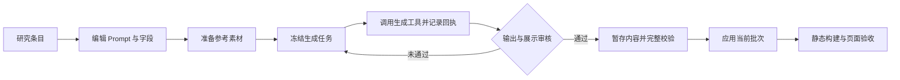

# Top 50 案例落地方案：代码调整、内容生产与发布

- 日期：2026-10-29（America/Los_Angeles）
- 状态：**已接入 50/50 个案例、31/31 个模板与 66 张验收结果，最终浏览器验收与双线代码复审已通过。详见 [实施进度](research/ai-image-top50/implementation-progress.md)。**
- 适用项目：Prompt Seen，当前工作区 100 个 Prompt、3 个 Template。
- 内容依据：[Top 50 调研报告](research/ai-image-top50/top50-report.md)、[研究原始数据](research/ai-image-top50/top50.json)。
- 执行清单：[50 条实施映射](research/ai-image-top50/implementation-manifest.json)。该文件是规划格式，`executable_import: false`；不能直接作为生产内容导入。

## 1. 决策与交付目标

沿用现有 Next.js 静态站、内容目录、模板编辑器和图片处理能力，补齐「有参考图的案例展示」和「可重复的增量内容生产」。完成后，用户可以浏览效果、查看输入参考、填写适合参数化的模板、复制准确的 Prompt，并在自己的生成工具中复现。

本期交付：

| 交付物   | 数量与规则                                                                                |
| -------- | ----------------------------------------------------------------------------------------- |
| 新增案例 | 50 个 Prompt 条目，全部对应调研清单，保留原排名与来源映射                                 |
| 新增模板 | 31 个 Template，每个至少一个实测默认样例；其余 19 个案例提供完整 Prompt                   |
| 实测输出 | 至少 66 张合格结果图：每例 1 张 + 前 15 名各补 1 张 + #29 玻璃变体 1 张                   |
| 参考图   | 按实际任务准备、导入和绑定；27 例必需、6 例可选、17 例无参考图                            |
| 内容语言 | 英文作为内容源语言，简体中文作为经复核译文；Prompt 正文保持英文，指定中文输出文字原样保留 |
| 内容入口 | 1 个总合集 + 4 个主题合集；首页和列表推荐位展示实测案例                                   |
| 工程交付 | 向后兼容的内容契约、增量生产工具、输入/结果展示、模板样例联动、来源说明、相关测试和截图   |

在当前基线上，完成后为 **150 个 Prompt、34 个 Template**。这是本批验收预期，不能写成程序内的固定数量限制。合集只放 50 个 Prompt，不再把关联的 31 个 Template 重复算作案例。

66 张是**通过验收的输出数量下限**，不是生成调用次数、预算或成功率承诺。16 格贴纸、九宫格等各按一张合成图片计数。参考图制作、失败重试、额外实验不计入这 66 张。

本期保持「实测内容库」的使用方式。在线上传并即时生成图片需要另外设计账号、生成队列、费用与存储；这不是展示这批案例的前置条件。

## 2. 当前代码的缺口

| 现状与依据                                                                                                                               | 对新增案例的影响                                 | 调整方式                                                     |
| ---------------------------------------------------------------------------------------------------------------------------------------- | ------------------------------------------------ | ------------------------------------------------------------ |
| [旧 manifest](../scripts/lib/media-generation/manifest.ts) 检查固定的 100 个 Prompt、101 个初始资产、44 个初始运行记录，并拒绝必需参考图 | 不能承担这次增量新增，尤其是 27 个必需参考图案例 | 新增通用增量生产入口；保留旧迁移工具的基线保护               |
| [旧 prepare](../scripts/lib/media-generation/prepare.ts) 写死 `referenceAssetIds: []`，每次一个输出                                      | 导入后会丢失输入关系                             | 新生产任务显式携带有序输入、角色绑定、一个或多个输出         |
| [内容 schema](../scripts/lib/content/schemas.ts) 的输入要求只有 `referenceImage`，模板版本没有输入契约                                   | 不能表达两个人物、侧脸加多张回忆照片等要求       | 增加参考图槽位与本地化说明，模板按版本保存输入要求           |
| [ExampleRuns](../src/ui/prompt-detail/ExampleRuns.tsx) 仅把参考图与结果作为两组小缩略图展示                                              | 用户无法在首屏看清「用了什么图、生成什么」       | 把选中运行记录的输入与结果放在主展示区，支持查看大图         |
| [模板编辑器](../src/ui/template-editor/TemplateEditor.tsx) 预览使用固定默认样张                                                          | 字段改变后，图片可能被误解为当前参数的效果       | 已实测样例切换时联动图片；自定义值明确显示当前参数尚无实测图 |
| [SourceInfo](../src/ui/prompt-detail/SourceInfo.tsx) 只有作者、链接、许可                                                                | 无法区分本网站改写 Prompt 与爆款灵感来源         | 保留现有作者归属，另加灵感来源、观察日期与指标对象           |
| [字段规则](../src/modules/template/types.ts) 只允许小写字母开头的 camelCase/数字名称                                                     | 研究条目不是可直接导入的模板                     | 编写字段与默认值，归一化变量名，不放宽字段规则               |

研究清单中有 **21 条被初步标记为模板、但正文没有变量**。不能据此批量创建空 `fields.yaml`。本方案重新按实际可复用输入选择 31 个模板，并在清单里列出每个字段。`age_range`、`garment_or_object`、`forest_island_mountain_valley` 分别归一化为 `ageRange`、`garmentOrObject`、`landscape`。

实现前已核对本地 Next.js 16.4.2 的 [静态导出指南](../node_modules/next/dist/docs/01-app/02-guides/static-exports.md)。保留 `output: 'export'`；继续在构建时生成路由与数据，不加入依赖服务端运行时的功能。

## 3. 用户将看到的效果

### 3.1 列表与合集

沿用现有图片卡片。卡片增加或复用「需参考图」「可调模板」提示，点击后进入同一套详情展示。原有参考图筛选已能表达 `none / optional / required`，直接复用。

总合集建议 slug 为 `social-image-top-50`，说明这是截至调研日的编辑精选，不是跨平台统一热度榜。四个主题合集为：个性化照片与角色、品牌与商业设计、信息设计与故事、艺术与趣味视觉。按原排名排序，保留每条入选理由。

B0 阶段先以「社交媒体灵感 · 首批实测」发布合集，显示实际已发布数量；50 条全部合格后再使用完整的 Top 50 标题与覆盖率。不能让含有 45 条草稿的合集宣称 50 条均已实测。

### 3.2 案例详情与弹窗

首屏顺序为：标题与用途 → 主结果图及对应参考图 → 需要准备的输入 → 复制 Prompt / 打开模板。完整详情页与列表弹窗复用 [PromptDetailBody](../src/ui/prompt-detail/PromptDetailBody.tsx)。

```text
同一角色 16 格中文表情贴纸                 [需 1 张角色参考图]
┌──────────────┬────────────────────────────────┐
│ 输入：角色图  │ 输出：16 格贴纸                   │
│ 可查看大图    │ 可查看大图 / 下载                 │
└──────────────┴────────────────────────────────┘
准备：角色参考图 + 16 条短配文
[复制完整 Prompt] [调整配文]
实测工具 / 已知模型信息 / 实测日期
灵感来源：Bilibili · 观察日期 · 查看原始内容
```

有参考图时，桌面采用左右对照，手机优先结果图并允许切换或展开参考图。多输入场景显示「人物 A」「人物 B」「服饰参考」等角色，按同一次运行的绑定关系展示。照片到贴纸、房间到模型等尺寸和布局会改变，第一版不做强制叠图滑杆。

无参考图案例保持现有大图布局；无需出现空的输入栏。默认先加载结果图，参考图缩略图与历史运行延迟加载，原图仅在打开或下载时取用。

### 3.3 模板交互

用户选择「默认样例 / 另一组实测值」时，字段、完整 Prompt、对应输入与结果一起切换。手工改值后，文案显示「当前参数尚无实测图片」，原样张如继续显示必须注明「默认样例」或其样例名。

这一步只调整文字。输入要求说明用户应在所用生成工具中上传哪些图片，并提供可复现的示例参考图；页面不放置没有生成能力的上传按钮。

来源互动数只出现在来源区，标注平台、指标名称、观察日期和对象。网站自己的结果图不展示原帖点赞数，不把视频播放量写成单张图片的点赞，也不使用 `aggregateRating` 表达这些数字。

## 4. 数据契约设计

以下字段是拟新增契约，需先修改 schema、读取、校验、构建索引和类型，之后才能写入正式内容文件。

### 4.1 输入要求与参考图角色

保留 `inputRequirements.referenceImage`，继续供筛选和旧内容使用。新增：

- `slots[]`：`id`、本地化 `labels` / `help`、`min`、`max`。只描述图片角色，不把图片路径当成模板文字字段。
- 本地化 `instructions`：图片清晰度、顺序、配套文字等实际使用说明。
- 新的字面 Prompt 在 `entry.yaml` 保存完整输入要求。
- 新模板在 `versions/vN/inputs.yaml` 保存完整输入要求，与正文和字段一起冻结。模板实例从明确引用的版本继承槽位；其现有 `referenceImage` 摘要必须一致，不复制一套槽位。
- 旧模板没有 `inputs.yaml` 时继续使用既有行为；不强制改写原 100 个 Prompt。

校验约束：有任意 `min > 0` 的槽位即为 `required`；存在槽位且全部 `min = 0` 即为 `optional`；无槽位的新案例为 `none`。同一版本槽位 ID 唯一、`0 ≤ min ≤ max`。具体图片数量遵守每个槽位约束。

例如 #33 有 `personA` 和 `personB`，各 1 张；#17 有 `profile` 1 张与 `memories` 2–4 张；#34 有 `person` 和 `garment`，各 1 张。正文明确按槽位顺序解释输入。

### 4.2 运行记录与展示绑定

保留既有 `referenceAssetIds` 作为有序图片 ID 的唯一列表，新增可选 `referenceBindings: [{slotId, referenceIndex}]`。`referenceIndex` 为从 0 开始的索引，避免再保存一份会漂移的资产列表。

新案例的运行记录必须满足：每个参考图都有且只有一个绑定，索引不重复、不越界，槽位存在且数量合规。旧记录没有绑定时继续按原顺序显示通用的「参考图」。

新增可选 `showcaseExampleId` 指定 Prompt 主展示运行，默认 `null` 兼容旧内容。新案例必须指定，且该运行属于这个 Prompt、其输出包含封面资产、Prompt 哈希与当前正文一致。主展示使用该运行自己的输入与输出，不能从不同运行拼凑。

模板的 `TemplateSample` 视图增加构建时计算的 `exampleIds`。只匹配模板 ID、版本、sample、字段值和正文哈希均一致的运行；按日期及 ID 稳定排序。不另维护手工「样例→图片」表。旧模板的默认展示保留兼容分支。

`ExampleRun` 继续保存实际提交的 `prompt.txt`、SHA-256、字段值、输入顺序、输出、日期、工具与已知模型信息。新生产回执另保存参考文件哈希、生成参数、尝试编号和审核结果。工具未返回准确模型 ID、seed 或尺寸参数时保留未知，不能从灵感原帖补填。

### 4.3 Prompt 归属与灵感证据

在 Prompt 入口新增可选 `promptProvenance` 与 `inspirationSources[]`，旧内容默认未知/空数组。`source` 仍描述网站提供的 Prompt 作者与许可，不用原帖作者冒充我们改写文本的作者。

每个灵感来源至少记录：

| 字段组     | 内容                                                      |
| ---------- | --------------------------------------------------------- |
| 身份       | `candidateId`、平台、作者、内容 URL、内容发布日期         |
| 指标对象   | `metricObjectUrl`、其发布日期、指标作用范围               |
| 数值与时间 | 指标名称及数值、`observedAt`、缓存时间是否已知            |
| 证据       | 官方 API / 索引快照等方法、证据 URL、原 Prompt 可获得程度 |
| 改写说明   | 原创改写或按主题重建；不声称精确复现原作者配方            |

生产内容只保存展示和追溯需要的摘要；完整研究材料继续留在研究目录。模板通过关联的已实测 Prompt 链接查看来源，避免复制一套热度数据。

图片的 `credit` 和 `provenance` 继续使用现有媒体契约。外部灵感图片不直接充当本站生成样张；优先自制、授权或自生成参考素材。输入为 AI 合成人物、模拟旧照片时在说明中写清楚，不能称为真实家庭照片修复记录。

### 4.4 版本与发布不变量

已有运行使用过的模板版本冻结，`body.txt`、`fields.yaml`、`inputs.yaml` 及样例值的语义变更进入新版本。修订案例正文后，旧实测记录继续保留；只有正文匹配的新运行才能作为新的主展示。

“模型身份已知”和“输出经审核可用”是两个不同事实。沿用现有 `model.verification` 语义，仅在回执提供足够依据时设置；输出验收由生产审核记录保证，不能用一个标签替代另一个事实。

## 5. 增量内容生产设计

### 5.1 文件与职责

| 位置                                                                                              | 职责                                                                                                    |
| ------------------------------------------------------------------------------------------------- | ------------------------------------------------------------------------------------------------------- |
| `scripts/content-produce.ts`（新增）                                                              | CLI 参数、任务状态和摘要输出                                                                            |
| `scripts/lib/content-production/`（新增）                                                         | 批次计划、ID 分配、输入冻结、回执、审核、暂存校验、应用与恢复                                           |
| [现有媒体导入](../scripts/lib/media/import.ts)、[处理](../scripts/lib/media/process.ts)           | 复用哈希、图片变体、元数据和储存流程                                                                    |
| [现有模板渲染](../src/modules/template/render.ts)、[内容校验](../scripts/lib/content/validate.ts) | 复用真正的渲染和发布规则                                                                                |
| `.artifacts/content-production/<campaign>/`                                                       | 持久本地工作目录：输入、输出、attempts、receipts、review、stage、apply journal；不被 content build 清理 |
| `docs/research/ai-image-top50/content-map.json`（应用后生成）                                     | Git 中保留 candidate→Prompt/Template/Example/Media 映射与已应用批次摘要；不保存私有路径或密钥           |

生产模块不依赖浏览器和 React。相同的数据契约既供 CLI 使用，也供集成测试验证；只提取旧工具中真正可复用的媒体与校验能力，不把旧迁移脚本的固定基线改成新入口。

### 5.2 流程与失败处理



1. **Plan**：核对研究文件哈希，读取当前内容，输出本批候选、拟新增文件、模板缺项和预估输出数。默认只预演；未知字段、未填默认值、无参考图、重复 slug 都阻止进入生成队列。
2. **分配**：按 `campaignId + candidateId` 建立稳定映射，动态分配 ID；不假设下一条一定是 `p_101`。分配/应用使用内容写入锁，`content:new` 复用相同的分配保护。重复执行读取既有映射，不能重复新增。
3. **Claim**：领取一个任务并返回精确正文、有序本地参考文件及角色、目标比例、任务指纹。目标比例显式保存；需要沿用原图比例时先解析图片尺寸并固化，不能靠正则猜 Prompt。指纹包含正文、模板版本、值、输入内容哈希与顺序、已知生成设置。
4. **生成与 Record**：由实际可用的图像工具调用者消费任务，再把输出路径和真实回执记回。CLI 不假装自己能调用聊天环境的 `imagegen`；采用该工具时由当前助手调用，也允许录入其他已验证工作流的结果。超时且结果未知时先对账，不盲目重复调用。
5. **Review**：逐项检查本方案第 8 节的画面要求、文字、身份/结构、参考关系和网页缩略图效果。失败保留尝试记录及原因；若改了正文、输入或参数，生成新的任务指纹，旧记录不覆盖。每任务默认最多 3 次尝试，之后进入 `needs_attention`，重新判断配方。
6. **Prepare**：导入图片并创建正式目录的暂存副本，生成不可变运行记录、中英文内容、模板文件、来源与映射；对「现有库 + 当前批次」运行内容校验。输出待应用文件、旧/新哈希及计划哈希。
7. **Apply**：校验计划哈希、目标 ID 与文件状态仍一致后应用这一批。文件系统多文件写入不能假定天然原子，使用日志和备份；发生中断按日志恢复，不留半批发布态。当前批次以外的工作区改动不写入、不回滚。
8. **构建与发布**：通过页面验收再同步资产和发布静态构建。应用内容和向外发布是两个独立步骤；发布沿用项目现有运维流程。

状态建议为 `planned → ready → running → generated → accepted → prepared → applied`，另有 `needs_attention`。正式内容是否公开仍由现有 locale 的 `draft / published` 规则控制。生成了文件不等于案例已发布。

提供 `status` 按条目汇总：缺素材、待生成、待审核、待翻译复核、待应用、已发布；同时显示 50 个案例覆盖率、66 张结果覆盖率，不能只报成功工具调用数。

拟新增入口示意（**以下命令尚不存在，实施时添加**）：

```sh
npm run content:produce -- plan --campaign top50-2026-10 --batch B0
npm run content:produce -- claim --campaign top50-2026-10
npm run content:produce -- record --campaign top50-2026-10 --receipt <receipt.json>
npm run content:produce -- review --campaign top50-2026-10 --review <review.json>
npm run content:produce -- prepare --campaign top50-2026-10 --batch B0
npm run content:produce -- apply --campaign top50-2026-10 --plan-hash <sha256>
npm run content:produce -- status --campaign top50-2026-10
```

### 5.3 每条内容的正式落点

- 每例都有 `content/prompts/p_xxx/entry.yaml` 与 `locales/en.mdx`、`locales/zh-Hans.mdx`；字面案例另有 `prompt.txt`，模板实例保存模板 ID、版本与字段值。
- 31 个模板有 `content/templates/t_xxx/entry.yaml`、两种语言说明、`versions/v1/body.txt`、`fields.yaml`、`inputs.yaml` 和 `samples/default.yaml`；有另一组实测值时增加对应 sample。
- 每次实测有 `content/examples/x_xxx/run.yaml` 与 exact `prompt.txt`；图片都有 `content/media/a_xxx.yaml` 及由现有流程生成的原图/变体。
- 第 29 例的 cloud / glass 使用同一套确实适用于两种材质的正文和 enum 字段；先改写并双样例实测，不能只把“cloud”替换成“glass”却留下天空和蒸汽描述。
- 新增合集仍使用 `content/collections/`。`.generated/`、`public/generated/`、`out/`、`dist/` 都由工具构建，不能手改。

## 6. 实施顺序、代码落点与完成标准

| 步骤                 | 工作与主要文件                                                                                                                  | 依赖                  | 可验收结果                                                             |
| -------------------- | ------------------------------------------------------------------------------------------------------------------------------- | --------------------- | ---------------------------------------------------------------------- |
| S0：内容准备与可行性 | 编辑 5 个试点的正文、字段、输入；提前试验 #50 结构引导                                                                          | 无                    | 5 例输入明确；#50 的可用工具/方法及阻塞已知                            |
| S1：契约兼容         | `scripts/lib/content/{schemas,load,read,rules,build-index}.ts`、`src/modules/content/types.ts`、`src/modules/content/README.md` | 无                    | 原内容无需重写仍通过；新槽位、来源、运行绑定能读、校验和构建           |
| S2：增量生产         | 新 `content-produce.ts` 与 `content-production/`；调整 `content-new.ts` 的 ID 分配保护；增加 package script                     | S1；S0 提供任务       | 必需参考图、多参考图和无参考图任务均可进入暂存；重跑不重复，失败可恢复 |
| S3：展示闭环         | `PromptDetailBody`、`ImageStage`、`ExampleRuns`、`TestInfo`、`TemplateDetailBody`、`TemplateEditor`；新增输入/来源展示模块      | S1；S2 可先用测试夹具 | 页面与弹窗都有输入/结果；已测 sample 联动；自定义值不误导              |
| S4：来源与内容出口   | `SourceInfo` 的邻接来源区、`src/modules/geo/markdown.ts`、SEO/搜索所需构建视图、i18n 新 namespace                               | S1、S3                | HTML、Markdown 导出和客户端信息一致；来源互动不变成本站评分            |
| S5：5 例实际导入     | B0 的 Prompt/Template/Example/Media、本地化与首批合集                                                                           | S0–S4                 | 5 条完整可浏览、可复制、可复现；桌面/手机截图通过                      |
| S6：扩至 50 例       | 按 B1、B2、B3 补齐；复用同一流程                                                                                                | S5                    | 每批单独校验与预览，累计新增 50 例、至少 66 张合格输出                 |
| S7：入口与发布       | `content/site.yaml` 推荐位、5 个合集、媒体同步与构建                                                                            | S6                    | 总合集名副其实；首页至少 2–3 个有有效标注的新案例；完整回归通过        |

契约变更先做小批代码提交/PR，随后完成「5 例从素材到页面」的一条完整流程，再扩内容。不要把 50 条的数据量与第一次架构修改混在一个不可验证的大改动里。按仓库约定，同步更新主设计文档和相关模块 README；该方案目前是待实施附录，不将未实现功能写成现状。

UI 沿用现有设计 token、图片比例、按钮和 React Aria 交互。新文案 namespace 覆盖 `en / zh-Hans / ja / ar` 四个当前可构建语言；新内容本期只发布经复核的英文与简体中文。预览语言的新增条目可以缺译或保持草稿，不用英文冒充译文。RTL、暗色、键盘焦点和 reduced motion 一起验收。

所有内部链接、图片地址和规范地址继续通过 `@/modules/url`，兼容现有 `/prompt-seen` 子路径。浏览器只接收需要的序列化视图，不加载完整研究 JSON。

## 7. 发布批次

| 批次 | 内容                                                                | 新增数 | 累计案例 | 该批结果图下限 |
| ---- | ------------------------------------------------------------------- | -----: | -------: | -------------: |
| B0   | #1 贴纸、#2 涂鸦变真实、#4 产品九宫格、#33 双人婚纱、#40 水晶球瀑布 |      5 |        5 |              8 |
| B1   | 前 15 名中除 #1、#2、#4 的其余条目                                  |     12 |       17 |             24 |
| B2   | #16–35，除已在 B0 的 #33                                            |     19 |       36 |             20 |
| B3   | #36–50，除已在 B0 的 #40                                            |     14 |       50 |             14 |

B0 覆盖中文密集排版、单参考图改图、产品一致性、多人物身份、纯文生图与模板联动。#50 在 S0 就试验，避免最后一批才发现工具或方法不能支持。

每批先作为草稿准备；案例的图片、实测记录、来源、本地化和页面验收完成后才发布该条。阶段完成可以按实际数量发布，但 **50 条全部完成** 的验收条件不降低。

## 8. 50 条内容映射

下表与 [implementation-manifest.json](research/ai-image-top50/implementation-manifest.json) 一一对应。JSON 还包含稳定候选 ID、建议 slug、现有分类、槽位数量、字段名与类型、变量改名、每条视觉验收要求和未分配的正式 ID。

| 排名 | 案例                         | 形式        | 参考图                           | 可填写字段 / 使用方式                                  | 样张下限 | 批次 |
| ---- | ---------------------------- | ----------- | -------------------------------- | ------------------------------------------------------ | -------: | ---- |
| 1    | 同一角色16格中文表情贴纸     | 模板 + 案例 | 必需                             | 16条中文配文                                           |        2 | B0   |
| 2    | 儿童涂鸦变真实生物或玩具     | 直接案例    | 必需                             | 完整 Prompt + 使用说明                                 |        2 | B0   |
| 3    | 照片转桌面收藏手办与包装     | 直接案例    | 必需                             | 完整 Prompt + 使用说明                                 |        2 | B1   |
| 4    | 同一产品九宫格品牌故事板     | 模板 + 案例 | 必需                             | 品牌配色、九个画面主题                                 |        2 | B0   |
| 5    | 宠物拟人，保留姿态和神情     | 模板 + 案例 | 必需                             | 成年年龄范围、性格                                     |        2 | B1   |
| 6    | 房间照片变等距剖面模型图     | 直接案例    | 必需                             | 完整 Prompt + 使用说明                                 |        2 | B1   |
| 7    | 同主题触感3D图标九宫格       | 模板 + 案例 | 无                               | 图标主题、九个图标对象、配色                           |        2 | B1   |
| 8    | 日常照片变治愈手绘动画       | 直接案例    | 必需                             | 完整 Prompt + 使用说明                                 |        2 | B1   |
| 9    | 餐饮品牌全套VI展示板         | 模板 + 案例 | 可选                             | 品牌名称、品牌配色、品牌调性                           |        2 | B1   |
| 10   | 个性人物钥匙扣商品图         | 直接案例    | 必需                             | 完整 Prompt + 使用说明                                 |        2 | B1   |
| 11   | 国家立体地形旅行指南         | 模板 + 案例 | 必需                             | 目的地国家、核对后的目的地、核对后的路线说明           |        2 | B1   |
| 12   | 产品剖透视技术信息图         | 模板 + 案例 | 可选                             | 产品名称、核对后的结构资料、准确的部件标注             |        2 | B1   |
| 13   | 时尚杂志封面肖像             | 直接案例    | 必需                             | 完整 Prompt + 使用说明                                 |        2 | B1   |
| 14   | 悬浮食材分层料理信息图       | 模板 + 案例 | 无                               | 菜品名称、食材与用量                                   |        2 | B1   |
| 15   | 城市地标与天气的3D微缩卡片   | 模板 + 案例 | 无                               | 城市名称、指定日期、已核对的天气与温度、当地地标       |        2 | B1   |
| 16   | 老照片温和修复与自然上色     | 直接案例    | 必需                             | 完整 Prompt + 使用说明                                 |        1 | B2   |
| 17   | 人物剪影内的照片拼贴海报     | 模板 + 案例 | 必需：侧脸轮廓、回忆或动作照片   | 人物姓名、强调色                                       |        1 | B2   |
| 18   | 真人照片转一致姿态的3D角色   | 直接案例    | 必需                             | 完整 Prompt + 使用说明                                 |        1 | B2   |
| 19   | 一致角色的四格温暖小故事     | 模板 + 案例 | 可选                             | 原创角色设定、四个故事节点                             |        1 | B2   |
| 20   | 复古工业专利蓝图             | 模板 + 案例 | 可选                             | 物件名称、短标注                                       |        1 | B2   |
| 21   | 工业产品多视图概念草图       | 模板 + 案例 | 可选                             | 产品概念、强调色、设计特征                             |        1 | B2   |
| 22   | 毛绒材质Emoji与图标          | 直接案例    | 必需                             | 完整 Prompt + 使用说明                                 |        1 | B2   |
| 23   | 节日红色写真与祝福九宫格     | 模板 + 案例 | 必需                             | 九条短祝福                                             |        1 | B2   |
| 24   | 字形窗口里的摄影海报         | 模板 + 案例 | 必需                             | 准确的短词、背景主色                                   |        1 | B2   |
| 25   | 膨胀气球字与尖刺字标         | 模板 + 案例 | 无                               | 准确的英文短词、材质颜色                               |        1 | B2   |
| 26   | 带标题与行动按钮的社媒广告   | 模板 + 案例 | 必需                             | 产品名称、标题原文、副文案原文、行动文案原文、品牌配色 |        1 | B2   |
| 27   | 几何模块与摄影融合的品牌海报 | 模板 + 案例 | 必需                             | 品牌名称、品牌配色                                     |        1 | B2   |
| 28   | 复古掌机像素对战画面         | 模板 + 案例 | 无                               | 两位原创角色、对战场景、像素配色                       |        1 | B2   |
| 29   | 品牌Logo的云朵与玻璃形态     | 模板 + 案例 | 必需                             | 云朵或玻璃材质                                         |        2 | B2   |
| 30   | 人群拖影中的静止人物         | 直接案例    | 必需                             | 完整 Prompt + 使用说明                                 |        1 | B2   |
| 31   | 直闪抓拍风特写肖像           | 直接案例    | 必需                             | 完整 Prompt + 使用说明                                 |        1 | B2   |
| 32   | 本人和巨型3D分身同框         | 直接案例    | 必需                             | 完整 Prompt + 使用说明                                 |        1 | B2   |
| 33   | 双人AI婚纱写真               | 直接案例    | 必需：第一位成年人、第二位成年人 | 完整 Prompt + 使用说明                                 |        1 | B0   |
| 34   | 明代风格汉服写真人像         | 直接案例    | 必需：成年人物肖像、服饰参考     | 完整 Prompt + 使用说明                                 |        1 | B2   |
| 35   | 博物馆图鉴式汉服与器物拆解   | 模板 + 案例 | 必需                             | 服饰或器物、已核对的史料、准确的中文标注               |        1 | B2   |
| 36   | 主题美甲设计特写             | 模板 + 案例 | 无                               | 美甲主题、配色、五种甲面图案                           |        1 | B3   |
| 37   | 层叠剪纸故事插画             | 模板 + 案例 | 无                               | 故事场景、纸张配色                                     |        1 | B3   |
| 38   | 有指纹的手捏黏土角色         | 模板 + 案例 | 可选                             | 角色与场景                                             |        1 | B3   |
| 39   | 水果变小动物                 | 模板 + 案例 | 无                               | 小动物、水果                                           |        1 | B3   |
| 40   | 水晶球瀑布溢出桌面           | 模板 + 案例 | 无                               | 球内景观                                               |        1 | B0   |
| 41   | 魔药瓶里挤着一只猫           | 模板 + 案例 | 无                               | 宠物种类                                               |        1 | B3   |
| 42   | 彩绘悬崖灯塔航拍             | 模板 + 案例 | 无                               | 海岸建筑                                               |        1 | B3   |
| 43   | 实拍鸡尾酒叠加手绘涂鸦       | 模板 + 案例 | 无                               | 饮品种类                                               |        1 | B3   |
| 44   | 猫咪鱼贩的市集摊位           | 模板 + 案例 | 无                               | 摊主动物                                               |        1 | B3   |
| 45   | 日本街头胶片纪实感           | 直接案例    | 无                               | 完整 Prompt + 使用说明                                 |        1 | B3   |
| 46   | 太阳朋克树冠城市             | 直接案例    | 无                               | 完整 Prompt + 使用说明                                 |        1 | B3   |
| 47   | 掌心微缩自然世界             | 模板 + 案例 | 无                               | 掌心景观                                               |        1 | B3   |
| 48   | 名画或照片变童趣蜡笔画       | 直接案例    | 必需                             | 完整 Prompt + 使用说明                                 |        1 | B3   |
| 49   | 空无一人的阈限空间           | 直接案例    | 无                               | 完整 Prompt + 使用说明                                 |        1 | B3   |
| 50   | 远看藏人像，近看是花卉风景   | 直接案例    | 必需                             | 结构引导工作流 + 完整 Prompt                           |        1 | B3   |

## 9. 内容与图片验收

### 9.1 所有案例共同要求

1. 有本网站实际生成并审核的封面，结果与该次保存的 Prompt、输入、参数匹配。研究中的 50 条目前均未生成验证，不能直接转成 `verified`。
2. 所有参考图在实际调用中被使用，顺序与槽位一致；必需参考图缺失即阻止发布。可选参考图的默认样例本期按无参考图生产；后续加入带参考图样例时，正文、回执和绑定同步记录。
3. 新模板每个字段都在正文中实际生效，正文没有未声明变量；样例值满足类型与长度/数量约束，生成正文和 `ExampleRun` 的快照哈希完全相同。
4. 中英文标题、简介、用途、操作步骤、限制和 alt 齐全。译文复核记录和源哈希有效；不能把机器草稿改个状态就发布。
5. 外部帖子来源可追溯，正文明确是独立改写/主题重建。指标保留原作用范围、抓取时间和证据等级；Reddit 的索引快照不说成实时点赞。
6. 各尺寸媒体可访问、缩略图可辨识、详情图不被拉伸或错误裁切。首屏和模板样例图片的归属无歧义。

### 9.2 特殊内容门槛

| 案例                    | 额外验收                                                                                                                       |
| ----------------------- | ------------------------------------------------------------------------------------------------------------------------------ |
| #1、#4、#7、#19、#23    | 格数准确；对应角色/产品一致；#1 的 16 条、#23 的 9 条中文逐字复核                                                              |
| #11、#12、#14、#15、#35 | 地图、技术结构、食材用量、指定日期天气和史料由提供资料约束；缺资料不能要求模型编造。天气卡是指定日期的示例，不提供实时天气承诺 |
| #16                     | 使用明确来源的旧照片或标明合成演示；修复不虚构无法辨认的面貌细节                                                               |
| #17、#33、#34           | 多参考图角色分别正确，尤其避免双人串脸和服饰输入被忽略                                                                         |
| #24–27                  | 单词、品牌名、标题、副文案、CTA 对照输入逐字检查；失败不进入推荐位                                                             |
| #29                     | 云朵与玻璃各有独立实测运行及完整来源；两条原帖指标分别展示，不相加                                                             |
| #48                     | 使用自有照片或许可清楚的画作；保留原帖存在争议的研究说明，不能将关注度说成一致好评                                             |
| #50                     | 同一输出在大图可见自然花园、缩略图可辨指定轮廓；记录实际结构引导工具、输入与参数。纯文字调用不保证成功                         |

#50 如尚无可用结构引导工具或输出未达标，保持草稿并明确列为完成阻塞；可以先发布其余合格内容，但不能将“已建 50 个目录”报告为“50 个实测案例已上线”。其他样例如需要后期排字或合成，必须记录加工步骤并说明复现方式，不能仍宣称为单次纯 Prompt 输出。

## 10. 工程测试与发布验收

### 10.1 有意义的自动验证

- **契约兼容**：读取当前原 100 个 Prompt、3 个 Template；默认字段不改变原有详情与分类。新必需槽位缺图、重复/越界绑定、跨条目 showcase、封面不是该运行输出都应报错。
- **模板联动**：默认样例及另一组实测值准确匹配图片；未实测字段值显示未实测状态；旧版本结果不会匹配新版本样例。
- **生产工具集成**：临时内容库中完成无参考图、单参考图、双参考图任务的 plan→record→prepare→apply；重复 apply 不新增，输入哈希变化使任务失效，目标文件变化中止应用，中途失败可按日志恢复。
- **内容出口**：静态 HTML、详情弹窗 payload、Markdown 导出均有相同输入要求和来源语义；未审核或未发布的条目不出现在 production 的列表、搜索、合集、sitemap 中。
- **浏览器验收**：手机/桌面、明暗主题、中文/英文以及预览 RTL；图片查看、复制、模板值切换、关闭弹窗返回原滚动位置；无需 JavaScript 时默认 Prompt、主图与输入说明仍可读。

代码修改完成后执行现有命令，按影响范围补充测试：

```sh
npm run content:validate
npm run typecheck
npm run lint
npm run tokens:check
npm test
npm run build
npm run test:e2e
```

`test:e2e` 使用已构建的 `dist/` 与项目配置的 nginx/Docker 服务；环境缺少依赖时记录未执行项，不能报告通过。预览构建与生产构建分别核验；生产构建使用实际部署环境的 `SITE_ORIGIN` 和 `BUILD_MODE=production`，保留子路径配置。不要把 `example.com` 占位 canonical 带入生产。

文档路径受当前 prettier ignore 影响，文档检查需显式使用 `--ignore-path /dev/null`；只格式化本次更改的文件。

### 10.2 最终完成定义

以下全部满足才可称为本次落地完成：

- 调研清单 50 个 candidate 均有唯一正式 Prompt 映射，31 个模板已实测；没有遗漏、重复、空壳或用其他案例静默替换。
- 至少 66 张合格输出、对应输入资产和不可变运行记录齐全，主展示与完整 Prompt 匹配。
- 50 条英文与简体中文内容均达到发布规则；来源说明、指标对象、观察日期和 Prompt 归属正确。
- 5 个合集和首页/列表入口可用；总合集真实显示 50 条；现有内容继续可浏览、搜索、复制和收藏。
- 代码检查、静态构建和相关自动化测试通过，5 个代表性案例有桌面/手机截图，来源区和输入对照已人工核验。
- 媒体同步与生产部署检查通过，当前批次的内容映射、审核记录及恢复路径可以追溯。

## 11. 实施落点

50 条案例及 31 个模板已接入；67 条实测记录中，较早的 #50 强人脸版本保留为历史比较，不计入 66 张验收结果。5 个合集与 3 个首页标注案例已接入。生产命令的实际参数、状态和恢复操作见 [生产工具说明](../production/README.md)，本方案第 5 节命令为设计阶段的示意，不应直接执行。

生成调用使用内置图像工具。工具未返回精确模型 ID 的运行保持 unknown。地图使用有来源的参考轮廓；天气与服饰明确为演示；#50 使用参考图约束，未声称使用 ControlNet。生产部署需要真实 SITE_ORIGIN 与现有工作流凭据；当前工作范围为项目实现、静态构建及本机视觉验收。

最终检查结果、截图与审查记录见 [实施进度](research/ai-image-top50/implementation-progress.md)。
